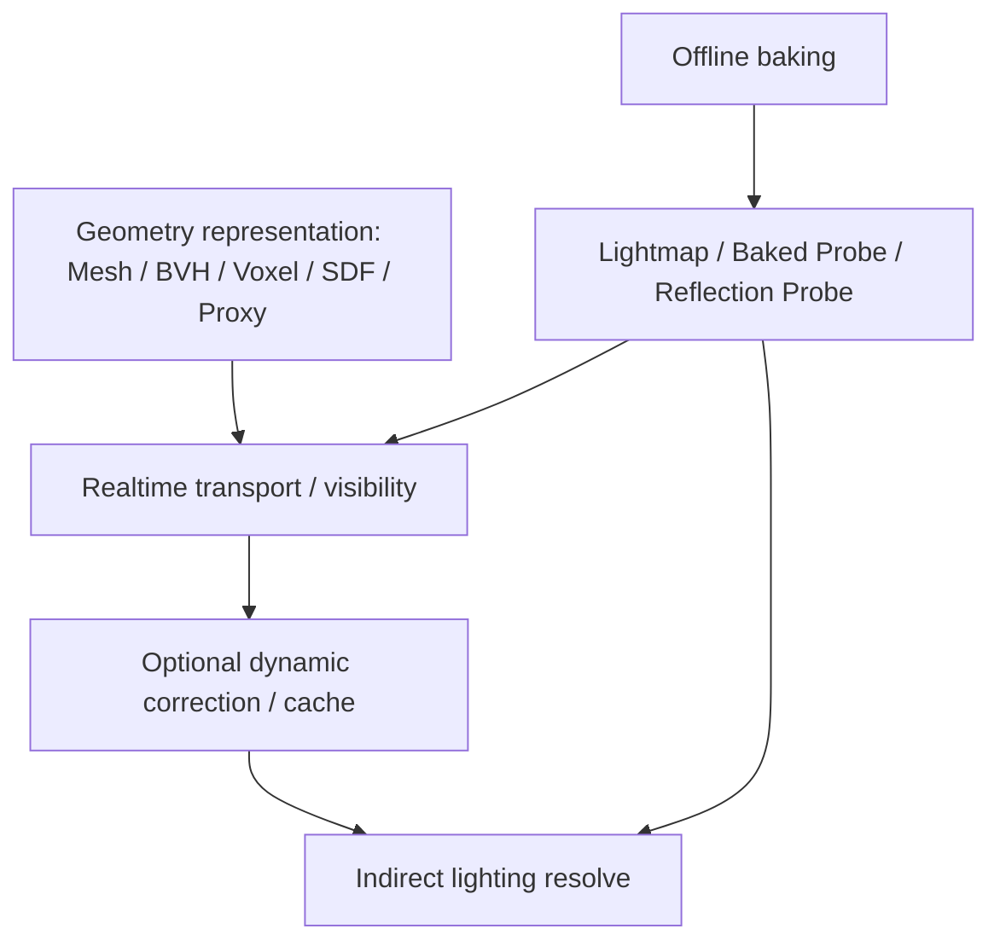

# Sashiko — オープンソースレンダラー・ゲームエンジンのGIシステム調査

- **調査・整理日:** 2026-11-26
- **用途:** SashikoのGlobal Illumination（GI）設計・実装調査のための参考資料
- **対象:** ゲームエンジン、描画ライブラリ、研究用レンダラー、および比較対象としてのSource-availableエンジン
- **ステータス:** 技術調査資料。Sashikoの実装仕様を確定するものではない。

## 目次

1. [要約](#1-summary)
2. [調査の前提と比較基準](#2-scope)
3. [エンジン・レンダラー比較表](#3-matrix)
4. [オープンソースゲームエンジン](#4-engines)
5. [描画ライブラリ・Web向けエンジン](#5-renderers)
6. [その他の実装](#6-others)
7. [研究用レンダラー](#7-research)
8. [Source-availableエンジン](#8-source-available)
9. [GI技術別の逆引き](#9-index)
10. [Lightmapとの組み合わせ方](#10-hybrid)
11. [Sashikoへの設計上の示唆](#11-sashiko)
12. [プロトタイプの評価計画](#12-evaluation)
13. [ソースコード調査先](#13-code)
14. [関連文献](#14-papers)
15. [調査の限界・前回回答からの補足](#15-limitations)

<a id="1-summary"></a>
## 1. 要約

### 1.1 調査結果

- Baked GIを採用する実装は依然として多い。Lightmap、Irradiance Probe、Reflection Probeを使い分ける方式は、静的環境の品質と低いランタイムコストを両立する。
- Realtime GIでは、Voxel、SDF、BVHなどの空間表現と、Probe、Radiance Cache、Surfelなどの光輸送・キャッシュ表現の組み合わせが見られる。
- GI方式を複数備える実装でも、すべての結果を単純加算するとは限らない。受光面ごとの優先順位、用途別の分担、GPU能力による切り替えなどが採用されている。
- Voxelを導入しても、GI全体をVoxelに統一する必要はない。CRYENGINE SVOGI Mode 0、OGRE-Next IFD、Babylon.js IBL Shadowsは、それぞれ異なる役割でVoxelを利用している。
- Lightmapの静的光輸送を維持しながら、動的オブジェクトによる遮蔽と色移りを一体的に差分補正する汎用機能は、今回の主要調査対象からは確認できなかった。存在しないと断定するものではない。
- 簡易Color Bleedingの最大の難点はVisibilityである。RSMやVPLの反射光を無条件に加算すると壁越しの光漏れが生じる。Voxelを用いても解像度による漏れ・過剰遮蔽は残る。

### 1.2 Sashikoの優先調査先

| 優先度 | プロジェクト | 注目する機能 |
|---|---|---|
| 1 | Godot | LightmapGI、動的受光用Probe、モバイル向けの機能分離 |
| 2 | CRYENGINE | Opacity-only SVOGI、Analytical Occluders（Source-available） |
| 3 | OGRE-Next | Voxel・IFD・VPLの比較、Diffuse/Specularの役割分担 |
| 4 | Wicked Engine | 複数GI方式、共通のRay Tracing基盤、GPU Lightmapper |
| 5 | Babylon.js | VoxelによるIBL遮蔽、RSMのVisibility問題 |
| 6 | Bevy | RustでのLightmap・Probe管理、GIソースの優先順位 |
| 7 | O3DE | Baked / Realtime共通Probeとフォールバック |
| 8 | Flax Engine | SDF・Surface Atlas・DDGIの分離（Source-available） |
| 9 | Hyperion | 静的Lightmapの維持と別系統GI、PRT |
| 10 | Kajiya / Capsaicin / Falcor | 将来のRT GI・参照レンダラー・キャッシュ実装 |

優先順位はSashikoの想定要件（Rust、クロスプラットフォーム、モバイル、Lightmap主体、局所的な動的補正）に基づく提案であり、各実装の総合的な品質順位ではない。

<a id="2-scope"></a>
## 2. 調査の前提と比較基準

### 2.1 用語

| 用語 | 本資料での意味 |
|---|---|
| Baked GI | オフライン、エディタ内、または起動時等に事前計算した間接光。毎フレームの光輸送更新を前提としない。 |
| Realtime GI | 光源・形状などの変化に応じ、ランタイムで間接光を更新する方式。すべての変化に対応するとは限らない。 |
| Dynamic receiver | 動的物体が間接光を受けられること。 |
| Dynamic contributor | 動的物体の存在や材質が他の受光面への間接光に影響すること。 |
| Indirect Shadow | 動的物体等によって、間接光が遮られる効果。直接光のShadow Mapとは別。 |
| Local Color Bleeding | 近傍の表面からの反射によって周囲に生じる色付きの間接光。 |
| Differential GI | 静的基準シーンからの光輸送の差分を補正として評価する考え方。本資料では設計上の分類名として使用。 |
| IBL | 環境マップによるライティング。単独では局所的・動的な光輸送を解くものではない。 |
| Visibility | 反射面・受光面の間、あるいは受光点・入射方向の間に遮蔽物があるかを表す情報。 |

SSAO、GTAO、SSR、Reflection Probeだけを備えていることは、動的Diffuse GIの実装を意味しない。また、動的物体がGIを受けられることと、他の表面へのGIを変化させられることは区別する。

### 2.2 根拠の扱い

- **確認:** 今回、公式ドキュメント、公式API資料、公開リポジトリのREADME・実装説明等を再確認した項目。
- **参考:** 前回調査で挙げた候補のうち、今回の再確認が限定的な項目。導入判断前にソースを再調査する。
- 各節に一次資料へのリンクを付ける。性能やメモリの数値は資料に記載された条件に限って解釈する。
- GitHubのブランチや`latest`ドキュメントは更新される。実装調査を始める際には対象コミットまたはリリースを固定する。
- 本資料は実行・ビルドによる検証ではない。異なるGPU上での相対性能、同時利用時の合成式、個別機能の成熟度は未測定。

<a id="3-matrix"></a>
## 3. エンジン・レンダラー比較表

### 3.1 オープンソースゲームエンジン

| プロジェクト | Baked / IBL系 | Realtime GI・補助機能 | 特徴 | 根拠 |
|---|---|---|---|---|
| [Godot](#godot) | LightmapGI、SH Light Probe | VoxelGI、SDFGI、SSIL | MobileはLightmap中心。SDFGIは動的寄与に制限 | 確認 |
| [Wicked Engine](#wicked) | GPU Lightmap、Environment Probe | Voxel GI、DDGI、Surfel GI、SSGI、Path Tracing | HWRT非対応時のCompute RTフォールバック | 確認 |
| [Bevy](#bevy) | Lightmap、Irradiance Volume、Reflection Probe | Solari | Baked GIは外部ベイク。RT系は別のプラグイン | 確認 |
| [O3DE](#o3de) | Baked Diffuse Probe Grid | RT Diffuse Probe Grid | 同一Probe表現のBaked/Realtime切替 | 確認 |
| [Stride](#stride) | Light Probe、IBL | VCTプラグイン | Graphics Compositorの拡張 | 確認 |
| [rbfx](#rbfx) | GlowによるLightmap・Light Probeベイク | — | 軽量なC++フレームワーク | 確認（機能概要） |
| [Hyperion](#hyperion) | Lightmap、Irradiance/Reflection Probe | Glimmer、DDGI | Lightmap受光面は維持。Glimmerの動的寄与は非対応 | 確認 |

### 3.2 描画ライブラリ・研究用・その他

| プロジェクト | 主な技術 | 用途・制約 | 根拠 |
|---|---|---|---|
| [OGRE-Next](#ogre) | VPL、VCT、IFD、IBL | 複数方式の比較・Hybrid | 確認 |
| [Babylon.js](#babylon) | RSM、IBL Shadows | RSMは二次Visibilityなし。Voxel遮蔽は主に静的向け | 確認 |
| [PlayCanvas](#playcanvas) | 外部Lightmap、Runtime Lightmapping、IBL | 内蔵ベイカーはGI非対応 | 確認 |
| [Three.js](#three) | Lightmap、L2 SH Probe Grid、IBL | ProbeのGPUベイク | 確認 |
| [Filament](#filament) | SH Diffuse IBL、Specular IBL | モバイルを含むPBRレンダラー | 確認 |
| [Blender EEVEE / UPBGE](#eevee) | Baked Probe Volume、Screen Tracing | Surfelをベイク内部で利用 | 確認（EEVEE中心） |
| [RBDOOM-3-BFG](#rbd) | Baked Irradiance Volume、IBL | BSP領域ごとのLight Grid | 確認 |
| [Dæmon](#daemon) | Lightmap、Light Grid | ビルド時にマップコンパイラで計算 | 確認 |
| [Armory3D・ezEngine](#other-candidates) | Baked Lighting、環境光、遮蔽 | 追加調査候補 | 参考 |
| [Kajiya](#kajiya) | RT、Irradiance Cache | Rust/Vulkanの研究実装、保守終了 | 確認 |
| [Falcor](#falcor) | Path Tracing、ReSTIR PT | 研究用Render Graph | 確認 |
| [Capsaicin](#capsaicin) | GI-1.2、二階層Radiance Cache | Direct Lightingから独立したGI | 確認 |
| [VCTGI / vxgi](#small-vct) | Voxel Cone Tracing | 小規模な技術実装 | 参考 |

### 3.3 Source-available（OSI準拠OSSとは区別）

| プロジェクト | Baked / IBL系 | Realtime GI | 根拠 |
|---|---|---|---|
| [CRYENGINE](#cryengine) | Environment Probe | SVOGI、旧LPV | 確認（SVOGI中心） |
| [Flax Engine](#flax) | GPU Lightmap | Software RT DDGI | 確認 |
| [Unreal Engine](#unreal) | Lightmass、Volumetric Lightmap | Lumen、SSGI | 確認（Lumen中心） |

`—` は今回の表で特定の機能を記載していないことを意味する。機能が存在しないことの証明ではない。

<a id="4-engines"></a>
## 4. オープンソースゲームエンジン

<a id="godot"></a>
### 4.1 Godot Engine（MIT）

| 方式 | 動的光源への追従 | 動的形状の寄与 | Mobile Renderer |
|---|---|---|---|
| LightmapGI | ベイク成分は固定 | 動的物体はProbeで受光。GIへの寄与はなし | 対応 |
| VoxelGI | 対応 | 動的遮蔽・寄与に対応（設定・解像度等の制約あり） | 非対応 |
| SDFGI | 対応 | 動的物体は受光できるが寄与しない | 非対応 |
| SSIL | 対応 | 画面空間で対応 | 非対応 |

- LightmapGIはComputeベースのGPUベイクを行い、動的物体向けProbeも配置できる。方向性のあるSHベイクも提供する。
- VoxelGIは静的ジオメトリのベイクを必要とし、実行時の照明変化や動的物体を扱う。
- SDFGIはカスケードを用いる広域向け方式。動的ジオメトリからの間接光への寄与が制限される。
- VoxelGI、SDFGI、LightmapGIは内部アーキテクチャ上、同時使用可能とされる。ただし、ベイク状態からの厳密な差分合成を保証する機能ではない。
- Compatibility Rendererはベイク済みLightmapを描画できるが、Lightmapの生成にはRenderingDevice対応環境が必要。

**Sashikoへの示唆:** 静的GIの品質を維持する経路と、高負荷GIの機能要件を分ける設計。Lightmapベイクと動的受光用Probeを同時に生成する資産パイプライン。

参照: [GI方式の比較](https://docs.godotengine.org/en/stable/tutorials/3d/global_illumination/introduction_to_global_illumination.html) / [Renderer別対応機能](https://docs.godotengine.org/en/stable/tutorials/rendering/renderers.html) / [内部アーキテクチャ](https://docs.godotengine.org/en/stable/engine_details/architecture/internal_rendering_architecture.html) / [VoxelGI API](https://docs.godotengine.org/en/stable/classes/class_voxelgi.html) / [GitHub](https://github.com/godotengine/godot)

<a id="wicked"></a>
### 4.2 Wicked Engine（MIT）

公式機能一覧にはVoxel GI、GPU Lightmap Baking、Surfel GI、DDGI、SSGI、Ray/Path Tracingが含まれる。

- LightmapはGPUで反復的にサンプリングしてベイクする。BC6H圧縮やデノイザの利用が可能。
- HWRTが利用できない場合、Compute Shaderを用いたSoftware RTにフォールバックする機能がある。対象はLightmap Baking、Path Tracing、DDGI、Surfel GI。
- RT Shadow等には同じフォールバックがない機能もある。Software RT対応はモバイルで実用的な性能を保証しない。
- 各GI機能の実装が存在することと、すべてを同時利用できることは別。合成・優先順位は実装コードを確認する必要がある。

**Sashikoへの示唆:** シーンの交差判定基盤とGIアルゴリズムの分離、ベイカーとRealtime GIでの共用。複数方式を同じレンダラー内で比較するための参考実装。

参照: [機能一覧](https://github.com/turanszkij/WickedEngine/blob/master/features.txt) / [技術ドキュメント（Ray Tracing / Lightmap Baking）](https://github.com/turanszkij/WickedEngine/blob/master/Content/Documentation/WickedEngine-Documentation.md) / [GitHub](https://github.com/turanszkij/WickedEngine)

<a id="bevy"></a>
### 4.3 Bevy（MIT / Apache-2.0）

調査時点の公式リリース資料は0.20（2026-10-08）。API資料は0.20.1を含む。

**Baked GI:** Lightmap、Irradiance Volume、Reflection Probe、View Environment Map。LightmapはセカンドUVとAtlas上の矩形を持つコンポーネントであり、マテリアルそのものではなくMesh Instance側に関連付けられる。ベイクは外部ツールで行う。

複数の間接光ソースが適用可能な場合は品質順に選択する。DiffuseとSpecularは独立して選択される。公開API資料ではLightmapが最優先、Diffuseでは次にIrradiance Volume、Specularでは次にReflection Probeとなる。Ambient Lightは別途加算されるため、すべてのソースを排他的に扱うわけではない。

**Solari:** Realtime Path Tracingを行うハイエンド向けレンダリングプラグイン。0.20ではReSTIRをオプション化し、デフォルト無効に変更。World Cacheサイズ、サンプル数、Temporal Accumulation、Bounce数を調整可能。macOS対応も追加されたが、内蔵デノイザにはプラットフォーム制約がある。対応ライト種別などはバージョンごとに確認が必要。

**Sashikoへの示唆:** RustでのMesh Instance単位のLightmap管理、Atlasによるバッチング、Indirect Lighting Sourceの優先順位。Solariはベイク済みGIの差分補正ではない。

参照: [Bevy 0.20リリース](https://bevy.org/news/bevy-0-20/) / [Lightmap API](https://docs.rs/bevy/latest/bevy/pbr/struct.Lightmap.html) / [Lightmap実装](https://docs.rs/bevy_pbr/latest/src/bevy_pbr/lightmap/mod.rs.html) / [LightProbe API](https://docs.rs/bevy_light/latest/bevy_light/struct.LightProbe.html) / [外部ベイクツール](https://github.com/pcwalton/bevy-baked-gi) / [GitHub](https://github.com/bevyengine/bevy)

<a id="o3de"></a>
### 4.4 O3DE / Atom Renderer（Apache-2.0 / MIT系）

RTXGI系のDiffuse Probe Gridを提供する。エディタとランタイムで個別に更新モードを指定できる。

| モード | 内容 |
|---|---|
| Real Time | HWRTを利用してシーンの変化に応じProbeを更新 |
| Baked | 事前計算したProbe Textureを利用。RT対応GPUは不要 |
| Auto Select | GPUのRT対応能力に応じてモードを選択 |

**Sashikoへの示唆:** LightmapとRealtime GIを別方式として持つ以外に、同じProbeデータ構造を利用して更新方法だけを切り替える設計が可能。高密度Lightmapの表面解像度と同等になることを保証しない点に注意。

参照: [Diffuse Probe Grid（24.09版）](https://version-2409--o3deorg.netlify.app/docs/user-guide/components/reference/atom/diffuse-probe-grid/) / [現行ドキュメント入口](https://docs.o3de.org/) / [実装Gems/DiffuseProbeGrid](https://github.com/o3de/o3de/tree/development/Gems/DiffuseProbeGrid)

<a id="stride"></a>
### 4.5 Stride（MIT）

ベイク済みLight ProbeとVoxel Cone Tracingを提供する。VCTは`Stride.Voxels`プラグインを追加し、対応するGraphics Compositor、Voxel Volume、Voxel Lightを設定する方式。公式セットアップガイドではGraphics Profile Level 11以上が必要。

**Sashikoへの示唆:** GIのRender Passやデータ管理をオプションのモジュールとして追加する設計。VCTプラグインの成熟度や実機性能は未検証。

参照: [Voxel Cone Tracing GI](https://doc.stride3d.net/latest/en/manual/graphics/lights-and-shadows/voxel-cone-tracing-gi.html) / [Light Probes](https://doc.stride3d.net/latest/en/manual/graphics/lights-and-shadows/light-probes.html) / [GitHub](https://github.com/stride3d/stride)

<a id="rbfx"></a>
### 4.6 rbfx / Rebel Fork Framework（MIT）

Urho3Dから派生したC++の軽量ゲームフレームワーク。公開Wikiでは`Glow`をLightmap・Light Probe Bakingモジュールとして説明している。モジュールの最新機能詳細やSHの格納形式は別途コード確認が必要。

参照: [モジュール説明（Wikiの固定版）](https://github.com/rbfx/rbfx/wiki/Home/4401711fac85b13761150dd3468bdf7f71ed8af5) / [GitHub](https://github.com/rbfx/rbfx)

<a id="hyperion"></a>
### 4.7 Hyperion Engine（MIT）

Baked Lightmap、Irradiance/Reflection Probe、Glimmer、HWRT DDGIを提供する。

GlimmerはCompute Shaderで光輸送を評価する独自GI。近傍ではメッシュに対するTrace、遠方では粗いVoxel表現とHeightfieldを利用する。PRT情報を用いて太陽光や天空光の変化に対応する。

- Lightmapを持つ受光面では既存のLightmapを維持する。
- 動的物体はGlimmerの光を受けるが、動的物体自身はそのGIに寄与しない。
- 低性能環境やWebでは近傍Probeを停止する構成があり、モバイルではGlimmerが標準で無効。モバイル対応自体も公式サイトでは安定版扱いではない。

**Sashikoへの示唆:** 空間表現の階層化、PRT、Lightmapと別系統GIの共存。ただし、Lightmap受光面に動的差分を加える実装ではない。

参照: [GI公式資料](https://hyperionengine.dev/docs/rendering/global-illumination.html) / [Rendering Overview](https://hyperionengine.dev/docs/rendering/) / [公式サイト](https://hyperionengine.dev/) / [GitHub](https://github.com/HyperionGameTech/HyperionEngine)

<a id="5-renderers"></a>
## 5. 描画ライブラリ・Web向けエンジン

<a id="ogre"></a>
### 5.1 OGRE-Next（MIT）

公式の[GI方式比較](https://ogrecave.github.io/ogre-next/api/3.0/_gi_methods.html)は、Sashikoの技術選定で特に有用な資料。

| 方式 | 役割 |
|---|---|
| Spherical Harmonics | 低周波の環境照明 |
| Parallax Corrected Cubemap（PCC） | 局所的な鏡面反射 |
| Instant Radiosity | VPLによる間接光 |
| Irradiance Volume | 空間的に補間する間接光 |
| Voxel Cone Tracing（VCT） | Voxel表現を使った間接光・反射 |
| Irradiance Field with Depth（IFD） | Depthを用いたVisibility-awareなDiffuse Probe GI |
| Cascaded Image VCT（CIVCT） | メッシュ単位のVoxel表現とカスケード |

IFDはDDGIに類似するが、Probe生成にVCTのVoxelデータやRasterizationを利用できる。Depthで光漏れを軽減し、Octahedral Mappingを用いて2D Textureに情報を保持する。

公式資料では、DiffuseをIFD、SpecularをVCTとするHybrid方式が紹介されている。VCT単体よりVRAM消費は増えるが、描画性能は改善するという実装上の知見がある。すべてのシーン・GPUに適用できる一般的な性能保証ではない。また、IFDでも光漏れは完全には解決しない。

**Sashikoへの示唆:** Voxelは最終GI格納形式でなくてもよい。交差判定やProbe更新のための空間表現として利用できる。Voxelと別の表現を併用することが必ずしも非効率とは限らない。

参照: [Global Illumination Methods（3.0）](https://ogrecave.github.io/ogre-next/api/3.0/_gi_methods.html) / [GitHub](https://github.com/OGRECave/ogre-next)

<a id="babylon"></a>
### 5.2 Babylon.js（Apache-2.0）

#### Reflective Shadow Maps（RSM）GI

RSMからVPL相当の反射光を生成し、受光面への寄与を近似する。解像度、サンプル数、Blurなどで品質・コストを調整できる。小規模なシーン向けの機能として位置付けられている。

**重要な制約:** RSM内の光源から反射面へのVisibilityと、反射面から最終受光面へのVisibilityは別である。Babylon.jsのRSM GIは後者を評価しないため、遮蔽物を挟んでも光が届き、Light Leakingが発生する。公式資料にも明記されている。

#### Voxel-based IBL Shadows

環境マップの重要度サンプリングと、最大256³のVoxel Gridによる遮蔽評価を組み合わせる。Voxelで拾えない小さな接触部分はScreen-space Shadowで補える。

```text
Environment Map -> 方向サンプル
                       |
Opacity Voxel --------> Visibility評価 -> IBL減衰
```

重要な制約:

- 遮蔽物の移動時にVoxelizationのやり直しが必要であり、公式資料は現状を実質的に静的遮蔽物向けとしている。
- 遮蔽はグレースケールであり、入射光の色に応じた厳密な差分を計算しない。
- ベイク済みLightmapへの動的差分補正を実装した機能ではない。

**Sashikoへの示唆:** RSMはVisibilityを省略することの問題点、IBL ShadowsはOpacity Voxelを照明の遮蔽専用に利用することの参考になる。両者がそのまま統合された動的GI機能という意味ではない。

参照: [RSM GI（公式ドキュメント原文）](https://github.com/BabylonJS/Documentation/blob/master/content/features/featuresDeepDive/lights/rsmgi.md) / [IBL Shadows](https://doc.babylonjs.com/features/featuresDeepDive/postProcesses/IBLShadowsRenderingPipeline) / [GitHub](https://github.com/BabylonJS/Babylon.js)

<a id="playcanvas"></a>
### 5.3 PlayCanvas（MIT）

外部ツールで生成したLightmapと、内蔵のRuntime Lightmappingを利用できる。Color、Direction、HDRのベイクに対応する。内蔵Runtime Lightmapperは多重反射GIをベイクする機能ではなく、GIが必要な場合は外部のベイク結果を使用する。

Bake対象ライトとRealtimeライトを分け、同じ直接光をLightmapと実時間照明で二重計上しない仕組みを持つ。

**Sashikoへの示唆:** 低コストな実行時ライティング、Lightmap UV、照明のMobility/Contribution設定。

参照: [Lightmapping](https://developer.playcanvas.com/en/user-manual/graphics/lighting/lightmapping/) / [Runtime Lightmaps](https://developer.playcanvas.com/user-manual/graphics/lighting/runtime-lightmaps/) / [GitHub](https://github.com/playcanvas/engine)

<a id="three"></a>
### 5.4 Three.js（MIT）

`LightProbeGrid`はL2 SHを用いたIrradiance Probe GridのAddon。Cubemap Capture、SH Projection、Texture PackingをGPU内で処理する。RGBの9 SH係数を7つのRGBAサブボリュームとして3D Atlasへ格納する。追加ベイクパスで前のパスの間接光を再利用できる。

**Sashikoへの示唆:** SH係数のテクスチャパッキング、GPU内ベイク、増分処理。LightProbeGridは公式資料に存在する機能だが、以前のThree.jsバージョンにまで遡って存在するという意味ではない。

参照: [LightProbeGrid API](https://threejs.org/docs/pages/LightProbeGrid.html) / [LightProbe API](https://threejs.org/docs/pages/LightProbe.html) / [GitHub](https://github.com/mrdoob/three.js)

<a id="filament"></a>
### 5.5 Google Filament（Apache-2.0）

モバイルも対象としたPBRレンダラー。IBLによるDiffuse・Specular Lighting、SSAO、Contact Shadow、SSR等を提供する。Diffuse IBLをSHで近似し、実行時の負荷やテクスチャアクセスを削減する技術資料がある。

今回確認した公開標準機能には、DDGI/Voxel GIに相当する汎用的な動的Diffuse GIは見当たらない。IBLとAOだけでも、用途によっては十分な品質を得られる設計例。

参照: [GitHubと機能一覧](https://github.com/google/filament) / [PBR技術資料のソース](https://github.com/google/filament/blob/main/docs_src/src_markdeep/Filament.md.html)

<a id="eevee"></a>
### 5.6 Blender EEVEE / UPBGE（GPL系）

EEVEEのLight Probe Volumeは位置ごとのDiffuse Indirect Lightingをベイクする。ベイク時にSurfelを使った内部シーン表現を構築し、光輸送を評価する。ProbeのValidity、Dilation、Normal/View Bias等によって不適切な位置や光漏れへの対策を行う。

Probeデータ自体は静的で、手動の再ベイクが必要。動的形状による光輸送全体が毎フレーム更新されるわけではない。UPBGEはEEVEE系の技術をゲーム向けに利用する候補だが、今回UPBGE固有の対応状況は再検証していない。

**Sashikoへの示唆:** Surfelの用途はRealtime GIに限定されない。GPUベイク中の一時データ構造としても使える。Probeの無効化と補間のVisibility対策。

参照: [EEVEE Light Probe Volume（4.5 LTS）](https://docs.blender.org/manual/en/4.5/render/eevee/light_probes/volume.html) / [Blenderソース](https://projects.blender.org/blender/blender) / [UPBGE](https://github.com/UPBGE/upbge)

<a id="6-others"></a>
## 6. その他の実装

<a id="rbd"></a>
### 6.1 RBDOOM-3-BFG

BSP Portal Area単位でBaked Irradiance Volumeを配置し、Octahedral形式で符号化したSH等のデータを補間する。SpecularにはEnvironment Probeを利用。全マップに均一なGridを張る方式と比べ、空白領域の無駄を抑える。

**Sashikoへの示唆:** 部屋・区画単位のProbe Volume、ストリーミング単位とGI格納単位の整合。

参照: [README — Baked Global Illumination](https://github.com/RobertBeckebans/RBDOOM-3-BFG)

<a id="daemon"></a>
### 6.2 Dæmon Engine

Quake系のLightmapと動的モデル用Light Grid。マップコンパイル時に`q3map2`で両方を生成する。表面に対する事前計算と空間内の動的受光を分担する伝統的な方式。

参照: [開発者によるLighting解説](https://github.com/DaemonEngine/Daemon/issues/831) / [GitHub](https://github.com/DaemonEngine/Daemon)

<a id="other-candidates"></a>
### 6.3 追加調査候補（参考）

| プロジェクト | 前回調査で挙がった技術・追加確認項目 |
|---|---|
| [Armory3D](https://github.com/armory3d/armory) | Lightmap、Voxel AO、Reflection Probe周辺。現行版でのGI機能の状態・レンダリング構成を確認する。 |
| [ezEngine](https://github.com/ezEngine/ezEngine) | Ambient Cube、Reflection Probe、事前計算した遮蔽情報の利用。最新実装・保存形式を確認する。 |

この2件は今回の主要な設計判断の根拠には使用しない。

<a id="7-research"></a>
## 7. 研究用レンダラー

<a id="kajiya"></a>
### 7.1 Kajiya

Rust + Vulkanの実験的Realtime GIレンダラー。リポジトリは保守終了を明記している。製品用の完全なレンダラーを目指したものではない。

- 動的ジオメトリ・照明を対象とするRay Tracing。
- Volumetric Irradiance Cacheを使用して多重反射の低周波成分を近似。
- Diffuse Final GatherとSpecular Traceによって詳細を補う。
- Clipmap、オンデマンド割り当て、Temporal Reservoir Resamplingなどを採用。
- Cacheは画面の受光点から直接参照するのではなく、主にTraceのHit位置から利用する。L1 SHによるIrradianceを保持する。

公式の性能例はRX 6800 XT、1920×1080で8.4 ms（特定シーンの描画全体）。他方式との共通ベンチマークではない。

**Sashikoへの示唆:** Rust/VulkanでのRender Graph、疎な空間Cache、サンプリングと更新の設計。保守終了のため依存ライブラリとしての採用よりも技術参照に適する。

参照: [GI Overview](https://github.com/EmbarkStudios/kajiya/blob/main/docs/gi-overview.md) / [GitHub](https://github.com/EmbarkStudios/kajiya)

<a id="falcor"></a>
### 7.2 NVIDIA Falcor

研究用Realtime Rendering Framework。Unbiased Path Tracer、ReSTIR PT Enhanced、RTXDI、NRDなどの実装・統合例を持つ。Render GraphによってRender Passを組み替えられる。

**Sashikoへの示唆:** Reference Renderer、GIアルゴリズムの交換可能な構成、画質・誤差の検証。低スペック用GIを直接実現する参考というより、比較用の高精度計算に適する。

参照: [GitHub](https://github.com/NVIDIAGameWorks/Falcor)

<a id="capsaicin"></a>
### 7.3 AMD Capsaicin

GI-1.2を公開する研究フレームワーク。二階層のRadiance Cacheとサンプリング改善を組み合わせ、Diffuse / Specular Indirect Lightingを推定する。原則として既存のDirect Lightingシステムと組み合わせる設計である。

**Sashikoへの示唆:** DirectとIndirectのRender Pass分離、複数Cacheの更新、光輸送の再利用。現在の公開実装はD3D12 Ultimate環境を前提とする。

参照: [GitHub — GI-1.2](https://github.com/GPUOpen-LibrariesAndSDKs/Capsaicin) / [GPUOpen](https://gpuopen.com/capsaicin/)

<a id="small-vct"></a>
### 7.4 小規模なVoxel Cone Tracing実装（参考）

| リポジトリ | 調査する箇所 |
|---|---|
| [rdinse/VCTGI](https://github.com/rdinse/VCTGI) | Voxelization、Radiance Injection、Mip階層、Cone Tracing |
| [nmcela/vxgi](https://github.com/nmcela/vxgi) | 3D TextureベースのVoxel GI、Diffuse/Specular評価 |

前回挙げた参照候補。今回ビルド・ソース詳細を再確認していない。アルゴリズムの理解に用い、実用性やライセンスは別途判断する。

<a id="8-source-available"></a>
## 8. Source-availableエンジン

以下は技術的な比較対象であり、OSI準拠のオープンソース実装とは区別する。コードを転用する際は各ライセンス・利用条件を確認すること。

<a id="cryengine"></a>
### 8.1 CRYENGINE — SVOGI / SVOTI

Sparse VoxelベースのGI。Integration Modeによって、Voxelへ格納するデータとGI評価方法を変える。

| 項目 | Mode 0 | Mode 1 / 2 |
|---|---|---|
| Opacity | Voxel内 | Voxel内 |
| Albedo / Normal / Radiance | Voxelへ格納しない | Voxel内に格納 |
| 反射光 | RSMから取得 | Voxelへ注入・伝播・取得 |
| Bounce | 1 bounce | 複数bounce（光源設定による） |
| Specular | Environment Probe等 | Mode 2ではTraced Specular対応 |
| 動的物体の反射光への寄与 | 対応、ただし静的Voxel近傍等の制限 | 公式資料では非対応（受光は可） |
| Voxel関連GPUメモリの公称例 | 約16 MB | 64 MB以上 |

上記はCRYENGINE公式資料の実装固有の数値である。Sashikoのメモリ予算に直接流用してはならない。

#### Analytical Occluders / Analytical Proxies

Voxel解像度だけでは不足する遮蔽を、Capsule、Box、Cylinderなどの解析的形状で補う試験的機能も資料に記載されている。

- `Analytical Occluder`: Cone Tracing後の平均光方向を使い、Deferredに遮蔽を追加する。
- `Analytical Proxy Hard / Soft`: Cone Tracing中に評価し、Voxelの代替として扱う。反射光にも寄与できる構成が説明されている。
- キャラクターのCapsule Shadowや移動するドアなどの用途が挙げられている。

**Sashikoへの示唆:** VisibilityとRadianceを分離する設計の具体例。静的空間のOpacity Voxelと動的な低コストProxyを併用する考え方は、Lightmap主体の動的遮蔽にも応用候補となる。ただし、SVOGI Mode 0自体はLightmapに対するDifferential GIではなく、動的遮蔽にも制約がある。

参照: [SVOGI公式資料 — Integration Modes / Analytical Occluders](https://www.cryengine.com/docs/static/engines/cryengine-5/categories/23756816/pages/25535599)

<a id="flax"></a>
### 8.2 Flax Engine

GPU Lightmapと、Software RTを用いたDDGIを提供する。SDFだけではHit位置のマテリアルとライティングを取得できないため、Global Surface Atlasを別途構築する。

```text
Global SDF -----------> Ray Intersection
Global Surface Atlas -> Hit Surface Lighting
                          |
                     DDGI Probe Update
                          |
                     Indirect Resolve
```

公式資料のメモリ使用量の目安:

| リソース | GPUメモリ |
|---|---:|
| DDGI Probe | 最大約69 MB |
| Global SDF | 最大約65 MB |
| Global Surface Atlas | 約24 MB |
| GI全体（モデルSDF等含む） | 約200–300 MB |

品質設定・コンテンツに依存する値であり、各行は総量の完全な内訳ではない。動的物体は静的物体より高頻度にSDF/Surface Atlasを更新できる。

**Sashikoへの示唆:** 交差判定用Geometry Representation、Hit位置でのRadiance取得、受光用Probe Cacheを分離する実例。HWRTを必要としないことと低負荷であることは別。

参照: [Realtime GI](https://docs.flaxengine.com/manual/graphics/lighting/gi/realtime.html) / [GitHub・独自ライセンス](https://github.com/FlaxEngine/FlaxEngine)

<a id="unreal"></a>
### 8.3 Unreal Engine

Baked GIではLightmass、Surface Lightmap、Volumetric Lightmapを利用する。Lumen GIではSurface CacheやScreen Trace、Software/HW RT等を使う。

- Lumen **GI** はLightmapのStatic Lightingを置き換える。LightmapによるDiffuse GIとの同時使用は非対応。
- Lumen **Reflections** はLightmap GIと組み合わせられる。この区別が重要。
- SSGIはベイク済み照明を補完する方式として参照できるが、本プロジェクトのWorld-space補正検討では主候補から除外している。
- Lumenは高性能なデスクトップ・コンソール等を主な対象とする。特定のAndroid/Vulkan Desktop Rendererでの対応を通常のMobile Renderer対応と混同しない。

**Sashikoへの示唆:** BakedとRealtimeの経路を分ける設計、DiffuseとSpecularの独立した品質選択。Lightmapを維持しながらすべてのRealtime GI機能を合成することが一般解ではない。

参照: [Lumen Technical Details](https://dev.epicgames.com/documentation/en-us/unreal-engine/lumen-technical-details-in-unreal-engine) / [Lumen GI and Reflections](https://dev.epicgames.com/documentation/en-us/unreal-engine/lumen-global-illumination-and-reflections-in-unreal-engine) / [SSGI（公式資料）](https://dev.epicgames.com/documentation/en-us/unreal-engine/screen-space-global-illumination-in-unreal-engine)

<a id="9-index"></a>
## 9. GI技術別の逆引き

| 調査したい技術 | 参照先 |
|---|---|
| Lightmap GPU Baking | [Godot](#godot)、[Wicked](#wicked)、[Flax](#flax) |
| Lightmap Atlas・Instance管理 | [Bevy](#bevy)、[PlayCanvas](#playcanvas) |
| Directional Lightmap | [Godot](#godot)、[PlayCanvas](#playcanvas)（ベイク表現は同一ではない） |
| Baked SH Probe・Packing | [Three.js](#three)、[Godot](#godot)、[EEVEE](#eevee) |
| Baked Irradiance Volume | [Bevy](#bevy)、[RBDOOM](#rbd)、[EEVEE](#eevee) |
| Baked / Realtime共通Probe | [O3DE](#o3de) |
| VPL / Instant Radiosity | [OGRE-Next](#ogre) |
| Reflective Shadow Maps | [Babylon.js](#babylon)、[CRYENGINE](#cryengine) |
| Opacity-only Voxel | [CRYENGINE](#cryengine)、[Babylon.js](#babylon) |
| Voxel Cone Tracing | [Godot](#godot)、[OGRE-Next](#ogre)、[Stride](#stride)、[Wicked](#wicked) |
| Voxel + Probe Hybrid | [OGRE-Next](#ogre)、[Hyperion](#hyperion) |
| SDFによる交差判定 | [Flax](#flax)、[Unreal](#unreal)、[Godot](#godot) |
| Software RT DDGI | [Flax](#flax)、[Wicked](#wicked) |
| HWRT DDGI | [O3DE](#o3de)、[Wicked](#wicked)、[Hyperion](#hyperion) |
| Dynamic Surfel GI | [Wicked](#wicked) |
| Surfelによるベイク | [EEVEE](#eevee) |
| Analytical Indirect Occlusion | [CRYENGINE](#cryengine) |
| World-space Irradiance / Radiance Cache | [Kajiya](#kajiya)、[Capsaicin](#capsaicin)、[Unreal](#unreal) |
| ReSTIR / Realtime Path Tracing | [Bevy](#bevy)、[Falcor](#falcor) |
| PRTと広域GI | [Hyperion](#hyperion) |
| モバイル向けの軽量間接光 | [Godot](#godot)、[Filament](#filament)、[PlayCanvas](#playcanvas) |

<a id="10-hybrid"></a>
## 10. Lightmapとの組み合わせ方

### 10.1 GIの共存パターン

| パターン | 内容 | 実装例・根拠 |
|---|---|---|
| A. 切り替え | Baked GIとRealtime GIを品質設定・GPUに応じて選ぶ | Godot、Bevy、Unreal |
| B. 同一表現の更新切替 | 同じProbe形式をOffline BakeまたはRealtime Updateで生成 | O3DE |
| C. 受光面・成分ごとの選択 | Diffuse/Specular、Lightmap有無等でGIソースを選択 | Bevy、OGRE-Next、Hyperion、Unreal Reflections |
| D. 既存間接光に遮蔽を追加 | 既存の間接光をVisibilityで減衰 | Babylon.js IBL Shadows、CRYENGINEのAO/Analytical Occluders |
| E. 差分補正 | 静的光輸送からの正負の変化量を既存GIへ加える | 研究例。Sashikoで検討中 |

A〜Dは必ずしも同じ製品内で排他的な方式ではない。Dについて、実装例はLightmapへの動的補正を直接実現するものとは限らない。

### 10.2 Lightmapを維持する理由

Lightmapは静的な受光面上の照明結果を保持する。十分なTexel密度とベイク品質を確保できれば、ランタイムでは少数のテクスチャ取得で高品質な間接光を利用できる。

Voxelは空間内のOpacityやRadianceを保持し、任意の位置・方向に対するTraceに利用できる。表面でなく空間を扱うため、解像度・カスケード・空間更新・メモリ帯域のコストが生じる。

両者を併用する合理性は、Lightmapを高品質な静的GIの格納形式、VoxelをVisibilityや局所的な光輸送の評価基盤として扱う場合に生じる。逆に双方がシーン全体の同一の間接光を計算する構成は、重複や二重計上の可能性がある。

### 10.3 Sashikoで考えられるVoxelの使用形態

| 方式 | 静的Voxel | 動的側 | 主な利点 | 主な課題 |
|---|---|---|---|---|
| Visibility-only | Opacity | ProxyまたはOpacity | Radianceデータ不要、遮蔽基盤を共用 | 各光輸送経路でのVisibility評価 |
| Dynamic Radiance-only | Opacity | Opacity + Radiance | 動的反射面からの寄与に限定可能 | 静的入射光の減少を別評価、光漏れ |
| Differential Voxel GI | Opacity + 基準Radiance | Opacity + Radiance | 正負の補正を統一できる可能性 | 差分の誤差、追加メモリ、Trace回数 |
| Voxel-based Probe Update | Opacity + 必要なRadiance | 更新対象の光輸送 | 受光側の評価コストをProbe補間へ移せる | 更新遅延、補間・Visibility誤差 |
| Full Voxel GI | Opacity + Radiance等 | 更新・光伝播 | 統一的なRealtime GI | 静的品質もVoxel解像度に依存 |

これらは設計案の比較であって、既存エンジンが同一構成を提供しているという意味ではない。

### 10.4 動的遮蔽とColor Bleedingは一体の光輸送変化

動的物体が静的環境より受光点に近い位置で入射方向を遮ると、その方向の入射Radianceは静的環境由来から動的表面由来へ置き換わる。受光点を `x`、法線を `n`、影響を受ける方向の集合を `Ωd` とすると、局所近似の差分は次のように書ける。

```math
\Delta E(x)=\int_{\Omega_d}(L_d(x,\omega)-L_s(x,\omega))\max(n\cdot\omega,0)\,d\omega
```

```math
E_{final}(x)=E_{baked}(x)+\Delta E(x)
```

通常のLightmapに保持する積分済みIrradianceだけでは、`Ls` の方向別情報は復元できない。さらに動的物体が静的反射面への照明を変える二次的な効果は、この局所近似だけでは含まれない。

差分方式の候補として以下を検討できる。

```math
\Delta E_{approx}=E_{coarse,current}-E_{coarse,static}
```

両者は同じ空間表現、受光条件、光源成分、Traceの範囲・重みなどで評価する必要がある。粗いGIの共通誤差が相殺される可能性はあるが、差分が正確になる保証はない。2回のTraceが必要なら通常GIより遅くなることもある。

<a id="11-sashiko"></a>
## 11. Sashikoへの設計上の示唆

### 11.1 基本方針（提案）

1. 静的環境のDiffuse GIをLightmapで表現する。
2. 動的受光用にBaked SH ProbeまたはIrradiance Volumeを提供する。
3. Specular IBLはReflection Probe等の独立した経路とする。
4. 直接光の静的ベイク成分とランタイム成分を明示し、二重計上を防ぐ。
5. 動的なGI補正はオプション機能とする。補正の無効化で元のLightmap品質が変わらないようにする。
6. Hardware Ray Tracingは低品質設定の必須要件にしない。

### 11.2 機能の段階的な導入

| 段階 | 機能 | 判断基準 |
|---|---|---|
| P0 | Lightmap + Baked Probe + Reflection Probe | ベイク結果の一貫性、モバイル性能、Atlas・ストリーミング |
| P1 | Directional Indirect Shadow | 動的物体の接地感、方向性、近傍の間接光遮蔽 |
| P2 | World-space Visibility基盤 | 静的Opacity Voxel / SDF等と動的Proxyの比較 |
| P3 | Local Color Bleeding | Visibility付きの反射光を局所評価。見た目と追加コストを検証 |
| P4 | Differential GI | 正負の補正、静的基準の再利用、二重計上の抑制 |
| P5（別系統） | Full Realtime GI | 昼夜変化、広域破壊、動的環境に必要な場合に検討 |

P2でVoxelを採用することは未確定。少数の動的物体の遮蔽だけなら、Capsule/Box等の解析的形状でP1を実装できる可能性がある。Voxelを使う場合も、まずVisibility用の最小構成から始める。

Local Color Bleedingを標準機能にする判断は、Visibilityと計算予算が成立した後に行う。VisibilityなしのVPL/RSMを汎用GIとして採用することは推奨しない。

### 11.3 概念上の責務分離



| 責務 | 例 |
|---|---|
| Geometry Representation | BVH、Voxel、SDF、解析的Proxy |
| Transport / Visibility | Offline Path Tracing、Ray/Cone Trace、Analytical Occlusion |
| Lighting Representation | Lightmap、SH Probe、Radiance Cache、Correction Field |
| Resolve | 受光側の評価、ソース選択、遮蔽・差分合成 |

これは設計上の責務分離であり、初期実装で汎用抽象インターフェースをすべて構築する指示ではない。最初に具体的な実装を作り、実際に共通化可能な部分が判明してから抽象化する。

### 11.4 実装前に明確にしておくデータ契約

- LightmapがIrradiance、Exitant Radiance、直接光込みの照明のいずれを保持するか。
- Baked ProbeがDiffuse Irradianceなのか、方向別Incident Radianceなのか。
- 動的反射光生成時にDirect LightingとBaked GIのどの成分を使用するか。
- 静的ジオメトリと動的ジオメトリのVisibilityをどう組み合わせるか。
- 差分補正に負の値を許すか。Clampはどの段階で行うか。
- Lightmap/Probe、Visibilityデータ、Correction Fieldのストリーミング範囲と無効化条件。
- Dynamic GIが無効化された場合のフォールバック、および品質切り替え時のTemporal History処理。

<a id="12-evaluation"></a>
## 12. プロトタイプの評価計画

### 12.1 比較する実装

| ID | 構成 |
|---|---|
| B0 | Lightmap + Baked Probe（補正なし） |
| B1 | B0 + Analytical Directional Indirect Shadow |
| B2 | B0 + Opacity VoxelによるDirectional Indirect Shadow |
| B3 | B0 + Visibility付きSurfel/VPL または Dynamic Radiance Voxel |
| B4 | B0 + 局所Differential Voxel GI |
| R0 | Offline Path Tracing（同じシーンの参照結果） |

B3は最低でも静的・動的遮蔽物を評価すること。B4では静的基準と現在状態の空間表現・サンプリング条件を揃えること。

### 12.2 テストシーン

| シーン | 確認するアーティファクト |
|---|---|
| 白い床と動く赤い箱 | 接地感、Color Bleeding、近距離の過剰光 |
| 薄い壁の両側に物体 | 壁越しのLight Leaking |
| 凹形状・複数家具 | 自己遮蔽、過剰遮蔽 |
| 開閉するドア | 動的Visibilityの更新遅延 |
| キャラクターの歩行・アニメーション | Proxyと実形状の誤差、Temporal Stability |
| 多数の動的オブジェクト | Update・Trace・Light Cullingのスケーリング |
| 大規模マップ・ストリーミング境界 | Voxel/Probeのメモリ、LOD、補正の境界 |
| 動的物体が存在しないシーン | Baked GIと一致すること、補正パスの省略 |
| 動く光源・静的反射面への動的影 | Baked GIで追従不能な成分と近似誤差 |

### 12.3 計測項目

- GPU時間: Geometry Update、Voxelization、Mip Generation、Trace、Resolve、Denoise等を個別計測。
- CPU時間: シーン更新、Proxy管理、カリング、ストリーミング。
- メモリ: 常駐GPUリソース、Transient Resourceのピーク、ディスク上のベイクデータ。
- 帯域・サンプル数: Texture Fetch、Trace回数、更新されたCell/Probe数、補正対象Pixel数。
- 品質: 光漏れ、遮蔽量、色移り、静的基準からの誤差、フレーム間変動、更新遅延。
- 比較条件: 同じシーン、同じ解像度・露出・トーンマッピング、同じGPUでB0からの増分を測定。

モバイルでは、対象機種のTile-based GPU、メモリ帯域、持続動作時の熱制約を考慮する。デスクトップGPUの公開性能値からモバイル性能を推定して確定しない。具体的な性能予算は対象デバイスとフレームレートが決まった時点で設定する。

<a id="13-code"></a>
## 13. ソースコード調査先

下記はソースを読む入口。各パスはバージョンによって移動する可能性がある。特定コミットに固定された監査結果ではない。

| プロジェクト | コード・資料の入口 | 調べる内容 |
|---|---|---|
| Godot | [renderer_rd/environment](https://github.com/godotengine/godot/tree/master/servers/rendering/renderer_rd/environment)、[内部構造](https://docs.godotengine.org/en/stable/engine_details/architecture/internal_rendering_architecture.html) | GI処理、LightmapperRD、GIデータ選択 |
| Wicked | [WickedEngine/shaders](https://github.com/turanszkij/WickedEngine/tree/master/WickedEngine/shaders)、[wiRenderer.cpp](https://github.com/turanszkij/WickedEngine/blob/master/WickedEngine/wiRenderer.cpp) | DDGI、Surfel、Voxel、Lightmap、Software BVH |
| Bevy | [bevy_pbr/lightmap](https://docs.rs/bevy_pbr/latest/src/bevy_pbr/lightmap/mod.rs.html)、[bevy_light/probe](https://docs.rs/bevy_light/latest/src/bevy_light/probe.rs.html)、[bevy_solari](https://github.com/bevyengine/bevy/tree/main/crates/bevy_solari) | Atlas、Probe選択、RTプラグイン |
| O3DE | [Gems/DiffuseProbeGrid](https://github.com/o3de/o3de/tree/development/Gems/DiffuseProbeGrid) | Probe Update、Bake、Mode切替 |
| OGRE-Next | [Components/Hlms/Pbs](https://github.com/OGRECave/ogre-next/tree/master/Components/Hlms/Pbs)、[GI方式比較](https://ogrecave.github.io/ogre-next/api/3.0/_gi_methods.html) | VCT、IFD、VPL、Hybrid |
| Babylon.js | [Rendering/GlobalIllumination](https://github.com/BabylonJS/Babylon.js/tree/master/packages/dev/core/src/Rendering/GlobalIllumination)、[公式IBL Shadows資料](https://doc.babylonjs.com/features/featuresDeepDive/postProcesses/IBLShadowsRenderingPipeline) | RSM生成、VPL評価、Opacity Voxel、遮蔽Trace |
| Three.js | [LightProbeGrid.js](https://github.com/mrdoob/three.js/blob/dev/examples/jsm/lighting/LightProbeGrid.js) | SH射影、GPUベイク、3D Texture Packing |
| Filament | [技術資料](https://github.com/google/filament/blob/main/docs_src/src_markdeep/Filament.md.html)、[Repository](https://github.com/google/filament) | SH IBL、PBR、Mobile最適化 |
| Kajiya | [assets/shaders](https://github.com/EmbarkStudios/kajiya/tree/main/assets/shaders)、[GI Overview](https://github.com/EmbarkStudios/kajiya/blob/main/docs/gi-overview.md) | Cache、Ray Trace、Final Gather |
| Falcor | [Repository](https://github.com/NVIDIAGameWorks/Falcor) | Path Tracer、ReSTIR PT、Render Graph |
| Capsaicin | [Repository](https://github.com/GPUOpen-LibrariesAndSDKs/Capsaicin) | GI-1.2、Radiance Cache |
| CRYENGINE | [SVOGI資料](https://www.cryengine.com/docs/static/engines/cryengine-5/categories/23756816/pages/25535599) | Opacity-only Voxel、RSM、Analytical Occluder |
| Flax | [Repository](https://github.com/FlaxEngine/FlaxEngine)、[Realtime GI資料](https://docs.flaxengine.com/manual/graphics/lighting/gi/realtime.html) | Global SDF、Surface Atlas、DDGI |

ソースを調査する際は、アルゴリズム本体だけでなく、GPUリソースのライフタイム、更新頻度、Static/Dynamic分類、GIの合成式、フォールバック、デバッグ表示まで確認する。ライセンスが異なる実装からのコードコピーは別途利用条件を確認すること。

<a id="14-papers"></a>
## 14. 関連文献

既存エンジンの技術的背景と、Sashikoで検討する差分補正・Visibilityの研究を追うための文献リスト。

| 年 | 文献 | 参考になる内容 |
|---|---|---|
| 1997 | Keller, [Instant Radiosity](https://doi.org/10.1145/258734.258769) | VPLによる光輸送の近似 |
| 2001 | Ramamoorthi and Hanrahan, [An Efficient Representation for Irradiance Environment Maps](https://cseweb.ucsd.edu/~ravir/papers/envmap/) | SHによるDiffuse Irradiance近似 |
| 2005 | Dachsbacher and Stamminger, [Reflective Shadow Maps](https://doi.org/10.1145/1053427.1053460) | 光源視点から反射光のサンプルを取得 |
| 2008 | Ritschel et al., [Imperfect Shadow Maps for Efficient Computation of Indirect Illumination](https://resources.mpi-inf.mpg.de/ImperfectShadowMaps/) | 多数のVPLのVisibilityを近似 |
| 2009 | Hašan et al., [Virtual Spherical Lights for Many-Light Rendering](https://www.cs.cornell.edu/~kb/projects/vsl/) | VPLの近距離特異点の改善 |
| 2010 | Kaplanyan and Dachsbacher, [Cascaded Light Propagation Volumes for Real-Time Indirect Illumination](https://doi.org/10.1145/1730804.1730821) | SH格子での光の注入・伝播 |
| 2011 | Crassin et al., [Interactive Indirect Illumination Using Voxel Cone Tracing](https://research.nvidia.com/publication/2011-09_interactive-indirect-illumination-using-voxel-cone-tracing) | 階層VoxelとCone Tracing |
| 2012 | [Reflective Shadow Map Clustering for Real-Time Global Illumination](https://doi.org/10.2312/conf/eg2012/short/009-012) | VPLを有限面積光源へ集約 |
| 2016 | [Precomputed Illuminance Composition for Real-Time Global Illumination](https://jcgt.org/published/0005/04/02/) | 事前計算した照明情報の合成 |
| 2017 | McGuire et al., [Real-Time Global Illumination Using Precomputed Light Field Probes](https://research.nvidia.com/publication/2017-02_real-time-global-illumination-using-precomputed-light-field-probes) | 静的Radiance・Visibilityの事前計算 |
| 2019 | Majercik et al., [Dynamic Diffuse Global Illumination with Ray-Traced Irradiance Fields](https://jcgt.org/published/0008/02/01/) | DDGI、Visibility-awareなProbe補間 |
| 2024 | Kuznetsov et al., [Hybrid Rendering for Dynamic Scenes](https://arxiv.org/abs/2406.07906) | 静的光輸送を事前計算し、動的シーンとの差分を評価 |

2024年のHybrid Rendering for Dynamic Scenesはニューラルネットワークを利用する研究であり、ここで検討するLightmap + Differential Voxel GIをそのまま実装したものではない。設計思想の関連文献として位置付ける。文献のリンクは参照用であり、すべての本文を今回精読したわけではない。

<a id="15-limitations"></a>
## 15. 調査の限界・前回回答からの補足

### 15.1 重要な補足・訂正

| 対象 | 正確な解釈 |
|---|---|
| Babylon.js IBL Shadows | Voxel化の負荷のため現状は実質的に静的遮蔽物向け。動的間接光遮蔽の完成済み実装ではない。 |
| CRYENGINE SVOGI | Mode 0は動的反射光に制約があり、Mode 1/2では公式資料上、動的物体がGIへ寄与しない。Analytical Occluders/Proxiesは別途検討に値する。 |
| Godot | GI方式の同時使用が可能でも、厳密なDifferential GIの合成を意味しない。SDFGIは動的寄与非対応。 |
| Wicked Engine | Baked DDGIや個別のRT Diffuse機能については、今回の公式機能一覧・技術説明だけで詳細を確定できなかったため、比較表では確認できた方式に限定した。 |
| OGRE-Next | IFDとVCTの併用による性能改善は公式の実装上の知見であり、一般的な性能保証ではない。 |
| Kajiya | 公式リポジトリは保守終了を明記。8.4 msはGI単体ではなく特定シーンの描画全体。 |
| Unreal Engine | Lumen GIはLightmapと併用不可だが、Lumen ReflectionsはLightmap GIとの併用が可能。 |
| Bevy | 0.20のSolariはRealtime Path Tracing系で、ReSTIRは標準無効のオプション。古いリリースの説明と区別する。 |

### 15.2 未検証事項

- 各実装のビルド・動作確認、モバイル実機でのベンチマークは未実施。
- すべての機能について、最新版ソースコードの実装・シェーダを精読したわけではない。確認範囲は各節を参照。
- Armory3D、ezEngine、小規模VCT実装、UPBGE固有機能は追加調査候補。
- WickedのBaked DDGI、StrideのVCTの成熟度、複数GIの同時利用時の正確な挙動等は未確定。
- ライセンス表記は概要。実際のコード転用・依存採用の際は対象コミットのLICENSE、サードパーティ依存関係、特許等の条件を確認する。
- 本資料のSashiko構成・優先順位は設計提案であり、決定事項ではない。

### 15.3 現時点の結論

SashikoはまずLightmapとBaked Probeを基盤として確立し、動的間接光遮蔽を段階的に追加する構成が妥当と考える。Visibilityを共有できる空間表現は有力な候補だが、Voxelの採用自体を前提とする必要はない。静的Opacity Voxelと動的Proxyの併用、解析的遮蔽、SDF等を比較し、最小の構成から実測する。

自然なLocal Color Bleedingを追加する場合は、Visibilityを省略せず、Lightmapの既存光輸送との二重計上を抑制できることを確認する。差分評価は将来的な研究対象とし、広域の動的照明が必要な場合には独立したRealtime GIを選択できる余地を残す。
