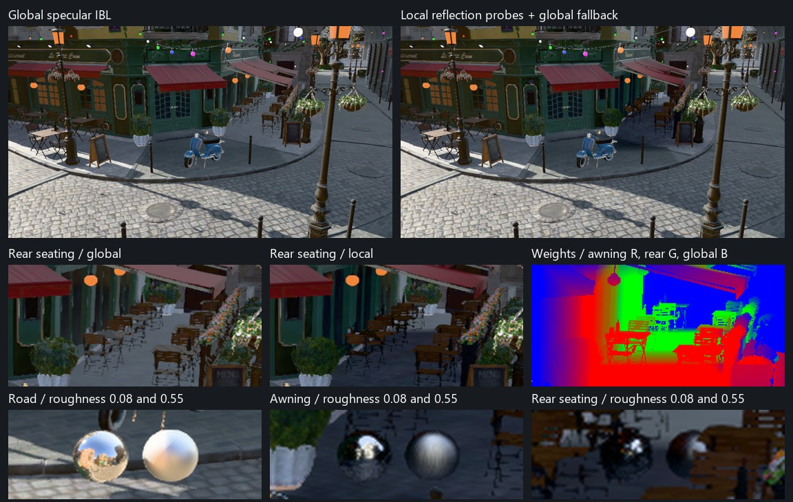
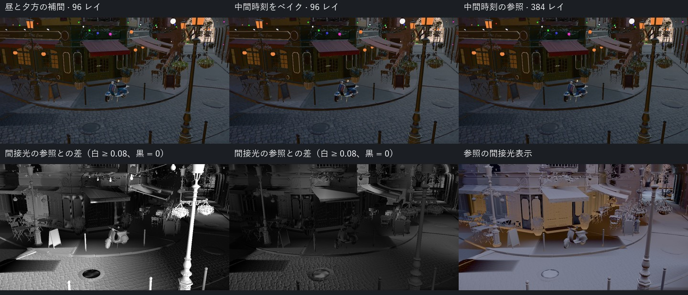
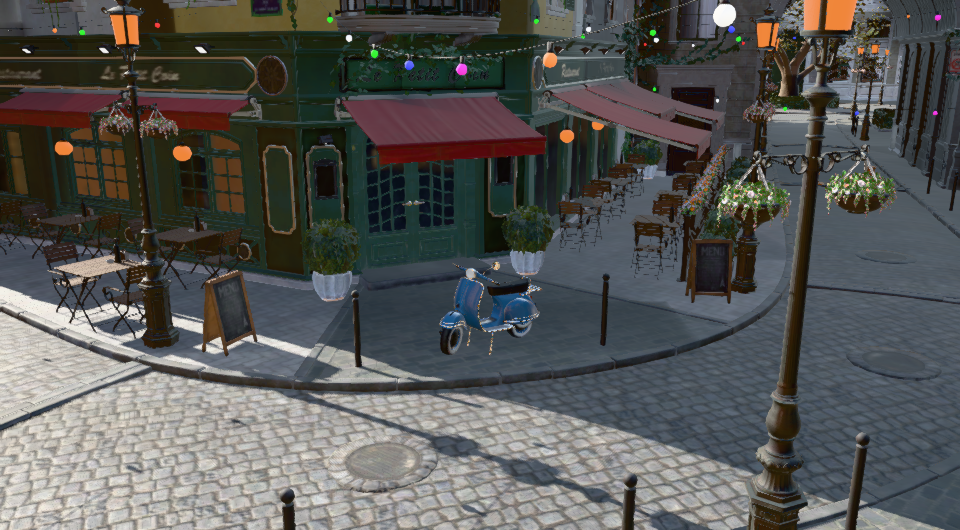
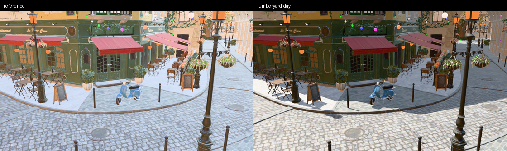

# 現行実装の検証状況

最終確認日は2026-11-22。以下の比較元と実行範囲は各記録に従う。実行手順は[開発ガイド](../guides/development.md)、
現在の契約は[RenderGraph](../design/rendergraph.md)と[Vulkan設計](../design/vulkan.md)、
全体範囲は[実装方針](../design/implementation-policy.md)を参照する。
過去の検証表・比較はGit履歴に残し、この文書は現在の確認範囲を示す。

<a id="bistro-local-reflections"></a>

## Bistro の局所鏡面反射

RTX 3060 で `lumberyard-day`、`bistro-corner`、960×530 の同一カメラ・太陽・拡散 GI・露出を固定して比較した。表示は上段がグローバルのみ／プローブ有効、中段が客席の拡大と重み、下段が粗さの異なる金属球を移動した 3 フレーム。



| 比較領域（左上 x,y ／ 幅×高さ） | グローバルのみ | ローカル追加 |
|---|---:|---:|
| 奥のひさし下（600,151 ／ 62×40） | 0.05048 | 0.04496 |
| 客席（605,213 ／ 55×42） | 0.06079 | 0.02328 |
| 日なたの石畳（35,439 ／ 86×42） | 0.25638 | 0.25638 |

数値はトーンマッピング前の線形 HDR の RGB 成分平均。石畳は領域内の全 RGB 値が一致した。深度から再構成したワールド座標で計算した重みとシェーダー出力を比較し、99 パーセンタイル絶対誤差は重複域 5,499 画素で 0.00431、フェード域 28,279 画素で 0.00391。ローカル寄与がある不透明深度画素で、radiance 中間時刻と両端の平均の最大差は 0.000488（RGBA16F）。次のコマンドで再計算できる。

```text
python tools/bistro/check_reflection_probes.py GLOBAL_CONTROL LOCAL_SHADED WEIGHTS RADIANCE_SWEEP
```

両 API の Forward と移動球、Vulkan Forward+ の時間変化、D3D12 Deferred、拡散 GI を外した D3D12 Forward+ で検証メッセージの警告・エラーは 0 件。通常フレームの Rust 確保・再確保・解放、および計測対象のネイティブ資源生成・破棄も 0 件。CPU ベイクは Bistro の静的三角形 2,824,136 枚を使用。

昼の HDR 環境を使って Bistro の局所反射を単一シナリオでベイクし、既存の昼／夕方の拡散アセットと合わせて Vulkan Forward+ と D3D12 Deferred で描画した。両方で製品構成の資源寿命・容量回復検査に合格し、通常フレームの Rust の確保・再確保・解放、計測対象のネイティブ資源生成・破棄はすべて 0 件だった。

別クレートから標準 API を使い、拡散単独・局所反射単独・併用の 3 通りで、単一シナリオのアセットを保存・再ロードして中心画素を検査した。両 API でウィンドウのリサイズ後もロード済み照明を使って描画できた。CPU と両 GPU の拡散ベイクは HDR 環境を使う単一・二時刻の両方を比較した。

### プローブ数と GPU 時間

RTX 3060、Vulkan Forward、960 × 530、昼の街角、同時フレーム 1 で、変更前（`6ff7aef`）と同じベイク済み拡散・二時刻の反射アセットを使った。各条件で 24 フレームのウォームアップ後、100 フレームの GPU タイムスタンプを集計した。数値はフレーム全体の中央値（ms）。

| 局所反射の配置 | 変更前 | 変更後 |
| --- | ---: | ---: |
| 拡散のみ（0 個） | 3.204 | 2.696 |
| ひさしと客席の 2 個 | 3.344 | 2.859 |
| 同じ 2 個と遠方の 30 個 | 4.665 | 2.905 |
| 同じ 2 個を各 16 個重ねた配置 | 5.253 | 4.195 |

遠方配置は最初の箱の位置と範囲を X 方向に 10,000 m から 30 m 間隔でずらした。各条件で変更前後の HDR キャプチャの SHA-256 が一致した。2 個の再測定は変更前 3.357 ms、変更後 2.862 ms。空間候補表は離れた箱をまとめて除外できる。実際に影響範囲が重なる画素では各候補の寄与を評価する。他の GPU での性能は未計測。

<a id="bistro-baked-lighting"></a>

## Bistro のベイク済み拡散間接光

### 時刻に合わせた間接光

現在の Bistro は、同じ HDR 空と太陽の軌道から昼・中間・夕方の拡散照度を独立にベイクする。RTX 3060 の Vulkan ベイクで 5,361 セルと 6,100 プローブ、14 配置の 214 チャート（65,536 テクセル）を使用した。同じ配置の拡散アセットは二時刻で 3,334,100 バイト、三時刻で 4,773,092 バイト（Bistro 外部ヘッダー込み）。直接光と影は各フレームの太陽方向で描く。

中間時刻を同じ配置・同じ輸送モデルで 384 レイに増やした結果と比較した。各方式は 96 レイ。全ライトマップ画素の線形 RGB 照度の平均絶対誤差は、昼と夕方だけの補間で 0.01900、中間を焼くと 0.00680。全有効プローブの SH 係数の平均絶対誤差は順に 0.05576 と 0.04600。比較した両方式の昼・夕方の保存値は一致した。高サンプル参照も同じ最大 2 反射の近似である。

同じ中間時刻を 960 × 530 の街角で描いた。参照画像との線形 HDR RGB の平均絶対差は、間接光の診断表示で 0.02125 → 0.01084、材質・直射込みの最終 HDR で 0.00196 → 0.00112。昼と夕方の HDR はどちらの時刻でも両方式で完全一致した。同じ 3 時刻アセットによる Vulkan Forward と D3D12 Deferred の通常フレームで Rust の確保・再確保・解放と計測対象のネイティブ資源生成・破棄は 0 件だった。

Vulkan Forward の GPU フレーム時間（同時フレーム 1、24 フレーム準備後の 100 フレーム中央値）は 3 時刻アセットで昼 2.474 ms、係数 0.25 で 4.327 ms、中間キー 0.5 で 3.359 ms。最初のキーはセル探索前に専用の読み出し経路を選び、位置補正と SH で画像読み出しを共有する。従来の二時刻アセットの昼は、今回の汎用読み出し経路で 3.305 ms、専用経路で 2.481 ms となり、HDR は一致した。前版の同じアセットでの計測は 2.696 ms。対象は RTX 3060 の街角 1 視点。



Vulkan と D3D12 の実機で、CPU と GPU の単一・二・三時刻ベイクを HDR 空のある小シーンで比較した。標準 Renderer の回帰テストでは、静的面とプローブに異なる RGB の時系列を与え、0、0.25、0.5、0.75、1 で各区間と端点の寄与を画素値で検査した。

### 以前の昼・夕方の比較

以下のベイク比較は昼の太陽方向を調整する前の測定。現在の昼景は[街灯と看板による照合](#bistro-sun-fit)を参照。

Bistro Exterior の不透明・アルファマスク形状 2,824,136 三角形を使い、同じ BVH・照明条件から昼と夕方をベイクした。間隔目標 2 m、最大深度 5、各受光点 96 レイ、ライトマップ予算 16,384 テクセル。生成結果は 5,361 セル、6,100 プローブ（無効 269）、静的配置 10 件の 64 チャート（16,376 テクセル）。照明テクスチャは RGBA32F の 256 × 430。[再現手順](../guides/examples.md#bistro-baked-lighting)


CPU を基準に、保存した線形 RGB の全成分の絶対差を測った。プローブは両シナリオの SH 係数、ライトマップは両シナリオの照度を対象とする。

| ベイク先 | SH 平均 / 最大 | ライトマップ平均 / 最大 |
| --- | ---: | ---: |
| Vulkan | 0.000464 / 0.109801 | 0.000200 / 0.063590 |
| D3D12 | 0.000404 / 0.109801 | 0.000183 / 0.047091 |

実機の小さな発光面と白い受光面の回帰テストでは、CPU と両 GPU の全アトラス成分が絶対差 0.0005 未満に収まった。Bistro の高密度な形状では、CPU と GPU でレイの交差判定に差が出るため、同じレイ数でも画素値の完全一致は保証しない。

同じ照明アセットで、Vulkan Forward+ と D3D12 Deferred の 800 × 450 の SDR を比較した。RGB 8 bit の平均絶対差は昼 0.141、中間 0.181、夕方 0.069、99 パーセンタイルは順に 2、4、1。両実行で検証警告・エラーは 0 件。白球はベイク後に追加し、静的チャートを割り当てていない。比較時は Forward+ の負荷試験用の点光源 64 個を無効にし、両方に同じ太陽を与えた。

Vulkan の製品構成＋メモリ計装で、Bistro 街角、800 × 450、Forward、16 フレームのウォームアップ後に 120 フレーム描画した。ホストの構築開始から GPU 完了を観測するまでの中央値は大域 IBL が 3.21 ms、ベイク済み拡散が 5.14 ms。各 1 回、他の検証と並行した参考値で、シェーダー単体の GPU 時間は未計測。両方の通常フレームで Rust の確保・再確保・解放、Renderer が発行したネイティブ資源の作成・破棄は 0 件だった。

公開 API だけを使う別クレートでも、太陽と鏡面 IBL を省き、白い三角形に赤と青の照度を与えた。`SceneInput::baked_lighting` の係数を 0、0.5、1 に変えた中心画素の SDR は両 API とも RGB (221, 3, 3)、(122, 0, 122)、(3, 3, 221) だった。

### 動的な資産更新と公開 API

訓練場の開発検証・製品構成を Vulkan と D3D12 で実行し、ウィンドウ、キャプチャ、ホスト合成の基準画像との差分は 0 件。製品構成の定常メモリ検証、姿勢・LOD・装備交換・容量回復の実機テストも成功した。CPU 回帰テストで、最大 LOD の同時部位数、装備の準備失敗後の描画と再試行、提示待ちの容量エラーの分類を確認した。ワークスペースの全ターゲット、Clippy、rustdoc、別クレートの標準利用例とカスタム ViewPipeline をビルドした。

<a id="bistro-daylight"></a>

## Bistro 屋外の昼景

<a id="bistro-sun-fit"></a>

昼の太陽方向を ORCA の屋外画像 1 に合わせた。左のメニューボードの上端が歩道に落とす影と、街灯から縁石を越えて道路に伸びる影を使った。深度から各受光面の位置を復元し、直接光と拡散ベイクに同じ表面→太陽ベクトル (0.519167, 0.478495, −0.708173) を与えた。太陽高度は約 28.6°。960 × 530 の同じ構図で、街灯の影の二つのふくらみの中心は公式が概ね (455, 447)、(531, 471)、調整後が (452, 444)、(530, 470)。Vulkan Forward の再ベイク・描画で検証警告・エラーは 0 件。[公式画像](https://d29g4g2dyqv443.cloudfront.net/sites/default/files/akamai/Bistro_Exterior_1.png)



以下は方向を再調整する前の昼景の検証記録。

ORCA 公式配布の **Bistro_Exterior_1.png** に、スクーター、車止め、マンホールを対応させ、深度から復元した街角の特徴点でカメラ位置と画角を調整した。太陽の方向は手前の車止めと石畳に落ちた影から推定した。公式ページには掲載画像のレンダラーや元の撮影設定が明記されていないため、評価対象はこの一枚の見え方である。[公式ギャラリー](https://developer.nvidia.com/orca/amazon-lumberyard-bistro)



960 × 530 の同じ領域で測定した SDR 表示輝度の中央値（sRGB を線形化し Rec.709 の係数で合成、白を 1 とする）。領域座標、参照画像のハッシュ、色の中央値は[比較ツール](../../tools/bistro/compare_daylight.py)で再現できる。

| 対象 | 公式画像 | 既定 | 昼景 |
| --- | ---: | ---: | ---: |
| 日向の石畳 | 0.747 | 0.387 | 0.622 |
| 日陰の石畳 | 0.201 | 0.545 | 0.145 |
| 日向／日陰 | 3.72 | 0.71 | 4.30 |
| カフェの緑の外壁 | 0.025 | 0.150 | 0.033 |
| 赤いひさし | 0.055 | 0.364 | 0.084 |
| 鉢植えの葉 | 0.016 | 0.163 | 0.032 |

日向・日陰の位置関係と店先の明るさが近づいた。暗部の外壁には褐色が残り、右手の路面では建物の影の境界がずれる。材質の原本を保持し、全視点で固定の光を使った。`street-mid` と `material-detail` の白・黒端の画素率は増えなかった（SDR 符号値の加重輝度が 1 以下または 254 以上）。ルートの先頭 2 秒を両設定で撮影した。柵や葉の時間方向の安定性は映像での観察対象で、静止画の輝度指標には含めていない。[実行手順](../guides/examples.md#bistro-daylight)

Vulkan／D3D12 の実 GPU で、街角 1 視点、既存 7 視点、ルート 60 フレームの各 HDR・SDR・深度が既存の `scene` 閾値内だった。既定の `street` は両 API とも変更前の 1280 × 720 キャプチャと 3 面がバイト一致した。Vulkan の街角では `bistro-graph` と `bistro` も同じ 3 面がバイト一致した。実行はオフスクリーンの開発検証構成で、警告・エラーは各 0 件。

<a id="engine-integration"></a>

## ゲームエンジンへの組み込み

Windows build 26200、GeForce RTX 3060、NVIDIA 610.88、Rust 1.99.0 で訓練場の Vulkan・D3D12 を実行した。各 API の最適化した厳格構成と製品構成で、標準ウィンドウ 29 フレームに続けて、同じデバイスでホストが組み立てた監視モニター・輪郭込みの 24 フレームを提示した。ヘッドレス 29 枚とホスト 24 フレームの入力・色・ID・深度・全 4 カスケードを合わせて各構成 293 ファイルが基準内に収まった。製品構成では画面外の射線 5 フレームも、準備後の記録から取得までの各メモリイベントが 0 件だった。画像比較は提示元の GPU 画像とヘッドレスの読み戻しに対して行い、デスクトップの色管理やディスプレイの出力は測定範囲外とした。[比較条件と追試手順](../guides/tooling.md#scene-materials)

主画面の光を赤、装備プレビューの光を緑に固定した。主カメラの近クリップ面の外側に遮蔽物を追加すると受け面の中央だけが暗くなり、横へ動かすと影が移り、削除後は全画素が元に戻った。受け面の全画素の深度は 0.5 のまま。準備数を超えるプレビュー追加が失敗したフレームも、既存プレビューの全画素が同じだった。[照明・影の検査](../../crates/training-yard/src/replay/lighting.rs)

全量 Bistro Exterior の street（2,832,120 三角形、1920 × 1080、24 フレーム予熱・120 フレーム描画、同時提出 2、Bloom 無効）を、二クレートへの再配置直前の `3254177` と比較した。同じ cook・IBL を用い、移行後の `bistro` と `bistro-graph` を二つの API と厳格・製品の両構成で実行した。各バックエンドの 4 通りすべてで移行前の HDR・深度・SDR と SHA-256 が一致した。厳格構成の native 警告・エラーは全経路で 0 件。[Bistro の入力と再生条件](../guides/development.md)

| Backend | HDR の SHA-256 先頭 12 桁 | 深度 | SDR |
|---|---|---|---|
| Vulkan | `c14918ad2699` | `1622e27695f2` | `6a2a39d3af61` |
| D3D12 | `baa236b1bc92` | `c6f61b199a1a` | `357783b17ad4` |

同じ street 条件で製品構成に `memory-profiling` を加え、両バイナリ・両 API の各 120 フレームを計測した。全 4 回とも Rust と VMA ホストの確保・再確保・解放、Renderer 発行の native 作成・破棄・メモリとディスクリプターの確保・解放は各 0 件だった。準備済み native オブジェクトのリセットは各 240 回で、画像ハッシュは上表と一致した。起動、ロード、予熱、最終キャプチャは計測区間外。

workspace の外に `renderer` だけを直接依存に持つアプリを置き、空の 3D シーンと赤い HUD を一つの Frame に記録した。厳格構成の Vulkan と D3D12 で 2 × 1 の結果がともに黒と赤の不透明 2 画素になった。バックエンド選択と画像領域には `renderer::core` の再公開型を使用した。

変更のない `4d1e6eb` から受入スクリプトを実行し、全 24 コマンドが成功した。各構成 293 ファイル、計 1,172 ファイルはすべて基準とバイト一致した（基準 ZIP の SHA-256 は `a33b2c846e9144452be41ea4683f0e02d43cff04993ae1feb5f8442aa70f17dc`）。監視映像の提示中、8 枚目の後に実ウィンドウを 384 × 192 から 320 × 160 に変更して以降の 16 枚も提示した。各ビルド構成で訓練場の実機テスト 13 件に加え、Vulkan と D3D12 のホスト所有デバイス・画像の試験が通過した。最小化中は描画を休止し、復帰後の寸法で提示できた。GPU とドライバーの実機範囲は上記の Windows 環境に限る。[ウィンドウ復帰の試験](../../crates/training-yard/tests/window.rs)・[受入手順](../guides/tooling.md#scene-materials)

公開例の `rust_pipeline` を実行し、`toon_views`、`two_views`、`textured_view`、`mixed_post`、`pbr_forward` を両バックエンドで再生した。最後の例はホストの HDR コピー、Bloom、影再利用を含み、中心の SDR は両 API とも [252, 118, 118, 255]、深度は 0.976431、2 枚目で 4 カスケードを再利用した。graphics を外した訓練場の直接依存は `renderer-core` だけとなり、二つの Compute の逆順回収試験も両 API で通過した。workspace の全機能テストは 611 件成功、通常実行で除外した実機等のテストは 166 件。上記の実機試験は別途明示実行した。[公開例](../guides/examples.md)・[core 単独の試験](../../crates/training-yard/tests/core_compute.rs)

隊員と装備交換に続く射線の 5 フレームを、単体ウィンドウ・ヘッドレス・ホスト所有 Graph の 3 経路で再生した。48 × 24 の出力で、ガラスを通した赤い弾道、緑の障害物による遮蔽、その手前に移動した弾道、消えた後の背景を全画素で照合した。途中の 2 フレームは 3D が 24 × 12、白い照準は出力の (1, 1) の 1 画素だけで、色差は各成分 1 以下。Windows Vulkan・D3D12 の厳格構成・製品構成で各 3 経路が成功し、実ウィンドウでは各 29 枚を提示した。ホストの射線 5 フレームは製品構成で毎回のメモリイベントがすべて 0 件だった。[描画と判定](../../crates/training-yard/src/effects.rs)・[再現手順](../guides/tooling.md)

空で起動して箱を移動・削除した後、個別の姿勢を持つ PBR 個体 17 体と、起動時に存在しなかった Toon 材質を標準 `prepare_assets` でロードし、両方の色を描画できた。共通 Runtime の試験では、初期 4 KiB の転送領域を拡張して 128 KiB の全バイトを書き戻し、拡張前に保持した登録バッファーの内容を読み戻した。不正な画像を含む拡張に失敗した直後にも、以前の上限と登録内容が維持された。Vulkan・D3D12 の厳格構成と製品構成で確認した。[ロード後の描画](../../crates/training-yard/tests/standard_motion.rs)・[同一デバイスでの容量変更](../../crates/renderer-core/tests/shared_runtime.rs)

Windows Vulkan・D3D12 の訓練場で、1,024 体を全件・16 体・0 件更新した。保持シーンとホスト配列の 128 × 64 出力は各段階でバイト一致し、全画素の色分類と位置も期待値に一致した。2 体分のビューで容量超過を検出してその描画を省き、ロード境界で再準備した。提出済みの実行枠の回収と、読み戻し結果の返却を別々に要求することを確認した。製品構成は各更新から二つの描画と結果返却まで、確保・再確保・解放および native 作成・破棄が各 0 件だった。[標的の入力と画像照合](../../crates/training-yard/src/targets.rs)

Vulkan・D3D12 のホスト再生で、左の鎧とその先端、右の胴、背景を ID 画像から読み戻した。上位バイトを含む u32 ID は完全一致し、先端を動かすとクリック結果も変わった。別途、横に移したカメラからのマウス照会を提出し、隊員の削除・同一スロットへの再生成後に結果を取得した。クリック時の部位は旧世代の鎧、新しい対応表の同じ ID は新世代の鎧を指し、古い選択を棄却できた。ホストの輪郭は選択部位の外側 1 画素だけがマゼンタになり、ID 画像から計算した全画素と一致した。プレビューをカットするとその 4 カスケードだけを再描画し、主画面の 4 カスケードは再利用した。次フレームは両方が再利用に戻った。開発検証ありと最適化した製品構成で実行し、製品構成の第 5～14 フレームに各確保／解放系イベントはなかった。[選択と世代の照合](../../crates/training-yard/src/replay/selection.rs)・[影の履歴試験](../../crates/training-yard/src/replay.rs)

訓練場のホスト再生 24 フレームで、主画面と装備プレビューに加えて監視カメラを第 6・12・18・24 フレームだけ描いた。監視パネルの全画素は、第 1～5 フレームがマゼンタの待機色、更新フレームが同じ Graph 内のカメラ画像、それ以降が前回提出から保持した画像と一致した。初回は左の隊員、以降は右の隊員のみが映り、パネル外の全画素は合成前の主画面と一致した。Windows Vulkan・D3D12 の開発検証ありと製品構成で成功し、製品構成の第 5～14 フレームは変更・提出・画像保持・再利用・結果返却を含めて確保／解放系イベント各 0 件だった。[監視モニターの記録と照合](../../crates/training-yard/src/replay/monitor.rs)

訓練場の Vulkan・D3D12 の画面外出力 48 × 24 は 24 枚すべてがバイト一致した。実ウィンドウでは 384 × 192 で各 24 枚を提示した。最適化した `presentation,vulkan,d3d12,memory-profiling` 構成のウィンドウ再生では、第 5～14 フレームで入力更新から記録・提示・再試行・回収までの Rust、VMA ホスト、native の確保／解放系イベントはそれぞれ 0 件だった。OS イベントのポンプ、初期化・ロード・破棄はこの計測の外にある。[再現手順](../guides/tooling.md)・[計測範囲](../../crates/training-yard/src/window.rs)

第 15 フレームから二つの装備を別のワーカーに要求し、後から要求した黄色い鎧を先に受け取って GPU に登録した。遅れて届いた鎧と不正な頂点インデックスを持つ装備を受けた後も、黄色い鎧の外形と色を維持した。隊員を削除したフレームには体も鎧も映らず、同じ位置に生成した新しい隊員には旧世代宛ての装備が適用されなかった。画面外再生では未回収の旧画像を保ったまま資産の更新を試み、両 API とも所有者の返却を求めた。旧画像の取得後に同じ資産を準備できた。隊員削除の後にも、その直前に提出した黄色い鎧を画像から確認した。[装備の要求と完了通知](../../crates/training-yard/src/yard/equipment.rs)・[旧画像の回収](../../crates/training-yard/src/standalone.rs)

ウィンドウ試験では各 API で 3 枚を提示した後、最小化してゼロ寸法の描画コールバックが呼ばれず、160 × 112 への復帰後さらに 3 枚提示し、破棄まで検証した。D3D12 で旧出力が提示側に保持されたまま次の描画が失敗する事例を訓練場で再現した。描画中の出力に加え、提示枠数だけ同じ形式・寸法の画像を準備すると同じ操作列が通った。ビューの変更試験では新しい Toon ビューが PBR 資産を拒否した後、以前の PBR ビューで三角形の深度 0.5 を両 API で読み戻した。

訓練場のホストは自分の Graph に描画先を作り、2 ビューの記録後にその Graph を受け取って 1 画素の UI を追加し、一度だけ投入した。Vulkan・D3D12 の取得画像の左上が白となり、シーンと影も同じ受理票で照合できた。`view_pipelines` の実機試験では、ホストが提出を取り消した場合と、異なる Graph の受理票を渡した場合に履歴が進まないことを確認した。一方のビューの確定に失敗した場合はトークンを破棄してから元の受理票で回復し、各ビューの確定回数は 1 回ずつだった。

`model_views` は同一モデルの 2 個体を 48 × 24 と 12 × 6 のカメラで同じ Graph に描く。7 フレームにわたり左右の画素を照合し、前者のカメラだけ鎧が描かれること、片方だけの発光と解除、共有材質変更が両個体に反映されることを確認した。2 関節のポーズを個別に更新したときは対応する側のシルエットと 32 × 32 の方向光カスケードの被覆が変わり、元の姿勢に戻すと基準に一致した。Windows の Vulkan・D3D12 とも開発検証あり、最適化した製品構成で成功し、厳格構成の破棄までの警告・エラーは 0 件だった。製品構成で最後の 3 フレームをポーズ更新から結果返却まで計測し、Rust の確保・再確保・解放、VMA のホスト確保系イベント、Renderer 発行の native 資源・メモリの作成／破棄がそれぞれ 0 件だった。

訓練場の `standard_motion` と `world_panel` を Windows の Vulkan と D3D12 で実行した。空の状態で UI を描いてから PBR 個体を追加・移動・削除し、同じ入力をホスト配列と保持シーンから渡した 32 × 16 の画像が全画素で一致した。独自 Toon が最初からある場合も同じ操作が通った。クリップした UI 単独と 3D に重ねた HUD の線形値 0.25 は取得結果で 137 となった。端末を遮る前景、装備プレビュー、1 画素の HUD を一度の提出で合成した 10 × 4 の画像は全 40 画素が期待値と一致した。両試験は開発検証ありと最適化した製品構成で通過し、厳格構成の破棄までの native 警告・エラーは 0 件。実ウィンドウでは両 API で空シーンを各 3 回提示した。複数ビューと通常フレームの計測結果は本節の監視モニター・選択・標的の各試験に示す。

二クレート再配置後の Windows 実機で Bistro の標準レシピと直接 Graph を Vulkan・D3D12 で実行した。小シーンを各 24 フレーム予熱し、120 フレーム描画後に取得した HDR・深度・SDR は四経路の間で全バイトが一致した。各 API の移行前の `fixture-forward-tent` のキャプチャとも一致し、厳格構成の報告は全四件とも警告・エラー 0 件だった。小規模な回帰試験にはこの 128 × 96 の fixture を使う。

`renderer-8po`。シーンからの初期化を Windows の Vulkan と D3D12 で検証した。release の開発検証あり・なしで
`view_pipelines` の実機試験が各 6 件通過した。標準カメラ（8×8）と独自 Toon（4×4）を同じ Graph に記録し、
各画像の全 RGBA バイトが低水準 API で組み立てた参照描画と一致した。テクスチャ付き材質、混在材質と Bloom、
複数ビュー、リサイズを含む公開例では、準備済みフレームの記録から結果返却まで CPU／native の計測対象メモリ操作は各 0 件だった。
Core／SyncVal と Debug Layer／GBV を有効にした実機試験で、破棄までの警告・エラーは 0 件だった。

共有 Runtime の枠をホストの投入で埋めてから初期化を再試行し、ホスト画像の 16 バイトと未回収の完了を確認した。
16 バイトずつのメッシュ転送中、材質の転送後、既存メッシュの新版を準備した後に中断し、各段階で以前の登録状態に戻ることを確認した。
デバイスを作らない試験では空シーン、共有する材質・変換、257 灯と余裕枠、不正なカメラ登録・転送宣言を確認した。
Vulkan の descriptor 予約では、同じバインディングを深度付き・深度なしの両方のパスで使う場合の必要数も検査した。
この初期化経路ではウィンドウ表示と Bistro 全量シーンの比較は実行していない。

`renderer-yp5`。ホストのウィンドウ、GPU 資源、アセット管理、複数のカメラを組み合わせる経路を対象にした。

| 確認した契約 | 比較条件と観測結果 |
|---|---|
| カメラと外部プラグイン | 一つの Graph で寸法と方式の異なるカメラを記録し、それぞれの描画結果を読んだ。投入を受理した後に一方の履歴の確定が失敗しても、同じ投入の残りを再試行できた。外部 crate の同じプラグインを CPU、Vulkan、D3D12、両 GPU の各ホストでコンパイルした。 |
| 常駐メッシュ | メッシュと材質のスナップショットを保持して描画先を 32×16 から未予約の 23×13 に変更し、HDR 画素を確認した。別の試験では更新を 128 バイトずつ転送し、新しい版が揃うまで旧版を描画できた。 |
| テクスチャと描画領域 | BC1・BC3・BC5・BC7 を含む画像の末端 mip をシェーダーで読み、BC3 の複数ブロック行はコピー後のバイト列も照合した。部分転送した mip の初期化状態と全 mip 転送時の状態を確認した。viewport と scissor は描画後の画素で有効範囲を照合した。 |
| ウィンドウと外部画像 | Windows の二つのホスト所有ウィンドウで同じ Runtime の画像を表示した。片方を閉じている間も他方で表示できた。ホスト所有テクスチャを Graph で更新し、使用中の返却拒否、退役後の返却と再登録、返却した画像の値を確認した。 |
| 照明と合成 | Forward、Forward+、Deferred の不透明・半透明で 257 番目の点光源による画素を単灯の参照と比較した。Forward+ の 129 灯ではタイルごとのマスクも照合した。標準出力のシェーダーは `renderer` への移動前後で同じ生成物を使う。 |

Windows の RTX 3060 で統合版 `7a5d119` と `renderer-jw0` の Bistro 小規模 fixture を比較した。
Vulkan／D3D12、それぞれ開発検証あり／なしで 6 ケースずつ、計 24 ケースの HDR・SDR・深度・影など 236 キャプチャ
（1,620,422,928 バイト）が一致した。各ケースで 3 フレームの warm-up 後に 5 フレームを計測し、
Rust と VMA ホストの確保・再確保・解放、および Renderer による native 資源・メモリの作成・破棄が各 0 件だった。
点光源テーブルの画像化に伴い Forward+ 4× の 8 ケースで予約が変わった。バッファは 31 → 28 個、
27,328 → 21,136 バイト、画像は 203,884,940 → 203,891,180 バイト、転送容量は 12,768 → 13,519 バイト。
他の 16 ケースは予約量も一致した。ここでは描画結果とメモリ操作を比較した。

1,025 インスタンスと 257 灯を同時に使い、標準 3 方式で個別描画と色、深度、4 カスケードの影を照合した。
メッシュの 128 バイト単位の転送、版の切り替え、転送のない呼び出しでは、GPU 完了と結果返却まで計測対象のメモリ操作が 0 件だった。
ホストが先に作成した Vulkan デバイス・画像と D3D12 DIRECT キュー・画像をそれぞれ採用し、描画資源の返却と Runtime 破棄後のホストキュー利用を実機で確認した。
固定 SDK でシェーダーを再生成し、生成物、反射情報、35 バリアントと 12 include のマニフェストを照合した。

CPU 専用のワークスペース試験は通常構成 371 件、開発検証構成 373 件が成功した。両 GPU と Windows 表示を有効にした構成では
通常 578 件、開発検証 591 件が debug・release の両方で成功した。単独バックエンドを含む Clippy、外部プラグインの実行ファイル内のシェーダー照合、
private 項目を含む rustdoc、HTML ドキュメントのリンク検査も通過した。

全実機試験の見直しで、カラー 2 面への同時クリアを未対応とする古い Vulkan 試験と、不正なインデックスの検査に必要な Compute Program を準備していない試験を修正した。
前者では 2 面を別の色で読み戻し、後者では投入拒否後も登録済みバッファの内容・版が保たれ、正常な再投入が成功することを検証した。
これらの試験と単独バックエンドの診断ヘルパーを取り込んだ `a286943` で再検証した。実行コードは `7a5d119` と同一である。
個別プロセスで実行した core の実機・計測受入は開発検証構成 122 件、通常構成 82 件が通過した。
実ウィンドウの smoke と tour では、標準・独自 Raster の 16 実行、合計 384 フレームについて寸法、描画画素数、画像ダイジェストを照合した。
開発検証の Vulkan Core／SyncVal と D3D12 Debug Layer／GBV は破棄まで警告・エラー 0 件だった。
同じ 2 構成で `renderer` の実機試験 34 件と Bistro の 11 件、CPU 上での異種ビュー検査、公開例の 19 通りの実行がそれぞれ成功した。

## ビューパイプラインの差し替え

`renderer-jw0`。RTX 3060 の Vulkan と D3D12 で、同一 Runtime に準備した標準描画と外部実装の
Toon 描画が、同じメッシュ・材質・カメラから異なる中心画素を出力した。両実装を同じアプリループで
2 カメラ、材質とメッシュの更新、出力のリサイズまで実行した。準備済みの通常フレームで計測した
CPU 確保・再確保・解放と Renderer による native 資源生成・破棄は各 0 件だった。

未投入フレームの破棄と投入拒否では履歴が進まないこと、投入が受理された後に 2 ビュー目の確定が
失敗しても同じ投入の残りを再試行でき、1 ビュー目を二重に確定しないことを確認した。
Bistro の小規模 fixture は `renderer-bzs` の記録と比較し、2 API × 2 検証構成 × 6 ケースで
236 キャプチャのバイト列と準備済み資源量が一致した。

## ビュー API・常駐アセット・混在 Deferred

`renderer-bzs`。RTX 3060 の Vulkan と D3D12 で、変換済み半透明メッシュを逆順に登録しても
同じ期待色になることを確認した。Deferred の材質面を読む段階の深度 0.5 と、Forward 不透明物の
合成後の深度 0.4 を読み戻して区別した。静止した影の再利用と通常フレームのメモリ検査も通過した。
100 種の PBR 材質をまとめて準備し、静止時には転送投入がなく、1 件の変更がバッファ 1 個・アップロード
1 パスの容量で収まった。二つのカメラで同じ三角形を描いたサンプルの有色画素数は 722 と 200 だった。
別のサンプルでは 64×64 から 32×32 に変更し、メッシュを縮小して材質を更新した結果、
両 API で有色画素数が 722 から 98 に変わり、中心画素も赤から緑に変わった。

変更前の `dac9e3b` と比較し、Bistro の小規模 fixture は 2 API × 2 検証構成 × 6 ケースで
236 キャプチャのバイト列と準備済み資源量が一致した。通常フレームの観測対象の CPU 確保・再確保・解放と
native 資源生成・破棄は 0 件。全 Bistro 素材を使った速度比較は行っていない。

## 共通マテリアルと混在描画

`renderer-y9p`。RTX 3060 の Vulkan と D3D12 を使い、Forward と Deferred それぞれで
PBR・頂点色 Unlit・独自 Toon・半透明を一つのリストに投入した。HDR 読み戻しを期待値と照合し、
深度による遮蔽、種類をまたぐ半透明合成、独自マテリアルのテクスチャ・係数更新前後の色と uniform buffer の参照を確認した。
Deferred では Toon だけをキャスターにしてカスケードの深度書き込みも確認した。
混在描画の通常フレームは Graph 構築から GPU 結果の読み戻し・返却までを計測した。

Bistro の小規模 fixture を `cf95cd5` の保存済み出力と比較した。
2 API × 2 検証構成 × 6 ケースの計 24 ケースで、236 個のキャプチャと準備済み資源量が一致した。
各ケースの通常フレームでは Rust の割り当て・再割り当て・解放と観測対象の native 資源生成・破棄は 0 件。
比較対象は Forward、影無効、Forward+ 4× と Deferred 1× の個別・インスタンス描画。全 Bistro 素材を使う性能計測は今回の比較対象外。

Bistro の shipping 構成で Vulkan のアルファ描画試験が一度アクセス違反で終了した。
同試験の単独再実行と、同じ順序での全 5 試験の再実行 2 回は通過した。原因は `renderer-kvs` で追跡する。

## メッシュの寿命と標準 PBR の公開 API

`renderer-lfs`。メッシュ更新後も、取得済みスナップショットは取得時のメッシュ版、Unlit の色と変換を保持する。
頂点ストライドの異なる版に更新した場合、新しい Unlit 入力は取得時に拒否される。
PBR はモデル空間の単体描画、ビューに応じた影の選択、HDR から SDR までの一括・分割出力を検証した。
ワークスペースの CPU テスト、4 通りの feature 構成の Clippy、非公開項目を含む rustdoc が通過した。

RTX 3060 の Vulkan と D3D12 で、製品相当構成と開発検証有効構成の各々で Pipeline の実機テスト 22 件と Bistro の 11 件が通過した。
両構成のフレームメモリ検査で通常フレームの割り当て・再割り当て・解放とネイティブ資源の生成・破棄は 0 件。
Vulkan では更新・登録解除前のメッシュを GPU 完了まで保持し、保守処理で回収する経路を確認した。

同じ GPU とドライバーで、移行前の `d16c5e8` と Bistro の 24 ケース（各 API・構成につき 6 ケース）を比較した。
Forward の Tent Bloom と影なし、Forward+ 4×・Deferred 1× の個別描画とインスタンス描画について、
HDR・SDR・深度・影など計 236 キャプチャのバイト列と、転送を含む資源の予約量が一致した。
全ケースの測定区間で Rust・VMA ホストの割り当て・再割り当て・解放と Renderer によるネイティブ資源の生成・破棄は 0 件。
検証有効構成の Vulkan Core／SyncVal と D3D12 Debug Layer／GBV の警告・エラーも 0 件だった。

## PBR レシピと再利用できる描画部品

`renderer-cc2`。標準のForward／Forward+／Deferredを `pipeline::GeometryPipeline` から選択できる。
名前付きの材質画像は材質ごとの既存サンプラーを使い、影のアルファも同じサンプラーで参照する。
材質・IBLの既定画像と影なし用のD32は一度に準備できる。Deferredの公開パスは既存バックエンドが扱う
単一mip・layer・sampleのアタッチメントを要求し、形式や寸法をGraph追記前に検証する。

左右の投影を受け入れ、カメラとカスケードの表裏はそれぞれの投影で決める。
モデル空間の直接描画は3方式の不透明・半透明・影に対応する。間接描画はグループ内で一つの変換を共有する。
変換テーブルの常に初期化する範囲は `max_transforms` に応じて6 KiBまたは96 KiBで、参照するdrawがないフレームでは転送を省く。
正負の向きは変換作成時に求めて保存し、GPUで鏡映の表裏と接線へ反映する。

Bloomは最初の縮小の4 tapへ明部抽出を統合し、4 dispatchで処理する。
RTX 3060（610.88）で、旧抽出画像の保存とVulkanの半精度変換には丸め差があった。
各tapをFP32演算でbinary16の表現値へゼロ方向に丸めた実装で、両APIの厳格構成で9×5の12出力と
全Bistro `street` の1280×720 TentのHDR、SDR、深度が旧版とバイト一致した。
照明シェーダーはビューの環境光強度がゼロなら、環境マップとBRDF LUTの参照を省く。

`3473d19` の最適化済みVulkan／D3D12で、製品相当と検証有効の各構成でPipeline 22件、Bistro 11件の
実GPUテストが通過した。鏡映した直接描画・半透明・影を3方式で比較し、D3D12の変換付きForward+では
DXILの頂点・ピクセル間のレジスターが一致することを反射情報でも確認した。
Vulkan Core／SyncVal、D3D12 Debug Layer／GBVの警告・エラーは0件だった。
検証有効のBistroプロセスは後半にPコア・HighQoSを設定した。性能比較は別の製品相当実行で行った。
デバイス機能なしの最適化済みPipeline CPUテストは68件、固定SDKの再生成照合は27変種・12 includeが通過した。

BistroのD3D12直接描画は、Forward+の4×とモデル変換を併用すると8,192 Bの転送予約に対し8,672 Bを必要とした。
初期準備で通常フレームのGraph全体の転送量も予約に反映し、この構成の予約は12,768 Bになった。
デバイス機能なしのBistro CPUテスト83件で予約の回帰を確認した。
転送予約の修正後、両API・両構成で7ケースずつを再実行し、HDR・SDR・深度・影の308キャプチャが旧版と一致した。
Forward+ 4×とDeferred 1×の個別描画と一括インスタンス描画を比較した72キャプチャも一致した。
すべての再実行で検証出力は警告・エラー0件、通常フレームの計測対象メモリ操作も0件だった。

性能計測は `8511197` と `4dda991` を比較した。後続のD3D12変換付きForward+の入出力順修正は計測対象外のシェーダーに限定される。
RTX 3060（610.88）の製品相当のBistro fixtureを1920×1080、1×、直接描画、影なし、同時3枠で比較した。
30フレームのwarm-up後に120フレームを測る実行を各条件で3回行った。
値はGPUで測ったGraph全体の時間の実行別中央値から取った中央値で、単位はms。

| 条件 | Vulkan 前 → 後 | D3D12 前 → 後 |
| --- | ---: | ---: |
| IBLなし | 0.1845 → 0.1779 | 0.2324 → 0.2263 |
| IBLあり | 0.1847 → 0.1852 | 0.2324 → 0.2335 |
| Tent Bloom | 0.4125 → 0.3429 | 0.4424 → 0.3779 |
| Box Bloom | 0.4106 → 0.3427 | 0.4424 → 0.3779 |
| 24個のモデル変換 | 0.2378 → 0.2232 | 0.2836 → 0.2714 |

30組すべてでHDR・SDR・深度と、BloomありのBloom後HDRが一致した。IBLの時間差は実行間のばらつきと同程度だった。
24変換のアップロードは96 KiBから6 KiBに減った。Bloomの1080p抽出用画像は、同時処理枠あたり公称約15.8 MiBを削減した。
Forward+は同じ測定手順で720p／1440p、点光源0／8／64灯を比較した。0灯では通常Forwardへ切り替わる。
8灯と64灯で、全ライトを走査する参照との24組の画像が一致し、8条件中7条件でタイル方式のGPU中央値が短かった。
D3D12の1440p・64灯ではタイル0.549 ms、参照0.535 msだったが、実行別の中央値には重なりがあった。
入力を常駐させたタイル生成だけのGraphは、64灯で720pが約15 µs、1440pが約35～36 µsだった。
この値は依存処理を含むため、照明シェーダー単体の時間はこの計測から求めていない。タイルマスクの方式は維持した。
全量Bistroの `street`（1080p、64灯、間接描画）では、GPU中央値は
Vulkanで5.625→5.711 ms、D3D12で5.124→5.083 msだった。
fixtureと全量を合わせた96組・300画像面がバイト一致し、計測した候補11,520フレームでは
Rust／VMA hostの確保・再確保・解放と、Renderer発行のネイティブ資源・メモリ作成・破棄が0件だった。
全量の最初の測定ではCPUのGraph構築＋compileが約3倍になったため、各プロセスのPコア割り当てとHighQoSを
揃え、前後を交互に3組ずつ測り直した。対応する測定の差の中央値はVulkanで+0.0294 ms、
D3D12で+0.0008 msだった。初回の差は再現せず、Vulkanの差の符号も組により変わった。
全6組の画像と予約容量は一致した。初回差の原因を特定できるCPUクロックの記録は得られていない。
実行引数・GPUの生時刻・画像ハッシュは `.tools/renderer-cc2/benchmark/results/` に保存した。

### 変更前の比較

`renderer-mmn`。アプリのビュー投影行列を、描画・可視判定・カスケード・Deferredの再構成で共有する。
CPUで誤った材質分類の事前拒否、HDR専用構成と影なし構成の予約、露出エラー後の再試行を確認した。
実GPUで正投影・非対称透視の画素と深度を既知の値と照合し、極端なモデル変換、
既定画像・材質・シャドウ履歴の投入後の保持を確認した。
Vulkan／D3D12を有効にした最適化済み製品・厳格構成で、それぞれPipelineの18件とBistroの11件の実GPUテストを通過した。
固定SDKで20バリアントを再生成照合し、SDK不要のCI検査で生成物・反射情報・12 includeのハッシュを確認した。

Forward+の一時画像は1タイルあたり公称16バイトで、1920×1080では1フレーム分が127.5 KiBとなる。
従来の永続バッファはビューごとに16.25 MiBだった。端数寸法と0→64→0灯を3フレーム同時投入してマスクを照合した。
Bistroの影無効・診断なしの小fixtureでは同時3枠の予約資源が58個から47個になった。
4枚のフルサイズ画像は診断キャプチャを明示した場合にだけ生成する。HDR専用準備では標準出力画像2枚分とProgramを除く。

WindowsのRTX 3060（610.88）で、`8e9d966`のBistroの実行条件を再現した。
Forward系の1×／4×、Deferredの1×、直接／packed／間接、個別・一括変換、Bloom、影無効、
全量シーンの36フレーム巡回、外部材質バンドル、手動Graph版を比較した。
両APIの製品・厳格構成で、44ケースずつ計1,616キャプチャと資源診断の追加100キャプチャがバイト一致した。
通常1,136フレームのGraph構築から投入・退役・結果返却までで、計測したRust／VMA hostの確保・再確保・解放、
Renderer発行の資源・メモリ作成・破棄およびdescriptorの確保・解放は0件だった。
標準ForwardとForward+ 4×＋間接描画のウィンドウで、各24フレーム、リサイズ、最小化・復帰、視点再生、
未退役フレームを残した終了を全8実行で確認した。Vulkan Core／SyncValとD3D12 Debug Layer／GBVの警告・エラーは0件だった。

同じ全量シーンの`street`を1920×1080、間接描画、3枠、24 warm-up、120計測フレームで比較した。
製品構成に`--gpu-timing`を付けた各1実行の平均を示す。単位はms/frame。

| API | 経路 | CPU Graph構築＋compile 前 → 後 | GPU 前 → 後 |
| --- | --- | ---: | ---: |
| Vulkan | Forward+ | 0.495 → 0.449 | 5.606 → 5.791 |
| Vulkan | Forward・影なし | 0.427 → 0.414 | 3.286 → 3.319 |
| D3D12 | Forward+ | 0.488 → 0.437 | 5.251 → 5.383 |
| D3D12 | Forward・影なし | 0.444 → 0.425 | 2.581 → 2.503 |

この条件ではForward+のGPU時間が両APIで増えた。タイルマスクはバッファの常駐容量と書込み量を減らし、
画像ビューでアクセス範囲を保証できるため採用した。時間の傾向は他のシーンやGPUでは未確認である。
計測時のキャプチャはD3D12の影なしHDRを除いてバイト一致した。この1構成では2,073,600画素中22画素の各1色成分が
FP16の隣接値になり、SDR・深度・アルファは一致した。現在の実装でForwardのDXILだけを旧版に差し替えるとHDRも一致した。
差分は正投影対応を含む新しい照明シェーダーのD3D12バイナリに由来する。差し替えは調査用の別ビルドで行った。
合成・実行条件とログは`.tools/renderer-mmn/`、APIの使い方は[小さなPBRシーン](../guides/examples.md#pbr-forward-example)に記す。

## 公開 Bloom とカスケードのシャドウ履歴

`renderer-2l7`。公開時の `passes::bloom` は同寸の線形HDRを返す5 dispatch分のProgram・画像・Graph宣言を登録していた。
固定のシェーダー資産を使い、Graphが各dispatchの書き込みと後段の読み込みを同期する。
CPUでは形式・所有元・初期化の拒否と不要パスの除去を確認した。Vulkan／D3D12の最適化製品・厳格構成では、
9×5 RGBA16Fのアップロード・Raster入力をそれぞれ使い、無効／テント／ボックスの全画素とアルファを照合した。

`pbr_forward::ShadowHistory`は同じGraphの受理済みexportから、カスケード画像の版と判定キーをまとめて更新する。
用意した4枚の保持にはRuntimeの登録と既存の寿命管理を使う。CPUでは未投入の更新を放棄した後の再構築と、
未初期化のexport拒否を確認した。両APIの製品・厳格構成で、別Graphの計画・受理結果と二重反映の拒否、
投入枠不足後の再試行、再利用フレームのGPU完了を回収する前の登録解除を確認した。

64×48のPBR例は、CPUでGPU完了を待たずに3フレームを投入する。初回・全再利用・1カスケードの入力世代変更で
シャドウパスは4、0、1本となり、SDRとシーンD32は3フレームでバイト一致した。
Vulkan／D3D12の製品・厳格構成で、独自HDRコピーとの合成、Bloomが背景へ加える光、検証警告・エラー0件を確認した。

WindowsのRTX 3060（610.88）で、両API・両構成のBistroを移行前`92e6281`と照合した。
129×97のfixtureと全量シーンの36フレーム巡回で、HDR、SDR、深度、シャドウマップと診断画像の364比較と、
シャドウ再利用・強制再描画間の324比較がすべてバイト一致した。固定視点での各5ヒットと巡回での3、15、24、32ヒットも一致した。
最適化済み通常588フレームのGraph構築・投入・退役・結果返却で、計測したRust／VMA hostの確保・再確保・解放、
ネイティブ資源・メモリの作成・破棄、descriptorの確保・解放は0件だった。
Vulkan Core／SyncValとD3D12 Debug Layer／GBVを有効にした構成で、警告・エラーは0件だった。

両API・両構成で外部材質バンドル、常駐資源の入れ替え・mip診断、表示24フレームとresize・最小化・復帰・再生・未退役フレームを残した終了を確認した。
Vulkanは128×96のfixture、D3D12厳格は801×601のfixture、D3D12製品は801×601の全量シーンでシャドウを毎フレーム描画する設定を使った。
単体`renderer-core`のBistroも、4構成のfixtureで出力48枚が移行前と一致した。
手順は[小さなPBRシーン](../guides/examples.md#pbr-forward-example)と[Bloomの受入](../guides/development.md#bistro-bloom-fixture)を参照する。
画像照合と計測のログは`.tools/renderer-2l7/`に保存した。

## 標準 PBR Forward の公開レシピ

`renderer-aqe`。容量集約は`renderer_core::capacity`で行い、`renderer`の`pbr_forward`が
1×のPBR・4カスケード・HDR／SDR出力を公開Graph APIで構成する。
CPUテストで予約登録の原子性、最大描画数と容量超過後の再試行、既存の影画像の再利用、既存ターゲットへの描画、
書き込み先の重複拒否を確認した。影の依存・資源の版・GPU完了までの所有は既存のGraphとRuntimeの契約を使う。
シェーダーは固定DXCで17バリアント、材質バンドルの8バイナリを既存資産と照合した。

Bistro素材を使わない64×48の小シーンで、同じ公開レシピから完成経路と独自HDRコピーを挟む経路を構築した。
Vulkan／D3D12それぞれの最適化製品・厳格構成で、SDRとD32は両経路でバイト一致し、
三角形の内外の画素・深度と、ネイティブ検証が有効な構成での正常な解放も確認した。

WindowsのRTX 3060（610.88）で、`renderer`のBistroを移行前`c152abb`と同一API・構成内で比較した。
129×97 fixtureでForward系3モード、Deferred、1×／4× MSAA、直接／packed／間接描画、インスタンス、Bloom、FXAAを実行し、
`full-a3`／`ibl-final`の全量シーンで36フレームの巡回を行った。HDR、SDR、D32、4カスケードと診断画像は
移行前との364比較、再利用と強制再描画の324比較でバイト一致した。固定視点では全カスケードが5回、巡回では順に3、15、24、32回ヒットした。
影を無効にした4枚は全画素がクリア値だった。個別にビルドした`renderer-core`のBistroのfixtureも従来の48出力と一致した。

3 warm-upフレーム・同時投入3枠の通常588フレームで、Graph構築から投入・退役・結果返却までを計測した。
Rust／VMA hostの確保・再確保・解放、Rendererによるネイティブ資源・メモリの作成・破棄、descriptorの確保・解放は0件だった。
厳格構成ではVulkan Core／SyncValとD3D12 Debug Layer／GBVが有効で、警告・エラーは0件だった。

全4構成で、作り直した外部材質バンドルと組み込みProgramの画像、容量不足からの再試行、資源の入れ替え、mip診断を照合した。
表示では24フレームとリサイズ、最小化、復帰、カメラ操作、未退役フレームを残した終了を確認した。
Vulkanは128×96のfixture、D3D12厳格は801×601のfixture、D3D12製品は801×601の全量シーンで影を毎frame再描画する設定を使った。

画像のチェックサムと計測ログを`.tools/renderer-aqe/`に保存した。
[標準 PBR Forward の起動と使い方](../guides/tooling.md#pbr-forward-recipe)を参照する。

## Rustレシピの合成とBistroの移行

`renderer-32c`。`Preparation`がパスの宣言上限、同時frameを含む一時資源、Programを準備時に集計する。
標準Forwardと出力レシピの間に自作copyを挟むCPUサンプルで、同じGraphへの合成と入力切替を確認した。
CPUテストでは予約の重複・容量不足からの再試行、Bistroの126構成と、透明描画の有無による4× MSAAのresolveを確認した。
シャドウ画像のimport、書き込み、投入受理後の版の公開は既存のGraphとRuntimeの同期・寿命契約を使う。
全量描画は`renderer`のBistro、Graphの直接利用は`renderer-core`のBistroで確認できる。

WindowsのRTX 3060（610.88）で、Vulkan／D3D12それぞれの最適化製品・厳格構成を実行した。
129×97 fixtureはForward系3モード、Deferred、対応する1×／4× MSAA、直接／packed／間接描画、個別／インスタンス描画、
Bloomの各モード、FXAA、AA-off、Bloomバイパスを含む。全量`full-a3`／`ibl-final`は36フレームの巡回を実行した。
移行前の完全YAML版と同一API・構成内でHDR、SDR、D32、4カスケードと診断画像の364比較がバイト一致し、
キャッシュありと強制再描画の324比較も一致した。固定視点では各カスケードが5回、巡回では順に3、15、24、32回ヒットした。
`--shadows-off`の4枚は全画素がクリア値だった。

3 warm-upフレーム・同時投入3枠の通常588フレームで、Graph構築から投入・退役・結果返却までを計測した。
Rust／VMA hostの確保・再確保・解放、Rendererによるネイティブ資源・メモリの作成・破棄とdescriptorの確保・解放は0件だった。
Vulkan Core／SyncValとD3D12 Debug Layer／GBVを有効にした厳格実行に警告・エラーはなかった。

全4構成で資源の同時投入、容量不足からの再試行、画像・材質差し替えと復元、mip診断の画像は移行前と一致した。
JSONの外部シェーダーバンドルと組み込みProgramの出力も一致した。表示は各構成で24フレームとリサイズ、最小化、復帰、
カメラ操作、未退役フレームを残した終了を確認した。Vulkanは128×96のfixture、D3D12厳格は801×601のfixtureを使った。
D3D12製品版のfixtureは801×601と1601×901で24フレームを表示し、終了時までに全フレームが退役した。
未退役時の終了は801×601の全量シーンで、シャドウを毎frame再描画して確認した。

画像のSHA再計算、計測と実行ログは`.tools/renderer-32c/`に保存した。
[Rustレシピの利用手順](../guides/tooling.md#rust-pipeline)と[サンプルの起動方法](../guides/examples.md)を参照する。

<a id="bistro-scene-pipeline-verification"></a>

<a id="bistro-post-pipeline-verification"></a>

## 移行前のBistroパイプラインの比較基準

`renderer-12t`の`renderer`サンプルは、4カスケード、シーン描画、Bloom、トーンマッピング、SDR出力を
一つの準備済みYAMLパイプラインで構築する。キャッシュが有効なカスケードでは、Graphに取り込んだ既存のD32画像を読み、
生成パスとその描画リストを省く。更新時は永続画像をclearして描画し、投入受理後にその版を次フレームへ渡す。
この選択はGraph構築時に確定し、既存のGraphによる同期と寿命管理を使用する。

CPU試験で供給元の欠落・重複、別Graphのハンドル、異なる画像記述子、準備されていない初期内容を拒否した。
画像の生成パスは単一attachmentを無条件にclearして保存するRasterパスとする。別パスの書き込み、追加のresolve出力、
生成前の読み取りも構成エラーになる。型付きの間接描画、MSAAカラーresolve、可変Computeグリッドは同じGraphの既存契約に従う。
CPU試験で、モード、MSAA、描画送信、Bloom、FXAAの126構成と、Forwardのインスタンス比較を準備した。

Windows RTX 3060（610.88）のVulkan／D3D12で、最適化した製品・厳格構成のYAML版を
変更前の`3b3462b`と同一API内で比較した。129×97 fixtureではForward系3モード、Deferred、1×／4× MSAA、
直接／packed／indirect、個別／インスタンス描画、Bloom Off／Tent／Box、FXAAとAA-off、Bloomバイパスを検証した。
各試行は3 warm-upフレーム、同時投入3枠とし、全量Bistro（`full-a3`／`ibl-final`）では
36通常フレームの巡回カメラを動かした。
取得したHDR、SDR、D32、4カスケードと診断画像は変更前との364比較、再利用と強制再描画の324比較でバイト一致した。

固定カメラの計測5フレームは4カスケードがすべてヒットした。巡回カメラのヒット数はカスケード順に3、15、24、32回、
更新数は33、21、12、4回だった。`--shadows-off`では4枚のD32画像の全画素がクリア値だった。
warm-upを省いた初回実行では両APIで4カスケードが生成され、次の診断フレームは4枚を再利用した。
厳格D3D12の初回は変更前と同じRust確保11件（753 byte）があり、資源の新規作成・破棄は0件だった。
通常のGraph構築から投入と退役・結果返却まで、合計588フレームを計測した。観測したRust／VMA hostの確保・再確保・解放、
Renderer発行のネイティブ資源・メモリの作成・破棄、descriptor確保・解放は0件だった。
厳格構成ではVulkan Core／SyncValとD3D12 Debug Layer／GBVが有効で、終了まで警告・エラー0件だった。

各APIの製品・厳格構成で、資源診断の同時投入、容量不足と解放後の再試行、画像・材質差し替えと復元、全mipの照合が通った。
各APIの厳格構成では、事前に生成した材質シェーダーをYAMLから選択した画像と、組み込みProgramで生成した画像も一致した。
ウィンドウではVulkanの128×96、D3D12の801×601から、両構成が24フレームを表示し、リサイズ、最小化、復帰、カメラ操作、
未完了フレームを残した終了を確認した。D3D12の128×96製品構成は両版で24フレームを表示し、初回の線形表示元が一致した。
両試行とも終了時の未完了数は0件だった。未完了フレームの終了試験は801×601で行った。

`renderer-core`のBistroは公開Rust APIでパスとGraphを構築する。同じGPUのVulkan／D3D12で、
最適化した製品・厳格構成のfixtureと640×480の全量Bistro（street）を実行した。各APIの製品と厳格、
および構成ごとの両APIの画像比較が受入基準内に収まり、厳格検証は警告・エラー0件だった。

移行前の実行手順と構成は[検証時点のガイド](https://github.com/tsukushibito/renderer/blob/56178090ad441dd03cfac009453e772f13ea0fa9/docs/guides/tooling.md#bistro-scene-pipeline)を参照する。
ログとキャプチャは`.tools/renderer-12t/`に保存した。

`renderer-d72`ではYAMLの回帰テストを小さなCPU fixtureで行い、releaseのフレーム構築テスト11件を追加のCIゲートにした。
Windowsの二API・表示構成で両BistroのClippyが通り、Tracyと開発診断を有効にしたサンプルのCPUテストはRust版75件、YAML版79件が通った。
workspaceのテストは`--tests`と`--doc`を個別に実行し、同名のBistroバイナリを生成するサンプルは個別にビルドする。
今回の変更はCIの実行範囲に限り、実GPUの受入は上記の検証記録に従う。

<a id="material-shader-verification"></a>

## 材質テンプレートとBistroのForward・シャドウ

`renderer-6sm`。固定版DXCを使ったアセットビルドで、BistroのForwardとシャドウの頂点・fragmentを各API向けに生成した。
SPIR-V／DXILの全8バイナリは既存のレビュー済みバイナリと一致し、既存17バリアントの`regenerate.ps1 -Verify`も成功した。
別のユーザー定義テンプレートと2つの材質入力では、両APIで異なるfragmentバイナリを生成し、再ビルドの一致を確認した。

RTX 3060（610.88）のVulkan／D3D12で、Bistroの128×96 fixtureと全量`full-a3`／`ibl-final`の640×480を比較した。
Forward 1×・直接描画で、組み込みProgramと、YAMLから選んだテンプレート生成物を読み込むProgramを製品・厳格の両release構成で実行した。
8組の比較でHDR、SDR、カメラD32、4枚のシャドウの計56出力のSHA-256が一致した。シャドウは各試行で再描画した。
YAMLから材質型のProgramを解決し、カスケード・材質資源・カリングはBistroのGraphで構築した。
テンプレート選択側は各条件4 warm-up＋4通常フレームを同時2枠で計測し、32フレームの観測対象の確保・解放／native作成・破棄は0件だった。
計測区間はGraph構築から結果返却までとした。厳格構成のnative warning/errorとD3D12 corruptionは0件だった。
別のステージを指すようにbundleとハッシュを改変した試行では、Bistroのレビュー済みバイナリとの照合でフレーム実行前に拒否した。

`renderer`の`yaml_pipeline`も同じGPUで、`build`から一つのRasterパスへ二つのProgramと材質別textureを設定した。
入力順を保った描画が1／2／3件のとき、9×7画像の全画素は順に赤／黄／青になった。
製品・厳格の両release構成で、4経路×2API×2構成×24回の合計384通常フレームを計測し、
Rustの確保・再確保・解放、VMAのhostイベント、nativeの作成・破棄とdescriptorの確保・解放は0件だった。
厳格構成はCore／SyncValとDebug Layer／GBVが有効で、終了までwarning/errorが0件だった。
[ビルドと再現手順](../guides/tooling.md#material-shader-build)を参照する。

<a id="yaml-pipeline-verification"></a>

## YAMLによるRaster／Computeの合成

`renderer-eek`。Windowsの同一RTX 3060（610.88）で、`yaml_pipeline`がYAMLと選択APIのシェーダーを実ファイルから読み込んだ。
同じアプリとRuntimeで、深度プリパスと本描画で不透明リストを共有する構成、Compute反転から全画面Rasterへつなぐ構成、
同じCompute接続でシェーダーを赤青交換に替えた構成を順に準備した。各構成は外部から渡した9×7の出力画像を使い、
opaqueの候補数を0／1／2件に変え、別queueの候補を除外した。Vulkan／D3D12の全出力画素を参照値と照合した。

`--release`の製品構成と厳格構成（`development-validation`）にそれぞれ`memory-profiling`を追加し、
各API・構成のwarm-up後に通常フレームを24回、合計288回計測した。YAMLの解析とWorkingSetの変更は計測外。
Graph構築・compile、GPU投入と退役、readbackの受取と返却を含む区間で、Rustの確保・ゼロ初期化確保・再確保・解放、
VMA host callbackの確保・再確保・解放、Renderer発行のnative資源・メモリ作成／破棄とdescriptorの確保／解放は0件だった。
既存領域のpool resetは各計測で48回観測した。厳格構成ではVulkan Core／SyncValとD3D12 Debug Layer／GBVが有効で、
終了処理までwarningとerrorは0件だった。表示・複数同時frame・再構成時間はこの計測の対象外。
[検証時点の利用手順と実行コマンド](https://github.com/tsukushibito/renderer/blob/56178090ad441dd03cfac009453e772f13ea0fa9/docs/guides/tooling.md#yaml-pipeline)を参照する。

<a id="runtime-shader-verification"></a>

## 実行時に読み込んだRaster・Compute

`renderer-6yv`。Windowsの同一RTX 3060（610.88）で、Vulkan／D3D12を含む最適化済みの製品構成と
厳格構成で実GPU回帰を各9件実行した。GPU試験は対象APIのSPIR-VまたはDXILだけを実ファイルから読み込んだ。
外部Rasterと埋め込みindexed描画を同じ区間に混ぜた全画素を照合した。Computeは同じABIで出力の異なる2版を
識別し、反転・色チャンネル交換の全画素を両APIで確認した。呼出元のロード時メタデータとProgramを解放した後も
準備済みの版が実行できた。対象形式が欠けたWorkingSetの置換失敗後は旧版を実行でき、置換成功後は旧版のGraphを拒否した。
Vulkan Core／SyncVal、D3D12 Debug Layer／GBVのwarningとerrorは0件だった。

CPU試験で形式・ステージ・境界が不正なバイナリの拒否と別版へのRaster binding再利用拒否を確認した。
従来のComputeと独自Rasterの`frame_memory`は両API・両構成の8 runで、通常フレームに観測されたRust heap
確保・再確保・解放、VMA host callbackの確保／解放、Rendererのnative作成・破棄がいずれも0だった。
この計測は共通の実行経路を通る埋め込みshader fixtureによる。外部アセットのロード・構成変更の費用と
外部アセット版での独立したフレーム計測は対象外とした。取込時の検査範囲と寿命は
[実装方針](../design/implementation-policy.md#external-shader-assets)を参照する。

## BistroのHLSL正本

`renderer-w6d`。移行前の比較元は`44451a4`。固定SDKのDXCで17バリアントをSPIR-V 1.3／DXILへ
直接生成し、`-Verify`で全バイナリ・reflection・manifestの再生成一致を確認した。
Vulkan 1.3の`spirv-val`、既存のbuffer範囲・定数配置・shader入出力の照合、PBR／GBuffer頂点の
非縮約FP32演算を確認した。生成手順は[ツールガイド](../guides/tooling.md#bistro-tools)に記録した。

Windowsの同一RTX 3060（610.88）で、最適化済みの移行前後の二API版を比較した。小fixtureと
`full-a3`／`ibl-final`の1080pシーンで、Forward＋tent Bloom、Deferred＋box Bloom、Forward+、
全灯参照、インスタンシング、間接描画を、各2 warm-up＋2測定フレームで実行した。
各APIの前後比較で、shader manifest以外の描画条件が一致することを確認した。

- VulkanではHDR・Bloom後HDR・SDR・D32深度と取得した影マップの全48ファイルで、移行前後のSHA-256が一致した。
- D3D12では小fixtureの全出力と全シーンの深度・影マップが一致した。全シーンの最大差はHDRが`0.0009765625`、
  SDRが4コード値。既存の画素閾値を外れたSDR画素は1画像あたり最大1画素で、`scene`の許容量内だった。
- 移行後のAPI間比較も、HDR・Bloom後HDR・SDR・深度の全比較で既存の`fixture`／`scene`閾値を満たした。

最適化済みのBistro CPU試験71件、材質・影・可視性を含むBistroの実GPU試験6件と、
BloomおよびForward+の実GPU試験各1件が成功した。小fixtureの6構成を両APIの厳格設定でも再実行し、
Vulkan Core／SyncVal、D3D12 Debug Layer／GBVのwarningとerrorは全12 runで0だった。
この比較は固定視点の描画出力を対象とする。実行ログ、元のreportと画像、画素比較結果は
`.tools/bistro-hlsl/`に保存した。

## 配布ビルドと起動時のバックエンド選択

`renderer-6yh`。WindowsのRTX 3060（610.88）で`windowed`と`bistro`のreleaseビルドを
Vulkan専用、D3D12専用、両対応で作成した。EXE中の既知のSPIR-V／DXILを元ファイルの全byte列と照合した。

| releaseビルド | `windowed`のSPIR-V／DXIL | `bistro`のSPIR-V／DXIL |
| --- | --- | --- |
| Vulkan専用 | 4／0 | 27／0 |
| D3D12専用 | 0／5 | 0／27 |
| 両対応 | 5／5 | 27／27 |

`windowed --smoke`は両単独版と同じ両対応EXEの両APIで成功した。両単独版は対象外の`--api`を
Window作成前に拒否した。両対応の厳格構成でも両APIで成功し、各runは24フレームと6遷移、
最終解放後のVulkan Core／SyncVal、D3D12 Debug Layer／GBVのwarningとerrorは0だった。
APIごとに単独版・両対応版・厳格版の24サンプルの寸法、出力digest、geometry画素数は一致した。
Vulkan専用の`headless`と`frame_loop`も各4本のSPIR-Vと0本のDXILを確認した。
D3D12専用の`bistro --fixture`は`--api`なしでD3D12を選び、64×48の描画を2フレーム完了した。

選択した形式がないCompute・Rasterを準備時に拒否し、既存の作業セットを維持することを両APIで確認した。
利用側Raster、fullscreenとindexedの混在、Vulkan単独形式のサンプリング同期も合わせ、
最適化した製品・厳格構成で各5件の実GPU回帰が成功した。CPU試験はGPU featureなし275件、
両対応の製品469件と厳格482件が成功し、CPU専用・両単独・両対応の全target Clippyとfmtも通過した。
警告をエラー扱いにしたRustdocと、mdBookのHTML・リンク検査も通過した。
検証したのは配布EXEに含まれるバイト列と、選択したAPIの準備・描画である。
物理RAMのページ常駐はこの検証の対象外とした。実行ログと実行ファイルは`.tools/backend-release/`に保存した。

<a id="shared-runtime-and-standard-output"></a>

## 共通Runtimeと標準HDR出力

`renderer-qen`。修正前の比較元は`5c81454`。Windowsの同一RTX 3060（610.88）で、製品構成とCore＋SyncVal／Debug Layer＋GBVの厳格構成を別processで逐次実行した。
受理情報とGPU作業を分離し、受理情報を破棄した後の実行、GPU完了後のCPU結果保持、登録済み資源を保持した作業セットの交換を確認した。
Vulkanの作業セットは資源とProgramを一括で確定する。成功時は旧構成のうち再利用しない未登録資源を返し、準備中に失敗した場合は旧構成が使える。
転送時のアラインメントと可視性は各バックエンドの既存経路で扱い、物理転送容量は初期化で個別に設定する。

| 確認 | 実行条件と結果 |
| --- | --- |
| 全Bistroオフスクリーン | `full-a3`／`ibl-final`、固定`street`、1280×720、tent Bloom。ForwardはFXAAあり、DeferredはFXAAなし。両API×両構成×2経路のHDR・Bloom後HDR・D32・SDRの32ファイルが、同一APIの修正前出力とSHA-256で一致 |
| Windows表示 | `windowed --smoke`は4 run×24フレーム。入力・リサイズ・最小化・復帰を確認し、全96サンプルの寸法、出力digestとgeometry画素数が修正前と一致。全Bistroの`--window-smoke`も各24フレームを受理し、GraphがVulkanで2件、D3D12で1件未完了の状態から終了 |
| 通常フレームメモリ | オフスクリーン8 runに加え、全Bistroを1080p、VSync offで8 warmup＋48測定フレームの固定巡回として4 run実行。観測したRust確保／ゼロ初期化確保／再確保／解放、VMA host 3イベント、Renderer発行のnative作成・破棄8イベントはすべて0。native resetは別計上 |
| 実GPU回帰 | 厳格・製品が各22件。共通Runtimeの再準備、Vulkanでの準備失敗と旧資源保持、D3D12の投入所有と結果枠、両APIの表示・resize・終了、全画面描画とindexed描画の混在、Compute・Bloom・Forward+・MSAA・indirect・変動frameメモリを確認 |
| Bistro資源差し替え | 小fixtureの`--resource-checks`を両API・両構成で実行。pending中の材質差し替え、容量不足後の再試行、通常frameメモリを確認 |
| CPU・静的検査 | workspaceのCPU試験は既定275、最適化済み両API製品486、全feature507件が成功。単独／両APIとGPU featureなしの全target Clippy、fmt、warnings拒否のRustdocを確認。固定SDKで標準出力・Bistro・全画面fixtureのshader再生成とABI照合を確認 |

描画の比較は現在のForwardとDeferredの色変換を対象とし、GPUの描画完了とWindowsの表示処理の退役を別に確認した。
最終解放後のnative診断はwarningとerrorが0だった。通常フレームの資源計測は既存の観測範囲に従い、driver内部の確保は観測対象外である。
実行ログ、比較元・実行バイナリ、利用した各reportと生画像は`.tools/api-unification/`に保存した。

<a id="raster-constant-storage"></a>

## Rasterの定数分離と大量描画

`renderer-7ft.14`。Rendererの比較元は`2d71116`、定数分離は`b9e75069`、計測用exampleを含む比較先は`0689ae2`。
大量シーンの比較元にも、`0689ae2`の計測用exampleだけを追加した。
Windows 11／Core i5-14600KF／RTX 3060（610.88）で、PコアとHighQoSを実行前に読戻した。
同じ設定の独立processを6組、変更前後の順を交互にして逐次実行した。各runは120 warmup＋600測定frame、2 in-flight。
大量シーンの主測定は詳細計時を無効にした最適化済み製品構成で、Graph構築からsubmit復帰までを直接測った。
Bistroの1080p実ウィンドウはForward 1×、Bloom tent、共有ジオメトリ直接描画、VSync off、計時ありで比較した。
[再現手順](../guides/development.md#raster-draw-scaling)を参照する。

| 可視オブジェクト数 | 定数ワード数 | Vulkan CPU差（ms/frame） | D3D12 CPU差（ms/frame） |
|---:|---:|---:|---:|
| 1,024 | 0 | −0.006 | −0.002 |
| 10,000 | 0 | −0.034 | −0.033 |
| 50,000 | 0 | **−0.795** | **−0.440** |
| 1,024 | 20 | +0.008 | 0.000 |
| 10,000 | 20 | −0.019 | +0.028 |
| 50,000 | 20 | −0.241 | −0.205 |

表は、組ごとのrun平均について変更後から変更前を引いた差の中央値を示す。主判定の50,000個・0ワードは
Vulkanで13.57%、D3D12で10.64%短縮し、どちらも6組すべてで短縮した。
このCPU区間の短縮率をGPU時間やBistro全体のFPSへ換算しない。
詳細計時では同条件のGraph構築がVulkanで0.350 ms、D3D12で0.197 ms短縮した。
native prepareも0.318 ms、0.086 ms短縮した。詳細計時の値は主判定の直接計測値と合算しない。

| Bistroの変更前後の差（ms/frame） | Vulkan | D3D12 |
|---|---:|---:|
| Graph構築平均 | −0.020 | −0.024 |
| Compile平均 | −0.005 | +0.005 |
| Native prepare平均 | −0.014 | −0.003 |
| Native record平均 | −0.002 | +0.028 |
| フレーム間隔p95 | +0.109 | +0.062 |
| フレーム間隔p99 | +0.012 | +0.106 |
| Graph GPU p95 | +0.006 | −0.002 |

全26条件・312 processで追試が必要な指標はなかった。CPU各区間の許容幅は0.05 msと基準値の5%の大きい方、
フレーム間隔はp95で0.20 ms、p99で0.30 msとした。主判定は組ごとの差の中央値で5%かつ0.10 ms以上の短縮と、
6組すべてでの短縮を求めた。

Windows x64ではdrawレコードが176→48 byte、バッチが48→56 byteになった。
Bistroの対象構成では7,957 drawを予約し、候補は6,364定数ワードを予約する。
対象の配列に予約する容量は1,782,368→852,984 byteで、スロットあたり約0.886 MiB減る。固定メタデータは別計上とする。
フルABI幅を既定で予約する一般入力にはこの削減率を適用しない。

同APIの変更前後で全Bistroの各96画像面は製品構成と検証付き構成ともバイト一致した。
大量シーンの50,000個についても、0／20ワードの合計12画像面が同APIで製品構成・検証付き構成ともバイト一致した。
両構成の`raster_batches`、`indexed_indirect`、`indexed_instancing`、`custom_raster`を実GPUで実行し、
検証付きではVulkan Core/SyncValとD3D12 Debug Layer/GBVが有効で、warning/errorはゼロだった。
同じ両構成の`frame_memory`では、可変draw/Program/attachment、取消、readbackとスロット返却を含む通常窓で、
Rust・VMAホストの確保／再確保／解放とRenderer発行のnative作成／破棄はゼロだった。resetは別計上した。
個別frame、実行条件、実行物のhashは`.tools/raster-constant-evaluation/performance/`に保存した。
集計`summary.json`のSHA-256は`bf1a99a6bad80bb50bcab4f14931c3882fc8cf4113a7e523cbad7ffdf723226a`。
他の機材やGPUでの性能、driver／OS内部の確保は未確認である。

<a id="rendergraph-hotspot-optimization"></a>

## 現行RenderGraphの構築hotspotと削減

`renderer-7ft.9`。比較元は`5da64b2079d65db4d2b87a2674e81f5e20c67e7d`、
実装は`55744b5f5b4a5dcd93f2b3a28f447ccdd8a02127`。
Windows 11／Core i5-14600KF／RTX 3060・driver 610.88／Rust 1.99.0で確認した。
過去のB3値を現在のhotspotの根拠にせず、同じ利用側測定コード・画質・phase境界で取り直した。
CPU範囲を校正する`renderer-7ft.10`のGodot比較とは独立した変更前後比較である。

通常releaseは`vulkan,d3d12`だけを有効にし、Tracy・追加検証・memory計装を除外した。
全量`full-a3`と`ibl-final`、1920×1080、route、2 in-flight、1,440 warmup＋720測定frame、
GPU query/native CPU timerありを前後で統一し、各API/sourceを3独立processで直列実行した。
全childは停止状態で作り、Pコアの論理CPU 0〜11（mask 4095）とHighQoSをnative読戻ししてから再開した。
build/cook・他の試験・画像解析とは共有lockで排他した。初期にTracy exportと重なったcohortは無効として除外した。
正式B3の3,600/1,800 frame窓とは区別し、before→afterの逐次cohortであることも限界として保持する。

| Graph構築 | Vulkan 変更前→後 | D3D12 変更前→後 |
|---|---|---|
| processごとの平均のrun中央値 | 2.574→0.917 ms | 2.471→0.916 ms |
| 個別frame p95のrun中央値 | 3.466→1.231 ms | 3.042→1.203 ms |
| 平均のrun間範囲 | 2.522〜3.043→0.907〜0.925 ms | 2.460〜2.508→0.894〜0.933 ms |
| 平均の減少率 | 64.39% | 62.92% |

この率はGraph build区間のelapsedだけである。最終drainを含む同じ旧protocol窓の
process charged CPU/frameのrun中央値は
Vulkan 7.595→7.465 ms、D3D12 7.357→7.205 ms、wall/frameは7.744→7.591 msと7.402→7.273 msだった。
全体差は約2%に留まり、3 processの小差から有意差・FPS向上を主張しない。GPUとpollingの費用は残る。
この窓を`.10`が校正した新しい共通CPU範囲やGodotの描画CPUへ読み替えない。
caller phaseへ内包されるnative timerを加算せず、広い`poll_and_retire`とyieldを除くactive-hostの
`poll_calls_elapsed`も混同しない。保存した全12runのroute0 HDR/SDR/depthは実ファイルのSHA-256を再計算し、
同APIの前後・反復でbit一致した。

最小の既定off Tracy scopeを追加した`20b0dc5`と実装後を、Pコア・同じ60測定/120 warmupで比較した。
pass内overlapは0.747→0.017 ms/frame、exact-read圧縮は0.960→0.117 ms/frame、
Graph buildは2.485→0.904 ms/frameだった。binding構築は変更前0.048 ms/frameであり、今回の優先対象にしなかった。
多数readerまでsortする費用と、resource/range/全属性をreadごとにhashする費用を、
[小writerの厳密比較と最初のreadの再利用](../design/rendergraph.md)で減らした。
単なるphaseの付替え、固定plan cache、unsafe化やvalidation offへの移動ではない。

Vulkanの変更前prepare prelude内ではimport revision照合0.055 ms、resource lease取得0.061 ms、
後続のcanonical snapshot copyは0.119 ms/frameだった。owner/generation lookupはO(1)であり、
線形lookupが主因とは扱わない。これらのscopeは既存native prepareのtimer境界を変更せず、
可変importの照合、予定状態rebase、lease、同期・完了・失敗時保持を維持して分解した。
今回のnative prepare短縮は主張しない。

一般入力の交換条件も、同じ公開Graphの構築・declare・取消/返却を使って確認した。
2,048 access、100 warmup、31×100 cycle、前後交互の各3独立processのsample中央値のrun中央値は、
同一read反復75.8→24.6 μs、異なるresource114.9→52.7 μs、1 writer127.9→95.5 μsだった。
単一resourceの全て異なるrangeは86.5→94.8 μs、read/write混在の多数writerは93.1→98.7 μsで、
約9.6%／6.0%の追加費用がある。GPUやcompileを含むframe全体の比較ではない。
準備metadataはWindows x64で24R byte/Graph slot増える。全range・purpose・stage・access属性の一致、
最初の競合pair、全accessによる容量拒否と一般区間索引を維持し、一律高速化を主張しない。

release workspace試験はCPU shipping **241件**／strict **243件**、
二API・presentation・memory計装あり shipping **443件**／strict **456件**が成功した。
後二構成のignored各94件は別枠であり、焦点GPU試験は二構成各5件、計10件を明示実行して成功した。
4構成のall-targets Clippyとfmtも通過した。
独立した`frame_memory`の二構成各6 processは、可変draw/Program/attachment、取消、pending・保持結果、
全slot返却を含み、Rust alloc/alloc_zeroed/realloc/dealloc、VMA host alloc/realloc/free、
Renderer発行native object/resource/memory/descriptor作成・破棄/確保・解放が全窓ゼロだった。resetは別計上した。
両APIの表示・resize・取消・pending終了/通常frameメモリも、shipping/strictの4試験で成功した。
表示のshippingは両APIでゼロを維持した。D3D12 strictは既存試験の診断baselineとして
Rust alloc 8回/645 byte（realloc/dealloc、VMA host、native作成/破棄はゼロ）を観測した。
この診断費用をshippingのゼロ条件へ含めず、Vulkan strict表示のRenderer通常窓はゼロだった。

全量B3のstrict/shipping・二API各3 process、計12 processは全て成功し、
既存profileの**1,360件の画像比較**が通過した。全7視点、shadow map 4枚、AA-off、同時View、
容量拒否/再試行、pending差し替えと復元を含む。同APIの反復とstrict/shippingはbit一致し、
全runで通常窓のRust/VMA host/nativeのゼロ条件を維持した。
strictはVulkan Core/SyncValとD3D12 Debug Layer/GBVの実効、終了後までのwarning/error/callback失敗ゼロを確認し、
例外・抑制は追加していない。正常終了した画像はSHA-256と全byte照合後に同一内容だけをhardlinkで共有し、
raw path・内容・report hashを保った。省容量化は全process/比較の完了後、共有lockの所有下で行った。

条件・source/EXE/PDB identity、全runの平均/p95、生counter、コマンドと原本のhashは
[ソースレビューの証拠](source-review.json)の`rendergraph_hotspot_optimization`へ記録した。
driver/OS内の未観測allocation、他機材、長時間soakと実OOM/Device loss注入は実行していない。
main統合・push・CIと課題の最終closeは`renderer-7ft.10`が担当する。

<a id="rendergraph-review-fixes"></a>

## RenderGraphの保証再利用・容量・公開APIのレビュー修正

`renderer-kkv`／`.1`〜`.5`。比較元`30eb807`、統合受入ソース
`66765be2a1a5ce691fc7c91379f73ca640ad0425`、Windows x64／Rust 1.99.0／RTX 3060・driver 610.88。
[現在の契約](../design/rendergraph.md)、[容量の数え方](../design/rendergraph.md#capacity-planning)、
[再実行手順](../guides/development.md#graph-review-gates)を更新した。
[ソースレビューの証拠](source-review.json)の`rendergraph_review_fixes`へsource/binary hash、コマンド、
生のメモリcounter、B3の実行条件・結果とCPU局所比較を記録した。ログ・raw画像は`.tools/kkv/`へ保持する。

| 修正 | 確認したこと |
|---|---|
| readerの区間複製を除去 | read-only accessを一件ずつ記録し、同じ範囲はAVLのkeyを共有。部分read→全域readと逆順の2,048 read、部分上書き、RAW/WAR/WAW、容量不足後の再利用を確認 |
| 一般indexのprefix保証 | count A/B/A、異なる頂点・Device上限、部分byte write、穴、snapshot、offset 0の完全prefix copyとshifted copyを確認。満杯は`GraphMetadata/Reconfigure`で、要約を追い出して再走査しない |
| Vulkanの共有descriptor | 異なる2 setは容量1で拒否し、同じsetの2 drawは容量1で描画成功。red→green→red、取消・reset・pending中の保持と出力を確認 |
| D3D12の画像slotとtarget view | description別候補/cursor、重複class、4,096画像、未使用classを含む返却を確認。3枚の色画像でもRTVは描画先の1個だけ、depth-onlyではDSV1個・RTV0個を実GPUで確認 |
| 確定したFrameGraph | graph/output/readbackを個別変更できないcompile-fail例、caller所有のimport出力とreadback/exportの対応、既存consumer移行、`buffer_desc`のowner・世代拒否を確認 |
| 説明・可読性 | 全13 Graph容量の単位と相互関係、compileの消費、import/exportとpoolの寿命をRustdocへ記載。`declare_pass`の圧縮記述を展開 |

release workspace試験はCPU **239件**／追加検証・Graph診断あり **241件**、
Vulkan/D3D12・presentation・memory-profilingあり **441件**／追加検証・Graph診断あり **454件**が成功した。
後二構成のignored各94件はこの件数へ含めない。別途、両APIの新しい回帰3件と既存の
owned Raster／caller-composed Engine Graphをshipping/strictで明示実行し、計10件成功した。
四構成のall-targets Clippy、warnings拒否Rustdoc、fmt、全featureのall-targets checkとHTMLのリンク検査も成功した。

独立した12個の`frame_memory` process（shipping/strict各6個）はCPU、両APIのowned/custom Raster、
Vulkan Engine画像経路の構築・compile・prepare・record・submitから完了／CPU結果・全slot返却までを確認した。
全窓でRust alloc／alloc_zeroed／realloc／deallocと要求byte、VMA host alloc／realloc／free、
native資源・memory・descriptorの作成／破棄・確保／解放がゼロで、resetは別計上した。
可変draw／Program／attachment、取消、保持結果、複数pendingを含み、準備と終了の費用は別に記録した。

既存のB3全量受入も両API×strict/shipping×独立3 process、計12回すべて成功した。
geometryは`full-a3`、IBLは`ibl-final`を使い、全7視点、4 shadow map、AA-off、同時View、
容量拒否／再試行、pending差し替え・復元を含む。既存profileの**1,360件の画像比較がすべて成功**し、
同API反復とstrict/shippingはbit一致した。strictはVulkan Core/SyncValとD3D12 Debug Layer/GBVの実効と
終了後までのwarning/error/corruption/callback失敗ゼロを確認し、例外・抑制を追加していない。
全runで通常frameのRust/VMA host/nativeのゼロ条件も維持した。

reader索引はWindows x64で一件72 byteとresource root 8 byteを予約し、writer nodeの旧履歴リンク8 byteを除いた。
queryは最悪O(S×R)となり得る。prefix要約は既定64件・768 byteとVec headerを各storeへ追加し、
Vulkanのbinding索引とD3D12のclass/target索引も準備時のmetadataを増やす。これらの交換条件と失効条件を現行設計へ記載した。
同一CPU小負荷の3回交互比較では、read-only断片化ケースのcompile/返却中央値は101.57→12.09 μs、
同一全域readの反復は4.86→4.74 μsだった。ただし他のworkerのCPU負荷は管理しておらず、
全Bistroの通常release比較、GPU時間短縮や一般的な高速化率の証拠にはしない。
今回のGPU受入も計装付きの正しさ・メモリ確認であり、通常性能の再計測ではない。
driver/OS内部の未観測allocation、別機材、長時間soak、実OOM/Device loss注入とWSI受入は再実行していない。

<a id="bistro-lighting"></a>

## BistroのIBL・影・HDRとGodot比較（B3）

`renderer-7ft.4`／`.4.1`〜`.4.4`。共通の公開Graphへ、利用側で静的IBL、4分割CSM/PCF、
RGBA16F、EV+1、PBR Neutral、FXAAを接続した。効果名によるbackend専用命令は追加していない。
[再現手順](../guides/development.md#bistro-b3)、[設計と採用理由](../design/implementation-policy.md#bistro-b3)、
[共有データ](bistro-lighting.json)、[同じ視点の比較画像](bistro-lighting-preview.png)を参照する。

Godot比較に使った通常release、strict＋メモリ観測、Disabled＋メモリ観測、Godot projectは同じclean code commit
`6dfa9dfaa980f4f9d4b10799bd334160c2c2fffd`から準備した。EXE/PDB・有効feature・入力hashを保存した。
その後の統合差分は文書と検証データだけで、実行時のsource入力は一致する。
**Graph最適化後の全量12 processの画像・メモリ受入と、CPU範囲を校正した24 processの正式比較が完了した**。
旧Godot CPU p95から丸めた3.0 msはscopeの異なる参考値であり、Renderer全体の必達予算にはしない。
正式CPU指標を両processの全thread charged CPU/frame平均へ再校正し、今回の参照予算は4.5 msとした。
[性能の節](#bistro-b3-performance)で境界と実測の範囲を区別する。
Windows 11、Core i5-14600KF、RTX 3060 12 GiB、driver 610.88、Rust 1.99.0。
全BistroのcookはB2と同じ`d74e9863328c238ea4b2a8fc5b617fe28879acf904a46d6b59b4b6874488d4f5`。
1,296 mesh／1,591 primitive／132材質／405原画像＋4 default画像、3,529 mip、2,832,120三角形を保持する。

### 照明・出力と独立した検査

IBLは固定Blender 4.5.16／NumPy 1.26.4で原本4K HDRを復号し、原画素で輝度cap 4を適用する。
diffuse irradiance 128×64、specular 1024×512の11 mip、BRDF LUT 256×256をRGBA16Fで保存した。
強度3とyaw 0は実行時に一度だけ適用する。最も粗い反射に使うLODは4に固定し、
それより小さいmipをroughness 1へ割り当てて方向依存を失う初期案は採用しなかった。
最終IBL manifestは`4ad3a2943d51981edda5a7172f663e1baf68b6b55389b46f2ff9c7e26c4b049e`。
独立2 process・chunk 64／37で全5出力のhashが一致した。
別の積分による143反射probeと42 LUT probe、runtimeの補間・half量子化を含む最大正規化誤差は
0.009864未満で、事前の上限1/32を満たした。方向・roughness・強度等の7故障も検出した。
Godotへ渡すRGBE panoramaは方向を合わせた別出力であり、半精度のIBLと同じbyteや積分器ではない。
全25,165,824 RGB成分の再復号誤差はRGBE量子化の上限内だった。

元の131 ORM画像のRは全て0だった。固定Falcor版の既定はAO無効で、元sceneにも有効化指定がないため、
B3照明profileは両実装でAOを無効にする。Rendererは素材作成時のAO強度、Godotはnative材質のgetterで
適用結果を検査する。元画像・glTF・材質参照は保持する。AO有効の小fixtureは別に残し、
汎用shaderでR=0を特別扱いしない。初期のAO有効pilotは暗さの原因調査であり、最終画質の証拠には含めない。

影は2 in-flightそれぞれに2048² D32を4枚、距離120 m、分割λ=0.6、10%の境界blend、最終fade、
texelに合わせた投影、9 tap PCFを使う。biasはconstant／slope／normalを0.75／1.5／1.0 texelで固定した。
MASKのdiscard・両面指定と、BLENDのshadow非投影を保持する。主depthとshadowは通常Zであり、
near 0.02／far 500 mのまま。reversed-Zへ変更した結果とは扱わない。
線形HDR→露出×2→Neutral→FXAA→sRGBを各一回通す。AAなしの診断出力も別に保存する。

現行sourceの二API・診断なしrelease workspace CPUは430件成功（ignored 87件は別枠）、
Bistro Python 126件（既存のWindows symlink権限試験1件skip）、Godot Python 19件が成功した。
all-target Clippy、fmt、任意Tracy構成のcompileとnative時計の`/W4 /WX` build・固定Godotでのsmokeも成功した。
strict/shipping・表示・memory構成の追加試験は[Graph最適化の記録](#rendergraph-hotspot-optimization)へ分けた。
Bistroの実GPU試験はstrict／shippingそれぞれ5件成功し、材質、alpha、IBL、HDR出力、影と大geometryを検査した。
共通APIのdepth-only discard／linear sampler pairも両API・両構成で別に確認している。

### 二APIの画像・資源・通常frameメモリ

小fixtureの先行受入に加え、現行sourceの1080p全Bistroを二API×strict／Disabled×独立3 processの12 runで直列受入した。
通常窓24 frame＋warmup 8、2 in-flightで、全Bistroの通常窓ではカメラとCSM入力を更新する。
ROI外に主画像・7固定視点のHDR／SDR／depth、影4枚、AAなしを保存し、
差し替え4 cycle、textureと材質の変更・textureだけの変更、旧pending結果、同時View、容量不足と再試行も確認した。
同API反復・strict/Disabledはbit一致、二APIは既存のfixture／scene数値profileを変更せず、
先行fixture 300件／現行全量1,360件の比較が全て成功した。境界画素やalphaを比較対象から除外していない。
strictのVulkan Core／SyncVal、D3D12 Debug Layer／GBVは最終native解放後まで警告・エラー・callback失敗0だった。

全runの通常窓でRust 4種とVMA host 3種の確保／再確保／解放、native作成／破棄8種が全て0。
resetは別計上であり、setup/shutdownの正の対照も確認した。
範囲はGraph build/compile、prepare/record/submit、poll/retire、結果返却で、capture/file I/Oや変更検査は窓の外にある。
driver内部の確保、実表示、物理page常駐を保証した観測ではない。
現行12 runは`--steady-state-cpu`でwarmupの未回収結果を通常窓へ引き継ぐ経路も使う。
同じ最適化済みGraphの旧drain経路と新経路を別途照合し、両API・両構成の464 planeが全byte一致した。
CPU境界の変更が画像、pending所有権、最終回収を変えていないことを確認した。

以下は影のreadbackと変更検査も準備した受入構成の、4 cycle排出後に一定へ戻った値。
最小限の通常描画に必要な量や、通常releaseのメモリ費用とは区別する。

| 観測 | Vulkan | D3D12 |
|---|---:|---:|
| 登録資源の論理byte（packed image等） | 5,190,556,336 | 5,190,556,336 |
| cached論理byte | 278,489,832 | 278,489,832 |
| native allocation／committed resource件数 | 3,761 | 3,768 |
| VMA allocation／committed確保要件byte | 5,877,617,472 | 6,322,585,600 |
| VMA block／暗黙heap件数 | 149 | 3,768 |
| VMA block／committed確保要件byte | 6,160,084,992 | 6,322,585,600 |

OS usage/budget、heap別値、upload/readback、各変更段階の値も共有JSONへ残した。
VMA block、D3D12確保要件、OS process会計の差を、そのままdriver overheadやallocator性能差にはしない。

### Godotの材質mipと比較条件の修正

同じ公式release EXEによるROI外probeで、実行時glTF読込の405画像は全て非圧縮`ImageTexture`、
mip数0だった。従来の「PNG mipを生成」という説明は実態と違っていた。
B2の過去データは**元の解像度だけを持つPNG画像**の条件として保持する。
B3では読込時に全3,529段を明示生成し、132 normal画像の縮小段だけ法線を再正規化する。
復号後の元解像度の画素hash、667材質参照、Resource/RIDの保持と、native読戻しの実mip数・filterを確認する。
Rendererは原本DDSのmip画素を保持し、GodotはPNGから生成するので、縮小段の画素が一致する保証にはしない。

通常4条件（主camera cullingなし／あり×timer off/on）とSDK Core付き1条件の短い全Bistro検査が成功し、
固定8視点の32比較は全画素bit一致した。CoreはSDK 1.4.341.1のlayerがアプリから有効化され、
最終unload後まで警告・エラー・VUIDは0。SyncValを明示有効化した試験とは扱わない。
native `Image.get_data()`の合計4,356,779,663 byteはRGB8/RGBA8の読戻し表現であり、GPU確保byteではない。

Godotの`all`は主cameraのfrustum cullingを無効にする条件で、方向光のcascade/caster判定は残る。
Godotのdraw/primitive値はbatch等のエンジン統計で、RendererのGraph drawやnative命令の件数とは別の指標である。
Native BRDF・IBL・影のfilter／絞り込み・depth prepass・batching、AgXとNeutral、FXAAの位置、表示処理に差がある。
この比較を、同じraster命令量によるRenderGraph単体の費用や画素等価性の証明にはしない。

<a id="bistro-b3-performance"></a>

### CPU条件を揃えた正式比較と性能目標

`renderer-7ft.10`の固定ソース監査では、Godot 4.7.2
`ed1daf0bf001b61586d9930840f2f1394092c079`の旧CPU timerがnative記録・submit・回収を除外することを確認した。
主thread描画ではpost-draw signal後にtimestamp結果をviewportへ反映するため、既存sampleのsetupは現在draw、
viewport CPU/GPUは以前の結果である。producer frame IDはscriptへ公開されず、その和を同一frameのCPUとみなさない。

| 処理 | 固定Godotソースの境界 | 旧setup／viewport |
|---|---|---|
| scene/canvas更新 | `begin_frame`／`TIMESTAMP_BEGIN`後の時計取得からsetup終了 | setupに含む |
| viewport・culling・描画命令追加 | `_draw_viewport`のbegin/end timestamp | viewport elapsedに含む。workerのjoinまでで、worker CPU総和ではない |
| screen blit/acquire | viewport本体終了後 | 除外 |
| Graph lowering・native command記録・submit/present | compositor end_frame→RD swap_buffers | 除外 |
| 次slotのfence待機・retire・query読出し | RD `_begin_frame` | 除外 |
| script/physics・draw前のmainloop同期 | `_draw`より前のmainloop | 除外 |
| timestamp dispatch・memory monitor更新 | post signal後だが`_draw`内 | 除外 |

根拠は固定版の[server drawとtimestamp反映](https://github.com/godotengine/godot/blob/ed1daf0bf001b61586d9930840f2f1394092c079/servers/rendering/rendering_server_default.cpp#L76-L165)、
[viewport開始](https://github.com/godotengine/godot/blob/ed1daf0bf001b61586d9930840f2f1394092c079/servers/rendering/renderer_viewport.cpp#L338-L343)と
[終了](https://github.com/godotengine/godot/blob/ed1daf0bf001b61586d9930840f2f1394092c079/servers/rendering/renderer_viewport.cpp#L750-L764)、
[viewport後のblit](https://github.com/godotengine/godot/blob/ed1daf0bf001b61586d9930840f2f1394092c079/servers/rendering/renderer_viewport.cpp#L977-L983)、
[RD swap_buffers](https://github.com/godotengine/godot/blob/ed1daf0bf001b61586d9930840f2f1394092c079/servers/rendering/rendering_device.cpp#L7868-L7881)、
[回収とGraph end](https://github.com/godotengine/godot/blob/ed1daf0bf001b61586d9930840f2f1394092c079/servers/rendering/rendering_device.cpp#L8048-L8127)、
[executeと待機](https://github.com/godotengine/godot/blob/ed1daf0bf001b61586d9930840f2f1394092c079/servers/rendering/rendering_device.cpp#L8187-L8220)である。
Safeの[main-thread描画](https://github.com/godotengine/godot/blob/ed1daf0bf001b61586d9930840f2f1394092c079/main/main.cpp#L2775-L2786)でも
[culling workerとjoin](https://github.com/godotengine/godot/blob/ed1daf0bf001b61586d9930840f2f1394092c079/servers/rendering/renderer_scene_cull.cpp#L3438-L3453)は残る。
別のverbose metadata probeではworker 20、max low-priority 6、実RD ring 2を観測した。
formal runの実worker数はscriptへ非公開のため設定値-1と区別する。ring容量2もRendererのhost未回収2件と同じ状態ではない。
verboseが表示する[既存RGB8→RGBA8変換](https://github.com/godotengine/godot/blob/ed1daf0bf001b61586d9930840f2f1394092c079/servers/rendering/renderer_rd/storage_rd/texture_storage.cpp#L2303-L2312)の
[通知条件](https://github.com/godotengine/godot/blob/ed1daf0bf001b61586d9930840f2f1394092c079/servers/rendering/renderer_rd/storage_rd/texture_storage.cpp#L2852-L2855)も確認し、
そのsmokeを正式値から除外した。素材を書き換えず従来のverbosityへ戻し、一般のwarning拒否は維持する。

比較用の`render_pre_post_ms`はSafe/main-threadのpre/post signal間を囲み、native lowering・submit・待機/回収も含む。
前後のmainloopと、post signal後のtimestamp dispatch・memory monitor更新は含まないため、
正式CPU基準は両engineの全process・全thread charged CPU/N平均とする。
Rendererは開始終了の実host未回収submission数を揃え、Godotは通常のframe ringを進める。
これは定常的な流入出の区間であり、実GPU occupancyや同じproducer frameの生成〜完了を揃えた測定ではない。
poll/retire・容量・寿命・失敗処理を保持し、Rendererの全loopと最終drain、明示yield、GPU、throughputも別に残す。
100 nsはOS CPUカウンタの単位であり精度の保証ではない。開始終了の読みは逐次なので端点のずれと計装費用も残る。
Godot native時計はbench専用の任意GDExtensionであり、製品Renderer libraryの依存や常設probeには追加していない。
固定公式Godotの生成header、ABIサイズ、EXE/descriptor/DLL/source hashを記録し、busy/sleepの独立smokeを確認した。

2026-11-18の正式比較は、材質の全mipを持つ同じcode source `6dfa9df`から準備した一組を用いた。
1920×1080、全Bistro、固定route、2 in-flight、各process 3,600 frame warmup＋1,800 frame測定とした。
Renderer二API×profiling off/on、Godot主camera culling off/on×timing off/onを各3独立process、計24 process、
順番を入れ替えて直列実行した。Godot主参照はculling無効の`all`であり、native shadow caster判定は残る。
通常Rendererはreleaseの`vulkan,d3d12`だけで、追加検証・memory計装・Tracyを含まない。
詳細native CPU timerとGPU queryはoff/onを分け、ROI端点のCPU/QPC時計と基本sample bookkeepingは両条件に残る。

全childを停止状態で作り、Pコア論理CPU 0〜11（mask 4095）とHighQoSをnative読戻ししてから再開した。
全24 processで非管理者・非AppContainerと同じCPU policyを確認した。controllerや他アプリの設定は変更していない。
build/cook・別試験・画像解析とは共有lockで排他し、収集前後のheavy process一覧は空だった。
GPU状態・clientとnative診断環境も前後に保存したが、desktop負荷・clock・温度を連続制御した記録ではない。

次は**詳細timer/query無効**の共通OS会計である。単位はms/frame、3 runの平均値の中央値と最小〜最大を示す。
run平均のpercentileや個別frameのCPU上限ではない。caller threadはprocessの内訳として読み、加算しない。

| 対象 | 全process CPU平均 | caller thread CPU平均 | QPC wall/N |
|---|---:|---:|---:|
| Renderer Vulkan | 7.127（7.083〜7.222） | 7.127（7.083〜7.205） | 7.261（7.203〜7.295） |
| Renderer D3D12 | 6.866（6.866〜6.901） | 6.866（6.858〜6.901） | 6.920（6.919〜6.996） |
| Godot all | 2.951（2.491〜4.462） | 2.517（2.387〜3.568） | 4.568（4.553〜4.782） |
| Godot frustum・補助条件 | 3.064（2.665〜3.967） | 2.431（2.274〜3.160） | 4.329（4.321〜4.420） |

Godot allのprocess CPU平均はrun順に2.951389／4.461806／2.491319 ms/frameだった。
最悪の4.461806を0.5 ms単位で切り上げ、**正式な平均CPU参照予算を4.5 ms/frame**とする。
2回目のwall/Nも4.782 msへ増えたがCPUほどの変動ではなく、原因は未特定である。遅いrunは除外していない。
Rendererは両APIともこの改善目標を上回った。旧3.0 msはsetup＋遅延viewport合成p95から導いた異なるscopeの参考値であり、
全Graph構築・native記録・submit・poll/retire・返却へ課す必達予算ではない。
CPU meanの差を同一仕事量の効率比へ読み替えず、4.5 msもframeごとのdeadlineや安定性保証にはしない。

**詳細timer/query有効**の別process群では、全process CPU平均の3 run中央値（範囲）は
Vulkan 7.188（7.144〜7.196）、D3D12 6.858（6.849〜6.910）、Godot all 2.891（2.821〜2.917）ms/frameだった。
独立runの変動が含まれ、on/off差をそのまま計装overheadにしない。端点時計は逐次読取りであり、
最初の返却配列構築が窓内、最後が窓外になる有限の費用とずれもある。100 ns単位は精度の保証ではない。

次は有効runのsampleごとの経過時間／GPU観測である。単位はms、p50は3 run中央値、p95はrun間範囲、p99は最悪run。
setupは現在draw、viewport/GPUは遅延結果なので、sample位置を同じproducer frameとみなさない。

| 対象と区間 | p50中央値 | p95範囲 | 最悪p99 |
|---|---:|---:|---:|
| Renderer Vulkan active host | 6.917 | 7.741〜7.956 | 9.371 |
| Renderer D3D12 active host | 5.064 | 5.999〜6.219 | 8.288 |
| Renderer Vulkan GPU | 7.390 | 7.493〜7.525 | 7.544 |
| Renderer D3D12 GPU | 7.037 | 7.132〜7.148 | 7.174 |
| Godot all pre/post draw elapsed | 4.523 | 4.633〜4.807 | 5.060 |
| Godot all 現在setup | 0.006 | 0.011〜0.012 | 0.023 |
| Godot all 遅延viewport CPU | 1.480 | 1.859〜2.447 | 2.993 |
| Godot all 遅延GPU | 4.543 | 4.608〜4.801 | 5.019 |

Godot all・timing有効の最悪GPU p95は4.801 msで、**GPU参照予算は5.0 ms**となる。
通常時のGodot all pre/post draw平均は3 run中央値4.515 ms、p95は4.658〜6.005 msだった。
旧CPU合成では欠けていたnative記録・submit・次slot待機/回収を含むが、これはcharged CPUとは別のelapsedである。
Godot反復画像88比較は固定profile（RGB差1 code以内・変更16画素以内・alpha完全一致）を満たした。
最大5画素・1 codeの差があり、全PNGのbit一致とは言わない。Rendererの反復画像も既存profileを通過した。

通常Rendererの全ROI charged CPU/Nは3 run中央値でVulkan 7.135／D3D12 6.875 msだった。
全ROI wall/Nは7.268／6.926 ms、最終drainと境界bookkeepingのtail総時間は各run
Vulkan 10.624〜12.689 ms／D3D12 9.946〜10.664 msで、すべて残している。tailを純粋なGPU待機とみなさない。
定常wall/Nの逆数の中央値は137.713／144.506 frame/sであり、offscreen throughputである。
iteration間隔p99は9.686〜12.024／9.223〜11.492 msだった。Godot allの通常post-draw間隔p99は4.913〜7.919 ms。
Rendererは今回のp99で60 frame/s相当の16.67 msを下回るが、120相当の8.33 msを超えた。
個別frameの最大や観測完了latencyは別途生sampleに残し、p99達成を全frame無停止の保証にはしない。
CPUとGPUを足してFPSを求めず、build-to-observed-completion latencyやoffscreen throughputを実表示FPSへ読み替えない。
ゲーム処理・scanout/input latencyを含む実表示の最終達成は未確認である。

### 残る費用と改善の範囲

詳細計測有効のrun平均の範囲は、Graph buildがVulkan 0.849〜0.889／D3D12 0.835〜0.856 ms、
native prepareが0.718〜0.732／0.241〜0.247 ms、native recordが0.618〜0.644／2.643〜2.694 msだった。
poll呼出しelapsedは4.160〜4.241／0.976〜1.010 ms、明示yieldは0.206〜0.210／0.855〜0.879 msである。
active hostは非重複phaseの和であり、loop/sample bookkeepingを含む全費用ではない。
native timerはcaller区間に、poll呼出しとyieldはpoll/retire区間に内包される。phaseのp95同士も加算しない。
Godotのblocking acquire/fence待機とRendererのnonblocking poll/yieldは同じ待機方針ではなく、
process CPU差からどちらかの純粋な描画費用やblocked時間を逆算しない。

新protocolの未最適化baseline `eed95cc` も、同じ入力・画質・route・3,600/1,800 frame・CPU policyで
二API各3独立processを収集した。通常stationary process CPU平均のrun中央値は
Vulkan 7.240→7.127 ms（−1.56%）、D3D12 6.953→6.866 ms（−1.25%）だった。
Vulkanのrun範囲は7.161〜7.274→7.083〜7.222 msで重なる。D3D12は6.927〜6.970→6.866〜6.901 msだった。
Graph build短縮に対してpoll/yieldが増え、全CPU改善は小さい。独立した時系列cohortであり、
A/B交互収集や統計的信頼区間ではないため、この小差を保証率や一意な最適化寄与とはしない。
別の同一旧境界による局所改善比較と、一般Graph入力での代償は[Graphの記録](#rendergraph-hotspot-optimization)へ分けた。

この比較後のD3D12 record（`renderer-c4y`）、影・PBR（`renderer-7ft.8`）、poll/retireの候補は
[120 FPSに向けた追加計測](#bistro-120-performance)に記録する。
比較値だけからaliasing、複数queue、vendor固有方式の利益を結論づけない。
Renderer Neutral／post-tonemap FXAA／consumer IBLと、Godot AgX／pre-tonemap FXAA／native IBL・BRDF・
PCF・caster判定・depth prepass・batching・表示の差、素材mip画素の差は残る。
AgX追加、Lumberyardの見え方変更、Bloom/B4、B5の表示・操作・temporal最終受入は今回へ含めない。
長時間soak、他機材、物理VRAM常駐、実OOM/device loss注入は未実行である。

<a id="bistro-bloom-fixture"></a>

## 外部Bloomの小HDR入力（B4）

`renderer-7ft.5.1`。標準forward recipeのscene-linear callbackと利用側が直接構築するGraphで、
同じ外部Bloomの無効・テント・ボックスをそれぞれ確認した。RTX 3060でstrict／shippingを
最適化済みの別processとして実行し、9×5 RGBA16Fの6出力（各360 byte）を各APIで独立期待値に照合した。
Vulkan/D3D12は全出力でbyte一致。一定色は厳密一致、端に明部を持つ入力では交換による出力差とalphaの保持を確認した。
strictのVulkan Core/SyncValとD3D12 Debug Layer/GBVは実効で、最終native解放後の診断は両APIでゼロだった。
CPU契約試験2件でculling、不適合format、未初期化read、Graph slot返却を確認し、固定SDKでshader生成物を再照合した。
[再現手順](../guides/development.md#bistro-bloom-fixture)。

### 全Bistroへの露出前統合

`renderer-7ft.5.2`。Windows／RTX 3060で全素材`full-a3`と`ibl-final`、1080p、2 in-flight、
8 warmup＋24定常frame、両API×strict／shipping×Bloom 3設定の12 processを逐次実行した。
7固定視点と巡回7サンプルで、API間のHDR・depth・SDR各42件、Bloom後HDR 28件の比較が通過した。
同APIのstrict／shippingはbyte一致し、Bloom設定間で前段HDR・depth・HDRのalphaを保持した。
無効→テント、テント→ボックスのSDR差を、各APIで固定6視点と巡回7サンプルすべてで確認した。
テントでは複数View、容量拒否と再試行、差し替えと復元を確認し、全12 runの通常窓で
Rust／VMA host／Renderer発行native作成・破棄の観測値はゼロだった。strictは最終解放後まで診断ゼロ。
色変換、固定画質、通常frameの同期・寿命は共通Graphに従う。実ウィンドウと長い性能計測はB5に残す。
コマンド、EXE、各reportと画像は`.tools/b4/`。比較要約のSHA-256は
`15be0ad2f29e04d5827c61f5c0a43ec8c3a6419ba77310b6f6cc942a48bd6c2b`。

<a id="bistro-b5-acceptance"></a>

## 全Bistroの画像・実ウィンドウ・組込受入（B5）

実装は`6d63696`。Windows／RTX 3060で`full-a3`、`ibl-final`、1080p、外部Bloomのテントを使う。
画像の予備校正では両APIのstrict各3 processで7固定視点と巡回7点を取得し、9 planeと名前付きROIで照合した。
予備計測のB3既存許容範囲は正しい二API画像を受理し、路面付近の材質欠落、receiverのnormal offset増加、
二重sRGB、glass・labelの不透明化を検出した。元のalpha 0によるcolor／depth／shadow被覆はゼロだった。
正式受入前に設定hashを`630a69ae5cfe9f793f5b22014f70d30090de1d4529bfab97522cedd06baceda7`へ固定した。
同じEXE・入力で両API×strict／shipping×独立3 processの正式受入に進み、9 plane×14サンプルと
15 ROIのAPI間比較、計141件がすべて通過した。同APIの反復およびstrict／shippingはbyte一致した。
14点のSDR差分画像を保存した。校正結果のSHA-256は
`b9e128401cade2ae7b5eae5fb43bf9a04d99fc8ba2d02e6903a6498e2d8532a0`、
正式受入要約のSHA-256は`05dbef12614f1f9fd4e9111b7891a472689ebcd972f589635d0f99e078db4bd8`。

実ウィンドウではstrict／shipping×両APIの4 processでカメラ移動と視点操作、resize、最小化と復帰、
Graphが1〜2件pendingの状態からの終了を確認した。カメラ操作は実イベントと同じcontrollerへのアプリ内再生を使った。
1080pのlinear RGBA8表示元と、同視点のoffscreen SDRを各processで2,073,600画素比較した。
linearの8 bit量子化から導くsRGB許容区間に全画素が入り、丸め後の最大差は7 codeだった。
display scanoutの時刻は観測していない。最終native解放後まで診断はゼロだった。
別の4 processで24 warmup後に固定巡回1,800 frameを表示要求まで進め、GPUと表示を退役させた。
全構成で通常窓のRust確保・再確保・解放、VMA host、Renderer発行のnative作成・破棄はゼロで、
既存資源のresetは別計上した。全構成で最終native解放後の診断はゼロだった。
同じ全Bistroのoffscreen経路で素材差し替えと復元、同時View、容量拒否と再試行を
両API・両構成の4 processで再実行した。一般資源の実GPU試験もstrict／shipping各1件で、
可変入力・履歴、準備変更とmetadata返却を確認した。
保存したrawとreportは`.tools/b5/`、表示比較と巡回を合わせた要約SHA-256は
`68972f48120a86c2acea36e594fc33ce731b6d9d107236bb2e4d41d72a58c285`。
[再現手順](../guides/development.md#bistro-b5)。

### B5の性能・メモリ計測

既存の原本とMikkTSpaceライブラリから全量cookを新しい出力先に再生成した。1回の経過時間は251.35秒で、
405画像・全3,529 mipとgeometryを含むmanifestは、測定入力の`full-a3`とSHA-256が一致した。
実行時の初回読込、native準備、uploadは各processの別区間として記録する。

計測はWindows 11／Core i5-14600KF／RTX 3060・driver 610.88、Balanced電源planで実施した。
起動前に各childのPコアmask 4095とHighQoSを設定し、native読戻し後に起動した。
両APIを逐次実行し、1080p・同じ全素材、外部Bloomのテント、2 in-flightで、各条件を独立3 processとした。
通常releaseは`vulkan,d3d12,presentation`。offscreenのGPU計時off／onは各3,600 warmup＋5,400測定frame、
別枠の実ウィンドウのVSync on／offは各120 warmup＋600測定frameとし、計24 processが完了した。

| 測定項目 | Vulkan | D3D12 |
|---|---:|---:|
| 通常offscreen、process CPU平均のrun中央値 | 4.714 ms/frame | 4.277 ms/frame |
| 通常offscreen、frame間隔p95のrun中央値 | 6.260 ms | 5.750 ms |
| 通常offscreen、frame間隔p99のrun間範囲 | 6.901〜7.134 ms | 6.381〜6.550 ms |
| offscreen計時あり、Graph GPU p95のrun中央値 | 5.922 ms | 5.459 ms |
| 実ウィンドウ VSync off、frame間隔p95のrun中央値 | 6.295 ms | 5.975 ms |
| 実ウィンドウ VSync off、frame間隔p99のrun間範囲 | 7.028〜7.638 ms | 6.724〜6.934 ms |
| 実ウィンドウ VSync on、平均frame間隔のrun中央値 | 16.670 ms | 16.668 ms |
| 実ウィンドウ VSync on、frame間隔p99のrun間範囲 | 26.534〜26.607 ms | 16.941〜17.253 ms |

通常offscreenの初回asset読込／native準備／uploadのrun中央値は、Vulkan 0.390／0.390／4.817秒、
D3D12 0.398／1.149／5.136秒だった。計時ありoffscreenの終了前OS GPU usageは
Vulkan 5,614.4 MiB、D3D12 5,315.8 MiBで、同境界のOS budgetは11,340.0 MiB。
定常使用量の比較には、この境界で取得したOSの値、準備済みクラスの容量と上のゼロメモリ受入を使う。
今後の同条件比較では、両API共通の初期基準にoffscreen CPU側frame p95 6.5 ms、Graph GPU p95 6.0 ms、
VSync offのウィンドウframe p95 6.5 msを用いる。VSync onの分布は表示ペーシングの基準として保持する。

offscreen実行は`6d63696`のEXEを使用した。ウィンドウ計時で、回収前の計時枠とGPU処理中の実行枠が埋まる
ケースを観測した。完了済みsampleを回収し、該当する一時不足はpollで進める修正後の`2936ba0`で、
両API・VSync on/offの小実機試験と全ウィンドウ計測を実行した。発行済みのGraphと表示元の所有は再試行まで保持する。
同修正後に全Bistroの24 frame表示smokeと8 warmup＋48 frameの通常メモリを両API・両構成で再確認した。
全8 processで最終解放後の診断はゼロで、定常メモリを計測した4 processは確保・解放とnative作成・破棄のゼロ条件を満たした。
再確認した表示比較の要約SHA-256は
`3c801e73fa015628969be9b0898de9b6fd14daa9fde6eeae4eb78c1d4d61700e`。
cpu setの生情報は再開前後で記録し、変動したparked bit以外のトポロジーとCPU policy、電源planを照合した。
全runのcommand、EXE・入力・reportのhash、生sample、p50/p95/p99、GPU・presentとCPU phase、
冷間区間・記録境界のメモリは`.tools/b5/performance/`に保存した。比較要約のSHA-256は
`84f66641492f34a2881d486e5a738f5db477e282b54c88383eaf7ebea6998ec5`。

<a id="bistro-raster-expansion"></a>

## B5後の描画パイプライン拡張

4× MSAA専用例はRTX 3060のVulkan／D3D12で1×、4×、drawなしの4× clear/resolveを照合した。
1×の部分被覆は0画素、4×の斜辺は両APIとも8画素で、奥に重ねた三角形は深度テストで隠れた。
D3D12の実機検証で1×と4×を区別しない再利用キーを発見し、サンプル数を追加した。
再試験では開発検証付きと製品構成の両方が最終解放時まで診断ゼロで終了した。

全Bistroの1080p・4×・Bloom tentを両API・両構成で実行し、同一APIのHDR・Bloom HDR・SDR captureは完全一致した。
B5の画像閾値を超えた画素は、各2,073,600画素のうちHDRとBloom HDRが各23、SDRが544で、すべて許容範囲に収まった。
実ウィンドウ4実行はresize・最小化・復帰・pending終了に成功し、表示元とoffscreen SDRの比較も量子化許容区間内だった。
`.tools/pipeline-expansion/msaa/smoke-summary.json` のSHA-256は
`592b67f38069889a54a6a4ddd60cfeeec8b7709e8bd6e24c5fc9437f4599fbed`。
別実行で24 warmup後に1,800フレームずつ巡回した。両API・両構成の確保・再確保・解放と
native資源作成・破棄はゼロだった。巡回要約のSHA-256は `0af0169819ab1b3603984e214e3fc5ba86b33d8e03cfe6c8f38eda3d9f79aaa1`。

MRT専用例は異なる形式の2色出力と深度を検証した。同一パスでinline定数のProgram → uniform bufferのProgram → inline定数のProgramを順に描き、
ブレンド順と深度の期待画素をVulkan／D3D12の両構成で照合した。
全BistroのDeferredとForwardの1080p比較では、同一APIのD32がバイト一致した。B5閾値を超えた画素は
HDRの485画素とSDRのVulkan 1,871画素／D3D12 1,861画素で、各2,073,600画素の許容範囲内だった。
DeferredのAPI間比較と同一APIの検証あり／製品構成も照合した。実ウィンドウではresize・最小化・復帰・pending終了と
表示元／offscreen出力の量子化区間を確認した。要約のSHA-256は `d42c59224b84e9fadbe2c110db1a8f5c4981bc1bee2b3d63461bd61695c51f84`。
既定のForward 1×は両APIで同じ視点のB5出力とHDR、Bloom HDR、深度、SDRがバイト一致した。

Forward+のタイル一覧とGPUの視野カリングはCPU参照の境界ケースと照合した。直接インスタンシングは
先頭以外から描画するインデックス範囲と左右の材質を確認し、間接描画は全可視・全不可視・混在とグループ境界を直接描画と比較した。
いずれもRTX 3060のVulkan／D3D12で開発検証ありと製品構成の実GPU試験が通過した。

全BistroのForward+と全ライト参照、同じ24配置のインスタンシングと個別描画を、1×／4×の両方で比較した。
Vulkan／D3D12、開発検証あり／製品構成の各組でHDR、Bloom HDR、SDRと1×のdepthがバイト一致した。
32回のオフスクリーン実行の通常区間は確保・再確保・解放とnative資源の作成・破棄がゼロだった。
Forward+とインスタンシングの実ウィンドウ16実行は、リサイズ、最小化、復帰、処理中の終了と
1080p出力のsRGB許容量内の一致を確認した。全48実行でnative診断はゼロだった。
`.tools/pipeline-expansion/staged/staged-comparisons.json`のSHA-256は
`c522cccbfcd76888773796957706bcb45628e36f0877aa7dcf7149389036cb5f`。

全Bistroに用意した127グループ、1,476プリミティブについて、共有ジオメトリの直接描画とGPUカリング後の間接描画を比較した。
Forward 1×のHDR、Bloom HDR、SDR、深度は、両API・両構成の各組でバイト一致した。
オフスクリーン8実行の通常区間はRust／nativeの確保・解放ゼロだった。
間接描画の実ウィンドウ4実行は同じ表示とライフサイクルの条件を満たし、全12実行でnative診断はゼロだった。
`.tools/pipeline-expansion/combined/combined-comparisons.json`のSHA-256は
`c901e4374cfa64c48051eb7b259b5627bc9e861b1ef9f333a8fe953b0c968957`。

全Bistroの巡回を、Deferred 1×、Forward+とインスタンシングの1×／4×、
Forward 1×／Deferred 1×／Forward+ 4×に間接描画を組み合わせた計8通りで検証した。
両API・開発検証あり／製品構成の32実行は、1080p実ウィンドウで24 warmup後に各180フレームを表示した。
全実行でRustとVMAホストの確保・再確保・解放、およびRendererが発行するnative資源の作成・破棄はゼロだった。
既存資源のresetは別に計上した。処理中の終了を含めて、native診断はゼロだった。
`.tools/pipeline-expansion/memory-routes/summary.json`のSHA-256は
`47a6e47a0d2228d26549596a1915f3effdac34d08be20e0282ad41c9e010a060`。

### 1080p巡回の性能比較

B5と同じWindows 11、Core i5-14600KFのPコア、HighQoS、Balanced電源プラン、RTX 3060（driver 610.88）を使った。
`2ca3c58`の製品ビルドでGPUタイミングを有効にし、同じ全Bistro、1080p実ウィンドウ、VSync off、Bloom tent、2 in-flightに固定した。
各構成・APIは独立processを3回起動し、毎回120 warmup後の600フレームを記録した。

| 描画構成 | Vulkan フレーム間隔 p95 | D3D12 フレーム間隔 p95 | Vulkan Graph GPU p95 | D3D12 Graph GPU p95 |
|---|---:|---:|---:|---:|
| Forward 1× | 6.314 ms | 5.947 ms | 5.891 ms | 5.328 ms |
| Forward 4× | 7.417 ms | 6.916 ms | 6.962 ms | 6.342 ms |
| Deferred 1× | 5.094 ms | 5.192 ms | 4.622 ms | 4.473 ms |
| 全ライト参照 1× | 11.844 ms | 11.825 ms | 11.161 ms | 11.052 ms |
| Forward+ 1× | 8.364 ms | 7.969 ms | 7.988 ms | 7.206 ms |
| 全ライト参照 4× | 14.506 ms | 14.983 ms | 13.953 ms | 14.054 ms |
| Forward+ 4× | 10.249 ms | 9.848 ms | 9.669 ms | 8.925 ms |
| 24回の個別描画 1× | 6.344 ms | 5.978 ms | 5.906 ms | 5.341 ms |
| 1回のインスタンス描画 1× | 6.415 ms | 5.934 ms | 5.915 ms | 5.335 ms |
| 共有ジオメトリ・直接 1× | 6.197 ms | 5.896 ms | 5.594 ms | 5.112 ms |
| 共有ジオメトリ・間接 1× | 6.792 ms | 6.123 ms | 6.283 ms | 5.285 ms |

値は各processで求めたp95の3回中央値。Forward+は同じ64灯の全ライト参照からフレーム間隔p95を29〜34%短縮した。
Forward 4×のフレーム間隔p95は1×から約1.0〜1.1 ms増え、ドレイン時のOS報告GPU使用量の中央値は約171〜174 MiB増えた。
Deferred 1×はこのシーンのForward 1×よりフレーム間隔p95が0.76〜1.22 ms短く、同GPU使用量は約101〜125 MiB多かった。
24配置を1コマンドにまとめた場合、フレーム間隔p95の変化は両APIとも0.08 ms以内だった。

同じ共有ジオメトリと材質順の間接描画は、直接描画よりフレーム間隔p95がVulkanで0.595 ms、D3D12で0.227 ms長かった。
グループ別のテンプレート転送・エンコードとGPUカリングを含む。VulkanのGraph prepare平均は0.405 → 0.517 ms、
record平均は0.363 → 0.421 msだった。D3D12のGraph record平均は1.115 → 1.097 msだった。
Graph GPU p95には固定スロットの実行も含まれる。Bistroではこの構成を `--submission indirect` で選択する。

66実行の報告と各フレームの生データは `.tools/pipeline-expansion/performance/` に保存した。
`cohort-summary.json`のSHA-256は `96790497a5560b761752ce52a5ce4929286e244d412e22396499540318ad0983`。
[再現手順](../guides/development.md#bistro-b5)

<a id="bistro-120-performance"></a>

## Bistro B3の120 FPS目標と高速化

`renderer-7ft.12`。固定B3の全Bistro、1920×1080、巡回route、2 in-flight、Core i5-14600KF／RTX 3060
（driver 610.88）で、各通常release runのフレーム間隔p99が8.33 ms以下を目標とする。
素材cook、IBL、影、FXAA、定常CPU測定境界を[正式比較](#bistro-b3-performance)から引き継ぐ。
通常性能では詳細timer/queryと追加検証、memory計装を無効にし、Pコア論理CPU 0〜11とHighQoSの
native読戻し後に開始する。3,600 warmup／1,800測定frameを使い、負荷のある収集・buildを直列化する。

### ベースラインと診断

`3d8369d`から通常releaseを再ビルドし、各APIの初回p99はVulkan 8.860 ms、D3D12 9.175 msだった。
同じ実行物の別processで詳細timer/queryを有効にし、600 warmup／600測定frameで影とAAを独立に切り替えた。

| GPU p95（ms、各1 run） | 通常の影・AA | 影のみoff | AAのみoff |
|---|---:|---:|---:|
| Vulkan | 7.414 | 3.012 | 7.350 |
| D3D12 | 7.095 | 2.562 | 6.982 |

影を無効にした診断の差は、CSM描画とPBR内のPCFなどを含むGPU区間全体の差である。
影とAAを有効にした診断のnative record平均はVulkan 0.671 ms、D3D12 3.199 ms、
利用側のpoll呼出しelapsed平均はそれぞれ4.118 ms、0.807 msだった。
GPU完了前のpoll反復も区間に含まれ、CPUのwait・native record・GPU時間を合算しない。
診断の画像条件とタイマー状態は通常性能の合否判定から外す。

### 個別候補の比較

画質設定を揃えた詳細計測の別process（600 warmup／600測定frame）で、2種類の変更を独立に比較した。
CSMの影マップ外のcasterを除外した`8ea44c2`では、GPU p95がVulkan 7.405→6.999 ms、
D3D12 7.072→6.629 msだった。D3D12のRaster読み取り専用入力を暗黙昇格・減衰させた`5f54143`では、
native record平均が3.062→1.203 ms、GPU p95が7.072→7.107 msだった。この条件のD3D12プロセスCPU平均は
7.031 msで、record短縮後もGPU完了までのpollを含む。各候補・APIで、route先頭＋7固定視点のHDR・SDR・
depthと4枚の影を含む56 planeを同APIの変更前と照合し、すべてbyte一致した。

主カメラの視錐台外にあるPBR描画も除外した`14430eb`では、route先頭の描画が1,591→1,189件となった。
CSM変更後との比較でGPU p95はVulkan 6.999→6.938 ms、D3D12 6.629→6.477 msだった。
両APIの各56 planeはbyte一致し、Vulkanの単回frame間隔p99は8.567→9.500 msと変動した。
GPU p95や描画数に加えて、通常版でのフレーム間隔で120 FPS相当を判定する。

回収前にGraphを構築・compileする実験`8b352d2`は、計測器off、600 warmup／600 frameの同一実行物で比較した。
p99はVulkan 10.321→9.138 ms、D3D12 8.650→8.947 msだった。D3D12が悪化し、CPU時間の改善も小さいため、
回収順の変更は統合候補から外した。

主カメラ・CSMのカリングとD3D12の状態遷移変更を合わせた`4ca8435`の初回通常版A/Bでは、
フレーム間隔p99がVulkan 9.317→8.693 ms、D3D12 9.641→7.666 msだった。
同APIの24 plane（route先頭＋7固定視点のHDR・SDR・depth）は両APIでbyte一致した。

Vulkanの最古submissionに対する明示Fence待機`c55b0f5`を、同一実行物の1,200 warmup／1,200 frameで
poll＋yieldと比較した。プロセスCPU平均は6.432→4.297 ms/frame、iteration p99は9.337→12.310 ms。
Fence待機と同期的な退役を含む呼出しの平均は2.699 msだった。p99が悪化したため採用しない。

直射光の係数が厳密にゼロの画素でだけPBRの影samplingを省く`3e74fd1`では、
同じ影・AA設定の600 warmup／600 frameでGPU p95がVulkan 6.922→6.432 ms、D3D12 6.511→5.924 msだった。
有効な直射光のPCFと出力演算を保ち、固定toolでSPIR-VとDXILを再生成した。両APIの各56 planeはbyte一致した。

### 影サンプリング変更までの通常版A/B

`3d8369d`と`3e74fd1`を、通常releaseの二API×変更前後×独立3 process、計12 processで交互に実行した。
各runのフレーム間隔p99と、定常区間のプロセスCPU時間・throughputの3 run中央値は以下のとおり。

| API | 前 p99（ms） | 後 p99（ms） | CPU平均（ms/frame） | throughput（frame/s） |
|---|---|---|---:|---:|
| Vulkan | 10.151 / 9.271 / 9.400 | 8.335 / 9.179 / 9.411 | 7.248 → 6.250 | 137.05 → 158.98 |
| D3D12 | 9.536 / 10.206 / 10.177 | 7.996 / 7.660 / 7.556 | 6.901 → 5.773 | 143.21 → 171.17 |

D3D12は全3 runでp99予算を満たし、Vulkanは最速runも丸め前の8.335234 msで8.33 msを超えた。
変更後6 runのroute先頭＋7固定視点のHDR・SDR・depth計144 planeは、同APIの変更前とbyte一致した。

### 再描画が不要な影マップの再利用

固定B3の各cascadeで、GPUへ渡す行列16要素のbit列とcaster条件が一致する場合にD32を再利用する。
同一実行物`d8821ff`の1,200 warmup／1,800 frame、通常releaseの比較で、iteration p99は
Vulkan 8.354→6.761 ms、D3D12 7.081→6.192 msだった。
両APIでcascade別hitは238／803／1,207／1,575回、合計3,823／7,200回（53.1%）。
CPU平均はVulkan 6.189→4.497 ms/frame、D3D12 5.747→4.071 ms/frameだった。
同じ条件の固定カメラの厳格検証では全cascadeがhitし、両APIのHDR・SDR・depth・4枚の影が
毎frame描画する経路とbyte一致した。再利用を通常経路に選び、`--redraw-shadows`で比較用の毎frame描画を選べる。

同じ全量routeの単回候補では、Graph構築先行がVulkan p99 8.416→8.205 ms、
非ブロッキング回収の試作が7.923 msだった。通常経路には影マップの再利用を採用した。

### 最終通常版の120 FPS判定

影マップ再利用を既定にした`2c85dba`を、同じ機材・素材・画質・route・CPU設定で両API各3 process実行した。
比較前の3 runは上の交互収集で採取した`3d8369d`であり、最終版は別の連続収集である。
最終版の詳細timer/queryはoffで、各runは3,600 warmup／1,800測定frame、2 in-flight。

| API | 変更前 p99 範囲（ms） | 最終版 p99（ms） | 最終版CPU平均の中央値（ms/frame） | 最終版throughput中央値（frame/s） |
|---|---:|---|---:|---:|
| Vulkan | 9.271〜10.151 | 6.666 / 6.690 / 7.085 | 4.462 | 221.10 |
| D3D12 | 9.536〜10.206 | 6.221 / 6.243 / 6.145 | 4.054 | 244.09 |

**両APIで全3 runがフレーム間隔p99 ≤ 8.33 msを満たした。** CPU平均も両APIでGodot基準の4.5 ms/frame以下だった。
最終版の各runで238／804／1,208／1,576回、合計3,826／7,200回（53.1%）のshadow再利用を観測した。
route先頭を再captureした時点では、各runで1枚を描画し3枚を再利用していた。
最終版6 runのHDR・SDR・depth計144 planeは同APIの変更前とbyte一致した。
範囲は固定機材のオフスクリーン描画で、B5の実表示・ゲーム処理、他機材や長時間soakは未計測。
生sample、artifactのSHA-256、CPU policyの読戻しを`.tools/b3-120/formal-default/`へ保管した。

### 厳格検証と通常フレームのメモリ

最初の全量D3D12 strictでは、2 in-flightの24測定frameにRustの確保と解放を各6回（各384 byte）観測した。
同じ実行物で`--redraw-shadows`を指定した対照は各0回だった。
`59a691b`で、D3D12診断履歴の保持先が確定してからメッセージ本文をコピーするようにした。
保持上限で破棄する通知の確保・解放が消え、同じ再現条件で各0回となった。
警告・エラー・callback失敗は0で、変更前後のHDR・SDR・depth・影の56 planeはbyte一致した。
変更は`d3d12-diagnostics`を有効にした構成の診断履歴だけに適用する。

修正後に通常性能版と同じfeature・target先でBistroを再ビルドし、PEの全ロード対象sectionが
`2c85dba`の計測用実行物とbyte一致することを確認した。
厳格構成で再利用と再描画が混在するrouteから1枚再利用・3枚再描画したcaptureを取得し、
両APIで毎frame描画する対照とHDR・SDR・depth・4枚の影がbyte一致した。

全量受入ではstrict／Disabled×二API×独立3 processの計12 runが成功した。
7固定視点・route先頭、影、AA-off、差し替え、同時View、容量不足と回復を含む画像比較1,360件が通過した。
同APIの反復とstrict／Disabledはbyte一致し、両APIの比較は既存のscene profileを適用した。
通常区間のRust・VMAホスト確保／再確保／解放、native資源／メモリの作成／破棄は全runで0。
厳格構成はVulkan Core／SyncVal、D3D12 Debug Layer／GBVの実効と最終解放時の警告・エラー0を確認した。
両構成のrelease workspace試験、Bistro CPU／実GPU試験、owned/custom Raster・深度・一般資源の実GPU試験、
D3D12ウィンドウ・resize・pending終了、fmtとall-target Clippyを実行した。
受入の生report・比較結果は`.tools/b3-120/final-validation-checked/`へ保管した。

<a id="bistro-residency"></a>

## Bistro全素材のメモリ・差し替え受入（B2）

`renderer-7ft.3.3`。source `b5480f60b4fe1b26b38f404087b3e3d3801c70b7`の最適化releaseで、
Vulkan／D3D12へ同じ全Bistroを載せ、メモリ観測と変更境界の検査を追加した。
[共有データ](bistro-residency.json)はsource／EXE／cook hash、全report、固定profileによる全比較を保持する。
[再現手順](../guides/development.md#bistro-residency)と[観測の意味・保証境界](../design/implementation-policy.md#bistro-residency)を参照する。

Windows 11、Core i5-14600KF、RTX 3060 12 GiB、driver 610.88、Rust 1.99.0。
全1,296 mesh／1,591 primitive／132材質／405画像・3,529 mip／2,832,120三角形と4枚のdefault画像を保持した。
cook manifestは既存の`d74e9863328c238ea4b2a8fc5b617fe28879acf904a46d6b59b4b6874488d4f5`で、
素材の省略、圧縮形式の変更、元alphaのoverrideはない。B2のsun＋定数ambientによるPBRである。

小fixtureと1080p全Bistroを、それぞれ二API×strict／Disabled×独立2 processの計8 run、合計16 runで直列受入した。
全量は通常窓24 frame＋warmup 8、2 in-flight、7固定視点を使う。両構成に独立した`memory-profiling`を追加し、
strictだけRenderer追加検証、Vulkan Core／SyncVal、D3D12 Debug Layer／GBVを要求した。
Disabledは追加検証・専用native診断を除外し、native要求をDisabledとした。
最終native ownerの解放後まで警告・エラー・callback失敗はゼロ。観測用構成の時間を通常release性能とは扱わない。

### 観測した確保量

以下は全量4 run/APIの準備後〜検査後で同じだった値。変更検査用の画像13枠・材質1枠、
同時Viewのcapture/readback容量も含む3,746物理registry枠の予算で、最小の通常描画必要量ではない。
登録済みの論理byteは両APIで5,184,373,768 byte（4.828 GiB）。画像はpacked texel量で、native確保量とは異なる。

| 観測 | Vulkan | D3D12 |
|---|---:|---:|
| native Allocation／committed resource件数 | 3,748 | 3,755 |
| VMA Allocation／committed資源の確保要件 | 5,433,374,144 byte（5.060 GiB） | 5,744,099,328 byte（5.350 GiB） |
| VMA block／committedの暗黙heap件数 | 138 | 3,755 |
| VMA block確保量／committed確保要件合計 | 5,716,431,872 byte（5.324 GiB） | 5,744,099,328 byte（5.350 GiB） |
| OSのdevice-local／local segment使用量 | 5,597,736,960 byte（5.213 GiB） | 5,348,818,944〜5,356,425,216 byte（4.981〜4.989 GiB） |
| 同じ照会の動的budget | 11,890,851,840 byte（11.074 GiB） | 11,890,851,840 byte（11.074 GiB） |

Vulkanはheap別の値を保存し、複数memory typeが参照するheapを重複加算しない。
`bufferImageGranularity`／`nonCoherentAtomSize`も保存した。D3D12の資源alignmentは全て64 KiBだった。
D3D12 DEFAULT／UPLOAD／READBACKの必要量は、それぞれ5,499,977,728／44,957,696／199,163,904 byte。
Vulkanのupload/readback容量は各66,371,584 byte、観測high-waterは22,369,792／66,355,200 byte。
D3D12の準備容量はupload合計44,768,768 byte、readback合計199,090,176 byte。
共通の同時capture予算を各result arenaへ渡す保守的な予約も含む。D3D12 live使用byte/high-waterは未観測で`null`のまま残した。

VMA blockとD3D12のnative確保要件、driverのusage推定・OSのprocess会計値は異なる範囲であり、
差額をそのままdriver overheadやallocatorの性能差にはしない。物理pageごとのVRAM常駐・evictionは測定していない。
budgetは変動する目安で、B3用に予約された余裕でも次の確保成功の保証でもない。
今回の全素材・変更用予算で不足や増加傾向を認めなかったため、VMA既定pool/suballocationとD3D12 committedを維持する。
追加allocatorの導入は不要と判断した範囲をこの条件に限定し、性能上の優越や他GPUでの収容は主張しない。

### 変更・容量・通常frameの確認

- street／material-detailの二つのViewを完了観測前に投入し、HDR／SDR／depthを逐次実行の参照と全byte一致させた。
- 2実行枠を使用中の3件目は`ExecutionSlots`／`ReleaseOwners`の型付き不足。必要件数が未取得の`None`は補完しない。
  一件の結果・owner返却後に同じplanを再試行し、参照画像との一致を確認した。暗黙の増設・GPU待機はない。
- 全素材を保持し、Vespa材質4・画像14の全12 mipと材質bufferを4回差し替えた。
  画像だけの差し替えと、その後の材質変更でHDR／SDRがそれぞれ非ゼロ画素変化し、depthは不変だった。
  旧pending描画は元画像と全byte一致し、古い画像／buffer planは型付きのstale拒否、新しいsnapshotのrefresh後に描画できた。
- 各mipを別Viewからnearest samplingし、全texelのRGBを独立した定数期待値と1 code以内で照合した。
  元画像のalphaは維持し、probe出力alphaは255を確認した。これは全供給画像を変更する試験ではなく、
  全素材が存在する状態で選択画像の全mipを変更する試験である。
- 各回の復元後にHDR／SDR／depthが参照と全byte一致し、native件数・必要byte・block量と論理所有量が横ばいだった。
  回収後の未登録保持byteは0。pendingとは完了が未観測という意味であり、実GPUがその瞬間も実行中という時間仮定を置かない。

同API反復はbit一致、二APIは既存のfixture／scene profileを変更せず全画素・全channelで比較した。
変更中・復元後・容量回復後・同時View・選択mipも含め、fixture 80件、全量224件の比較が全て成功した。
各runの通常窓はGraph build/compile/submit/poll/retire/result返却を含み、Rust 4種・VMA host 3種の
確保／再確保／解放とnative作成／破棄8種が全て0。resetは別計上し、setup／shutdownの正の対照も確認した。
追加scan、OS照会、資源変更、capture、file I/Oはこの窓の外にある。

最適化workspace CPUはstrict 405件、shipping 391件（example・doctestを含む）、Bistro Python 96件成功
（Windows symlink権限による既存CPU試験1件skip）。両API併用のClippy、fmt、通常PBRの材質・alpha／paired geometry、
一般資源のpending更新・履歴・working set再準備も確認した。native OOM／Device lossの注入、
物理page常駐、D3D12 staging live high-water、B5の最終巡回・実表示・操作の再受入は未実行である。
Vulkanの追加metrics単体試験は厳格native検証を前提とし、strictで成功した。
Disabledで呼んだ一回はこの前提のassertで停止したため、shippingの受入に数えていない。
Disabledのメモリ照会・資源変更は、上記の独立したBistro受入で確認し、単体試験の検証条件は緩和していない。

<a id="godot-bistro"></a>

## GodotによるBistroの性能目標の校正

`renderer-yxz`。Godot 4.7.2 Standardの公式Windows x86_64 release templateを用い、
既存の全量Bistroと固定camera routeを描画する比較用プロジェクトを追加した。
Windows 11 Home 10.0.26200、Core i5-14600KF、RTX 3060 12 GiB、driver 610.88。
Godotの実行version/hashは`4.7.2.stable.official.ed1daf0bf`、実Vulkan APIは1.4.341である。
RendererのVulkan 1.3 baselineと同一のnative機能集合を意味しない。
[再現手順](../guides/development.md#godot-bistro)、[生sampleと集計](godot-bistro.json)、
[予算の適用範囲](../design/implementation-policy.md#godot-performance-target)を参照する。

### 固定条件と実行identity

計測用sourceは専用ブランチの`36a7a99bde49cf724e4924071cb3bbddb8a05967`。
SHA512確認済みの公式配布物から`--export-release`でEXE/PCKを作成し、全runで同じ組を使った。
EXE SHA256は`d34d36f3be1a6c49c56525ae86469b92e4f417ddf0b43cf00dd80c385c4b0562`、
PCKは`67595e3d5cbbf0ea92c3d92c418a300d593dc0f60142698450cbeea109b7f744`。
editor・template・project source・conditions・全407 glTF/buffer/PNGのhashもJSONへ残した。

1920×1080固定内部viewport、Forward+、明示Vulkan、VSync/FPS上限なし、
LOD/occlusionなし、太陽＋diffuse ambient 0.03、影/IBL/AA/Bloomなし、linear tone mapping/exposure 1とした。
元のalpha、normal/ORM/emissive、両面材質はGodotのglTF取込を使用した。
全1,296 mesh instance、1,591 surface、2,832,120 triangle、132材質、405画像がロードされた。
glTF authoring lightは無効にして固定太陽だけを作成する。

`all`はfrustumを含む全geometry cullingを無効にし、Rendererの現行全primitive描画に近い負荷を与える。
`frustum`はGodotのfrustum cullingを使う。scene資源は両条件とも全量ロードする。
固定60Hzの入力routeをframe番号で進め、warmup 3,600 frame（二周）後に1,800 frameを計測した。
各culling条件×viewport timer/queryの無効/有効×独立3 process、計12 runを順序を回して直列実行した。
他セッションのbuild/GPU試験はユーザーと待機を調整し、計測中にcook/build/画像解析を並行しなかった。
clock/affinity/power設定や一般desktop負荷は固定せず、OS全体のscheduler/stack traceは取得していない。

### CPU・GPU・frame間隔

単位はms/frame。平均列は各runのframe平均を取った後の3 run中央値であり、
p95/p99列は各runの個別frameのpercentileの最小〜最大である。
run平均のpercentileや、CPU/GPU時間を合計したframe時間ではない。

| 条件 | 平均のrun中央値 | 各runのp95範囲 | 各runのp99範囲 |
|---|---:|---:|---:|
| 全量・通常frame間隔 | 4.185 | 4.918〜8.884 | 6.386〜10.630 |
| frustum・通常frame間隔 | 3.870 | 4.567〜6.593 | 5.337〜8.525 |
| 全量・CPU描画（計測有効） | 1.808 | 2.314〜3.130 | 3.350〜4.727 |
| 全量・GPU（計測有効） | 4.020 | 4.718〜4.749 | 4.797〜4.874 |
| frustum・CPU描画（計測有効） | 1.318 | 1.964〜2.107 | 2.748〜3.136 |
| frustum・GPU（計測有効） | 3.767 | 4.449〜4.502 | 4.531〜4.613 |

CPU描画はGodotのglobal setup＋単一viewportのCPU描画時間であり、script/physicsやprocess全体のCPU占有時間を含まない。
GPUは遅れて観測され得るviewport queryで、sample frame番号を厳密なGPU命令のframe番号と解釈しない。
frame間隔は`frame_post_draw`間の単調時計差で、CPU scheduling/pacing等も含む。
実scanoutやinput latencyではなく、headlessのRenderer wall/frameとも直接同一視しない。

全量では全frameが1,706 draw call/2,832,120 primitive、frustumではframe平均1,173.626 draw call/
1,795,236.640 primitiveで、3 runとも同じ分布だった。Godotの統計値とnative call数は区別する。
通常frame間隔の平均を逆数にした値は全量約239、frustum約258 frame/sだが、
全量の3回目はp95 8.884/p99 10.630msであり、安定240 FPSや安定120 FPSの証拠ではない。
このrunは不都合な値として除外せず、原因は未特定のまま保持した。

計測有効/無効のframe平均のrun中央値比は全量+0.87%、frustum -0.35%だった。
独立process間の変動を含む記述値であり、負の差は高速化でなく、query単独の費用や上限を保証しない。
無効runのCPU/GPU値は収録しない。releaseの`static_memory_bytes=0`は利用不能なcounterで、
CPU使用量ゼロを意味しない。Godotのvideo monitorは3,948,388,912 byte、texture 3,804,301,824 byte、
buffer 124,799,072 byteだったが、実VRAM常駐やnative確保event数として扱わない。

### 暫定目標と確認範囲

このB2条件の旧参考値はCPUのsetup＋遅延viewport合成p95 3.5ms、GPU p95 5.0msである。
全量・計測有効の最悪run p95を0.5ms単位で切り上げた過去値であり、CPUの3.5msを
Rendererのbuild/compile/prepare/record/submit/poll/retire/返却全体へ課す根拠にはしない。
現行B3の全process charged CPU/frame平均とは集計範囲も機能条件も分け、
必須同期/寿命/容量/安全性の処理を除かない。

frame間隔の暫定基本目標は**60 FPS（各runのp99 ≤16.67ms）**、追加目標は
**120 FPS（同p99 ≤8.33ms）**とする。通常runの最悪p99 10.630msは前者に約6.04msの余裕を残すが、後者を超える。
このため平均約239 FPSをそのまま目標に採用せず、120 FPSの安定維持は追加調査の対象とする。
これはB2条件の描画基準であり、影・IBL等の追加後、ゲーム処理込み、別機材、実表示の保証ではない。

固定7視点＋route先頭の8画像は全12 run、計96画像で、各視点のPNG hashが条件・反復をまたいで完全一致した。
Godot内の再現性とculling/query設定による画像不変を確認した範囲であり、
Rendererとのpixel一致や全1,800 route frameの画像比較は行っていない。
Godotのmesh形式・base-only材質画像・材質BRDF/depth prepass・表示は、Rendererのworld-space stream/
元DDS mip/clip精度契約とは異なる。GPU差をGraph単体の費用へ帰属しない。

別の短いrelease runは`--gpu-validation`を有効にし、4条件とも120 warmup＋60 frameで成功した。
各logでSDK 1.4.341.1の`VK_LAYER_KHRONOS_validation`がアプリケーションから有効になったことを確認し、
warning/error/VUIDは0。正式版とproject sourceのhashは同じだが、PCK hashは異なるため同一artifact試験とは呼ばない。
SyncValの明示有効化は行っていない。Renderer側の既存Core/SyncVal受入を代替しない。
CPU証拠受入6試験、固定条件検査、実行後のhash・全sample再集計が成功し、
再生成した基本証拠JSONもbyte一致した。最新main取込後のHTMLは17 page・2,369 local link/resource/fragmentを確認した。
既存mdbook-mermaidのmdBook版警告は残るが、生成とリンク確認は成功した。
他GPU/OS、長時間soak、OOM/device loss、GPU利用率・clock・schedulerによる外れ値原因、
Godotのallocation event観測、B4相当の描画と最終表示の受入は未実行である。
このB2校正に含めなかったIBL・影・HDRの確認は[上のB3受入](#bistro-lighting)を参照する。

<a id="bistro-pbr"></a>

## Bistroの実行用cookと二APIのForward PBR

`renderer-7ft.3.1`／`.3.2`と、実装後レビュー・計測の`renderer-bj6`。
利用側の`tools/bistro/cook.py`と`bistro` exampleを公開Graphへ接続した。
Model／scene／材質recipeをRenderer本体へ追加せず、同じcook・camera・shader契約をVulkanとD3D12で実行する。
実行方法は[開発ガイド](../guides/development.md#bistro-pbr)、
現在の境界は[実装方針](../design/implementation-policy.md#bistro-runtime-cook)を参照する。

### 素材・取込の保証

固定Bistro入力の全1,296 mesh、1,591 primitive、132材質、405画像、2,832,120三角形を保持した。
実行用は48 byteのworld-space position／normal／tangent／UVと、primitiveごとのu32 indexである。
MikkTSpaceのper-corner結果を再indexし、非一様変換・反射のnormal／tangent／sign／windingを処理する。
2,900,027頂点、139,201,296 byteの頂点と33,985,440 byteのindexになった。
元の19退化面・27,956退化UV面も削除していない。
有限のゼロ接線486 cornerには理由を記録したfallbackを使い、うち474件は実素材の投影角度重みの消失である。
非有限値やMikk生成失敗をfallback成功に置き換えない。

全405 DDSの供給済み3,529 mipを再サンプルせず復号し、baseは固定PNGと全画像で完全一致した。
raw mip count 0のnormal 20件は全て1×1であり、欠落mipの補完ではない。
色はnative sRGB sampling、normal／ORMはlinear dataとして扱い、BC5の正Z復元とgreen反転は全供給mipへ適用する。
画像のpacked合計は5,011,178,404 byteで、native確保量やVRAM常駐量とは区別する。
alpha分類120 opaque／7 mask／5 blend、glass 12段とlabel 5段の全ゼロalphaを保持した。

独立した全量cook 2回は125.047秒／138.162秒で、manifestと全payload hashが完全一致した。
manifest SHA-256は`d74e9863328c238ea4b2a8fc5b617fe28879acf904a46d6b59b4b6874488d4f5`。
独立レビューでも全mesh／node／primitive／材質／画像／sampler対応に欠落・重複を認めなかった。
Rust側も取込時に範囲・形式・index最大値・basis・hashを確立し、画像を一枚ずつ検査・uploadする。
`GeometryData`の不変要約をGPUへ引き継ぎ、通常drawのためのindex本文保持・再走査を避ける。
元のCPU geometryとupload ownerはGPU完了後、通常frame窓へ入る前に返す。

### PBRと実装後レビュー

B2はGGX metallic-roughness、normal、AO、emissive、両面、MASK／BLENDを実行する。
照明は固定の太陽と明示した定数diffuse ambient 0.03、合成はlinear RGBA16F、
このB2受入のSDRはclampと一度だけのsRGB OETFである。
IBL・影・露出・PBR Neutral・AAは[上のB3受入](#bistro-lighting)、BloomはB4の範囲で扱う。
nativeはsRGB・全2D mip chain upload・単一mip／全chain sampling・LinearRepeatを明示準備する。
D3D12の大小bufferと画像は全execution共通の物理class数を指定し、in-flight数で全assetを重複確保しない。
登録資源、記録・GPU・CPU consumerが終わる前に再利用・破棄しない。

レビューで、Vulkanの全mip refresh、D3D12の準備容量縮小、index全量更新の古い最大値、
頂点＋index同時upload容量、実ロードmanifestとidentityの対応、camera入力境界、
fixtureのview照合、Windows拡張pathの包含検査を修正した。
旧D3D12 callerのglobal画像数も、従来の同時実行予算を維持する個数へ移行した。
画像layout検査がbuffer self-copyを拒否する回帰は、既存全lifecycle試験で検出し画像だけへ限定した。

材質のGPU gateは集計depthだけで済ませず、独立したf64参照を持つ17 panelで
metallic・roughness・normal scale・接線回転／符号・UV・sRGB・emissive・正面／裏面・alphaを分けて照合する。
2×2 sRGBのUV probeは、定数UV・swap・V反転・filter後decodeを検出する。
alpha-zeroは同じAPIで独立に描いた空sceneのHDR／SDR／depthと全byteを一致確認する。
float16 clearの変換をCPUの最近接丸めへ固定できないため、対照自体も許される隣接half値・SDR・depthを検査する。
これによって通常材質の数値許容誤差を広げていない。

### 1080pの画像・確保・native受入

Windows 11 x64、Core i5-14600KF、RTX 3060／driver 610.88、Rust 1.99.0。
1920×1080、2 in-flight、変化するroute入力24 frame＋warmup 8と、固定7視点のHDR／SDR／D32Fを確認した。
strictはRenderer追加検証＋Vulkan Core／SyncVal、D3D12 Debug Layer／GBV、
shippingは追加検証・専用診断をコンパイル除外しnative要求をDisabledとした。
Vulkan shippingのcore／sync観測は`None`であり、falseへ補完していない。
両構成で各API独立2 process、計8 runが成功し、最終native所有者破棄後まで警告・エラーはゼロだった。
各runの通常窓はRust 4 event・VMA host 3 event・native作成／破棄8 eventが全て0、resetは別計上した。
setup／shutdownのpositive controlsも確認した。driver内部の未観測確保はRendererの保証へ加えない。

受入前に固定した画像profileは、fixture HDRの絶対＋相対誤差各1/1024・SDR 1 code・depth 2^-20、
scene HDRの絶対0.005＋相対0.01・SDR 3 code・depth 2e-6、超過画素は全画素の0.1%以下である。
全画素・全channelを集計し、輪郭等を除外しない。同API反復はbit一致とする。
7視点×各構成の同API反復／二API比較、計56照合が全て成功した。

実素材のalpha-zero 2材質・24 primitive・222三角形も、全sourceをロードしてから同じ選択で検査した。
strict／shipping各4 runで元の7視点がHDR clear／SDR 118／depth 1を保つことを確認し、
glass／label近景の指定領域ではopaque overrideによってHDR／SDR／depthの全てが変わった。
各構成16件のzero-coverage検査と11件の画像照合が成功した。opaque overrideはこの検査専用で、通常描画は元のalphaを保つ。

最初の1080p比較ではlabel近景のdepth 29,538画素が基準を超え、最大差は2.980232e-6だった。
native viewport／depth／copy／UBOの不一致はなく、clip行列積の積和順序に敏感な近景だった。
頂点のclip座標だけを明示した順序の`precise` FP32積・和へ固定し、生成SPIR-VのNoContractionとDXIL命令も検査した。
camera／ABI／cook／固定条件・比較閾値は維持したまま、近景pilotのdepth差はbit単位で0になり、全視点の再受入も通過した。
FMA機会を失う可能性は記録し、速度向上とは主張しない。

材質／UV／alphaとgeometry容量のGPU gateはstrict／shipping各3件、
既存Compute／custom Raster／汎用資源は各構成3件、WSIは各構成2件が成功した。
shippingの既存全lifecycle確保試験4件も成功した。
release workspace CPUは全feature391件／shipping375件、Bistro Python94件（Windows symlink権限のCPU試験1件skip）、
CPU調査tools 56件、Clippy・fmt・warnings拒否Rustdocを確認した。

### 通常releaseのPBR計測

同じ機材・cookを使い、`9950282`の通常releaseを一度だけbuildし、両APIで同じEXEを使った。
実効featureは`vulkan,d3d12`で、追加検証・Graph診断・memory countersはコンパイル除外し、native検証要求はDisabledとした。
EXE SHA-256は`8fd2ba02c2f1771a6e2837f2c4a7df75e7b7d13c16648f53814b4355ec0119ac`。
PE/PDBのGUID・age、埋込conditionsを含むsource hash、cook・shader identityを保存した。
1920×1080、全1,591 primitive、cullingなし、2 in-flight、固定60Hz入力経路の1,800 frame、warmup 3,600 frame（二周）。
API×内部CPUタイマー＋GPU timestampの無効／有効×独立3 process、計12 runを順番を入れ替えて直列実行した。
build・cook・他のGPU試験・offline画像解析は計測と並行させなかった。ETW収集・管理者実行は使用していない。

以下は各runのframe平均から求めた3 runの中央値、括弧はrun間の最小〜最大で、単位はms/frameである。

| API | 通常process CPU | 通常main thread CPU | 通常wall/frame | GPU平均（計測有効時） |
| --- | ---: | ---: | ---: | ---: |
| Vulkan | 19.583（18.212〜20.148） | 19.462（18.125〜20.061） | 20.081（19.059〜21.214） | 4.906（4.488〜5.024） |
| D3D12 | 32.674（31.241〜33.967） | 32.613（31.207〜33.915） | 33.785（33.014〜35.545） | 8.479（8.158〜8.958） |

process／main CPUはOSのcharged timeである。wall/frameはROI全体のrunner wallをframe数で割り、最後のdrainとresult returnを含む。
保存したQPC窓との整合も検査しているが、読取位置が異なる二つの値を同じ値として扱わない。
ロード・upload・prepare・warmup・最終capture・shutdownはROIへ含めない。
frameごとのbuild開始〜完了観測にはqueue滞在と後続host処理を含むため、上のwall/frameや表示遅延とは異なる。
headlessのyield pollでありVSync／present／表示FPSの測定ではない。GPU値はtimestampを有効にした別processの観測である。

| API | Graph build | compile | submit | poll／retire | result return |
| --- | ---: | ---: | ---: | ---: | ---: |
| Vulkan | 11.759 | 1.680 | 5.807 | 0.825 | 0.005 |
| D3D12 | 11.922 | 1.699 | 19.833 | 0.328 | 0.002 |

この表は通常runの呼出側QPC区間の各中央値で、CPU占有時間や排他的なnative関数費用ではない。
中央値を別々に求めるため合計はwall中央値と厳密一致しない。
このPBR条件ではD3D12のsubmit区間が長く、VulkanのCPU／GPU時間が短い。
driver内部の原因や全workloadでのAPI優劣をこの区間計測だけから断定しない。
両APIでGraph構築も大きいので、後続の最適化はこの負荷で原因を特定してから比較する。
D3D12の計測有効runではnative `record`が18.064〜19.018ms/frame、中央値18.068msだった。
これは命令記録、descriptor設定、barrier、export取得、query終了、Closeまでのhost経過区間である。
Vulkanはdescriptor準備の一部を`prepare`へ計上するため、同名phaseを同じ仕事内容として単純比較しない。
後続の`renderer-4wl`では、以下のTracy計装でソース区間を調べた。sampled stackの取得や最適化実装は行っていない。

内部CPUタイマーとGPU timestampをまとめて有効にしたprocess CPU中央値はVulkan 20.139ms、D3D12 33.568msだった。
無効時に対する観測差は+2.84%／+2.74%、wallは+5.87%／+2.16%。
独立3 runのばらつきを含む記述値であり、負の差を高速化と解釈したり、単独のquery費用へ帰属したりしない。
無効時のnative phaseとGPU時間は欠測`null`とし、0で補完しない。
全12 runのframe数・実行identity・終了状態が一致し、ROI後に別途描くroute frame 0は、API内で計測有無をまたいでもHDR／SDR／depthがbit一致した。
全1,800 frameの画像を保存・比較したという意味ではない。
先行したwarmup 60 frameの独立12 runも補助記録として保持した。通常process CPU中央値は18.950／33.524msで、API差の傾向は同じだった。
主結果には固定の二周warmupを満たす表の値を使い、両batchを混ぜて集計しない。
独立レビューでも全reportのhash・数値・ROI・同一EXE・画像hashを再照合し、不整合を認めなかった。
ドキュメントは17 HTML page・2,270 local link/resource/fragment、32 diagram instanceを検査し、viewer・theme・mobile・printの表示を確認した。
これは新しいPBR負荷の基準測定であり、PBR未実装時との速度改善率ではない。

<a id="bistro-tracy"></a>

### Tracyによる非管理者のCPU区間計測

以下は最適化前の導入・hotspot調査である。削減実装後の同条件比較と現在の受入は
[Graph・D3D12のCPU処理削減](#bistro-cpu-optimization)を参照する。

`renderer-4wl`で任意の`tracy` featureを追加し、Graph構築・Bistro利用側・二backendのhost処理を計装した。
通常構成は依存・区間名・計装処理をコンパイル除外する。最適化と追加検証の選択は独立のままである。
`tracy-client 0.19.0`／`tracy-client-sys 0.30.1`に同梱されたTracyは0.14.1で、portableの収集・exportも同版へ固定した。
有効にしたnative機能は`enable,ondemand,only-localhost`だけで、system tracing・sampling・context switch収集は使わない。
配布ZIP・native header・license・EXE/PDB・source・入力・CLIのhashは、
[機械可読データ](source-review.json)の`tracy_profiling`へ保存する。
導入・収集・exportを含む関係processのWindows `TokenElevation`は全て0で、UAC・driver/service導入・OS設定変更は使用していない。

同じ機材・全量cook・shader・固定routeで、通常版／同じ計装EXEの未接続／接続を各API独立3 process、計18 run実行した。
1920×1080、2 in-flight、warmup 3,600＋測定1,800 frame、release最適化、追加検証と内部CPU/GPU timestamp計測は無効である。
二buildのRust sourceは`ccb20b0fbde461cb440c11007883817bee2d7452`で一致し、feature差は`tracy`だけである。
通常EXEは`e169be1fcd74145b018e5739b934cf48109703160cb7f9f2d14ec077b7a2f2a6`、
計装EXEは`d6c23b77e80597ba36c08a7faa8075dd7d04821208d902649c83bbc1507b98fe`。
通常EXEに代表3区間の文字列がなく、計装EXEには存在することも確認した。
順序を周回ごとに入れ替え、warmup終了後に専用collectorへ接続してから測定を始めた。
収集のflush・画像readback・CSV解析はROI外で、全18 run終了まではbuild・GPU試験・offline解析を並行させなかった。

以下はprocess CPUの3 run中央値（最小〜最大）、単位はms/frameである。

| API | 通常版 | 計装・未接続 | 計装・接続 |
| --- | ---: | ---: | ---: |
| Vulkan | 20.113（17.344〜20.590） | 18.837（17.083〜19.479） | 19.592（19.479〜20.790） |
| D3D12 | 31.892（21.953〜32.231） | 32.083（27.786〜33.932） | 32.352（30.660〜37.300） |

同じROIのrunner wall/frameは次のとおりで、最終drainを含むheadless throughputの分母である。保存QPC窓との整合も確認した。

| API | 通常版 | 計装・未接続 | 計装・接続 |
| --- | ---: | ---: | ---: |
| Vulkan | 20.779（17.843〜21.324） | 19.347（17.763〜20.005） | 19.372（19.088〜20.124） |
| D3D12 | 33.103（22.712〜33.314） | 32.803（28.949〜34.896） | 31.611（29.509〜35.593） |

接続時process CPUの通常版に対する観測差はVulkan -2.59%／D3D12 +1.44%だった。
run間差が大きく、負の差は高速化の証拠ではない。純粋な計装費用や低overheadの上限をこの比較から確定しない。
process CPUにはTracy clientのbackground threadも入り、別processのcollector CPUは含まない。
main thread・呼出側phase・各runの値もJSONへ保持し、通常版と計装版を混ぜて集計していない。
全runの描画identityが一致し、ROI後に描くroute frame 0のHDR／SDR／depthはAPI内で全mode・反復を通してbit一致した。
二API間も既定のscene閾値で成功した。全1,800 frameの画像一致を検査したという意味ではない。

ソース区間の集計には、APIごとに完全な3 trace、計10,800 frameを使った。
各Vulkan traceはROI内5,844,602 zone、D3D12は11,550,602 zoneで、全6本のnonce・閉じたROI・
1,800個のframe・入れ子とself算術・raw inclusive/self exportの対応を検査した。
最初のVulkan 2本目は測定rootの終了を含まず拒否し、同じEXEと入力でその1本だけを再取得した。
元18 runのCPU／画像比較は保持し、再取得したreportをそこへ混ぜず、source trace側だけを置き換えた。

原因はcollectorへ先に停止を要求すると、clientの未送信queueを捨て得ることだった。
正常収集を`DONE → END → 対象の通常終了 → native clientのqueue排出 → collectorの自然終了・保存`へ修正した。
frame markはzoneとは別queueであり、frame数やquery backlog 0だけでは末尾送信の証明にならない。
新手順は二APIの実fixtureでも取得・exportまで確認し、再取得分も全frameと完全ROIを通過した。
traceに入るROI後の画像取得・teardown区間は集計から外した。旧不完全ファイルも失敗の証拠として残している。

次は各runのself総時間を1,800 frameで割った値の3 run中央値（最小〜最大）、ms/frameである。
selfは直接の子zoneを引いたhost経過時間で、待機・descheduling・未計装呼出し・計装費用も含む。
表の各中央値を足して正確なframe内割合にせず、inclusiveとの重複加算も行わない。

| ソース区間 | Vulkan | D3D12 |
| --- | ---: | ---: |
| Graph Rasterのアクセス整理・attachment | 5.664（5.312〜5.741） | 5.204（4.695〜5.712） |
| 常駐資源のGraph import・camera更新 | 4.697（4.430〜4.795） | 4.331（3.975〜4.830） |
| D3D12のpass共通記録 `raster.record` self | 対象外 | 5.706（5.492〜6.569） |
| D3D12のdescriptor構築・root binding | 対象外 | 5.166（4.790〜5.716） |
| D3D12のCOMMONへのbarrier記録 | 対象外 | 4.255（4.078〜5.012） |

共通側のアクセス区間は、使用bufferのソート、attachment登録、全drawのbindingを含むaccess競合整理を含む。
importは常駐vertex／index／材質／画像の登録、検索・ソート済み配列への挿入・metadataコピーとcamera更新である。
これらを再利用・失効の保証とともに減らす調査を`renderer-ic1`へ登録した。

D3D12の`raster.record` selfはdraw childを除いた4 call/frameで、pass access集約・transition・clear・PSO/state設定を含む。
descriptor区間は1,592 call/frameで、buffer GPUVA／root descriptor・image SRV構築／CreateSRV・table設定をまとめて含む。
COMMON区間はbuffer／scratch／imageの走査と必要なtransitionの記録で、GPUでのbarrier実行時間ではない。
個別native callやdriver内部のCPU費用は未分離であり、細分化・発行数の観測と削減候補の検証を`renderer-9v5`へ登録した。
この導入時の計測は共通Graph構築とD3D12のhost記録を先に調べる根拠であり、削減実装の速度比較とは分ける。

CPU workspaceは`--all-features`計396 testと`--no-default-features --features vulkan,d3d12`計366 testが成功した。
Tracy有効のstrict／shipping実GPU材質・alpha・geometry容量は各3件、警告・エラー0で成功した。
PythonはTracy 19件、CPU調査58件、Bistro計測11件、Clippy・fmt・warnings拒否Rustdoc・依存監査を確認した。
Windows専用終了処理6件はローカル非管理者で実行した。Linux CIのskipや管理者Windows runnerをその実行証拠とは数えない。
大量解析はdisk-backed SQLiteで、生成1,800 frame・117,002行/exportの回帰ではtracemallocのPython保持peakが16 MiB未満だった。
設定cacheやbatch上限を、全量process RSSやchild・OS file cacheを含む上限とは扱わない。
Vulkan／検証／frame memoryの方針に従い、GPU命令順・同期・寿命・容量・必須検証は維持した。
通常構成の保証と任意Tracyの費用・確保は区別し、vendor最適化の採用や一般推奨からの逸脱はない。
GPU timestamp・sampled stack・scheduler／driver内部の原因・他機材・長時間soakはこのTracy計測で確認していない。

素材全量の更新・実VRAM予算の`.3.3`、B3以降の画質、他機材・長時間soak・device lossはこの受入へ追加していない。
詳細と実行identityは[ソースレビューの証拠](source-review.json)の`bistro_pbr`へ記録する。

<a id="bistro-cpu-optimization"></a>

### Graph・D3D12のCPU処理削減

`renderer-ic1`／`renderer-9v5`で、Tracy調査から指摘した六点を改善した。
`Graph::raster_bindings`がGraph・Programごとの不変bindingを一度検査・所有し、複数drawで再利用する。
同じpassの完全に同一なreadonly footprintだけを集約し、attachmentの競合検査も全体検査で覆う経路では一回にした。
空draw・bindingなし・attachment専用の必要な検査、write hazard、draw順と失敗時rollbackは保つ。
snapshotはprivateなchecked生成境界でdescriptor・初期化範囲を保証し、importでの同じ内容の再走査を除いた。
owner・generation・revisionと重複importの整合性は引き続き検査する。
import登録表も準備済みHashMapへ変え、ソート済みVec挿入によるsuffix移動を除いた。
resource IDは引き続きcallerの登録順であり、表の反復順には依存しない。

D3D12はpass accessを一回走査して用途を合成し、buffer→imageの初出順で適用する。
同じnative画像・typed format・mip範囲のSRVは排他的execution内で共有し、pending中や別frameへ再利用しない。
末尾のCOMMON復帰は必要なtransitionと順序を保った一配列・一native呼出しへ集約した。
いずれも明示準備した容量内で動作し、暗黙の増設・待機へfallbackしない。
同期、GPU／CPU consumerの寿命、COM参照の回収、native失敗処理はshippingにも残す。
詳細な保証・失効・容量は[RenderGraph](../design/rendergraph.md)と[D3D12実装方針](../design/implementation-policy.md)へ反映した。

#### 通常版の変更前後

比較元はclean `62dcec627edd21ccdf4f54016eac8b08dfee9446`、変更後の実行archiveはclean
`d41178d2f985e052697145be216770c03c61398c`である。後続`0248bfc`は検証無効時のtest期待値二箇所だけを修正し、実行binaryを変えない。
同じRust 1.99／release最適化、feature `vulkan,d3d12`、EXE/PDB照合済みの通常版を使った。
RTX 3060／610.88、i5-14600KF、全量cook・shader・条件は変更していない。
1920×1080、2 in-flight、固定route、warmup 3,600＋測定1,800 frameで、
前後×二API×内部計時off/on×独立3 processの計24 runを完了した。
最後のD3D12通常版一回はQPC／wall窓が約3.9%異なり、既定の1%ゲートで拒否した。
元データを保持し、成功済み22 runを再照合した上で最後の前後一組だけを同条件で再取得し、採用24 runとした。
閾値の緩和や、性能値を理由としたrunの除外は行っていない。
前後の隣接pairは反復ごとに順序を替え、API・計時条件の順序も回転した。
主結果は通常Windows hostであり、controllerと全targetの`TokenElevation=0`・`TokenIsAppContainer=0`を実測した。
machineのaffinity・power設定は変えていない。
測定中にbuild・他のGPU受入・画像／CSV解析を並行実行していない。
先に完了したAppContainer内の24 runは別cohortとしてJSONへ保持し、主結果へ混ぜない。
同環境ではTracyのTCP所有確認がaccess deniedとなったため、通常hostで短い二API取得・完全ROI exportを確認後、
主結果の24 runと全量source traceを取得し直した。UAC・管理者実行・OS設定変更は使っていない。

以下は内部CPU timer・GPU queryともoffの通常版。各値は独立3 run中央値（最小〜最大）、ms/frame。
process CPUはWindows charged CPU、wallは最終drain込みROIの経過時間÷1,800である。

| API | CPU 変更前 | CPU 変更後 | 中央値差 | wall 変更前 | wall 変更後 |
| --- | ---: | ---: | ---: | ---: | ---: |
| Vulkan | 15.929（6.693〜16.710） | 10.122（4.184〜11.736） | -36.5% | 16.465（6.886〜17.365） | 10.498（4.265〜12.215） |
| D3D12 | 25.382（20.599〜34.957） | 16.970（8.116〜18.142） | -33.1% | 26.488（21.262〜36.470） | 17.848（8.426〜18.958） |

run間の変動をそのまま範囲へ含めた。この機材・負荷・実行条件の観測値であり、schedulerやCPU配置による変動の内訳は測定していない。

次はnative CPU timer＋GPU timestamp queryを有効にした別条件で、同じく3 run中央値（最小〜最大）、ms/frameである。
native recordはcaller phaseの内部にも含まれるhost経過時間であり、CPUやwallと加算しない。
offとonを混ぜず、queryの純粋な因果的費用とも扱わない。

| API | process CPU 前→後 | native record 前→後 | GPU timestamp 前→後 |
| --- | ---: | ---: | ---: |
| Vulkan | 15.547（12.222〜21.701） → 5.469（4.210〜9.722） | 1.306（1.078〜1.829） → 0.787（0.637〜1.354） | 4.223（3.389〜5.472） → 1.800（1.787〜2.792） |
| D3D12 | 18.707（12.179〜35.477） → 11.693（8.620〜19.410） | 10.654（7.422〜19.722） → 7.412（6.068〜12.261） | 5.353（4.388〜9.238） → 3.234（3.065〜5.102） |

各runのmain-thread CPU・caller phase・native prepare/record/submit/retire・個別frame wall分位点、
全値・範囲・observed差・device/driver・input/helper/EXE/PDB hashを
[機械可読データ](source-review.json)の`cpu_hotspot_optimization`へ保持した。
採用24 reportは各ファイルの単一byte snapshotからhash・長さ・全metric・identity・runtimeを再計算し、保存recordとの完全一致を公開前gateにした。
全24 runの描画identityが一致し、ROI後のroute frame 0のHDR／SDR／depthはAPI内で前後・計時条件・反復を通してbit一致した。
API間も既定scene閾値で成功した。この値はheadless throughputの条件であり、表示FPSや全測定frameの画像一致を示すものではない。

#### ソース区間とnative発行数

変更後は同じ計装条件の全量traceを各API一processずつ取得した。旧表の独立3 trace中央値と新しい単一traceの観察を分ける。
旧traceのRust sourceは`ccb20b0`、新traceは`d41178d`であり、通常版の24 runとは別cohortである。
新traceも各1,800 frame、nonce・閉じたROI・frame数・入れ子・raw inclusive/self対応を検証した。
追加したnative-call子区間により親selfの意味が変わるため、次表は前後とも同じ親のinclusive、ms/frameで揃える。
host経過時間にはdeschedulingやdriver内部待機、未計装処理も含み、sampled CPU stackや純粋なnative CPU費用ではない。

| 区間 | 旧3 trace中央値（最小〜最大） | 新1 trace |
| --- | ---: | ---: |
| Vulkan Graph構築全体 | 11.564（10.872〜11.741） | 1.695 |
| D3D12 Graph構築全体 | 10.651（9.692〜11.754） | 1.728 |
| Vulkan Rasterアクセス・attachment | 5.664（5.312〜5.741） | 0.403 |
| D3D12 Rasterアクセス・attachment | 5.204（4.695〜5.712） | 0.414 |
| Vulkan Graph import・camera更新 | 4.699（4.432〜4.798） | 0.616 |
| D3D12 Graph import・camera更新 | 4.333（3.977〜4.832） | 0.635 |
| D3D12 pass記録全体 | 12.817（12.102〜14.461） | 4.088 |
| D3D12 descriptor・root binding | 5.166（4.790〜5.716） | 0.530 |
| D3D12 COMMON復帰 | 4.255（4.078〜5.012） | 1.809 |

bindingの一回登録へ移した費用もGraph構築全体と通常版CPUには含む。
アクセス整理の子区間の減少だけを総削減時間とせず、inclusive親子も重複加算しない。
D3D12の実`CreateShaderResourceView`子区間はROI内734,400回、
**408回/frame**だった。旧sourceの6,365回/frame（1,591 draw×画像4枚＋resolve一枚）に対し、
新しいunique view 408件（source 405＋使用fallback 2＋HDR resolve 1）という事前計算と照合した。
旧native回数はsource計算であり、旧traceで個別FFIを計数したという意味ではない。
COMMONのnative子区間は1,800回、**1回/frame**。
必要なtransition数の削減やGPU上のbarrier時間の計測ではない。
改善後にもD3D12のpass記録selfが2.837 ms/frame、COMMONのnative呼出しを囲む子区間が1.598 ms/frame残る。
前者はpass開始時のtransition・clear・PSO/state設定などを含み、後者にもdeschedulingや待機が入り得る。
各一traceのhost経過時間として、Native呼出し回数と細分化、COMMON方針を保つ追加batchの検討を`renderer-c4y`へ記録した。
pureなdriver CPU時間や原因を確定した値とは扱わない。

#### 回帰・メモリ・描画の受入

最適化済みCPU workspaceはdevelopment `--all-features` 413件、shipping 396件が成功した。
全target Clippy、headlessの診断無効Clippy、fmt、warnings拒否Rustdocも成功した。
新GPU regression三件はstrict／shippingで、view/mipの数値内容、実SRV三回への集約、
COMMON呼出し一回、容量不足後の回復、COM回収、cancelとpending descriptor所有を確認した。
既存Raster／Compute／一般資源／D3D12共有Graph／engineの五gate、材質・alpha・大geometryの三gate、
両APIのresize／cancel／pending shutdownも両構成で成功し、strictのnative警告・エラーは0だった。
検証無効のD3D12 reportでは`teardown_checked=false`が正しいため、新testの期待値をfeatureと一致させた。
最初にtest filterが一致せず0件だったshipping五回は証拠から除き、正しいshipping名で各一件を実行し直した。

全量Bistroもstrict／shipping各4 processで受入し、固定7視点は同API反復・構成間でbit一致、
API間は凍結済みscene閾値のまま、strict 28・shipping 42比較が成功した。
従来の受入済み`92d41de4`画像との28比較も同APIでbit一致した。
全pixel・edge・alphaを含め、閾値を緩和したりidentityを削除して比較したりしていない。
source-alphaは各構成4 processで、元材質二件の24 primitive／222 triangleを保持し、
route＋7視点×二APIのゼロ被覆16件、不透明対照の整合16件、glass／labelの感度を含む11比較が成功した。

CPU、両backend buffer、Vulkan engine imageのfull lifecycle四gateに加え、
全量Bistroの両構成・両APIで通常frameのRust／VMA allocation・reallocation・deallocationは各0、
Renderer発行のnative create／destroy・memory alloc／free・descriptor alloc／freeも各0を確認した。
resetは別counterとし、setup／shutdownの正の対照も保持する。driver内部確保はこの保証へ含めない。
`CreateShaderResourceView`は準備済みheapへのdescriptor書込みであり、ここで0と確認したdescriptor heap等のalloc／freeとは別である。
新しいread index・template・scope配列・SRV cacheには明示準備するmetadataが必要であり、
総RSS・VRAMや準備memory全体の削減を主張しない。HashMap clearと保守的なdescriptor容量preflightも残る。

独立レビューでAPI契約、容量、rollback、寿命、COM解放、計測harnessを確認した。
strict／shippingの実GPU正しさ・確保gateは既定のAppContainer実行環境で行い、通常hostの性能値とは区別する。
Vulkan／検証／frame memory方針を適用し、vendor依存最適化やAPI契約からの例外は採用していない。
他機材、長時間soak、device loss注入、sampled stack／scheduler／driver内部原因、B3／B4は未実施範囲に残す。

<a id="cpu-stack-profiling"></a>

## 最適化済みCPUスタック・schedulerの調査環境

`renderer-jat`。容量エラー・資源探索・共通形式の改善を公開した`607bdf9`を基準に、
[CPU調査CLI](../guides/tooling.md#cpu-profiling)と、二API共通の`profile_workload`を追加した。
`profiling`はreleaseを継承し、full debug情報とstripなしだけを変更する。
最適化・assert・overflow・LTO・codegen設定を調査用に変えず、追加検証とnative metricsも独立させた。
保存したEXE/PDBをhash・GUID/ageで再確認し、source hash・toolchain・実効featureと結び付ける。
専用UUIDのWPR instanceだけを操作し、開始失敗や結果不明時には所有を推測してcancelしない。
UAC昇格やOS設定変更はCLIへ組み込まず、収集だけを管理者プロセスから実行する。
一度起動した管理者プロセスで複数runを収集でき、build・通常試験・保存済みETL解析は管理者権限を要しない。

Windows x64、Intel Core i5-14600KF、RTX 3060／driver 610.88、Rust 1.99.0。
WPR 10.0.26100.9818、WPA exporter 11.7.383.39833、xperf 10.0.26100.4654、
行解決にはLLVM 18.1.4を使用した。`CPU.Verbose`でSampledProfile・CSwitch・ReadyThreadのstackを収集した。
最初の通常権限での開始は`0xc5585011`で失敗し、OSのUAC確認後に実収集した。
raw ETL・system-wide CSV・symbolsはローカルに保持し、共有する証拠は対象processの集計に限定する。

### 実サンプルからソースまでの対応

Vulkan・256資源・8,192 frameの最終runでは、QPCの16組の実値が同じETL時刻原点に一致した。
測定窓は`0.3785166..3.4578062 s`、main TIDのrunningは3,071.8978ms、readyは7.2695ms、
未分類off-CPUは0.1223msだった。未分類をblockedやゼロへ置き換えていない。
3,061個のleaf sampleは全てCount=1で、weightは3,040.2765ms。sample数は関数の呼出回数ではない。
Events/Buffers lostはともに0。実ETLの専用BEGIN/END markerもQPC窓を囲むことを確認した。
全threadのrunning/ready/blocked合計はwallを超え得るため、main threadと分ける。
schedulerのrunningはCPUへ割り当てられた区間であり、割込み等も関わるため、
OSのcharged CPU時間やsample weightと同値とはしない。

Images表の実ロードアドレス`0x7FF668840000`は、PEのpreferred base `0x140000000`と異なる。
採取した命令アドレスから実baseを引いたRVAを対応PDBで解決し、12アドレス全てでソース行を得た。
Renderer由来の16スタックフレームでは、manifestの正規化source hashと行の存在も全て一致した。
例えば実IP `0x7FF66889E779`は`GraphWork::submitted`の`work/record.rs:280`、
`0x7FF66887C04B`は`RecycleQueue::drain_into`の`graph/cache.rs:39`へ対応する。
関数entryの代理アドレスを採取IPとして使っていない。caller stack・inline・未解決native frameも保持する。
D3D12の256資源runでも、26,461 sampleから実IP 12個を解決し、全てでソース行を確認した。
repository由来の20 inline frameもhashと行が一致し、`FrameSubmission::wait`、
`Registry::bind`／`commit`、`bounded::prepare`、Graph構築・解析・submitへ対応した。
同runの`n/a` stack 204件はCPU/selfの費用を保持してinclusiveのframeへ分割せず、欠損として記録した。
最適化による行位置の曖昧さ、driverやOSの未解決symbol、短い処理のsampling漏れは残る。

実CSVの確認で、WPAの既定groupingがprocess小計だけを出すことが分かり、leaf出力へ修正した。
また同一Old/New PID・TIDのself-switchでは過去のLastOut/Readyが残る実例があり、
このidentityを明示確認した行だけoff-CPUを0として扱う。近接時刻から推定しない。
Ready/Standby/DeferredReady、Waiting、未分類状態を分け、staleな起床時刻による二重計上を拒否する。
readying側stackとnew thread stackは列の意味を保持し、後者を待機原因と断定しない。

### ビルドと収集の費用

cleanな同一sourceのrelease／profiling archiveを使い、全条件を同じ管理者contextとした。
16 byteの可変入力を4／256資源のcopy chainへ流し、1 in-flight・yield poll・seed 42、
500ms warmup後に65,536／8,192 frameを実行した。
API×規模×通常release／非収集profiling／収集中profiling×独立3 processの計36回が成功し、
同じframe数のcontent digestと最終native validation結果も一致した。
順序を入れ替え、測定中にbuild・GPU試験・offline ETL解析を並行させなかった。
12本のヘッドレスETLのうち11本はlossゼロで、各条件に2〜3本、3,061〜26,461 sampleの有効なrunがある。
Vulkan・4資源の3回目は36,095 eventの欠落でWPA/xperfが拒否し、stack/scheduler受入から除外した。
保存停止前のWPR statusは0だったため、statusだけでlossゼロとはしない。
raw失敗記録を保持し、`-tle`／`-tti`で通したり欠落をゼロで埋めたりしなかった。
表のOS CPU counter・内容照合とETLの品質は独立した観測である。

以下はprocess累積CPU時間をframe数で割った値の、独立3 runの中央値である。
main thread CPU、QPC wall、各runのmin/maxと個別値も証拠へ残す。

| API／資源数 | 通常release | 非収集profiling | 収集中profiling | 収集中／非収集の中央値比 |
|---|---:|---:|---:|---:|
| Vulkan／4 | 51.737µs | 50.545µs | 52.929µs | 4.7% |
| Vulkan／256 | 373.840µs | 375.748µs | 379.562µs | 1.0% |
| D3D12／4 | 152.349µs | 140.429µs | 200.748µs | 43.0% |
| D3D12／256 | 957.489µs | 1,001.358µs | 1,668.930µs | 66.7% |

これらは人工的な1 in-flight転送負荷の値であり、API全般の優劣や表示FPSを示さない。
debug情報を加えた差にもrun変動があり、無費用とは主張しない。
特にD3D12は変動が大きい。4資源の非収集profilingは68.4〜170.5µs、収集中は78.4〜263.2µs、
256資源はそれぞれ988.0〜1,020.4µs／1,102.4〜3,229.1µsだった。
表の比は3 runの記述統計であり、一定の計測overheadや因果効果を保証しない。
収集中の遅さだけをRendererの不要処理と判定しない。
通常性能の比較は非収集runを使う。clock・affinity・powerと他のdesktop負荷は固定していない。
外部markerのCLI開始を含む経過時間中央値はbegin 77.6ms／end 76.8msで、QPC測定窓の外にある。
停止・ETL mergeのwall時間もRendererのCPU処理へ加算しない。
ライブラリへETW依存や毎draw/frameのmarkerは追加せず、専用文字列・collector処理はPython側だけにある。
caller exampleのphase timerと既存runtime/GPU計測、native検証、memory counterは区別した。

### 表示の処理とpacing、品質確認

修正後の`windowed`を両API・VSync ON/OFF・各独立2 process、24 warmup＋1,024 frameで収集した。
8本全てでlossゼロ、実process start/endとmain＋App loopのsample stackによるmain TIDを確認した。
ETLのROIはstartup/warmup/teardownを含む実process寿命であり、
非warmupのframe間隔・native phase統計とは別の母集団である。

| API／VSync | 定常frame間隔中央値の2 run範囲 | process全寿命のmain scheduled-running | 同blocked |
|---|---:|---:|---:|
| Vulkan／OFF | 1.548〜1.570ms | 0.933〜0.969s | 0.941〜0.984s |
| Vulkan／ON | 16.654〜16.703ms | 8.507〜9.181s | 7.782〜8.428s |
| D3D12／OFF | 1.524〜1.553ms | 1.103〜1.169s | 0.856〜0.899s |
| D3D12／ON | 16.659〜16.675ms | 7.914〜9.006s | 7.911〜8.922s |

ONでは9,203〜10,245回のbackpressure retry、OFFでは0回を記録した。
configured 1ms retryと`winit::wait_for_messages_impl`を含む待機stackを対応づけ、
event-loop待機に属するblocked区間はOFFで0.700〜0.778s、ONで6.733〜7.989sだった。
ONでもscheduled-runningが残り、全経過時間をVSync待ちへ分類していない。
driver/OS内の未解決処理、収集の影響、native呼出しのelapsedも含むため、
retry件数やstackの長さだけから不要処理とは断定しない。
ready・未分類区間・process境界の未観測残差も保存し、全寿命の時間を1,024で割って定常CPU費用にしない。

最初の表示captureでは、完了後のwinit最終`AboutToWait`が解放済みbackendをpollしてpanicする不具合を検出した。
終了状態をshutdown開始時に確定し、終了後callbackへ再入しないよう修正した。
CPU回帰と、修正後の全8計測runでpanicなしを確認。既存の起動native crash／WSI stall課題とは別である。
製品／strictの表示smoke各APIは24 frame・6遷移・入力／全画素digest／geometryが一致し、最終診断もゼロだった。
ヘッドレスの両API・4／256資源・両構成で可変入力8 frameを確認し、
通常窓のRust 4event、VMA host 3event、native作成・破棄8eventが全0だった。resetは別計上する。
shippingの両WSI全lifecycle確保試験も再確認した。winit同期callerの確保とRendererの確保を分け、native/VMAは全窓を含める。

統合版はPython 55試験、release workspace製品337／全feature350試験、windowed CPU各12試験、
全target Clippy、fmt、warnings拒否Rustdocが成功した。
最初のCIはD3D12単独構成で、測定サンプルのVulkan専用importが未使用となりClippyが拒否した。
専用helperをVulkanの使用箇所で参照する形へ直し、単独APIの製品／開発構成も確認した。
計測済みEXE/PDB/sourceは保存したcommitへ結び付けたままで、import整理後の再計測として扱っていない。
mdBook 17ページ・2,170 local link/resource/fragmentと、browserで32個のdiagram／theme／mobile／printを確認した。
既存preprocessorのmdBook版警告は残るが、生成・リンク・描画チェックは通過した。
build manifest、各run、counterの全値、受理／拒否したtrace、実IP／ソース対応と確認範囲は
[ソースレビューの証拠](source-review.json)の`cpu_profiling_environment`へ記録する。
このCPU調査の受入では、raw ETLとsystem-wide CSVは含めない。他機材／Linux GPU、長時間soak、OOM／Device loss、Bistro全体の速度は未確認である。

<a id="runtime-review-improvements"></a>

## 容量エラー・資源探索・共通画像形式の改善

`renderer-5xv`と子課題。比較元は`483e304`。
両Runtimeの`capacity()`が不足資源・回復操作・判明した上限と必要数を返す。
未準備や固定上限超過を通常backpressureと分け、同Graph内の累積staging／range／資源不足も
失敗時に判定する。追加の診断走査を通常成功経路へ持ち込まない。
D3D12表示例の3440×1440 verifyは19,814,400 byteを要求し、16 MiB上限を準備前に明示拒否する。
Graph／Programの画像形式は単一の`renderer_core::ImageFormat`とし、用途別native formatと能力検査は維持した。
READMEも二APIの現行対応範囲と三層の利用入口へ更新した。

Windows x64、Intel Core i5-14600KF、Rust 1.99.0、最適化有効。
ビルド完了後、他のビルド・GPU試験を並行させず、変更前後の順序を交互にした独立3 processを比較した。
各入力を最低100ms warm-upし、31 sampleを採取。以下は各run中央値3個の中央値である。
各sampleは反復batchの1cycle平均であり、個々のframeのlatencyやp95ではない。

| CPU fixture | 変更前 | 変更後 | 削減率 |
|---|---:|---:|---:|
| Vulkan 64候補・同class、全取得＋逆順返却 | 1.756µs | 0.562µs | 68.0% |
| Vulkan 64候補・8class | 1.961µs | 0.838µs | 57.3% |
| Vulkan 1024候補・同class | 88.063µs | 8.750µs | 90.1% |
| Vulkan 1024候補・16class | 191.119µs | 15.638µs | 91.8% |
| D3D12 登録1024＋一時8、取得とArc返却 | 1.850µs | 0.080µs | 95.7% |
| D3D12 一時512・同class | 56.384µs | 5.076µs | 91.0% |
| D3D12 登録1024＋一時512・16class | 190.423µs | 7.282µs | 96.2% |

両harnessの通常測定窓はalloc／alloc_zeroed／realloc／deallocが全0だった。
D3D12の小入力8資源は82.8→79.3nsと差が小さく、広い負荷での速度優位の根拠にはしない。
Vulkanの各候補が異なる64classは1.751→1.262µs、1024候補・512classは144.325→117.703µsで、
class交錯時の比較走査が残ることも確認した。初期のsmall-case回帰をlast-hit cacheで調整してから再計測した。
VulkanはGitの旧cacheを同一harnessで直接compileし、D3D12のreferenceは旧`entries.iter().position`の
条件を同一の所有取得・返却窓で実行する。D3D12のnative所有境界だけを`Arc<()>`へ置き換え、
Vulkanのdescriptor keyは整数で与える。native実行・frame全体・GPU速度の比較ではない。

代償は準備済みclass／node／bitmap metadataの常駐量増加である。
D3D12のlease保持候補の走査、Vulkanの多class比較と明示作成時のoldest走査は残る。
clock・affinity・power設定は固定していない。別CPU／GPU／driver、Bistro全体の効果は未確認。
全入力・各runのraw sample、p95、source hashと確認範囲は
[ソースレビューの証拠](source-review.json)の`implementation_review_followup`へ記録する。
再実行は[CPU資源探索の比較](../guides/development.md#resource-reuse-measurement)を参照する。

統合版ではfmt、CPUのみ／二API表示のshipping／全featureの全target Clippy `-D warnings`と
release通常試験167／333／346件、windowed CPU試験各11件、warnings拒否Rustdoc、READMEのCPU例が成功した。
RTX 3060／driver 610.88上のstrict実GPU21件、shipping実GPU11件とCPU確保試験1件も成功。
両API・両構成の表示smokeは各24frame・6遷移を受理し、入力・全画素digest・可視画素数が全て一致した。
strictはCore/SyncValまたはDebug Layer/GBVの実効と、最終owner解放後までの診断ゼロを確認した。
shippingは追加診断なし・native Requested Disabledであり、外部注入の不存在を証明するものではない。

shippingのCPU、両buffer、Vulkan Engine画像の全lifecycleに加え、両APIのWSI通常窓で
Rust 4event、VMA host 3event、Renderer発行native作成・破棄8eventのゼロを再確認した。
native resetは別計上。最初のEngine画像fixtureは以前から通常forward用`mesh()`の明示準備がなく失敗し、
setupの準備一覧へ追加して再実行した。baselineと統合前のfixture blobが同一であることも確認した。
これは試験準備の修正であり、Programを通常submitで暗黙作成する回避策は追加していない。
大画面verify拒否はCPU回帰で確認し、実desktopの3440×1440 resize操作は未実行である。
最初のCIでは表示なしVulkan構成で表示専用の予約エラーhelperが未使用となり、Clippyが拒否した。
helperへ呼出元と同じWindows／presentation条件を付け、表示なしVulkan単独／二APIの
製品・開発4構成でも全target Clippyを確認した。広域のlint抑止や実行処理の変更は加えていない。

## 二APIのWindows表示・自由カメラ・通常frame計測

`renderer-7ft.2.6`。共通の`PresentationConfig`／`PresentOutcome`とアプリ所有のevent loopを使い、
同じ公開標準forwardまたは独自GraphをVulkan WSI／D3D12 DXGIへ接続した。
`presentation`はAPI選択と独立し、D3D12単独の表示にもVulkanを要求しない。
契約と選択理由は[表示の独立性](../design/implementation-policy.md#122-presentationの独立性)、
再実行は[Windows表示](../guides/development.md#windows表示)を参照する。

Windows x64、Rust 1.99.0、RTX 3060／driver 610.88、同一LUID。
GPU作業は逐次実行し、時間計測の最終runはビルド・他の検証を並行させずに実行した。

| 確認 | 結果 |
|---|---|
| 同じ入力・二構成 | 標準forward／独自Raster＋標準outputを、両API・strict／shippingで各24 frame実行。全画素のdigest、既知palette、左上clear画素、可視geometryを照合し、8経路が完全一致 |
| 自由camera入力 | 共通controllerへ5段の移動・相対mouse・右ボタン解放・focus lossを再生し、変更したcameraで実GPU描画。両API・両構成で移動／視点変更のdigest変化、mouse解放後の移動継続、focus loss後の停止を確認 |
| Window寿命 | 両API・両構成の24 frame smokeで3回resize、VSync往復、最小化・復帰、最終present直後の終了を実行。native fixtureでは取得後cancel、再present、未回収のpresent所有、runtime先行破棄と最終closeを確認 |
| strict／shipping | release＋Core/SyncVal／Debug Layer＋GBVと、追加検証・専用診断をコンパイル除外したnative Disabledを独立processで実行。strictは最終native解放後もwarning／error／corruption／callback失敗ゼロ |
| 通常frameメモリ | 各API・各構成の独立WSI fixtureで18変動source・36 present。shippingはbuild／compileからGPU・present退役、readback、結果・slot返却までRust alloc／alloc_zeroed／realloc／dealloc、VMA host、native作成／破棄が全0。resetは別計上 |
| 時間計測 | 640×480・3 draw、API×VSync ON/OFF×各3 process。24 warm-up＋96計測frameを各runで実行。CPU build／compile／prepare／record／submit／poll／retire／結果返却、Graph GPU、表示用GPU、acquire／present API、retryとframe間隔を別記録。計測runにreadbackとmemory counterを含めない |
| 既存回帰・品質 | 独自Raster／一般資源履歴／混合Graphのstrict・shipping各3件、D3D12 query寿命のstrict・shipping各1件が成功。release CPU全feature334件、二API表示＋memory製品321件、CPUのみ166件、windowed例10件が成功。全target Clippy、warnings拒否Rustdoc、fmt、固定bindings／既存shader再生成照合も成功 |

D3D12は一つのflip-model Swapchainを維持し、当該PresenterのGPU使用とcommand参照が戻った後、
明示変更境界で`ResizeBuffers`を行う。Vulkanはmaintenance1 present fenceと通常GPU参照の両方を待つ。
両APIともゼロextentを保留し、通常の不足・未準備時は暗黙waitや増設を行わない。
表示拒否後も受理済みGPUのsource・命令・descriptorを保持し、別出力への切替を利用側へ制限しない。
内容revisionは読み取り表示で変更せず、実資源とsnapshotを投入境界で照合する。

計測は明示opt-inとし、query・結果領域を固定容量で準備する。
無効化は以後の投入だけに適用し、pending sampleは完了・消費まで保持する。
表示sampleはGPU投入ごとに一件で、表示要求が拒否された投入も含む。accepted frameとの一対一対応は主張しない。
外側CPU合計とnative phaseは重複するため加算しない。測定末尾も通常の非blocking poll・結果返却を完了してからcloseする。
明示capacity blocking waitは各runで0、event loopのretry間隔1msはframe間隔へ含まれる。

最終3 runの中央値は、VSync OFFの要求間隔がVulkan **1.531–1.543ms**、D3D12 **1.531–1.553ms**、
ONはそれぞれ **15.146–16.725ms**／**16.634–16.802ms**。
Graph GPU区間はOFFで **6.400–6.464µs**／**9.216µs**、ONで **7.360–7.424µs**／**9.216µs**。
小さい表示負荷と明示retryの基準値であり、最大FPS、shader占有時間、Bistro性能、APIの普遍的な優劣には読み替えない。
VulkanのTOP_OF_PIPE／BOTTOM_OF_PIPEとD3D12のBOPというnative timestampの違いも保持する。
raw sample・中央値・nearest-rank p95・source hashは[current-metrics.jsonの`windowed_presentation`](current-metrics.json)、
メモリの全epochと境界は[frame-memory.jsonの同名欄](frame-memory.json)に記録する。

strictではD3D12 InfoQueueのinfo文字列保持が通常epochへ非同期に到着する場合があり、
初回は16 alloc／1249 byteを観測した。診断baselineとして別記録し、製品のゼロ保証を診断費用で代替しない。
時間の初期試行では他の検証との並行実行によるばらつきもあったため、上表は逐次測定した最終3 runを用いた。
Window受入はwinitの一process一event loop制約に従い、APIごとの独立processで実行する。

一回のVulkan shipping WSI試験は3分以上停滞して停止した。段階ログを加えた直後の試験と、
最終の独立3 processは各約1秒で成功し、原因と停滞箇所は特定できていない。
追加した計測の有限性・lock範囲は監査したが、native／winit内部の停止かどうかも未確定である。
未再現の留保として`renderer-1ji`に記録し、既存のstartup crash課題と同一原因とは扱わない。

OSからwinitへの実キー／マウス配送は未検証で、Computer Useによる追加確認はツールのアプリ利用が未承認のため未実施。
present受理・maintenance fence・D3D12 queue markerを実画面の表示完了とせず、PresentMon等のscanout測定も行っていない。
この小規模WSI受入では、他GPU／driver、Linux実GPU、実OOM／Device loss、一般拡縮・HDR表示、Bistro PBR／影／tone mapping／Bloomを実行していない。
現行Bistro PBRの別受入は[本書冒頭](#bistro-pbr)を参照する。
新しいvendor最適化、通常CIへの実GPU必須化や時間閾値は追加していない。

## 利用側Raster shaderとblend・depthの二API実行

`renderer-7ft.2.8`。staticなtrusted Raster descriptorから頂点属性・inline定数・
読み取りbinding・blend／depthを具体化し、標準Programと利用側Programを同じGraph経路へ接続した。
契約と選択理由は[RenderGraph](../design/rendergraph.md#program由来bindingとshader-stageのowned計画)、
再実行は[開発手順](../guides/development.md#owned-raster-acceptance)、source hashと生reportは
[メモリ検証データ](frame-memory.json)の`custom_raster`を参照する。

Windows x64、Rust 1.99.0、RTX 3060／driver 610.88。同じLUIDの両APIを逐次実行した。

| 確認 | 結果 |
|---|---|
| 利用側shaderと三構成経路 | 24-byte頂点、32-byte VS／FS定数、三groupの疎なUniform／StorageRead／画像／samplerを使用。標準forward直接、postの独自Raster交換、標準opaque＋独自半透明＋標準出力copyを同じ公開APIで実行 |
| 内容・順序・depth | 8ケース×2周期、4出力・588 byte／frame、計9408 byte／API／runを独立期待値とAPI間で完全一致。straight／premultiplied alpha・加算・置換、逆draw順、depthで遮蔽されるdrawとdepth非更新、0／1／複数drawを確認 |
| 変更・寿命・失敗 | 記録／pending／結果ハンドル保持中の再準備拒否、65個の異なる資産の容量拒否後も旧集合で描画、集合交換後の旧plan拒否（bindingなしも含む）と再準備による復帰、cancel／記録枠不足、pending中Uniform／画像の更新とdelete、公開plan／runtime破棄後の結果消費を確認 |
| strict／shipping | 追加検証＋Core/SyncVal／Debug Layer＋GBVと、追加検証・専用診断を除外したnative Disabledを別processで各3回成功。strictは最終native解放後もwarning／error／corruption／callback失敗ゼロ |
| 通常frameメモリ | 各API・各構成の独立processで24 warm-up＋24変動frame、3 pending＋3保持結果を測定。build／compile／prepare／record／submit／完了／readback／poll・退役／全slot返却まで、Rust alloc／alloc_zeroed／realloc／dealloc、VMA host alloc／realloc／free、native作成／破棄・descriptor確保解放は全0。resetはVulkan48／D3D12 96として別計上 |
| 既存実GPU回帰 | 一般資源／履歴と既存混合Rasterのstrict／shippingが各成功。D3D12 native9件、Vulkan Raster native10件も厳格構成で成功 |
| CPU・品質 | release CPU166件、全feature331件、二API製品＋memory-profiling310件、D3D12単独製品194件／追加検証＋graph診断195件が成功（Rustdocを含む）。全targetの全feature・製品・D3D12単独診断構成Clippy、warnings拒否Rustdoc、fmt、shader再生成・bindings再生成照合が成功。HTML17 page・2050 local linkとMermaid32図のviewer／theme／mobile／printを確認 |

保証済みのABI・頂点属性・shader footprintはtrusted取込で確立し、実Device能力はpipeline準備で確認する。
safe Graphでは定数byte数、binding／資源範囲、attachment／depth条件を空drawも含めて保証する。
generic定数の任意word値を有限値保証と混同せず、D3D12 inlineの動的index禁止と
resource descriptor配列の非対応を取込契約へ明記した。
Vulkanの全Rasterで準備済みProgramを記録前に確認し、未準備のbindingなしProgramもpanicせず容量エラーにする。

Program集合は生涯累積でなく現在の集合に64資産までとし、準備成功後に交換する。
Vulkanのfresh owner／descriptor領域再作成は明示変更境界の費用であり、通常frameから移動した隠れた仕事ではない。
D3D12の結果返却anchorはnative readback枠の早期返却と分け、全消費後も結果ハンドルのDropまで変更を拒否する。
anchorはregistryに保持して通常の結果Dropで解放せず、idle公開前の取得で再準備との競合を防ぐ。
shader／descriptor／資源の所有、GPU完了、native失敗処理を検証cfgへ移していない。

新しいGPU時間比較、他GPU／driver、Linux実GPU、実OOM／Device loss、MRT／一般mip、
Bistro PBR／影／tone mapping／Bloomは、このRaster単体の受入では未実行である。
Vulkanの一般推奨に沿ってpipeline／descriptorを明示準備し、通常frameのnative作成を避けた。
新たなvendor最適化や測定なしの性能優位は主張せず、必須の実GPU CIや時間閾値も追加していない。
表示・自由camera・通常frame時間計測の現在の結果は、冒頭の`renderer-7ft.2.6`を参照する。

## 一般資源のimport・更新・履歴と退役

`renderer-7ft.2.5`。D3D12のbuffer／画像を共有物理registryへ移し、一般Graphのimport/export、
owner・世代・内容revision、refresh/deleteと実GPU完了までの保持を接続した。
Vulkanの既存canonical状態・一般binding・provenanceを同じ利用側fixtureで受け入れた。
二APIのkeyが偶然一致しないよう、runtime ownerはGraphと共通のprocess内採番を使う。
現行契約は[RenderGraph](../design/rendergraph.md#d3d12-buffer-lifetime)、
再実行は[一般資源の受入](../guides/development.md#general-resource-acceptance)を参照する。

Windows x64、Rust 1.99.0、RTX 3060／driver 610.88。同一LUIDを確認し、GPU作業は逐次実行した。

| 確認 | 結果 |
|---|---|
| 共通履歴fixture | 初回／reset／3×7→2×2 resize、CPU待機なしの3段Storage画像＋buffer加算を実行。履歴9出力・1104 byte／API／回を独立期待値と二API間で完全一致。各APIの48変動frameも全画素一致 |
| importと更新 | 画像／bufferの重複import、read-only consumerの複数投入、pending中の両資源更新とdelete、古いsnapshot拒否とrefresh、別backendのkey拒否を確認。importしたvertex/indexとattachment Loadを標準opaqueで描き、両APIで全21 pixelが白 |
| D3D12記録境界 | prepare後の内容更新をsubmitで拒否。未投入cancel、二つ目のexport token取得失敗後の参照・token返却と再投入成功、最終readbackを確認 |
| strict／shipping | Renderer追加検証＋Core/SyncVal／Debug Layer＋GBVと、追加検証・専用native診断を除外したnative Disabled構成を別processで各3回成功。strictは最終native解放後までwarning／error／corruption／callback失敗ゼロ |
| 一般履歴メモリ | 各APIの24 warm-up＋24変動frame。構築／compile／prepare／record／submitからFence完了、readback、旧履歴deleteと全plan/result/metadata返却までRust alloc／alloc_zeroed／realloc／dealloc、VMA host alloc／realloc／free、native作成／破棄は全て0。reset各48回は別計上 |
| 既存回帰 | 二APIの混合Raster／Compute strict/shipping、独立processの両API Compute-only／標準混合メモリが成功。既存厳格nativeライブラリ回帰62件も成功 |
| CPU・品質 | 通常CPU160件、release全feature325件、release二API製品301件（各Rustdoc1件を含む）が成功。全feature／targetと二API製品構成のClippyがwarnings拒否で成功。D3D12単独も診断enabled/disabledのcheck・Clippy・debug/release CPUと独立診断featureを確認 |

一般履歴のメモリ窓はlibtest内で逐次測定し、既存の独立processメモリゲートと併用した。
実行コマンド・UTF-8 LF source hash・raw byteと診断・メモリ結果は
[検証データの`general_resources`](frame-memory.json)に記録する。
strict native回帰の一括指定には明示opt-in必須の性能専用試験も含まれ、環境変数未指定でその1件が拒否された。
正しさ回帰62件は成功しており、この課題で性能専用試験や新しい時間性能比較は行わない。
shippingのゼロ時間Fence待機はVulkan各57回、D3D12各55〜57回のtimeoutを実観測し、再wait後に内容を照合した。
待機失敗／Signal失敗の所有は既存CPU注入、部分native作成失敗とpending退役は既存実GPU回帰を併用する。
実OOM／Device loss/removalは発生させていない。shippingの診断件数0は外部Layer注入の不存在を証明しない。
D3D12は既存COMMON復帰を維持し、新たなvendor最適化・未計測の性能効果やVulkan/VMA推奨の例外は設けていない。
一般Raster shader・blend/depthの`.2.8`と二API表示・通常frame時間の`.2.6`は、それぞれの現在の受入記録を参照する。

レビュー修正`renderer-7ft.2.5.1`で、D3D12も登録資源をdeleteせずworking setを変更できるようにした。
現行の変更境界では全実行・結果・export付きsubmissionの返却を確認し、新poolの準備成功後に
canonical registryを移す。登録buffer／画像のkey・内容・provenanceを維持し、新classにない登録画像のview枠も補う。
Graph color画像は初回からRT／UAV対応とし、後から追加したStorage Programも同じ画像を使える。
この固定用途の性能・memory効率は未比較で、理由と代案は[資源管理の契約](../design/rendergraph.md#d3d12-buffer-lifetime)に記す。

修正後の最終ソースでは、strict／shippingの二API受入と既存混合Raster回帰をそれぞれ1回再実行した。
登録3資源＋準備3資源の6-entry上限で2×2／3×2を6回交互に準備し、旧read-only plan、
新Storage Programによる旧HDR画像の読み書き、登録indexの描画と全画素を両APIで確認した。
既存D3D12 native回帰9件（pending寿命、部分作成失敗、provenance容量、graphics/compute/clear等）も成功した。
過剰容量・不正classの準備失敗後にも旧資源・構成を利用できた。
完了済みexport metadataを保持している間の交換拒否も確認した。
修正前は交換後の通常返却でRust deallocが4回376 byte発生したが、修正後の6返却窓は
alloc／alloc_zeroed／realloc／dealloc・VMA host・native作成破棄の全イベントが0だった。
通常履歴の24測定frameも両APIで確保／解放0を維持した。resize／Program準備自体は明示変更境界であり、このゼロ計測に含めない。

`renderer-yp5`では、Vulkan／D3D12の最適化済みstrict・shipping構成で
`shared_runtime`、`general_resources`、`pbr_gpu`の`mixed_materials`を実行した。
登録bufferの同じsnapshotで13×7の画像class追加と準備失敗をまたぐreadbackが一致し、1枠のrange poolが増設されないことを確認した。
Bistroと同じ常駐資源の利用契約で、32×16から未予約の23×13へ変更して元のmeshとPBR材質を再利用し、中央のHDR値と背景を照合した。
一般資源の反復リサイズ、登録済み頂点・indexの描画、完了済みexport metadataの交換拒否も両構成で通過した。
D3D12では交換後に最後のbuffer snapshotを返してもRust確保／再確保／解放・VMA host・native資源イベントは各0だった。
検証有効時のnative警告・エラーは0。全量Bistroを使うリサイズ時間・VRAMの比較はこの試験の対象外である。
strictはCore／SyncValとDebug Layer／GBVを確認し、最終native解放後まで問題0。
release CPUは全feature325件、二API製品301件、D3D12単独の製品188件／追加検証189件が成功した。
全featureとD3D12単独enabled/disabled・二API製品のClippy、warnings拒否Rustdoc、HTMLの17page／2036linkと
32 diagramのviewer／theme／mobile／print確認が成功した。
最終ソース8件のhash・raw report・元の再現条件は
[検証データの`general_resources_review_fix`](frame-memory.json)に記録する。従来の`general_resources`は修正前commitの記録として保持する。
実GPUゲートは引き続き`#[ignore]`の明示実行で、CIへ実GPU依存や時間閾値の必須チェックは追加していない。

## 公開三経路のconsumer移行と混合Compute受入

`renderer-7ft.2.7.4`。`frame_loop`と`engine_workloads`の代表構築を
`begin_graph`／`connect_snapshot`→公開`graphs::forward`→利用側post→`select_output`へ移行した。
既存Engine便利APIも同じ公開recipeを使うため、用途のある便利入口は維持する。
`frame_scaling`の古いexample CPU試験も現行の容量・pool・公開構成へ更新した。
ライブラリの同期・寿命・検証配置やshader binaryは変更していない。

[共有fixture](../../crates/renderer-core/fixtures/standard_fixture.rs)は、標準forward直接、
identity post、利用側post、標準パスからの直接合成という4出力で三経路を比較する。
既存trusted sampled乗算／storage加算shaderを`Graph::dispatch`で接続し、
無効・乗算→加算・加算→乗算への交換・追加加算を選ぶ。3×7のRGBA16F全画素を独立期待値と照合する。
draw数0／1／4／2、tint・行列・Uniform offsetを変え、使わない多段postは通常のcullingで除く。
直接合成には同geometry depth prepassとLoad・等深度描画、標準outputを含める。

Windows x64、Rust1.99.0、NVIDIA RTX3060／driver610.88。GPU作業は全て逐次実行した。

| 確認 | 結果 |
|---|---|
| CPU公開API | 既存標準API10試験に加え、12変動frameで三経路の構築・post選択・不要枝除去・slot返却を確認 |
| workspace・静的検査 | CPU160件、release全feature325件、release二API製品301件（各Rustdoc1件を含む）が成功。frame_loopのexample CPU9件、全feature／targetのcheck・Clippy、fmt、diffとwarnings拒否の全feature Rustdoc生成も成功 |
| 二API実GPU | strict／shippingの別processが成功。旧RGBA8／HDRの17出力を保持し、4case×4出力を追加。各API各3回、33 readback・4096 byte／回を独立期待値とAPI間で照合 |
| 所有・失敗・Engine回帰 | `engine_graph`のstrict／shipping各1試験、既存Engineのstrict8試験が成功。旧新mesh・複数View・短命入力・出力権限・pending保持・cancel・容量拒否を維持 |
| 代表consumer | `frame_loop`はstrict／shipping各48測定frameと12 warm-upで描画・履歴・入力churnを確認。`engine_workloads`はstrict45画像、shipping519画像を全RGBA照合し、大mesh・2View・streaming・pending更新と退役を確認 |
| 混合構成の通常frameメモリ | 両APIで24 warm-up＋24変動frame、4出力・672 byte／frame、3 pending＋3保持結果を確認。構築／compileからnative実行・完了・readback・全slot返却までRust alloc／alloc_zeroed／realloc／dealloc、VMA host alloc／realloc／free、native作成／破棄が全て0 |
| 既存メモリ回帰 | CPU24frame・Vulkan Engine画像48frameと、両API Compute-only各24frameもゼロを維持。Engine画像ではdraw／pass変更、material・行列変更、prepared容量満杯とcancel、結果返却を再確認 |

strictはCore＋SyncVal／Debug Layer＋GBVを実効確認し、最終native破棄後までwarning／error／corruptionゼロ。
shippingはRenderer追加検証・専用診断を除外し、native Disabledを指定した別buildで内容を照合した。
混合メモリの診断baselineも各API別processで同じ範囲がゼロだった。
native resetはVulkan48回、D3D12は記録cancelも含む96回で、作成・破棄とは別計上する。
最大20 draw、vertex/indexとprovenance、11 HDR＋2 D32／frameと両種のProgramを準備境界で予約し、
通常frameの暗黙増設や待機を加えていない。

実行コマンド、source hashとraw報告は[検証データの`standard_composition`](frame-memory.json)に記録する。
一般import／履歴は`.2.5`、独自graphics shader・半透明／blend／depthは`.2.8`、
表示と通常frame時間計測は`.2.6`の対応節、PBRは[現行B2受入](#bistro-pbr)を参照する。最終tone mappingはB3に残る。
consumer例の既存計時値を新たな時間性能比較として採用せず、外部Layer注入とdriver内部確保は未観測とする。
Vulkan／VMA一般推奨からの新たな例外は設けていない。

## 公開標準パスと標準グラフ

`renderer-abr`で標準パス、Forwardレシピ、snapshotの標準描画ヘルパーを`renderer::standard`へ移した。
組み込みProgramの信頼境界とバイナリ、資源の所有、Graphの解析とnative実行は`renderer-core`が担う。
CPUとVulkanは出力確定を共有し、Graphの置換、互換性のない出力と未初期化の読み取りを引き続き拒否する。
入力接続のscratchは拡張callbackの前に返し、Vulkanの常駐入力pinは従来どおり投入または取消まで保持する。
YAMLは独立featureで、既定の型付きRust APIの通常依存は`renderer-core`だけである。

型付きAPI単体14件とworkspace CPU301件が成功した。全feature／全targetのClippy、全featureのRustdoc、fmt、
固定ツールによるSPIR-V／DXILの再生成照合とABI検証、mdBookとChromiumのMermaid検査も成功した。

RTX 3060のVulkan／D3D12で、最適化した厳格・製品の各構成を実行した。各API・構成で3回、
1回あたり33 readback・4,096 byteを照合し、標準レシピと直接合成の出力が一致した。
BistroのHDR、Neutral、sRGB、FXAA、IBLと影を両API・構成で確認し、厳格構成の検証警告・エラーは0件だった。
VulkanのEngine回帰では常駐版の保持と退役、Graph置換拒否、出力の登録所有を確認した。

通常フレームの計測はCPUの24フレーム、両APIの標準合成を厳格・製品で各24フレーム、
Vulkanの常駐入力・画像出力を厳格・製品で各48フレーム実行した。Rustの確保・再確保・解放、
VMAのhost確保・再確保・解放、Renderer発行のnative資源・メモリの作成・破棄はすべて0件だった。
枠のresetは別に計上した。YAML featureの有効時には付属例で両APIの出力も照合した。
実GPUの範囲はオフスクリーンで、driver内部の確保は計測対象外とした。Vulkan／VMA一般推奨からの例外はない。
ログは`.tools/renderer-abr/`と`.tools/renderer-abr-gpu/`に保存した。

以下は移動前の公開標準部品の受入結果である。

`renderer-7ft.2.7.3`。公開`standard::passes::{opaque, depth_prepass, output}`と
`standard::graphs::{forward, forward_with_post}`を追加した。標準層は公開Graph／Program／copy APIだけを使い、
Engineの便利経路も公開forwardを呼ぶ。任意depthとcaller指定attachment・Clear／Load／Store、
unlit scene-linear colorのpost境界を公開し、export／readback／submit／presentは部品から分離する。
同geometry prepass後には限定ProgramのLESS_OR_EQUAL＋depth writeなしを使い、0 drawでもdepth Loadを必須にした。
既存meshのLESS＋write、生成時の定数保証、資源pinとnative同期・寿命・容量・失敗処理は維持する。

Windows x64、Rust1.99.0、NVIDIA RTX3060／driver610.88。GPU試験は逐次実行した。

| 確認 | 結果 |
|---|---|
| CPU契約 | workspaceの通常CPU・release全feature・release二API製品構成が成功。公開標準APIの10試験で直接利用、多段post、直接合成、0 draw、未初期化Load／Discard、任意depth、culling、容量、post出力とGraph置換拒否を確認 |
| 二API実GPU | Core＋SyncVal／Debug Layer＋GBVのstrictと、Renderer追加検証・専用診断なし＋native Disabledのshippingが成功。各API各3回、17 readback・1408 byte／回を独立期待値とAPI間で比較 |
| 新規描画内容 | RGBA8／RGBA16Fの同geometry prepass後に色が描け、奥の形状を拒否し、手前のoverlayを描いても元のD32が変わらないことを確認。標準forwardの空描画clear、二段画像copyのpost、HDR出力copyも照合 |
| Engine回帰 | 既存Vulkan EngineのCore＋SyncVal有効8試験が成功。公開recipeへの委譲後も既存描画・入力所有・cancel等を維持 |
| 通常frameのメモリ | CPU24frameは任意depthのforward／post、Vulkan画像48frameはrecipeと直接prepass構成を切り替え、draw数0／1／4／2、複数pending、cancel、容量不足、結果返却を含めて成功。Rust alloc／alloc_zeroed／realloc／dealloc、VMA host alloc／realloc／free、native作成／破棄は全て0。native reset96回は別計上 |
| 静的検査・文書 | 全feature／targetのcheck・Clippy、fmt、diff検査と独立レビューが成功。全feature Rustdocをwarnings拒否で生成。mdBook17ページ・2012ローカル参照、Mermaid32図とviewer／theme／mobile／printの検査も成功 |

native strictは最終破棄後までVulkan warning／errorとD3D12 warning／error／corruptionゼロ。
メモリprobeはprepass＋colorのため最大4物体に8 drawを準備境界で予約し、通常frameで増設しない。
raw報告、実行コマンドとUTF-8 LFソースhashは[検証データの`standard_graph`](frame-memory.json)に記録する。
色／depthの契約と利用例は[現行設計](../design/rendergraph.md#公開標準パスと標準グラフ)を参照する。

この段階のpost二APIfixtureは両API対応の画像copyを使い、利用側Computeの三経路受入は上記`.2.7.4`で追加した。
一般import／履歴は`.2.5`、独自半透明・shader／blend／depth設定は`.2.8`の対応節、PBRは[現行B2受入](#bistro-pbr)を参照する。最終tone mappingはB3に残る。
表示・通常frame時間性能、非観測の外部Layer注入やdriver内部確保は今回の保証に含めない。
prepassedもGraphでは保守的depth read/writeを維持し、Vulkan／VMA一般推奨からの新たな例外や性能改善の主張はない。

## 利用側Graphへの入力接続と出力選択

`renderer-7ft.2.7.2`。`FrameSnapshot::connect_graph`と、Vulkan常駐入力向けの
`begin_graph`／`connect_snapshot`／`submit_graph`を追加した。接続だけではRaster・画像・export・readbackを追加しない。
複数snapshot/View、同mesh旧新版、任意の画像/buffer出力を扱い、一画像の便利経路も構成後に`select_output`する。
`prepare_snapshot`の非mesh登録余裕も利用側指定とし、標準color/depth用の二枠を一律に要求しない。
公開標準パス・標準グラフは上記`.2.7.3`で追加し、三経路受入と代表consumer移行は`.2.7.4`で確認した。
この`.2.7.2`受入点の後続範囲として、一般D3D12 import/履歴は`.2.5`、独自Rasterは`.2.8`に残る。

`RasterParameters::new`で有限値を保証する不変公開型へ統一し、snapshotと利用側が同じ`Graph::raster`を使う。
保証済み定数の再走査とEngine専用のvalidated描画入口を除去し、公開iteratorの実要素ごとに容量を確認する。
接続scratchはuser code中にlockを保持せず、正常・失敗・unwindで返却する。
常駐meshは構築からcompile・submit/cancelまで既存の準備済みleaseでpinし、受理後はRuntimeのGPU所有へ引き継ぐ。
公開したmesh bufferはwriteと直接exportを構築時に拒否し、不変版とindex provenanceを保つ。
同期・GPU完了・native失敗・owner/世代・容量の保証は製品構成にも残す。

Windows x64、Rust 1.99.0、NVIDIA RTX3060／driver610.88でGPU試験と計測を逐次実行した。

| 確認 | 結果 |
|---|---|
| workspace CPU試験 | 通常構成と最適化済み検証有効・無効構成が成功。短命入力・接続のみのculling・容量・不正iterator・有限値生成を確認 |
| 新公開APIのVulkan実GPU | Core/SyncVal有効と製品相当の両構成で成功。snapshotなしCompute/copy、旧新meshの異なる寸法HDR全画素、複数export、未投入cancel・pending削除・出力権限を照合 |
| mesh-onlyの最小registry | 二つのmesh bufferだけのregistryで成功。非mesh余裕0で画像出力なしのreadback、余裕1と過大値の容量拒否を確認 |
| 既存Rasterの二API受入 | Vulkan/D3D12のstrict・shipping両構成で成功。各backend各3回、順序・Load・深度・texture・HDRの9出力を既存期待値と照合 |
| 既存Engine回帰 | Core/SyncVal有効の8試験と、製品相当のpending旧mesh保守退役・無確保試験が成功 |
| 新接続経路のメモリ | CPU24frame、Vulkan画像48frameの可変draw/パス・複数pending・cancel・容量不足・CPU結果返却を含む計測で、Rust alloc/alloc_zeroed/realloc/dealloc、VMA host alloc/realloc/free、native資源・memory作成/破棄はすべて0。native reset96回は再利用として別計上 |
| 静的検査・レビュー | 全feature/targetのClippy、format、diff検査と独立した所有/APIレビューが成功。重大・中程度の指摘なし |

実行コマンド、ソースhash、メモリのraw報告は[検証データの`graph_input_connection`](frame-memory.json)を参照する。
Vulkan Core/SyncValとD3D12 Debug Layer/GBVのstrict回帰は最終native破棄後までwarning/errorゼロ。
製品相当はRenderer追加検証・診断featureを無効にしnative検証をDisabled指定した。
非観測の外部Layer注入やdriver内部確保、表示・通常frame時間性能、一般D3D12常駐入力、履歴は今回の実証範囲に含めない。
本変更は既存の同期・寿命・生成時保証を引き継ぎ、Vulkan/VMA一般推奨からの新たな例外は設けていない。

## 公開APIの三層方針と移行計画

`renderer-7ft.2.7.1`。[公開API方針](../design/implementation-policy.md#public-api-layers)として、
汎用Graph API、同じ公開APIで定義する標準パス、それらから構成する標準グラフを採用した。
Engineによる現行固定構成と移行後の契約を区別し、入力接続・出力所有・標準部品・consumer受入を`.2.7`、
一般import/履歴/退役を既存`.2.5`、独自Raster/blend/depthを新`.2.8`、表示と時間計測を既存`.2.6`へ分けた。
[着手順序](../design/implementation-policy.md#public-api-migration)をBeadsの依存へ反映し、小HDR外部Bloom`.5.1`を`.2.7`後へ前倒しした。

文書と課題計画のみの変更であり、公開API・native実行・shader・検証配置・メモリ保証の実装は変更していない。
独立した設計・作業計画レビューで重大な指摘なし。0 draw時のLoad保持、構築時からの資源pin、課題の親の表記を明確化した。
`bd dep cycles`は循環なし。mdBook 0.5.4でHTML17ページを生成し、ローカルリンク・fragment・資源の検査、
Mermaid 12.3.0 bundle一致、32図の実描画・viewer・theme・mobile・print・外部asset非依存の検査が成功した。
Rust試験・実GPU受入・時間/メモリの再計測は今回実行していない。新APIの対応や性能を今回の文書検査の成果としない。
同期・寿命・Load/Storeと検証済み入力の保証は既存方針を維持し、一般推奨からの新たな例外は設けていない。

## 利用側Compute・多段HDRと画像copyの二API実行

`renderer-7ft.2.4`、統合実装確認点`adb51d1`。利用側の静的なtrusted Compute descriptorを
明示したunsafe境界で取り込み、owned dispatchをVulkan/D3D12の通常実行へ接続した。
Uniform/Storage buffer、sampled画像/sampler、typed storage画像のbindingからアクセスを導出する。
固定dispatchと出力extent由来の2D dispatch、buffer実byte footprintと全域画像writeの保証を分ける。
Graph構築でslot/範囲/format/extent/dispatch/重複subresourceを保証し、不変operandを引き継ぐ。
GPU書込は対象buffer範囲のCPU index provenanceを失効させる。

Vulkanは`prepare_compute_programs`、D3D12は`prepare_graph_working_set`でpipeline/root layoutと
descriptor/native画像の容量を明示準備する。通常frameの作成・増設・暗黙waitを追加しない。
typed format/usage能力、実Device上限、pass間依存、descriptor排他、Device共通sampler上限、
実Fence完了と不明完了時の保持、native失敗処理は製品構成にも残す。
shader本体の範囲外アクセス・race・全域writeの安全性はunsafe取込のレビュー責務であり、
reflection/hashだけの保証へ読み替えない。現行ABIと未対応事項は[設計](../design/vulkan.md#managed-uniform)を参照する。

Windows x64、Rust1.99.0、`CARGO_INCREMENTAL=0`、NVIDIA RTX3060／Vulkan driver610.88。
vendor/device IDとLUIDを照合し、全GPU作業を逐次実行した。
[実行手順](../guides/development.md#owned-compute-acceptance)、入力・実容量・counter・全52 source hashと26実行コマンド、
raw byteのlossless hex表現と4メモリ報告は[検証データの`owned_compute_native`](frame-memory.json)に記録する。

| 確認 | 結果 |
|---|---|
| 共通CPU／二API release製品／release追加検証＋診断 | 143／292／305件＋Rustdoc各1件成功 |
| all-target Clippy | CPU、presentation＋D3D12＋memory-profilingの製品／診断、およびD3D12単独で警告ゼロ |
| 新CPU回帰 | 未初期化storage read、重複View、ABI不足、dispatch/format/extent不一致と容量付き構築のrollback成功 |
| 同じ公開Graphのstrict／shipping | 各1件成功。各API3回、各回4 readback・416 byteを全て独立期待値とAPI間で照合 |
| 既存native回帰 | Vulkan54件、D3D12 8件、共通Raster/bufferのstrict/shipping各1件、engine公開負荷1件成功 |
| ABI・生成物 | SPIR-V/DXIL全13 assetとD3D12 bindings再生成一致、ABIの正例・意味的な改変拒否成功 |
| 文書 | HTML17ページ・1932ローカル参照、Mermaid32表示とviewer/theme/mobile/print検査成功 |

利用側shaderは4×4×1 local size、3×7入力に1×2×1 workgroupsを使う。
sampled画像＋Uniformの乗算から、storage画像＋GPU生成StorageRead bufferの加算を1/2/3段で接続し、
HDR画像copy、FP32 sampleとbuffer dispatch/copyを照合する。Rendererのeffect列挙は増やしていない。
未準備Programと画像class容量不足の拒否を独立に確認し、明示準備/容量変更後のcancel・再試行も成功した。
同じplanを2回使い、最後は同じ入力から別planを作り、公開plan/runtimeを完了観測前に破棄した。
結果消費までの所有保持を確認する試験であり、破棄時にGPUが実行中だったとは強制・断定しない。

strictはCore＋SyncVal／Debug Layer＋GBVの実効と最終native解放後までの診断ゼロを確認した。
shippingは追加検証・専用診断をコンパイル除外し、native `Disabled`を要求して同じ内容を照合した。
診断なしの件数0を、外部Layer注入がなかった証明には使わない。

メモリ窓は各APIの製品／診断baselineを別processで実行した。24 warm-up＋24変動frame、
3 in-flightと3保持結果、5 Program、dispatch総数5/6/7、入力値・Uniform offset・ping-pong bindingを変える。
Graph構築/compile、prepare/record/submit、完了/poll/retire、全readback消費・全plan/result/Graph slot返却までを含め、
全4窓でRust alloc/alloc_zeroed/realloc/deallocの回数と要求byte、native作成/破棄・memory/descriptor確保解放がゼロ。
VulkanのVMA host callbackもゼロ。native reset48／96は準備済み枠の再利用であり、native全呼出しゼロの意味ではない。
startup/shutdownの正の対照と全slot返却を確認した。driver/OS内部確保、時間性能や大規模sceneへ一般化しない。

独立レビューでCompute samplerのDevice共通quota迂回を検出し、既存helperと容量回帰へ統一した。
初回3×5入力ではHDR全画素は一致したが、既存sample shaderのUVがtexel境界へ当たるFP32 sample期待値が不一致だった。
境界依存oracleという推論に留め、driver不具合とは断定しない。3×7へ変えて0.2 texel以上の内部marginを取り、
許容差を広げず全byte照合を再受入した。初回ログも保持した。一般推奨からの新たな最適化例外はない。

この`.2.4`受入時点では、CPU/GPU時間計測の拡張は合意どおり`.2.6`の表示統合へ残す。実native OOM/Device loss、他GPU/driver、
Linux実GPU、D3D12 import/export、二API表示、Bistro/Bloomアルゴリズムは今回未実行である。
以下の過去のnative dispatch拒否・画像copy未対応記録は、各節に記した当時の確認点に従う。

## D3D12 Rasterの用途集約と追跡容量

`renderer-68c`、実装確認点`33587ca`。`.2.3`レビューの3件を改善した。
各Raster/AttachmentPassのbuffer用途は該当passのaccess列だけで合成・消去し、全Graph bufferの初期化・走査を除去した。
index provenanceは`provenance_segments_per_resource`（既定64）で操作数から独立して予約し、
既定のsegment枠は208,896→3,264となった。buffer-onlyと完全な不変mesh要約は0を指定できる。
depth clear値はGraph構築で有限値・0〜1・subnormal拒否を保証し、backendでの同じ値の再検査を除去した。
native対応形式・Device適合・容量・同期・実完了・失敗処理は維持する。

Windows x64、Rust1.99.0、`CARGO_INCREMENTAL=0`、NVIDIA RTX3060。
入力・設定・source hash・実行コマンド・連続窓の結果は
[メモリ検証データの`owned_raster_review_fixes`](frame-memory.json)に記録する。

| 確認 | 結果 |
|---|---|
| 共通CPU／二API release製品／release追加検証＋診断 | 138／277／290件＋Rustdoc各1件成功 |
| all-target Clippy | presentation＋D3D12＋memory-profilingの製品／診断、およびD3D12単独で警告ゼロ |
| 新CPU回帰 | 同じbufferのVertex/Index/Uniform合成、一回の適用、次passのIndex-only、clear-onlyを確認 |
| 新実GPU回帰 | 共有bufferのdegenerate drawとclear内容、容量0/1の拒否・cancel・再試行・mesh要約・pin返却がstrict／shipping各成功 |
| 既存実GPU受入 | 共通Raster、3×5可変clear、共通bufferがstrict／shipping各成功。新回帰を含め10 test-config実行成功 |
| 文書 | HTML17ページ・1920ローカル参照とMermaid32表示、viewer/theme/mobile/printを確認 |

strictは最終native解放後までCore＋SyncVal／Debug Layer＋GBVの実効と診断ゼロを確認した。
shippingはRendererの追加検証・専用診断を除外しnative `Disabled`を要求して、同じ期待内容を照合した。
外部Layer注入の不在を診断なしの件数0から証明したとは扱わない。

D3D12のbuffer／Raster窓を製品／診断baselineの4別processで再計測した。
bufferはprovenance容量0、24warmup＋48変動frameと境界ケース、Rasterは容量16、24warmup＋24変動frameである。
Graph構築/compile、prepare/record/submit、GPU完了・poll/retire、readback消費とplan/result返却までを含め、
全4窓でRust alloc/alloc_zeroed/realloc/deallocの回数・要求byteとnative作成/破棄・memory/descriptor確保解放はゼロ。
native resetの198（buffer）／96（Raster）は準備済み枠の再利用である。startup/shutdownの正の対照も確認した。

segment予約枠の減少を常駐byte・時間性能の実測へ読み替えない。
access列の二回走査は追加の使用列metadataを避ける選択であり、密なbinding入力の時間改善は未計測である。
このclear受入では、CPU/GPU時間、可変clearの大解像度比較、他GPU/driver、実native OOM/Device lossは未実行。
Vulkan実装は変更せず、共通Raster/buffer受入を再実行した。以下の`.2.3`実装時のD3D12容量・計測記録は当時の確認点に従う。

## owned Raster・画像転送の二API実行

`renderer-7ft.2.3`、統合ソース確認点`ccd838e`。共通owned Graphから、複数draw順、color-only、
depth付きcolor、depth-only、RGBA16Fとdraw別Uniform/画像/samplerをVulkan/D3D12へ実行する。
レビュー済みProgramとattachment構成のPSO、画像/View、descriptorを明示準備し、通常frameでは保持・再利用する。
一般dispatch/画像copy、MRT、native複数mip/layer、D3D12 import/exportと表示はこの受入に含めない。

Windows x64、Rust1.99.0、`CARGO_INCREMENTAL=0`、NVIDIA RTX3060／Vulkan driver610.88。
同じadapterのvendor/device IDとLUIDを照合し、GPU実行を直列に行った。
[実行手順](../guides/development.md#owned-raster-acceptance)、入力・条件・counter・source hash・25コマンドは
[メモリ検証データの`owned_raster_native`](frame-memory.json)に記録する。

| 確認 | 結果 |
|---|---|
| 共通CPU、二API release製品、release追加検証＋診断 | 138／276／289件＋Rustdoc各1件成功 |
| all-target Clippy | presentation＋D3D12＋memory-profilingの製品／診断、およびD3D12単独で警告ゼロ |
| 同じ公開Graphのstrict／shipping | 各1件成功。各API3回、9 readback・704 byteを全て独立期待値とAPI間で照合 |
| 3×5の可変clear | strict／shipping各1件成功。depth0.25→0.75、0/1、color/depthのLoad保持を全画素照合 |
| 既存Vulkan Raster/Compute/composite回帰 | strict10件成功。draw順・index拒否・共有fetch・descriptor不足/再利用・pendingを含む |
| D3D12の部分作成失敗・cancel・pending所有 | strict1件成功 |
| 共通buffer Graph | strict／shipping各1件成功。画像準備不足と未対応dispatchの拒否後にも再利用可能 |
| ABI・生成物・文書 | 管理下SPIR-V/DXIL ABI、D3D12 bindings再生成一致、fmt/diff、HTML17ページとMermaid32表示の検査成功 |

strictは最終native解放後までCore＋SyncVal／Debug Layer＋GBVの実効と診断ゼロを確認した。
shippingは追加検証・専用診断をコンパイル除外しnative `Disabled`を要求して同じ内容を照合する。
外部Layer注入の不在を診断なし実行から証明したとは扱わない。
共有Graphは二回ずつ同じplanを使い、最後の所有試験だけ同一入力から別planを作る。
公開plan/runtimeを完了観測前に破棄し、結果取得まで所有が残ることを確認した。
GraphPoolのbackingは保持し、破棄時点でGPUが実行中だったとは強制・断定しない。

メモリ窓は各APIの製品／診断baselineを別processで実行した。16×16、24warmup＋24変動frame、
3in-flightと3個の保持結果、5Program、draw0/1/2/3、色形式・attachment形状・binding・入力値を変える。
depth clearも1と0.875を切り替え、native fast clearとshader clearを含む。
Graph構築/compile、prepare/record/submit、完了/poll/retire、全画素readback・結果/plan返却を連続窓へ含めた。
全4構成でRust alloc/alloc_zeroed/realloc/deallocの回数・要求byte、native作成/破棄・memory/descriptor確保解放がゼロ。
VulkanのVMA host callbackもゼロ。native resetの48／96は既存枠の再利用であり、native全呼出しゼロの主張ではない。
startup/shutdownの正の対照と全Graph slot返却を確認した。driver/OS内部の確保、時間性能、物理VRAMやWSIまでの保証へ一般化しない。

初回の内容照合は成功したが、D3D12のoptimized clear未指定による警告820/821で厳格受入が失敗した。
固定既定値はnative clear、他の値は準備済み全域triangle/PSOを使う形へ修正し、警告を除外せず再受入した。
追加draw/帯域の交換条件、代案とD32 subnormal clear拒否は[現行方針](../design/implementation-policy.md#d3d12-runtime)に記す。
不明なGPU完了時にもPSOとclear geometryを保持する修正は独立レビューで確認した。
実native OOM/Device loss、他GPU/driver、直接のD3D12 clear A/B、Bistroの影照明・tone mappingは未実行である。
以下の`.2.2`時点のnative拒否記録は当時の範囲であり、今回のRaster/画像対応を反映した現行境界は上記に従う。

## RenderGraph設計ガイドのHTMLとMermaid図

`renderer-chk`。mdBook 0.5.4 / mdbook-mermaid 0.17.1 / Mermaid 12.3.0で、
既存文書と[導入](../design/rendergraph-overview.md)、[設計図集](../design/rendergraph-diagrams.md)をHTMLへ生成した。
現在の実装確認点は`ccd838e`。主要Rust型の共有所有、flat arenaとowned命令、compile、
producer/culling、live hazard、範囲/subresource、native投入、別々の寿命、work/result状態、
importのrevision、binding/stage導出、容量の13図をMermaid原本へまとめた。導入の3図も同じ原本をincludeする。
生成・配布・固定版・ライセンスと更新方法は[文書ガイド](../guides/html-docs.md)を参照する。

`renderer-6vt`で生成HTMLを`build/docs/`、配布ZIPを`build/rendergraph-html.zip`へ分離した。
mdBook設定、検査の既定値、CIの検査・artifact保存先、利用文書とGit ignoreを同じ配置へ更新した。
新しい配置で17ページのローカル参照検査と全32箇所のMermaid実描画検査、ZIPの完全性確認が成功した。
旧配置の文書生成物だけを除去し、Cargoの出力は保持した。

Windows x64で固定CLI配布物のSHA-256照合、npm lockfileの導入、表示用bundleの再生成一致、
生成済み全17ページのローカルリンク・fragment・asset検査が成功した。
隔離Chromiumで13図の32表示箇所（導入3＋図集13＋全章印刷16）を描画し、構文・SVG title/description、
拡大/縮小/原寸/全体表示、Escでの返却、拡大中のPDF印刷、明暗テーマ、390pxの本文横overflowなし、
印刷時の操作ボタン非表示、localhost以外の文書asset要求なしを確認した。
Chromeでも型関係図・シーケンス図の文字と矢印、原寸拡大、Esc/閉じるでの復帰、暗色テーマと章内移動を確認した。
掲載した完全なCPU Rust例は最新実装でcompile/runが成功した。

図はJavaScriptによりSVGへ描画する。表示ライブラリは同梱し外部CDNへ依存しない。
mdbook-mermaidはビルド元mdBook 0.5.0と呼出元0.5.4の版差を警告するが、上記の生成・実描画検査は成功した。
標準検索の日本語分かち書き制限はガイドに明記した。ブラウザー自動化のURL制約で`file:`直接表示は未確認。
CIには固定CLI取得・ハッシュ照合、bundle一致、HTMLリンクと実描画検査、`rendergraph-html` artifact保存を追加した。

Rendererの実装・validation配置・同期・GPU寿命・メモリ方針は変更しない。新たな推奨例外はない。
実GPU受入・性能計測・shader/bindings再生成は文書変更のため再実行していない。

## Program由来bindingとshader stageのowned計画

`renderer-7ft.2.2.5`、実装・統合確認点`52a5d74`。
buffer/ImageView/samplerの型付きbindingをComputeと各drawで共用し、Programから用途・
Vertex/Fragment/Compute stageと実footprintを導く。descriptor全範囲と実アクセスを分け、
命令・binding・定数・View/samplerを準備済みarenaへ所有する。
実際の別VS/FSに結び付いた`textured_mesh()`はVS Uniform16 byteとFS sampled画像/samplerを持つ。
既存の四Compute assetも同じGraph入口を使う。契約は[Graph設計](../design/rendergraph.md#owned-shader-bindings)に従う。

Windows x64 / Rust 1.99.0で、CPU default132件、`vulkan,d3d12` release製品269件・
追加検証/graph診断あり282件と各Rustdoc1件が成功した。新しい公開API回帰8件、
構成例の無効化試験1件と実行、内部の所有/stage対応・shader reflection契約を確認した。
短命入力とdraw別material、選択mip/layer/depthの初期化、producer/culling、WAR/循環、
後半drawのfeedback拒否、foreign資源、slot/種別/容量失敗後の再利用、descriptor末尾の未初期化を確認した。
全target Clippyは`presentation,d3d12,memory-profiling`の診断有無で成功し、fmtも通過した。
固定SDKによるSPIR-V/DXIL再生成一致、SDK不要ABI試験、matrix layoutとVS/PS signatureの不一致拒否も成功した。

CPUの新しい`shader_bindings`窓は24変動frame、1/2/3 Raster段×2draw、
Uniform offset 0/16/32と3mip×2layerのView変更、sampled Compute出力64 byte、取消・不要write・
3plan保持・全返却/resetを含み、製品releaseのRust確保/ゼロ初期化確保/再確保/解放と要求byteは全0だった。
既存4窓も全0で、追加検証ありは別baselineとして確認した。native実行の測定とは区別する。

RTX 3060 / driver 610.88でVulkan strictの正しさゲート53件（WSI込み）と、製品構成の境界1件が成功した。
二API共有Graphはstrict/製品の両方で10pass・308 byteが全一致した。strictは最終native解放後まで診断ゼロ、
製品は追加診断除外/native Requested Disabledを確認し、外部layer注入の不存在証明とはしない。
liveなbuffer dispatch・textured Raster・sampled dispatch計画は拒否し、拒否時のnative作成/解放8eventは全0だった。
Vulkanの取得/再利用数は不変で、culled枝専用の資源も取得しない。
この`52a5d74`受入点では、D3D12の画像計画は先行する画像uploadの未対応判定で拒否するため、新shader命令のnative loweringを通した証拠にはしない。
製品Engine48frame、WSI18source/36present・18readbackも再受入し、RendererのRust4event・VMA host3event・
Resetを除くnative8eventは全0だった。WSIのcaller要求は別rowで記録する。

この`.2.2`受入点では、これで`.2.2`のCPU計画・構成/所有の受入を満たす。一般graphicsのnative PSO/二API実行は`.2.3`、
一般native Compute/copyは`.2.4`、BloomアルゴリズムはB4に残る。HDR Graph形式、storage-image Compute、
任意shader取込、複数subresourceを覆うViewは今回の実装範囲に含めない。
Vulkan guidanceの用途別stage/access・descriptor/資源寿命と検証配置を維持し、新しい規約例外はない。
Linux/別GPU・driver実GPU、長時間耐久、実native OOM/loss、時間性能と物理VRAM改善は未確認。
コマンド・生counter・容量・native比較は[機械可読記録](frame-memory.json)の`owned_shader_bindings`にある。

## 明示Programとowned Raster列

`renderer-7ft.2.2.4`、実装・統合確認点`5d7fb6b`。
実在する両APIのmesh資産へ結び付いた`ManagedRasterProgram::mesh()`と借用draw sliceを公開Rasterへ接続し、
従来のsingle-draw操作とEngine内部batchを同じprepared owned coreへ統合した。
Program identity、順序、各80-byte定数とbuffer/attachment参照を保持し、Engineの有限値保証は再走査しない。
空sliceはattachment-onlyへ正規化する。Vulkanは同じmesh shaderとnative所有者を使い、
複数drawでも指定したLoad/Storeを記録する。
契約と未対応形は[Graph設計](../design/rendergraph.md#producer範囲attachment)と[Vulkan設計](../design/vulkan.md#graphのshaderと描画)に従う。

Windows x64 / Rust 1.99.0で、公開API8件・内部所有/解決失敗2件・Program資産契約1件（Vulkan有効時は2件）の新規回帰を含め、
CPU default122件、`vulkan,d3d12`のrelease製品257件・追加検証/graph診断あり270件、各Rustdoc1件が成功した。
fmtと全target Clippyは`presentation,d3d12,memory-profiling`の追加検証/graph診断有無で成功した。
短命sliceの変更後も残るdraw順/定数/Program/View、後半drawの未初期化・foreign buffer・非有限値・容量・解決失敗、
共有Vertex/Index用途、culling、Load/Discard、slot pin/返却を確認した。
頂点stride28・VS定数80 byte・1 RGBA8出力は既存DXIL reflectionとsource、Vulkan実asset対応へ結び付けた。

製品CPUの新しい`owned_raster`窓は24変動frame、0/1/4/2 draw、共有2mesh、任意depth、定数/clear値変更、
呼出元配列の変更、未compile取消、不要な後続write、3plan保持、全返却/resetまで含み、
Rust alloc/alloc_zeroed/realloc/deallocと要求byteは全0だった。既存CPUの3窓も全0を維持し、
追加検証/graph診断ありは別baselineで確認した。CPU rowだけをnative実行の証拠にしない。

RTX 3060 / driver 610.88でVulkan strictの正しさゲート52件（WSI込み）が成功し、
製品構成の境界テストも別に実行した。depth0と青色をseedした後のLoad/Load複数drawは1024 byteの青色を保持し、
旧batchのClear固定へ戻る退行を検出する。既存のdraw順/深度/Compute連携、後半index不正、共有buffer用途も通過した。
CPU color-only Rasterのnative拒否と、その後の正常実行を確認した。
Engine製品48frame、WSI製品18source/36present・18readbackも再受入し、RendererのRust4event・
VMA host3event・Resetを除くnative作成/解放8eventは全0だった。WSI caller要求は別rowに保持する。
二API共有buffer Graphはstrict/製品とも308 byte全一致。strictはCore/SyncValまたはDebug Layer/GBVの実効と
最終native所有者解放後まで警告/error等ゼロを確認し、製品は追加診断除外/native Requested Disabledで確認した。

この`5d7fb6b`受入点では、このmeshはdescriptor bindingを持たない。`.2.2.5`で別Programのbinding/stage CPU計画を接続したが、他のshader/PSO、
D3D12 Raster、depth-only/MRT描画、first_index/base_vertex/多instanceと一般native subresource実行は後続に残る。
index本文の範囲・未知内容・Device上限とGPU寿命は既存native経路で維持し、CPU Programだけから安全を推定しない。
新しい規約例外はない。Linux/別GPU・driver実GPU、長時間耐久、実native OOM/loss、時間性能と物理VRAM改善は未確認。
shader/bindingsは無変更で再生成Verifyは未実行。コマンド・生counter・容量・native結果は
[機械可読記録](frame-memory.json)の`owned_raster`にある。

## attachment配列と画像subresourceのCPU計画

`renderer-7ft.2.2.3`、実装・統合確認点`f290cef`。
`ImageDesc`のmip/layer数と同じ論理画像に属する単一subresource View、
描画命令なしの`attachment_pass`のcolor配列/optional depthを追加した。
短命sliceの所有、各mip/layerの初期化・producer・RAW/WAR/WAW・culling・全域export、
Load/Store/Discardとowner/extent/format/alias/容量失敗後の再利用を確認した。
旧`clear_attachments`入口は置換し、固定mesh Rasterは従来の形だけを扱う。
CPUで扱える構成とnative実行範囲は[Graph契約](../design/rendergraph.md#画像subresourceとowned-attachment配列)に従う。

Windows x64 / Rust 1.99.0で、公開API8件・所有/限定lowering2件・資源契約4件の新規回帰を含め、
CPU default111件、`vulkan,d3d12`のrelease製品245件・追加検証/graph診断あり258件、各Rustdoc1件が成功した。
fmtと全target Clippyは`presentation,d3d12,memory-profiling`の追加検証/graph診断有無で成功した。
新しいCPUメモリ窓は24変動frame、3mip×2layer、color-only/depth-only/MRT、Load/Store、
clear値変更、未compile取消、culled枝、3plan保持、全owner返却とslot resetまでを含み、
製品releaseのRust alloc/alloc_zeroed/realloc/deallocと要求byteは全0だった。
従来のsnapshotとowned Computeの窓も全0を維持し、追加検証ありは別baselineで確認した。
準備境界のattachment arenaによる保持容量は増える。counterゼロから常駐量・時間性能の改善は推定しない。

RTX 3060 / driver 610.88で、Vulkan strictの正しさゲート52件（WSI込み）が成功した。
新しいnative境界テストはstrict/製品で別実行し、単一画像cacheと同じbase extentを持つmulti画像の取得・準備拒否、
liveなcolor-only/depth-only/MRT拒否、culled multi枝の非取得、従来clearの赤色64 byteを確認した。
Engineの製品48frameとWSIの製品18source/36present・18readbackも再受入し、RendererのRust4event、
VMA host3event、Resetを除くnative作成/解放8eventは全0だった。WSIの同期的なcaller要求は別rowに保持する。
二API共有Graphはstrict/製品とも10pass・308 byteが全一致した。
strictはCore/SyncValまたはDebug Layer/GBVの実効と、最終native所有者解放後まで警告/error等ゼロを要求した。
製品は追加検証・専用診断を除外してnative Requested Disabledとし、外部layer注入の不存在証明にはしない。

このattachment/subresource CPU契約の受入点では、native画像は1mip/1layer、新attachmentのloweringは1 RGBA8＋D32・両方Clear/Storeに限定していた。
その受入単独を一般owned Raster・graphics Program/PSO・複数subresource View・Bistroのnative実行の証拠にしていない。
現行の全2D mip chain・sRGB・二API PBRの対応と受入は[本書冒頭](#bistro-pbr)を参照する。
同期/寿命/validation配置/shader信頼境界の新たな例外はない。Linux/別GPU・driverの実GPU、長時間耐久、
実native OOM/loss、時間性能は未確認。shader/生成bindingsは無変更のため再生成Verifyは未実行とした。
実行コマンド・生counter・native境界の結果は[機械可読記録](frame-memory.json)の`attachment_subresource_cpu`にある。

## 管理下buffer Computeのowned計画

`renderer-7ft.2.2.2`、実装・統合確認点`65893fa`。
`Graph::dispatch`は管理下uniform/storage readbackのProgram identity・workgroup数と、
manifest順の論理buffer descriptorを準備済み領域へ所有する。
shader実footprintを別契約として保持し、32-byte descriptorでも読書き・初期化は先頭16 byteだけに限定した。
所有・保証境界・制限は[Graph契約](../design/rendergraph.md#owned-shader-bindings)に従う。
この`65893fa`のowned計画受入では、一般Computeのnative実行、native Program/Bindingsのimport/保持、MRT/subresourceのnative実行、一般Rasterを含めていなかった。
後続の一般Compute／RasterとB2のnative受入はそれぞれの対応節と[本書冒頭](#bistro-pbr)を参照する。

Windows x64 / Rust 1.99.0で、公開API8件と内部契約2件の新規回帰を含め、
CPU default97件、`vulkan,d3d12`のrelease製品231件・追加検証/graph診断あり244件、各Rustdoc1件が成功した。
短命入力後の所有、descriptor tailの未初期化拒否、直前producerとculling、RAW/WAR/WAWの逆順制約拒否、
同bufferの非重複実範囲、slot/foreign・旧世代handle/range/alias/dispatch不正、途中容量失敗後の再利用とplan pinを確認した。
fmtと全target Clippyは`presentation,d3d12,memory-profiling`の追加検証/graph診断有無で成功した。
shader・生成bindingsは変更せず、既存SPIR-V/DXIL reflectionのABI一致・不一致拒否スクリプトも成功した。
shader/bindings再生成Verifyは今回未実行である。

CPUメモリfixtureへowned dispatchの別計測窓を追加した。24変動frame、consumer数1/2/3、
offset 0/16/32と入力値変更、culled枝、未compile取消、3plan保持、全owner返却とslot resetを含め、
製品releaseのRust alloc/alloc_zeroed/realloc/deallocと要求byteは全0だった。
従来のsnapshot/build/compile/return窓も全0を維持し、setup/shutdownの正の対照を確認した。
追加検証/graph診断ありreleaseは別baseline実行で正しさとcounterを観測した。
CPUのみのnative counterゼロをnative dispatchの証拠には使わない。
[容量・生counter・コマンド・native境界の結果](frame-memory.json)の`owned_compute_cpu`へ記録した。

RTX 3060 / driver 610.88で、二API共有buffer Graphをstrictと製品の別runで逐次実行した。
両backendのlive dispatch拒否、その後の実行枠再利用、culled dispatch枝の非取得を確認し、
既存10passの308 byteは各backend・CPU期待値間で全一致した。
strictはCore/SyncValとD3D12 Debug Layer/GBVの実効、最終native所有者解放後まで警告/error等ゼロを確認した。
既存管理下buffer資源/版・producer→StorageReadのnative回帰もstrict3件・製品3件を逐次実行し成功した。
これは既存private実行fixtureの回帰であり、新しいGraph dispatchの実GPU実行ではない。
製品は追加検証・専用診断を除外しnative Requested Disabledで確認した。外部layer注入の不存在証明にはしない。
同期・資源寿命・shader信頼境界・準備容量・validation配置の一般推奨から新たな例外はない。
このowned計画の受入単独ではLinux/別GPU・driverの実GPU、長時間耐久、実native OOM/loss、一般dispatchの二API内容照合を確認していない。
後続のnative受入と分け、時間性能・物理VRAMの改善の根拠にもしていない。

## 通常フレームのメモリ規約と実装

`renderer-dzz` / `renderer-7ft.2.2.1`。従来の実装確認点は`43ef7e9`。
追加compile改善の`d633021`でも下表の5経路を製品releaseで再受入し、全ての通常窓でゼロを維持した。
最新の容量・counter・実行コマンドは[ソースレビューの証拠](source-review.json)の
`rendergraph_efficiency_improvements.compile_time_reduction.current_memory_reports`、旧基準と負の対照は[従来の計測](frame-memory.json)にある。
[規約](../design/implementation-policy.md#steady-state-memory)に従い、準備済み資源・容量内の通常frameでは
Rendererの汎用heap alloc/alloc_zeroed/realloc/deallocと、Renderer発行のnative資源/メモリ作成・破棄を行わない。
入力・draw数・pass構成を毎frame変え、構築/compileからGPU/present完了、CPU結果消費/返却まで確認した。
固定plan再生だけの別入口や、元の確保する通常入口は残していない。

| 製品releaseの計測 | 通常窓 | Rust 4 event | VMA host 3 event | native作成/解放8 event |
|---|---|---|---|---|
| CPU snapshot/build/compile/return | 24frame、3owner保持 | 0/0/0/0 | 対象外 | 対象外 |
| D3D12 buffer | 48frame＋未消費結果破棄/切離し退役 | 0/0/0/0 | 対象外 | 全0 |
| Vulkan buffer | 48frame＋未消費結果破棄 | 0/0/0/0 | 0/0/0 | 全0 |
| Vulkan Engine Raster/Compute/Composite | 48frame、3pending/3held結果 | 0/0/0/0 | 0/0/0 | 全0 |
| Vulkan WSI | 18source/36present、18readback（同時保持6）、3pending/3held結果 | 0/0/0/0 | 0/0/0 | 全0 |

Rust欄はalloc/alloc_zeroed/realloc/dealloc、host欄はallocate/reallocate/freeの順で、要求byteも全0だった。
既存枠のResetは許可し、descriptorの暗黙freeとは区別する。
全ての通常owner Dropを窓内に含め、setup/shutdownの正の対照でhook稼働を確認した。
CPUのみのnativeゼロは証拠に使わない。[機械可読の結果・容量・実行コマンド](frame-memory.json)と
[再実行手順](../guides/development.md#通常フレームのメモリ計測)を参照する。

共通はGraph/Snapshot/ImportRangesの準備済みslot、flatなaccess/draw/name/uploadと解析workspaceを使う。
論理Graphの区間は予約済みAVL node arenaへ移行し、offset順による全配列の後続移動を除去した。
`Graph::compile(self)`で同じbackingを凍結し、consumerが終わるまでpinする。全accessの一時Vecも`.2.2.1`で除去した。
Vulkanはnative実行/descriptor/stagingとwork/result/exportを別寿命のpoolへ分け、D3D12もnative実行と独立resultを事前作成する。
通常の容量不足では増設・暗黙waitをせず、必要な検査・同期・GPU/present/CPU寿命・native失敗処理を維持する。
資源変更に伴う旧meshの最後のsource/登録/Map nodeと旧Swapchainの破棄は明示保守へ分け、
通常frameの作業枠・readback返却はそのまま進める。旧meshのprepared pinが後から戻るcaseと、
回収可能な旧Swapchainを保持したまま18sourceを描くcaseでもゼロを確認した。

WSIは通常epoch全体を囲み、同期的なwinit/WindowのRust要求を別rowへ示す。
この独立fixtureはshipping RendererのRust worker/native Rust診断callbackを持たない。
native/host callbackはevent pump中も含むepoch全体を数え、callerとRendererのnative/host rowは重複し得る。
資源変更/resize/VSync/suspend/取得後取消、明示保守、追加1sourceのpending終了は別境界に記録した。
旧世代の実破棄を通常pollへ戻さず、完了観測と枠返却は通常経路に維持した。

以下は`43ef7e9`時点の受入範囲である。Windows x64/Rust 1.99.0、RTX 3060/driver 610.88で、開発release CPU230件/製品release CPU214件と各Rustdoc1件、
全target Clippyの有効/無効構成、fmtが成功した。strict Vulkan51件（WSI以外）、WSI1件、
32 CPU asset/GPU常駐3のstream/churn/複数View/別renderer/replay受入をstrict/製品で確認した。
二API共通の10pass Graphはstrict/製品とも308 byte全一致。D3D12 strict寿命1件・管理下Program2件も成功した。
strictはCore/SyncValまたはDebug Layer/GBVの実効と最終native所有者解放後までwarning/error等ゼロを維持する。
製品測定は追加検証なし・native Requested Disabledで行い、外部Layer注入の不存在を証明したとは扱わない。
固定D3D12 bindings再生成VerifyのSHA-256は`c179861321f92adb42ccd014b0284a9d8e0e37e02f5cc21c9c7e51cc1b3e7f1c`。
shaderは無変更で今回の再生成Verifyは対象外とした。

native hookの独立監査では通常frame/退役/presentの未計測factory/drop/resetはなかった。
VMA host rowはVulkanへ転送されたcallback要求も含み、VMA/driverの起源を分けない。
Vulkan device memoryは成功通知、D3D12 committed resourceは暗黙heap要求、descriptorはset/要素数で、物理割当数として加算しない。
callback外のdriver/OS/native内部、D3D12 bootstrap/CPU shader blobとtest専用旧factoryは未観測であり、
後者を通常の準備済みframe経路で呼ばないことを別に監査した。
この所有・回収受入では、別GPU/driver・Linux実GPU・長時間耐久・実native OOM/loss・時間性能/物理VRAM改善は未確認である。
準備容量による常駐量増加、木の更新とprovenance等の配列操作は代償として残り、ゼロからCPU/GPU高速化を推定しない。

CPUの移行前基準値`117ae5b`は同じ24変動frameで2,502/24/62/2,526回だった。
同構成のrequire-zeroが旧基準を拒否する負の対照も保存した。
旧合成compileの37,953要求は別入力のalloc/realloc要求で、deallocや通常frame全体の証拠ではない。
`.2.2`の後続owned命令・MRT/subresource等まで実装完了したとは扱わない。
実装commitの[CI 43674843105](https://github.com/tsukushibito/renderer/actions/runs/43674843105)は全10job成功、初回、4分53秒だった。

## Graph・表示・descriptorの効率整理

`renderer-0dm`の2.2レビュー修正は`9f65b97`で統合確認した。
Rasterのvertex/index集約は使用resource列だけを初期化・sort・列挙し、各passでの全resource走査を除去した。
同一bufferの両用途、最大index範囲、従来のaccess順を保ち、後半draw/attachment/access容量失敗後の
別meshによる再試行と、pass間・slot再利用の回帰を確認した。追加準備領域はresource上限×usize、
既定x64で2 KiB/slotである。密な入力のsort費用を含む実時間性能は未測定。
D3D12は製品の`bounded`経路に重複する未使用のtest用buffer計画・記録を削除し、
実buffer一つの作成後失敗fixtureと、管理下shaderのprivate実GPU受入を維持した。

Windows x64 / Rust 1.99.0でCPU133件、`vulkan,d3d12`のrelease製品270件・
追加検証/graph診断あり283件と各Rustdoc1件、fmt、全target Clippyの
`presentation,d3d12,memory-profiling`の追加検証/graph診断有無が成功した。
CPUの既存5計測窓は各24変動frameで、両構成のRust確保/ゼロ初期化確保/再確保/解放と要求byteが全0だった。
追加検証ありは別baselineであり、CPU窓をnative実行のメモリ計測とは扱わない。

RTX 3060 / driver 610.88でVulkan batchの順序/深度/Compute内容、後半不正index、
共有Vertex/Indexの厳格3件、製品構成のattachment境界1件が成功した。
D3D12は実buffer部分作成失敗/取消/pending寿命の厳格1件、保持した管理下shader fixtureの
strict2件・製品2件が成功した。二API共通buffer Graphも別processのstrict/製品で各10pass・308 byte全一致。
strictは最終native解放後まで警告/error・callback失敗ゼロ、製品は追加診断除外/native Requested Disabledを確認した。
この受入では、外部layer注入の不存在、実OOM/loss、別GPU/driver、時間性能・物理VRAM改善は未確認。
同期・GPU/CPU寿命・容量/native失敗の保証とvalidation配置を維持し、新しい規約例外はない。
shader/生成bindingsは無変更で再生成Verifyは実行していない。コマンド・counter・確認点は
[機械可読記録](frame-memory.json)の`graph_review_cleanup`に記録した。

`renderer-l3g`と、`renderer-6de` / `renderer-ygu` / `renderer-xqo` / `renderer-0g6` / `renderer-9nb` / `renderer-agu`。
追加compile改善は`2b392d3`との比較で、統合実装は`d633021`。配列実装`1fbe51c`も同じharnessで再測定した。
[生sample・public API/Engine harness・実行コマンド](source-review.json)の
`rendergraph_efficiency_improvements.compile_time_reduction`へ記録した。途中のpipeline単体と初回計測も残す。

明示依存をpassごとの予約済みlinked arenaへ追記し、後続passのoffset更新を除去した。
内容/hazardの区間はresourceごとの予約済みAVL frontierへ移し、無関係な後続segmentの移動を除去した。
producer、未初期化read拒否、culling後の再解析、RAW/WAR/WAW、容量上限は維持する。
構築時と追加検証のoverlap判定、Raster/clearのtargetとclear値検査は共通helperへ整理した。
容量不足は11項目とGraph/import slot等の種別・上限・判明した必要数を、heap確保なしで返す。

追加改善では、全辺が前向きなら従来と同じ順序を直接出力し、CSR/ready heapの構築を省く。
全passが宣言順のまま残る場合だけ初回dataflowの内容を再利用し、同じwriteのreplayを省く。
cullingや並べ替えがあれば再計算し、hazard・容量拒否・循環・診断lifetimesは維持する。
区間nodeは96/104→64/64 byte、reader履歴は32→24 byteへ縮小した。
既知の隣接位置を分割に使い、高さ不変で再balanceを止め、全域置換では古い木をまとめて回収する。
固定planのcacheや診断を外して見掛けの時間だけを減らした比較ではない。

Windows x64 / Core i5-14600KF / Rust 1.99.0、`rustc -O`のfeatureなしで同じharnessを使い、
計測processだけを同じlogical CPU（mask `0x1`）へ固定した。100msの共通process warm-upに続き、各入力は8回warm-up後9回、表は中央値である。
clock/priorityは固定せず、前回→pipeline単体→今回→配列参考の順で別processを逐次実行した。
初回の小規模caseに見えた悪化は共通warm-up後に再現せず、初回sampleも保存した。周波数・schedule・背景負荷の寄与は分離していない。
時間はGraph構築後のcompileのみで、構築・plan返却は含まない。全寿命の確保ゼロは別の連続区間で確認する。

| CPU入力 | 配列参考 `1fbe51c` | 前回 `2b392d3` | 今回 `d633021` |
|---|---:|---:|---:|
| 8,192passの疎な依存chain追加のみ | 28.669 ms | 0.0276 ms | 0.0279 ms |
| 8,192個の穴を挟むwriteのcompile、offset降順 | 120.549 ms | 4.117 ms | 1.202 ms |
| 同、固定seedの順序 | 62.719 ms | 8.251 ms | 2.905 ms |
| 同、offset昇順 | 1.638 ms | 5.085 ms | 1.414 ms |
| 8,192個の隣接write＋全域read、昇順 | 1.470 ms | 2.883 ms | 1.188 ms |
| 同、固定seedの順序 | 41.913 ms | 5.517 ms | 2.574 ms |
| 8,192passのdisjointな後向き依存chain | 20.177 ms | 2.579 ms | 1.502 ms |
| 8,192個のwriteを全域writeで上書きして除去 | 0.439 ms | 1.184 ms | 0.398 ms |
| Engine 128mesh/1,024draw＋2Compute/readback、260pass | 0.0842 ms | 0.0192 ms | 0.0121 ms |
| Engine 1,024mesh/1,024draw＋2Compute/readback、2,052pass | 3.8434 ms | 0.1600 ms | 0.0924 ms |
| 同、未使用Compute branchも追加して除去 | 3.8383 ms | 0.1558 ms | 0.1137 ms |

前回悪化した昇順・広いreadも今回の同条件では短縮した。Engine入力は小さなtriangleの共有/別meshであり、
重いgeometry・Bistro・実アプリ全体・GPU時間・FPSの改善を示さない。16/128passの小規模入力と不要branchも測定した。
1mesh/8,192drawをbatch化した6passのEngine caseは約0.5〜0.7µsで、100nsの時計粒度付近の差を改善・退行と断定しない。
全入力での速度を保証せず、壁時計の固定CI閾値も追加しない。
同じCPUメモリfixtureの準備時Rust要求byteは配列114,504→前回153,240→今回122,088となった。常駐/peak/VRAMの値ではない。
通常24frameの全counterゼロは維持した。

Vulkanは最後に確立したreadのexact stage/access pairを累積readerとwriterから分離し、
同じbuffer readのCPU回帰で依存生成8→1を確認した。新scope、write、layout変更は必要依存を保持する。
Snapshotごとに16 byte増える。submit/retire/reset等は予約上限全体ではなく当該Graphのresource prefixだけを走査し、
大小のGraph再利用と取消・途中失敗を確認した。D3D12 mapの二重初期化も除去した。

統合後はCPUのみ87件、開発release245件、製品release229件と各Rustdoc1件、fmtと全target Clippyが成功した。
RTX 3060 / driver 610.88でstrict Vulkan52件（WSI込み）、D3D12寿命1件、二API共有bufferのstrict/製品を逐次実行した。
共有bufferは各backend308 byte全一致。strictはCore/SyncValまたはDebug Layer/GBVの実効と、最終native解放後まで警告/error等ゼロを要求する。
製品の同一reader、並べ替えreadback、mesh描画、旧mesh退役、5経路のメモリ・表示受入も成功した。
適用した同期・所有・入力保証の一般推奨からの新しい例外やpolicy変更はない。
この受入では、Linux/別GPU・driver、Bistro全体、実OOM/loss、長時間耐久、GPU性能・物理VRAM改善は未確認である。
shader/生成bindingsは無変更で再生成Verifyは今回未実行。既知の未再現起動異常`renderer-0pb`の解決も主張しない。

`renderer-agv`、比較元`413ff7d`。read/exportのproducerを最終依存集合へ直接追加し、
readごとの一時BTreeSetと取り込み直しを除去した。途中に未初期化の穴があれば解析全体を失敗にし、
producer/culling/hazard/live cycleと最終内容再計算は維持する。
この比較点では全accessの解析用一時Vecは未変更だった。現行では上記`.2.2.1`の準備済みworkspaceへ移行済みである。

表示は同queueでcanonical scopeが正確にFRAGMENT/SAMPLED_READ、layoutがSHADER_READ_ONLYのときだけ
source画像barrierを省き、Swapchain画像barrierと呼出しは残す。新write/scope/layoutでは必要依存を記録する。
previousの保持をscalar scopeへ狭め、唯一のowned Snapshotをnextへmoveして2回目のcloneを除去した。
内容revision/初期化/provenance/writer、submit受理時公開、source leaseとGPU/present退役を維持する。
D3D12はtable用rangeだけを作り、buffer-only bindingの全None table配列を除去した。
mixed root index、native pointerの安定、全資源の強保持と部分失敗cleanupは維持する。
適用した同期・所有・境界保証の一般推奨からの新たな例外はない。

[同一の既存CPU harnessと結果](source-review.json)でrelease/default featureなしを比較した。
2,048資源/4,096passのcompileは確保要求40,001→37,953回、総要求byte 7,125,062→6,912,070。
8,192drawのframe構築は18回/1,706,449 byteで不変だった。allocatorのalloc/realloc要求であり、
常駐量・peak・CPU時間・GPU性能の改善率を示すものではない。

Windows x64/Rust 1.99.0でfmt、CPUのみ/製品/開発の全target Clippy（`-D warnings`）、
CPUのみ通常71件、製品release通常192件、開発release通常203件と各Rustdoc 1件が成功した。
CPU回帰は表示の省略・失効条件を1件追加し、D3D12は既存試験をinterleaved root順へ変更した。
producerは既存のhole/producer/export/culling回帰を活用し、同じ契約の試験を複製していない。

RTX 3060/driver 610.88でreleaseの適用実GPU8件を逐次実行した。
strict/製品それぞれでWSI 1件、D3D12 managed 2件、二API共有buffer Graph 1件が成功した。
WSIは同一出力2回のaccepted presentを18出力分確認し、間に明示GPU waitを追加せず、
内容照合、resize/VSync/取得後取消、pending終了と最終Window/native所有者の解放を確認した。
strictはCore/SyncValまたはDebug Layer/GBVの実効と最終native解放後まで警告/エラー等ゼロを維持する。
製品構成は追加検証/専用診断を除外し、releaseとnative Requested Disabledで同じscenarioを実行した。
外部Layer注入の不存在を証明したとは扱わない。独立レビューに未解決指摘はない。
正式ログは`.tools/agv/gates/`。実行filterは[開発ガイド](../guides/development.md)と機械可読の結果を参照する。
shader/生成bindingsは無変更で今回再生成Verifyは実行していない。
この再編受入では、全Graph/transfer実GPUの再受入、Linux/別GPU/driver、Bistro全体、時間性能/長時間耐久、実native OOM/lossは未実行。
既知の未再現native起動crash `renderer-0pb`の解決も主張しない。

<a id="managed-uniform"></a>

## 管理下Programと資源bindingの二API実装

`renderer-7ft.2.1.7`。Uniform/StorageとRGBA8/RGBA16F/D32画像/View/samplerの契約を維持し、
StorageRead bindingとreadonly storageの16-byte copyを両APIへ追加した。
`Binding`/`BindingResource`がbuffer/View/samplerを一つのcomplete collectionで扱い、
旧buffer専用binding APIを置換した。既存の固定ProgramKindは増やしていない。
この作成契約受入点では、親`renderer-7ft.2.1`の作成契約はこの範囲で実証した。owned命令・初期化/hazard/subresource計画は
`.2.2`、graphicsのstage/vertex/attachment/PSOとRaster実行は`.2.3`へ残す。
[作成保証とVulkan所有](../design/vulkan.md#managed-uniform)、
[D3D12のroot/tableと保証](../design/implementation-policy.md#d3d12の管理下programとuniform)、
[再実行](../guides/development.md#管理下uniform-programの作成と受入)を参照する。

safeなshader入口はレビュー済みのuniform/storage-read/sample/sample-float readback 4本である。
新`storage_read.comp`はset0/binding0のreadonly SSBOの先頭16 byteを読み、
set1/binding0のwriteonly出力へ16 byteを書く。DXILのraw SRV `t0/space0`とUAV `u0/space1`、
SPIR-VのNonWritable/NonReadableを実dumpでも確認し、manifestとreflectionへ結び付けた。
両sampled assetはseparate texture2Dとsamplerを`textureLod`で実際に使い、
DXILでも`t0/space0`と`s1/space0`をactiveに保持する。`sampled_readback`はRGBA8へpackして16 byte書き、
`sampled_float.comp`は4 sampleの全RGBAをFP32 bit列の64 byteとしてStorageへ書く。
D32でもこの既存shaderを再利用する。
SPIR-VはShader capabilityと32-bit floatのみで、shaderFloat16や16-bit演算型を要求しない。
生成時のSPIR-V/DXIL reflection照合はslot/type/count/member offset/size/local sizeに加え、
float2D image、sampler、writeonly出力と余分な資源を確認する。
float出力のarray 4、literal count、stride 16、offset 0、block size 64も照合する。
固定SDKの全9本SPIR-V/DXIL再生成Verify、SDK不要の改変拒否（pwshとWindows PowerShell 5.1）、
D3D12 bindings Verifyが成功した。既存8shaderの43 source/binary/HLSL/reflectionファイルは比較元`35ae8f0`と不変である。
storage-read SPIR-Vは`10aa5b93fa3e89a5e9d7c4b32921e4edac215ddc64c1f33dd45cc08d446d4398`、
DXILは`4b249dc0d1728365f867e2219cc556ef1f57141ed1b99ae37d60cb3457a37c6a`。
当該管理下Programの作業点では生成bindingsへroot SRV記録に必要なAPIを追加し、固定generatorとのSHA-256一致
`fbb5d0a887223679910c3e2baa7d0abf7e3c82d52cacc298456d18a195d3564d`を確認した。

作成境界で全slotの欠落/重複/余剰、resource kind/用途、owner、論理buffer範囲とDevice alignment、
実format/usage/extent対応、View範囲を保証する。この作成契約受入時点の画像はmip/layer/sample各1、未初期化作成であり、
暗黙upload/submit/waitを持たない。Viewは画像を保持し、bindingはProgram、buffer/範囲、
View/Image、samplerとdescriptor heap/setを強保持する。不変なslotと資源metadataを記録時に再走査しない。
入力を直接参照するlazy slot解決を維持し、検査専用Vec、選択済みslotの再照合、別のslot再探索を増やしていない。
全入力検査に成功してからnative descriptorを一度具体化し、失敗時は途中の参照を解放する。
Vulkanのsampler生存数上限は全旧/新作成箇所でDevice単位予約/失敗返却/native破棄後返却へ揃えた。
D3D12のtexture/samplerはshader-visible SRV/SAMPLER heapのtable、bufferはroot CBV/SRV/UAVを使う。
native容量/失敗・同期・実Fence完了・GPU寿命は製品に残す。
公開Image/Storageの作成成功は内容初期化を意味せず、各shaderが書いた16または64 byteだけをreadbackする。
色のImageとViewは同じ実formatを使い、実DeviceのRGBA16F対応はRGBA8と区別して作成境界で保証する。
D32のVulkan Image/Viewは`D32_SFLOAT`とdepth aspect、D3D12は`R32_TYPELESS` Imageと
`D32_FLOAT` DSV/`R32_FLOAT` SRVを使い、attachmentとsampledの実能力を保証する。
View用途を作成時に固定し、色のdepth attachmentとattachment Viewのsampled bindingを拒否する。
`preferred_depth_clear`は後続clearの予定値であり、作成時の初期化ではない。D32の`None`は合法で、
色への`Some`、NaN/Inf、[0,1]外とsubnormalを共通作成境界で拒否する。
値の検査を記録へ重ねず、不変Image descriptorから実clear値を使う。

StorageReadは同じStorage用途のdescriptorであり、Vulkanはread/write双方をSTORAGE_BUFFER数へ合算する。
D3D12はraw root SRVの16-byte alignmentと論理範囲を作成時に保証する。
private prepareでproducer/consumerのexact asset、同じinput版・先頭offsetと実際の16-byte write/readを
一度結び付け、input/outputを各一度leaseする。descriptorのsize全域を初期化保証とは扱わない。
同bufferは別byte範囲でもprivate実行を拒否する。公開binding作成へalias全slot走査を追加しない。
Vulkanのproducer COMPUTE write→consumer COMPUTE read barrier、D3D12のUAV→NON_PIXEL transitionを使い、
2 dispatch間にCPU待機やcopy/readbackを挟まず、最後のconsumer outputだけをreadbackする。
再利用で前consumer read→次producer writeの実行順も保つ。
asset identity照合とproducer/canonical slotの追加metadataは試験専用であり、通常libraryへ追加しない。
D3D12の既存ManagedProgram保持は通常のlayout取得に必要であり、この除外の主張には含めない。

private upload/dispatch/readbackと入力色、Image/Storageの排他lease/stateは`cfg(test)`に限定する。
通常buildにCPU検査用画素payloadやprivate executor metadataを保持しない。
初回uploadした旧画像と別に作った新画像を保持し、旧画像再利用時は再uploadせず旧内容をsampleする。
VulkanはCOPY→sampled readとStorage write→copy→host依存、D3D12は実GetCopyableFootprintsの
row配置とCOMMON→COPY_DEST→NON_PIXEL_SHADER_RESOURCE→COMMONを確認した。
取消で未初期化を公開せず、pending中の競合を拒否し、不確定失敗では既存Retainedと所有連鎖を保持する。
Vulkan初回画像遷移の既存COPY execution対策も維持する。
D32は転送uploadせず、Vulkanのdepth-only Dynamic Rendering load CLEAR/store STORE、
D3D12のDSV clearで初期化する。Vulkanは両depth stageのwrite→compute sampled read依存と
layout遷移をrendering scope外で記録する。D3D12はCOMMON→DEPTH_WRITE→
NON_PIXEL_SHADER_RESOURCE→COMMONへ遷移する。attachment ViewとDSV heapもWork/Retainedに保持する。
先行D3D12 strict試験ではreadback一致後にclear値未指定の警告821を3件観測し受入失敗とした。
作成時のpreferred clear値をoptimized clear値へlowerして修正し、警告の例外扱いは追加していない。
この値指定の性能効果は測定していない。

Windows x64/Rust 1.99.0でfmt、CPUのみ/製品/開発の全target Clippy（`-D warnings`）が成功した。
CPUのみ通常71件、製品release通常191件、開発release通常202件と、各構成のRustdoc 1件が成功した。
Rustdocは両backendの公開Image/View/Sampler/binding作成例をコンパイルする。
共通契約、shader/ABIと両backendの作成/同期/所有の独立レビューで修正必須の未解決指摘はない。
境界値の組合せは共通CPUへまとめ、native試験での同じ拒否classのmatrixを形式ごとに複製しない。
共通CPU契約は既存test内へまとめた。UniformとStorageReadのbuffer-copy ABI checkerを共有し、
既存Uniformの改変拒否を維持したまま新negativeをreadonly/SRV register/raw read-only種別の4件へ絞った。

RTX 3060/driver 610.88でreleaseの実GPU試験を逐次実行した。
StorageReadは既存uniform producerから同Workで初期化した旧版/新版の16 byteを別Storageへcopyし、
非零offsetの全byte一致を確認した。producerなし、不一致input/offsetと同buffer別範囲を拒否し、
cancel/busy/pending/完了後reuse、両Program/Bindings/input/outputの最終解放を共有fixtureで確認した。
RGBA8は既存の2x2非対称入力をnearest/clampで読み、公開272-byte Storageのoffset256からの16 byteが一致した。
RGBA16Fの旧入力はrow-major成分 `[-2,-1,-0.5,-0.25,0,0.25,0.5,1,1.5,2,3,4,8,16,32,64]`、
新入力は成分の逆順で、各32 byteの正確なhalf格納である。両APIとも公開320-byte Storageの
offset256からの64 byteが独立に指定したFP32期待bit列と全byte一致した。
NaN/subnormal/負のゼロの追加契約は今回要求しない。境界外clamp、nearest対linearの違い、
画像の行/成分、逆順binding、型/owner拒否、未投入cancel、pending/busy、実完了後reuse、
runtime facade先drop、最終View/Image/sampler/heap/Device解放を確認した。
D32は旧版0.25/新版0.75を宣言・clearし、既存64-byte出力の4 texelのRを
`0x3e800000`/`0x3f400000`へ照合した。GBAの値は今回の受入保証に含めない。
旧版の再sampleは再clearせず旧値を維持する。attachment Viewの用途違い/別Image拒否、
clear取消後の未初期化read拒否と再clear、pending中の所有、最終解放を共通fixtureで確認した。
strictはVulkan Core/SyncValまたはD3D12 Debug Layer/GBVの実効を確認し、
最終native解放後までwarning/error/corruption/callback問題ゼロだった。
製品の追加検証/専用診断除外・native Requested Disabledでも同じbyte一致を別processで確認した。
この成功だけから外部Layer不存在やnative診断有効を主張しない。

今回の統合結果では既存StorageとRGBA8/RGBA16F/D32を含め、strict/製品の各Vulkan 5件、D3D12 2件、計14件が成功した。
D3D12のstorage 1件はuniform単独とStorageRead chainの両case、sampled 1件は3形式を実行する。
workerではGPUを実行せず、rootが統合結果を逐次実行した。正式ログは`.tools/b1-storage-read/gates/`に保存した。
変更範囲外のGraph/WSI全体の実GPU回帰は今回再実行していない。直近の全60件成功はGit履歴の`.2.1.4`の記録を参照する。

この管理下Program受入では、Linux実GPU、別GPU/driver、一般shader/owned Graph画像実行、comparison sampler/PCF、
性能・長時間耐久、実native OOM/Device lossは未実行である。性能優位や計算量の改善は主張しない。
既知の未再現起動crash `renderer-0pb`の原因確定や解決も主張しない。

<a id="repository-review"></a>

## ソース全体のレビューと効率修正

### 2026-11-18の同期・再試行と公開経路の整理

比較元は `3fee629`。Windows／RTX 3060（610.88）、Vulkan SDK 1.4.341.1 を使用した。

| 課題 | 確認した境界 |
|---|---|
| `renderer-80w` | `syncval_shader_accesses_heuristic=true` の Core/SyncVal で、同一Graphと連続submitのfragment→Computeサンプルを実行。依存stageと取得byteを照合し、解放後まで診断ゼロ |
| `renderer-ywn` | 間接引数の予約失敗を64回繰り返し、同じGraphで正常な資源作成、compile、返却に成功。最適化したCPUメモリ窓の確保・再確保・解放は各ゼロ |
| `renderer-9o5` | 作業セットの不正descriptor、縮小した範囲容量、先行資源作成後の故障注入に対して、旧クラスと登録済みの二つの区間を取得でき、正常な再準備にも成功。厳格構成でcache回帰4件も通過 |
| `renderer-6vg` | Vulkan Win32の厳格・製品構成で表示slot準備失敗、native作成後の画像準備失敗、退役待ちと再試行を確認。各36 present・18 readbackで通常フレームのCPU／native確保・解放はゼロ |
| `renderer-kvr`、`renderer-fdx` | 二APIの厳格・製品構成で、Graph経由の非ゼロoffset、RGBA8・RGBA16F・D32、二版の保持と再利用、9×3画像の反転と赤青入れ替えを期待値と照合 |

`renderer-9o5` の小規模な故障注入では、VMA allocationの個数とbyteが再準備前の5件・8,384 byteから
旧資源と新資源の併存時に6件・8,448 byteへ増え、失敗後は5件・8,384 byteへ戻った。
この値はVMAのallocation統計であり、VMA blockやプロセスのVRAM使用量は別の指標である。
WSIでは実際に旧Swapchainを退役させた後にエラーを注入した。ドライバーOOM自体の再現は未実施。

統合後に、画像同期、作業セットの失敗と再試行、両APIのWin32表示、Vulkan画像フレームのメモリ、
MRT・4× MSAA・間接描画・インスタンシング・Bloomの実GPU試験、headlessのPPM出力を厳格・製品の両構成で再確認した。
CPU専用、全feature、最適化した二API製品構成のworkspace試験と、CPU／Vulkan単独／D3D12単独／全featureのClippyも通過した。
シェーダーABIと固定ツールでの再生成、BistroのPython試験、HTML 18ページのリンクとMermaid 32描画を確認した。

`renderer-jgs` の画像受入は、全Bistroの1080p、Forward 1×、直接描画、Bloom tentで実行した。
両APIの厳格・製品構成を3回ずつ実行し、同一APIの反復一致、二APIの126画像面と15 ROIの比較、通常フレームのメモリ条件を通過した。
先行pilotで材質欠落、shadow receiverのずれ、二重sRGB変換、alpha強制不透明化の検出も確認した。
画像要約のSHA-256は`28cd3786debc9af368c1dfc8d984338730fa2b648c8d30bd2abcf569ca2f54f6`。
生のレポートと比較画像はローカルの`E:/renderer-review-20261118-3fee629`に保存した。

最初の製品Vulkanスモークは24 presentとresize／最小化／復帰まで通過し、カメラ再生の画像判定で失敗した。
`renderer-bmq`で受理されなかった提出のキャプチャを破棄し、スモーク中の入力をスクリプトに限定した。
再試験では両APIの厳格・製品計4条件で24 present、カメラ再生、復帰、pending終了と最初の表示画像を照合した。
巡回は4条件で24 warmup＋1,800 frameを完走し、通常フレームの確保・解放・native作成／破棄はゼロだった。
厳格構成の巡回は、スモーク専用修正前に採取した同一の通常巡回経路の結果を使用した。
結合した表示要約のSHA-256は`3be379043f343e27ab6ff56d85a1ac9927f95565fe9f3a2830341c5cace8e0bc`。

`renderer-420`、比較元`f649bcf`。第一者のRenderer Rust 64ファイル、example 11、
integration test 4、Bistro Python 28、validator 2、PowerShell 6と、benchmark、
独立試作、生成・依存設定、CI、文書構成を分担レビューし、主要な修正を別担当が再レビューした。
生成bindingsとshader成果物はFFI・ABI・所有・固定入力による再生成の境界で確認した。
配布asset全体の任意の破損や全driverの動作を証明するレビューではない。

| 課題 | 確認した問題と修正 |
|---|---|
| `renderer-420.1` | compile解析用の名前・初期範囲・依存の複製を借用へ変更。drawの中間配列を除去し、不変snapshotのパラメーター保証をprivateな値で引き継ぐ |
| `.2` | mesh uploadの完了prefix・残byte・全resident退役走査をcursor、残量、retiring索引へ変更。不要なLRU sortと重複Arc cloneを除去。readbackは退役後に一度sortして検索。importはowner/generation/revisionを維持し、深い不変metadata再比較だけ開発診断へ移す |
| `.3` | resize時とsampleの重複Fence pollを除去。再描画の期限を固定し、ゼロ寸法で待機する。非ゼロ寸法への復帰はSwapchain作成済みかどうかに依存しない |
| `.4` | 同一file/archive/FBXの重複hash、画像sourceの全量保持、Node Bufferの複製、出力されないtangent計算を除去。validatorによる入力上書きと、失敗した比較結果をsummaryが成功として公開する不具合も修正 |
| `.5` | 不変Device限界値を初期化時から再利用。参照transferの二重検査・初期化範囲の複製/書込ごとの再反映・記録後のplan保持を除去。広域dead-code抑止を撤去し、参照専用経路とprivate INFO履歴をtest構成へ限定 |
| `.6` | D3D12 readbackの全量zero-fill後の上書きを除去。結果検索/残数判定の二乗走査をsort・二分探索・残数へ変更し、保証されたCOM親interfaceへのQueryInterfaceを除去 |
| `.7` | 同一queueで既に可視化済みの完全に同じread scopeだけ、重複barrierを省略。CPU回帰は8読取の依存8件から1件。新stage/access、write、WAR、layout変更への依存は保持 |
| `.8` | PPMのpixelごとの小書込をbuffer化。計測reportにcompile featureを記録し、観測したnative検証のbenchmark混入を拒否。shader hashをstream化、照合textをLF固定、全SPIR-Vのcompile/検証成功後に公開 |

[機械可読の証拠と同一CPU harness](source-review.json)を保存した。Rust 1.99.0、release、
default featureなしで、2,048資源/4,096passのcompileはallocation要求46,146→40,001回、
総要求byte 7,230,276→7,125,062。8,192drawのframe構築は19→18回、
2,689,489→1,706,449 byteだった。後者はsnapshot作成後の測定で、常駐量・peakではない。
GPU速度、wall-clock、Bistro性能の改善率は測定していない。

Blender 4.5.16 LTSの同一入力でtangent計算の有無を比較し、1,296mesh/
2,832,120triangle、11,664配列比較とmetadata、全407個のglTF関連fileが一致した。
alpha再検証の出力39,662 byteも変更前後で一致した。
shaderは最後のcompileを故障させても全5個の既存SPIR-Vを保持し、
`core.autocrlf=true`のcheckout相当で13個のtextがLFとなって再生成照合に成功した。

構成上のGraphとengineの相互依存、Program/bindingと記録、物理資源とGraph、
WSIの複数所有境界の同居は、下記`renderer-hyf`で機能追加前に整理した。
[現在の境界](../design/implementation-policy.md#source-boundaries)を既存B1課題へ反映する。backendのprivate分離、生成bindingsの隔離、
`foo.rs`と`foo/`、integration test/実GPUignoredの区分は維持する。
現在のraw Graph作成境界のextent/clear検査、動的なowner/revision、同期・寿命・容量・native失敗は保持する。
一般Programをさらに拡張する場合も、read scope省略の成立条件を再確認する。
既知の未再現native起動crash `renderer-0pb`は未解決で、このレビューで解決したとは扱わない。

統合したRustソースでfmt、製品/開発の全target Clippy（`-D warnings`）、CPU通常66件、
`presentation,d3d12`のrelease通常180件、追加検証/Graph診断ありのrelease通常191件が成功した。
RTX 3060で逐次実行したreleaseの厳格Vulkan 46件、製品経路/新規回帰4件、
Renderer追加scanなしのbatch 1件、D3D12寿命1件、二API共有bufferの厳格/製品各1件の
合計54件が成功し、表示smokeも厳格/製品の両方で成功した。
各厳格gateは正常終了とnative最終解放後まで既存の診断判定を維持し、新規native警告/エラーはない。
製品構成の成功をnative検証が実効有効だった証拠へ流用しない。
Python 60件、Node 10件とshader再生成照合が成功した。
公式offline glTF validatorの0 error/1,591 warning/1,591 infoは従来の`issues`全体と一致し、
nativeの診断ゼロと区別する。Linuxは実GPU未実行で、CIのCPU/build確認を別に記録する。

<a id="source-reorganization"></a>

### B1実装前の4つの責務境界の整理

`renderer-hyf`、整理前`9f6b3a4`。`renderer-7ft.2.1`の一般Program機能を始める前に、
4点を実装・統合した。[設計](../design/implementation-policy.md#source-boundaries)と
[機械可読の検証記録](source-review.json)の`source_reorganization`に対応する。

| 対象 | 整理後の境界 |
|---|---|
| GPU非依存Graph | 公開facade、resource/pass/error/builder、共通解析を分離。Graphからengine型を参照せず、mesh変換はengine bridge、保証と追加はGraph builderが担当 |
| Vulkan Program | publication、creation、inline BindingPool、native recordを分離。作成・bindingにGraph依存なし。追加allocation/Arc/lockなし、lease保持とpool→Programの解放順を維持 |
| 両APIの物理資源 | backend直下のresources、Vulkan errorへ抽出。物理owner/factoryにGraph型の依存なし。D3D12のCPUアクセスは完了・範囲・排他的所有のprivate unsafe契約を明記 |
| Windows表示 | native Surface/Swapchain/slot/acquire guard/Program/commandsとGraph adapterを分離。native側にGraph状態を持たず、private slot/guardの操作が取消と退役を所有 |

公開入口はfacadeからの直接reexportで維持し、並行API、一般RHI、`mod.rs`を追加していない。
独立レビューでmesh provenance/Arc共有/失敗時の未追加、部分作成cleanup、
descriptorと参照資源、GPU＋present両完了、未確定失敗時の保持・旧世代退役を確認した。
依存方向の機械検査もすべて成功した。shaderのsource/binaryと、実行可能な固定操作の範囲は変えていない。

統合後のfmt、製品/開発の全target Clippy（`-D warnings`）、CPU通常67件、
`presentation,d3d12`のrelease通常183件、追加検証/Graph診断ありのrelease通常194件が成功した。
前節と同じrelease実GPU54件および製品/厳格の表示smokeが再び成功し、
resize/cancel/pending終了と最終native解放の既存診断判定を維持した。新規native警告/エラーはない。
Programのnative call site 38件とshader include 6件は不変。
WSIは53→52件で、唯一の差は不変limitsの再照会を既存Device cacheへ置換したことだった。
固定SDKのSPIR-V/DXIL再生成照合も成功した。

同じrelease CPU harnessで、compileのallocation 40,001回/7,125,062要求byteと、
frame構築18回/1,706,449要求byteが整理前後で一致した。
これは合成入力のallocation要求の確認で、実時間・GPU速度・Bistro性能の測定ではない。
Linux実GPU、別GPU/driver、Bistro全体、既知`renderer-0pb`の再現・解決は今回未実行である。

## Bistro計画と現行実装の区別

開発計画を[実装方針のB0〜B5](../design/implementation-policy.md#bistro-roadmap)へ改訂した。
追跡は`renderer-7ft`。`renderer-7ft.1.1`では利用者要件を合意し、
[確定要件と素材検証](../design/implementation-policy.md#bistro-requirements)を記録した。
対象は屋外全体、太陽光＋IBL＋影、PBR/HDR/tone mappingと利用側Bloom、基準1920×1080、
自由カメラと固定視点・自動巡回、両APIのWindows表示・操作、初回受入は既存RTX 3060である。
要件の合意を実装・実GPU受入の成功とは扱わない。
B0で維持・改修・置換・外部基盤を比較し、[native上位置換＋低レベル再利用](../design/implementation-policy.md#foundation-selection)を採用した。
旧M4の6/22完了は準備・Device・buffer実行の実績であり、新計画の進捗率へ流用しない。
旧M4の未着手分は後継課題を示して置換し、実装完了とは扱わない。

素材の取得・棚卸し・変換とCPU検証を下記へ記録した。`renderer-7ft.1.1.1`がこの作業の追跡先である。
全ゼロalphaに加え、最終camera/path/light/IBL/露出と再現・比較手順を下記のとおり固定した。
要求・比較入力の固定に続き、公開APIの利用例と基盤比較・採用・移行範囲を設計し、B0の設計を完了した。
B0の設計確認ではRenderer本体・管理下shader・native経路を変更せず、offline素材検証と実GPU受入を分けた。
現在は一般owned Graph／Program／bindingへB2のcookと二API PBRを接続し、
[本書冒頭](#bistro-pbr)の画像・alpha・確保・native受入とRTX 3060での性能測定を完了した。
独自Bloom、IBL・影・最終tone mapping、BistroのWindows表示・操作は後続範囲に残る。
実VRAM常駐・更新予算の`.3.3`も未実測であり、packed素材byteやoffline変換をその証拠へ流用しない。

<a id="public-api-comparison"></a>

### 公開APIのUXと拡張契約の比較

`renderer-7ft.1.2`の[比較と第一案](../design/implementation-policy.md#public-api-comparison)を記録した。
構築時owned命令案Aとframe内借用callback案Bに同じ型付きpass dataを使い、記録時期と依存宣言の軸を分けた。
第一案はA＋binding／attachment由来のアクセスである。理由は実命令の確定境界と所有契約の単純さで、
CPU／GPU速度の優位を実測した判断ではない。基盤選定の`.1.3`でもAを維持した。
一般owned命令は現行Graphへ接続済みで、B2の二API PBR受入も[本書冒頭](#bistro-pbr)へ記録した。

[当時のRust試作](https://github.com/tsukushibito/renderer/blob/3fee62930ed59a01d2fdee902a9a11542fdd6de1/crates/renderer-core/examples/graph_api_comparison.rs)はGPU非依存のCPU意図を比較した。
複数draw、depth-only／color-only、独自Compute、module内の多段Bloom、履歴初回／継続／resize、
このCPU試作で扱ったMRT／mip Viewを同じ入力で書き、ownerだけを正規化した命令とアクセス用途を照合する。
短命なdraw slice終了後のAの命令保持、Bのframe借用と不要callback非実行、
owner／範囲／bindingの不一致と宣言外アクセスの拒否を対象にする。
再現は[開発ガイド](../guides/development.md#public-api-comparison)を参照する。

Windows x64／Rust 1.99.0でworkspaceの既存CPU試験65件と新規9件が成功し、
新規9件はdebug／release双方で確認した。fmt、CPU全target Clippy（`-D warnings`）、release比較実行も成功した。
独立レビューの指摘を反映し、Loadのread用途、Bloomの抽出／blur／無効化、重複writeとcallbackの出力欠落を補った。

| 比較入力 | probeが保持したpass | CPU命令 | 資源用途 | Aのbuild／record callback | Bのbuild／record callback |
|---|---:|---:|---:|---:|---:|
| 履歴初回 | 12 | 22 | 24 | 13／0 | 0／12 |
| 同extentの履歴継続 | 12 | 22 | 25 | 13／0 | 0／12 |
| extent変更によるreset | 12 | 22 | 24 | 13／0 | 0／12 |

各入力で13passを登録し、未使用effectを1pass除去した。両案の命令・用途は各入力で一致した。
Aは除去前のbuild時にenum本文1,840 byteを構築し、Bはその時点で命令を構築しない。
Bにもpass dataとcaptureの保持があり、この値だけで総メモリや速度を比較しない。
文書のUTF-8／fenceと相対link／anchor、`git diff --check`を確認した。

試作の選択処理は画像単位の保守的な後方到達性probeであり、現Rendererのcompilerを実装し直すものではない。
範囲の局所検査と利用コードの一致を確認するが、mip単位のproducer／culling、初期化、
完全なRAW／WAR／WAW、native barrierを検証しない。mesh／programの識別、history import／exportも記号的表現で、
native参照の強い保持、canonicalな予定状態、revision、submit失敗・GPU完了の実証ではない。
件数・enum本文byteは構造的な観測であり、nested Vec、callback capture、allocator、catalog等を含む全保持量ではない。
shader生成・ABI・GPU内容・Windows表示・実GPU性能は今回未実行で、Renderer本体とshaderの実装を変更していない。
Vulkan指針の用途由来同期・記録から完了までの寿命と検証方針を設計へ適用し、API契約からの例外はない。

<a id="foundation-comparison"></a>

### 基盤の比較・採用と小試作

`renderer-7ft.1.3`の[採用理由・代案・工数・移行範囲](../design/implementation-policy.md#foundation-selection)を記録した。
固定操作の維持は独自パス要件を満たさず、全面native置換、safe wgpu、wgpu-hal直接利用と比較した。
採用はnativeの低レベル所有・同期・退役・WSIの再利用と、上位の一般owned命令／Program/bindingへの置換である。
safe wgpuのnative実装負担の小ささとRenderBundleによる事前検査を認めたうえで、
現AGENTSの保証済み内容の反復検査を製品経路から外す規約を維持する判断とした。
nativeの速度優位や工数実績を証明したものではない。B1〜B5に受入条件・依存を持つ17子課題を作成した。

[当時の独立試作](https://github.com/tsukushibito/renderer/blob/3fee62930ed59a01d2fdee902a9a11542fdd6de1/tools/foundation-probe/src/main.rs)はwgpu 30.0.2を固定し、独立したruntimeで実行した。
短命draw Vecを即時closureからowned planへ移し、depth-only／color-only各2draw、
利用側WGSL Computeでcolor/depthを読む3passを8×4で記録した。
submit直後にplanと呼出側textureをDropし、実submissionとmap callbackの完了を待って128byteを照合した。
source／lockfile／shader／実行ファイルのSHA-256、原byte、adapter情報と4runを
[共有JSON](foundation-comparison.json)へ保存した。再現は[開発手順](../guides/development.md#foundation-comparison)を参照する。

| 実行要求（release、二backend逐次） | Vulkan | D3D12 |
|---|---|---|
| native flags空（bits 0） | 全128byte期待値一致 | 同左、Vulkanとも全byte一致 |
| DEBUG＋VALIDATION要求（bits 3） | 全128byte期待値一致 | 同左、Vulkanとも全byte一致 |
| pipelineなしdrawの負の対照 | 両flagsでcore Validation errorを返した。無効命令は未submit | 同左 |

Windows x64、Rust 1.99.0、NVIDIA GeForce RTX 3060、vendor 4318/device 9351、
Vulkan driver 610.88／D3D12 driver 32.0.16.1088を観測した。
vendor/device/nameの一致を確認したが、この試作ではLUIDを照合せず、同型複数adapterの同一性を証明しない。
有効fixtureのwgpu API Validation errorはゼロ。負の対照の期待errorと区別する。
depthの読取りが結果へ反映されるよう、出力blueは描画depth 0.25のUNORM値64を期待する。
depth drawを空にした一時変異ではclear値1.0からblue255となり、内容不一致で失敗することを確認して復元した。
native検証の実効、SyncVal/GBV、最終native解放後のwarning/errorは未観測でJSONのnullとし、
**この小試作を既存の厳格native受入の合格として数えない。**

全`Study::scenario`／多段Bloom、MRT/mip、履歴revision/reset、Windows表示・自由camera・resize/最小化・
pending終了、native失敗注入、HAL単独の安全性、全Bistro実行と性能・メモリは今回未実証である。
全代表入力の比較表はAPI写像の設計判断であり、この3passだけで同期・寿命の全契約を証明しない。
wgpuは独立workspaceの採用実験に限定し、Rendererの依存とnative実装を変更していない。
Vulkan指針の能力照会・用途由来同期・所有と実完了、検証方針の保証境界を選定へ適用した。
API契約・一般推奨・既存GPU受入からの新しい例外、vendor固有最適化、性能主張はない。

統合時にworkspaceのCPU試験65件、API比較9件のdebug/releaseと比較実行、fmt、CPU全target Clippyを確認した。
独立試作のfmt/check/全target Clippy/通常test（実GPU1件はignore）、release buildと上記4実行が成功した。
独立依存のcargo-deny 0.20.2はadvisories/bans/licenses/sourcesが成功。
hashbrown 0.16/0.17とsyn 2/3の重複warningを確認し、advisory除外は追加していない。
foldhash 0.2.0のZlibは独立試作の監査設定だけで個別許可し、Rendererの依存方針を拡張していない。

<a id="bistro-assets"></a>

### Bistro屋外素材の実体検証

入力・tool/function hash、全画像の対応、材質recipe、全meshの誤差とValidator原文は
[機械可読の現在データ](bistro-assets.json)、見た目は[比較画像](bistro-assets-preview.png)、
再現は[開発ガイド](../guides/development.md#bistro-preparation)を参照する。

原本ZIP・検証済み屋外glTF一式・環境HDRと上記比較PNGはGit LFSで共有する。
[素材一覧とライセンス](../../assets/bistro/README.md)、[全412ファイルのmanifest](../../assets/bistro/manifest.json)で
パス・byte数・SHA-256を固定した。固定条件PNGを含む実体は計1,775,343,744 byteで、既存の検証済み407ファイルもbyte一致する。
重複画像を共有するLFSオブジェクトは210個、計1,601,410,069 byteである。
原本・変換済み素材・従来の比較PNGは今回もbyteを変更していない。
ライセンス・検証JSON・manifestは通常Git、toolや作業中間物は引き続きGit管理外である。
既存410ファイルのLFS共有時には、originへ208/208オブジェクトの送信が成功し、ローカルキャッシュを共有しないdetached checkoutで
全410ポインタと空キャッシュを確認した後、originから全量取得して全ファイルのsize/SHA-256一致を確認した。
元checkoutと取得先の`git lfs fsck --objects --pointers`も成功した。
共有hooksは全6本を実行可能として追跡し、pre-pushのstdin保持・LFS失敗時停止と
`bd hooks install --beads`による全hookのbyte保持を確認した。
manifest・ポインタ・素材の変更時は取得境界で再照合する。Rendererのdraw/submitへ全量走査を追加していない。

| 確認 | 結果 |
|---|---|
| 公式入力 | `Bistro_v5_2.zip` 894,377,473 byte、SHA-256 `0d50e3c724c6c5da19f8eb99ad3f53e36fec37ffa2df9621f9ccf0603f3934e1`。FBXは`471991629c7e35a88338c48f3565390ad19cc5d1d7c7e067fc2a60b4f3b5f195`。同梱README/licenseもhash保存 |
| 独立FBX解析 | 1,296 Geometry/mesh Model、2,832,120三角形、132材質・405画像、欠落参照/名前衝突なし。有限値、index/normal/UV/material slot範囲と接続を確認 |
| 元FBXから取込結果への対応 | 全1,296 Model/Geometryの元float32位置・向き・raw corner normal・両UV・面ごとの材質slotが完全一致。428件の長い名前の短縮も追跡し、衝突なし。world行列の元FBXからの再導出はこの検査に含めず、取込後からglTFへの行列保持を別に確認 |
| 元の面と属性 | normal＋TextureUV/LightMapUV、tangent/colorなし。重複面2,894（逆向き980）、厳密な面積ゼロ19を保持。重複面のうち2,609は法線、765はUVが異なる |
| 変換・材質 | Blender 4.5.16 LTS build 3f6797307da5。通常の面削除とnormal精度低下を避ける限定profileを使用。132材質のfactor/alpha/両面/UV/チャンネル、405画像の変換画素を照合 |
| 独立glTF形状比較 | 全instance・三角形・向き・重複・材質・raw source normal・UV0/UV1を照合して成功。最大world位置差2.60e-5 m、normal成分差3.90e-7、UV差0。float32の絶対/相対許容値はデータに記録 |
| 形式検査 | Khronos Validator 2.0.0-dev.3.10、外部buffer/画像も検査、エラー0。TANGENT consumer生成の警告1,591、保持した未使用LightMapUVのinfo 1,591を抑制せず保存 |
| 再生成 | 元FBXを別Blender processで再取込し、glTF・buffer・全405画像、計407 file / 851,291,697 byteがすべてbyte一致 |
| CPU画像QA | 元FBXから明示PBR recipeを構成したsceneとglTF再importを同じ3視点・固定光・Cycles CPU 8 sample・960×540で比較。形状/材質の大きな欠落は見られず、RGB PSNR 34.8〜39.2 dB。完全一致やruntimeの合否閾値とは扱わない |

raw normalの圧縮表現を使うとBlender内ではゼロ/方向差が生じたため、glTFデータは保存したraw値を直接正規化して出力した。
CPU previewにはBlenderの再符号化・sample noise等の差が残り、屋根等の局所差も画像に残す。
glTF再import後のBlender終了ログには24 byteの未解放block報告が1件あり、tool診断として保持する。
Rendererのnative所有・GPU完了の受入を行った結果ではない。

**確定した素材解釈（`renderer-7ft.1.1.2`）:** `MASTER_Glass_Dirty_MASKED`は68面/13mesh、
`Paris_LiquorBottle_01_Labels`は154面/11meshで使われる。元alphaを保持し、不透明overrideは加えない。
両材質の面はopacity 0によって不可視で、shadowにも被覆を作らないことを後続実装の受入条件とする。
いずれも非退化面であり、mesh/materialを削除する決定ではない。
原本・glTF・全画像はbyteを変更せず、glassはMASK/cutoff 0.5、labelsはBLENDを維持する。
mask/blendの分類と、ORMのないラベル材質のnonmetal/roughness 0.5も明示した変換方針である。

元DDSのDXT5 alphaを独立に全mip復号し、glassの12段・labelsの5段で全sample 0を確認した。
既存PNGへのbase mip変換もRGBA一致し、labelsはRGBも全0である。不透明化でラベル画は復元されない。
同梱READMEの不透明度規約・屋外pysceneのoverride不在と、Falcor 4.0.1のBC3読込・alpha付きtextureのmask分類・
texture alphaによる除外を照合した。4.0-previewと4.4でも整合を確認したが、配布物はexact Falcor commitを指定していない。
現行labelsのBLENDとFalcorのMASKを一般に等価とは扱わず、固定したalpha 0での被覆0が整合するという判断である。
[確定方針と代替案](../design/implementation-policy.md#bistro-alpha)、[入力・一次ソース・計測](bistro-alpha.json)、
[alpha保持／不透明化／差分／対象coverageの比較画像](bistro-alpha-preview.png)を保存する。
比較は全sceneのmesh・材質を保持し、対象材質だけを変更するCycles CPU診断である。
1,296 mesh・2,832,120面を保持し、32 sample・seed 0・960×540、固定camera/lightで6画像を生成した。
瓶の近景には全条件共通の固定area lightを追加し、暗所での見落としを避けた。
不透明copyの対象coverageは窓97,308／瓶164,497画素で、その領域内のRGB差>2は59,855／126,290画素だった。
値は低sampleのnoise・間接光変化も含む診断結果であり、runtimeの合否閾値へ使わない。
このalpha調査で作者の意図・Falcor実行・Renderer実GPU画像/性能・最終camera/lightの受入は確認していない。
構図・照明入力の選定は下記の別CPUプレビューで確認し、実GPU受入は後続に残す。
取込/cook境界の保証と変更時の再検証に限定し、draw/submitへ検査や診断payloadを追加していない。
alpha追加分を含むPython 41件と既存Node 5件が成功した。Nodeのsymlink試験はsandbox内のEPERM後、
通常権限で5件すべてを再実行して成功した。Rust/native実装変更がないためローカル実GPU試験は今回対象外である。
文書5件のUTF-8/fence・相対link/anchor 107件、全411 payloadのsize/SHA-256、
alpha判断を含む素材reportの再生成と`git diff --check`も成功した。独立レビューの指摘を反映し、
glTFで省略されたMASK cutoffの実効既定値0.5を判断データへ記録した。

元にないTANGENTはこのglTFへ生成収録していない。標準生成を試した別条件ではzero tangent 345個が形式エラーとなったため、
MikkTSpace生成と退化入力fallback・実行用mipをB2の取込/cook要件へ記録した。
PNGはbase mipだけで、元DDSとmip情報は保持する。これらの警告はnative API検証ゼロ方針の例外ではない。
素材はAmazon Lumberyard Bistro / NVIDIA ORCA / [CC-BY 4.0](https://creativecommons.org/licenses/by/4.0/)。
配布元は[公式ページ](https://developer.nvidia.com/orca/amazon-lumberyard-bistro)であり、画像は本検証で変換・描画した。

検証ツールのローカルCPU試験はPython 34件・Node 5件成功。独立レビューで材質検査のAO用UV/transformと
予期しない発光の検出、重複三角形の対応、元FBXから正規化normalへの照合を補強し、回帰試験を追加した。
文書4件のUTF-8/fence・相対link/anchor 79件・既存policyへのbacklinkと`git diff --check`を確認した。
LFS共有追加では文書7件のUTF-8/fence・相対link/anchor 106件も確認した。
通常CIへ小fixtureの`asset-tools`を追加した。ローカルのRust/native GPU再実行はRenderer実装変更がないため対象外とし、
pushした組合せのbuild/testはCIで別に確認する。

<a id="bistro-conditions"></a>

### Bistroの描画・比較条件

`renderer-7ft.1.1`の固定入力は[conditions.json](../../tools/bistro/conditions.json)、
判断と再現条件は[実装方針](../design/implementation-policy.md#bistro-conditions)、
手順は[開発ガイド](../guides/development.md#bistro-conditions)にまとめた。
[機械可読の実行記録](bistro-conditions.json)と[CPUプレビュー](bistro-conditions-preview.png)に、
入力/設定/tool/画像のhash、全scene保持、照明候補と未実行の範囲を記録する。

固定7視点（全景・路地・材質・glass・label・巡回中間・折返し）と、
30秒/60 Hz/1800 frameの往復巡回を指定した。基準は1920×1080、near 0.02/far 500 m、
右手Y-up/m・縦FOV・論理上原点の画像・通常Zの0〜1とし、native変換は同じrayを保つ。
cameraの自動露出・jitter・DOF・motion blurは使わない。設定の有限値・参照・視線の補間特異点、
閉路と半開frame列、入力4件のsize/SHA、HDR方向のcardinal/逆yawをCPUで検証した。

同梱HDRの原本を保持し、元texelのRec.709輝度を4へcapして高輝度源を抑え、別太陽を加える。
輝度100超の213 texelが全周の立体角加重輝度積分の44.902%を占め、cap 4で変更するtexelは68,105件だった。
この処理は太陽の完全な分離でも照度の物理校正でもない。未処理IBL＋太陽、IBLのみとの比較を保存する。
cameraに見える背景は一定の線形RGB .18とし、環境内の別建築をBistroのgeometryに見せない。
IBLは照明・反射へ残す。固定露出EV +1、commit固定のKhronos PBR NeutralとsRGB一回で出力する。

CPU画像はBlender 4.5.16 LTS build `3f6797307da5`、Cycles CPU・960×540・32 sample・seed 0、
adaptiveなし、限定したbounce数、CPU OpenImageDenoiseの表示用画像で構図・露出を判断した。
全1,296 mesh・132材質・2,832,120三角形を保持し、元glTF/buffer/textureのbyteは変更していない。
全景は全mesh境界を各辺5%以上の余白でfrustum内へ収めた。巡回のeye経路4 segmentと
全1800 frame×5本のnear-plane rayで侵入0を確認するが、連続したfrustum体積や歩行可能性の証明ではない。
noise除去前/後のscene-linear 32-bit EXRとPNGを生成し、CSM/PBR/IBL前処理/Bloom/AAの実GPU正解画像とは扱わない。
太陽は仰角30度/RGB 1、IBLはcap 4/強度3、露出はEV +1とした。
瓶の近景はfillを追加しておらず暗いため、alpha被覆を色画像だけで受け入れない。

画像閾値は同API反復3回以上・二API差・既知の誤りへの検出感度で受入前に校正する手順とし、
性能はcold準備、1800 frame×2 warm-up＋×3計測、生sampleとphase別p50/p95を記録する手順を固定した。
B2のfixture／scene用数値閾値、既知誤りの検出、alpha 0のcolor／depth被覆0、終了後までの厳格native検証と性能は
[本書冒頭](#bistro-pbr)の実GPU受入で確認した。shadow被覆、B3以降の最終画質閾値、FPS／実VRAM予算、
Bistroの二API表示／操作／resizeは後続範囲に残る。
near .02/far 500 mの通常Zにおける遠方depthの最終画質上の分解能も別途評価し、必要なら条件を改訂する。
Python 57件・Node 5件、文書5件のUTF-8/fence・相対link/anchor 124件、全412 payloadのsize/SHA、
固定条件を含む素材reportの再生成とdiff checkを確認した。改行変換による記録hashの不一致を防ぐため、
条件JSONの元byteと新規tool/検証JSONのLFを属性へ固定し、既存alpha reportの参照SHAもGit blobに一致させた。
固定条件のoffline作成時にはRust/native/shaderを変更せず、GPU受入をその作業の成功へ含めなかった。
後続B2の実装・実GPU結果は[本書冒頭](#bistro-pbr)に示し、素材の入力走査は取込境界へ置いている。

## 環境と対応範囲

以下の環境・品質ゲートは旧M4の`2b15cd0`で確認した保存範囲である。現行B2の環境・構成・結果は[本書冒頭](#bistro-pbr)を参照する。

| 項目 | 確認値 |
|---|---|
| OS / target | Windows x64 / `x86_64-pc-windows-msvc` |
| CPU | Intel Core i5-14600KF |
| Rust / Cargo | 1.99.0 / 1.99.0 |
| GPU / driver | NVIDIA GeForce RTX 3060 / NVIDIA 610.88 |
| Vulkan SDK / Loader | 1.4.341.1 / 1.4.341 |
| Instance / VMA要求API | Vulkan 1.3 |
| Queue | family 0、index 0、Graphics＋Compute、表示時は同じqueueのpresent対応も照会 |
| bindings / allocator | ash 0.38.0+1.3.281、vk-mem 0.5.0、同梱VMA 3.3.0 |
| Windows表示依存 | winit 0.30.13、ash-window 0.13.0、raw-window-handle 0.6.2 |
| D3D12 | Windows限定、private bindings 0.100.0、単一DIRECT queue、committed buffer、legacy barrier |

CPUのGraph・engine入力はGPU・windowなしで構築できる。
表示はWindows、EXT swapchain maintenance1と依存拡張・feature、
同一Graphics＋Compute＋present queue、SRGB_NONLINEARのRGBA8/BGRA8_SRGB、OPAQUE対応に限定する。
実機で必要能力を照会した。固定bindingsにあるEXT版を利用し、headlessの必要能力は増やしていない。
別queue、拡張なしfallback、透明Window、HDR、任意shaderは対応したと扱わない。

## 品質ゲート

| 確認 | 結果 |
|---|---|
| fmt | 成功 |
| CPU / Vulkan / Windows presentation / D3D12 / Vulkan＋D3D12の全target check・Clippy `-D warnings` | 各backendの製品／開発＋dump、計10構成成功 |
| CPUのみの通常試験 | 両構成とも単体53件＋公開API 9件＋負荷fixture 3件成功 |
| Vulkan featureの通常試験 | 製品145／開発157単体＋公開API 9件＋負荷fixture 4件成功、45／44 ignored |
| presentation featureの通常試験 | 製品150／開発162単体＋公開API 9件＋負荷fixture 4件成功、46／45 ignored |
| D3D12 featureの通常試験 | 製品63／開発62単体＋公開API 9件＋負荷fixture 3件成功、2／3 ignored |
| Vulkan＋D3D12 featureの通常試験 | 製品155／開発166単体＋公開API 9件＋負荷fixture 4件成功、各48 ignored（公開二API受入と負荷fixtureを含む） |
| 最適化・独立feature | releaseのVulkan／D3D12／併用、各製品・開発構成のCPU試験成功。各backendのnative診断だけ／Graph診断だけ／開発検証・dumpなしのcheck、受入workerの併用5構成Clippy成功 |
| native検証ありの明示GPU試験 | release、実Win32 Surfaceを含むVulkan 43件を再実行して成功、逐次実行 |
| 製品経路の明示GPU試験 | release・診断featureなし・native Disabledのmesh画素照合1件成功。CPU upload Arc解放・provenance保持0・index走査0も確認 |
| D3D12 runtime | releaseの厳格検証／製品構成各1件成功。共有所有、設定不一致拒否、終了と同一process内再作成を確認 |
| D3D12 buffer寿命 | release厳格検証1件成功。未投入キャンセル、作成途中の注入失敗、逆順待機、runtime先行終了、pending Drop、空Graphの最終解放順を確認 |
| 二API共通buffer Graph | clean `2b15cd0`でrelease厳格検証3回＋製品3回成功。同じ10-pass Graph・同じGPUで各308 byteが全一致 |
| D3D12準備の実機回帰 | 既存3回の準備受入に加え、clean `2b15cd0`で反復scriptを1回再実行して成功。固定shader再生成・同一GPU・厳格診断を確認 |
| Validation / SyncVal | 実効設定を確認し、native所有者の破棄後までwarning・error・callback失敗ゼロ |
| Shader再生成検証 | 固定SDKの5種類のSPIR-V検証・再生成一致に加え、HLSL・検証済みDXIL・reflection・manifestの再生成一致 |
| headless例／frame loop例 | 既存のPPM・24-frame照合結果を継承。今回CLI本体の再実行はなく、同じ操作・寿命はGPU試験と下記負荷でも確認 |
| engine負荷 | releaseの開発検証あり45画像／製品519画像が全RGBA一致。大mesh、47 chunk upload、更新・削除、複数View、3 in-flightを確認 |
| engine Windows表示例 | releaseの開発検証ありでVSync ON/OFF各起動、製品構成でも`windowed --smoke`成功。各12 Present要求、VSync往復・resize・最小化復帰・pending終了 |
| 表示例の引数検査 | VSync既定ON、ON/OFF指定、smoke併用、不正引数拒否のCPU試験1件成功 |
| exampleのCPU試験 | frame計測9件、大メッシュfixture・統計4件、windowed引数1件成功 |
| 依存監査 | 今回は依存追加・lockfile変更なし。cargo-denyの既存成功結果を継承し、CIでもworkspace・独立generatorを再確認する |
| Rustdoc | 製品／開発＋dump構成で`RUSTDOCFLAGS=-D warnings`成功 |
| 文書 | UTF-8、相対リンク・anchor、fenced block、差分空白を確認 |

実GPUはignored試験を明示実行し、前提不足を成功・skipへ置き換えていない。
CPU fallbackの成功で実GPU受入を代替しない。
今回のM4-03/04統合確認のソースは`2b15cd0bc7ca68892f433c1a67d5033278f7252f`、実行時のmainはcleanである。
品質確認の全コマンド・終了値は`.tools/m4/runtime-buffer/gates/summary.json`、
実GPUの逐次実行は同`gpu/summary.json`へ保存した。既存engine負荷・表示smokeの数値は各節の固定ソース結果を継承する。
入力拒否を確認するアプリケーションERRORログはValidationの異常とは区別する。
最終品質ゲートでは`CARGO_INCREMENTAL=0`を使い、初期の並行確認で見られた
hard-link不可というincremental cacheの環境warningをソース診断と区別した。

Windows / LinuxのCPU・Vulkan、およびWindows presentationのcheck・Clippy・CPU試験を
[GitHub Actions](https://github.com/tsukushibito/renderer/actions/workflows/ci.yml)に設定している。
このローカル確認はLinux実行や実GPU CIの合格を意味しない。

### 製品版と開発用の検証分離

ライブラリの最終確認点は`e96d270`、表示例の追補は`aa5f1eb`。
`renderer-y7e`／`fa3`／`585`／`vmj`／`kyt`／`jp2`を統合した。
profileと独立した`development-validation`、`vulkan-diagnostics`、`graph-diagnostics`を実装した。
製品の既定native modeはDisabledで、診断なしのRequired要求は明示的に拒否する。

Graph構築が保証したowner・範囲・用途の独立再検査とdead部分だけの循環検出を開発用へ移した。
producer・初期化・culling・live hazard／循環・最終内容・import revisionの保証は維持する。
管理下meshは生成時の不変count／最大値をprivate uploadへ引き継ぎ、一般writeで失効する。
位置を保つ完全copyだけが継承し、証明できない部分範囲は拒否する。
任意Graphの部分byte更新には入力保証としてprovenanceを残す。
同count・交互の頂点数の32 drawで、一般入力の走査は旧32回から1回、管理下meshは0回となるCPU回帰を確認した。

native診断offのmonitor／内部handleはZSTで、診断専用Arc・callback・履歴・debug_utils・命名／label構築を持たない。
Graph診断offはdump API・専用依存／寿命metadata・culled名・未使用transient名を除外する。
live／export／importの運用エラー用の名前は残す。通常のreleaseライブラリを使う外部allocation probeで、
1024資源の保持量を447,488→352,256 byte（全culled）、899,072→774,144 byte（2048 live pass）と確認した。
開発検証のon/offでは変わらず、Graph診断だけが保持を追加する。各caseでplan破棄後の収支は0。
これはallocatorへの要求byteで、overhead・stack・process RSS・VRAMではない。

release LLVM IRでもlowering dump固有の4文字列が製品構成に存在せず、Graph診断ありのpositive controlには存在した。
operational log用のtracingは残る。同期・完了・容量・native失敗を検証用cfgへ移していない。
最適化＋検証あり／なしのCPUと実GPUの両経路を確認した。

trim_idle_resourcesは明示的なworking set境界で、登録中・pending・escaped leaseを保護する。
実GPUでidle画像2個を解放し、VMA allocationは7→5件、9,888→8,864 byte、cache論理byteは320→0。
登録中64 byteとretained 132 byteは維持し、全owner退役後はstagingの2件／8,192 byteへ戻った。
VMA blockは100,663,296 byteのままなので、process VRAM削減やbyte budgetの保証とはしない。
世代上限・古いkey・失敗後の空きslot再利用も確認し、hidden waitを追加していない。

Rasterは名前付きdraw／typed attachmentとClear(value)へ移行し、未使用clear入力を除去した。
解析専用declare_passの競合拒否は安全な構築境界に残し、共有O(A log A)の検査へ変更した。
全read 8192宣言は線形・一時allocationなしで、元のbuilderの最初の衝突pair／error contextを保つ。
資源所有・準備・記録を既存private moduleへ分離し、独立レビューでも契約の欠落は見つからなかった。

native検証ありのrelease GPU43件はCore／SyncValの実効を確認し、native破棄後までwarning・error・callback失敗ゼロ。
別runの製品mesh試験は画素とCPU upload Arcの解放、保持segment・走査ゼロを確認した。
製品monitorは収集しないため、件数0や起動報告の不在を外部Layer非注入の証明にしない。

### VSyncと表示例

既定ONはFIFO、OFFは実Surface対応を確認したIMMEDIATEで、未対応要求はUnsupportedとなる。
同値変更、acquire／present、resize、最小化復帰、取消とpending終了を実Surface試験で再確認した。
表示例は開発構成のVSync ON/OFF各起動と製品構成の3回、releaseのsmokeが終了コード0。
開発構成はCore＋SyncValの実効と終了後の診断ゼロを要求し、製品構成はmonitor処理を持たない。
実際のVキー手動入力、別GPU／driver、driver／compositor設定、表示FPSやPresentMonは未確認である。

## 動作・寿命・異常経路

| 領域 | 確認した契約 |
|---|---|
| Graph解析 | byte範囲ごとのproducer、RAW/WAR/WAW、生存解析、循環、未初期化の穴、Attachment load/store/discard、dead宣言も含む検査、安定dump |
| native同期・内容 | upload/copy→vertex/index、color/depth→Compute→sampled composite→readback、端数dispatch、全byte/画素照合、用途別Programの保持、初回画像遷移の既存driver対策 |
| import/export | pending producerをCPU waitせずconsumerへ引継ぎ、owner/generation/内容revision、read-onlyと表示は内容revisionを維持、投入時の同期rebase、書き込み後の旧内容拒否、削除と再利用 |
| frame進行 | metadata Dropは非待機、Runtimeのbounded pending、投入前capacity拒否、単件poll／結果を返すwait、共有timeout、明示drain、native完了とreadbackのCPU寿命の分離 |
| 再利用 | 3 in-flight×4 roundで未読24 readback leaseを保持して再利用、warm-up後の作成数はresource 9 / execution 3 / descriptor arena 3で安定、結果byte不変 |
| 容量・削除 | pending中の削除と旧key拒否、別entry/世代、size切替、4096-byte readback容量の不足と結果消費後の回復、既存の未投入失敗回収 |
| history | 18 frameの連鎖＋read-only利用、初回・同extent reset・5×3へのresize、3件連続のhost未待機submit、pending consumer中reset、CPU参照との全byte照合 |
| engine入力 | owner/世代付きmesh/material CRUD、immutable snapshot、旧snapshotの独立利用、View/model/tintの画素変化、empty draw、実index上限、GPU pending中の更新・削除 |
| 準備と投入 | upload準備とbuildを分離、同一snapshotを独立rendererへ入力、2 View先行build、旧版と新版の独立常駐、foreign prepared Graphの拒否、pin中の退避保護 |
| custom pass | crate外のconsumerによる標準Graphへの処理追加、同寸linear RGBA8の契約、foreign handle/format/extent/未初期化の拒否、不要branchの除去 |
| 計測query | 通常off、pending lease保持、disable後の受理済みsample回収、完了後即再利用、readbackの遅延消費、有効bit幅・wrap・availability |
| WSI | 実Win32 Surfaceで18表示、各frameのheadless画素照合、resize/連続resize、ゼロextent/最小化復帰、取得後cancel、pending close、Windowの保持と解放 |
| 失敗状態 | CPU境界試験でsubmit OOMの状態不変、timeout/不確実失敗の保持、Device loss、presentのenqueue区分、SUBOPTIMAL、上限なし画像数等を確認 |

追加のupload境界試験では、Fence完了後の結果取得エラーだけなら退役済みentryを回収して次へ進み、
未完了Fenceエラー・timeoutでは所有を維持することを確認した。実driverへのquery OOM注入とは区別する。
presentの`OUT_OF_DATE`は`RecreateRequired`で、受理された`Presented`とは別にするCPU回帰を追加した。

未完了所有の保証は「GPUが遅いはず」という時間の推測に置かず、CPU状態試験と
実際の複数未待機submit・内容照合で分けて確認した。
WSI実試験は主に正常/resize/cancel経路であり、native OOM・Device loss・Surface lossを
実driverへ発生させた試験とは区別する。

frame/metrics、engine/custom、WSIを独立レビューした。
CPU retireにnative実行枠のreset費用が含まれない点、release失敗後の再release、
terminal pending残留による回収停止は修正し、最終差分を再確認した。
追加の確定した同期・早期解放問題は見つかっていない。これは未確認環境までの保証ではない。

push後のLinux CIで、Instance拡張名をpointerの値で整列する実装がOSごとに異なる順序を返し、
既存lifecycle試験が失敗した。C文字列の内容による整列・重複除去へ修正し、
別heapの同名文字列を使う回帰試験を追加した（`renderer-u4h.14`）。
修正後のVulkan／presentation全target check・Clippy・CPU試験と実GPU26件を再実行して成功した。

## 採用した基準と制限

既存ExecutionPool・staging・画像/View・descriptorを活用し、frameごとの新設poolや
全面idleを導入していない。通常frameはpollで回収し、Dropの待機に依存しない。
単一queue、物理aliasingなし、通常descriptor set、管理下shaderという基準を維持する。

表示はGraphと同じqueueへの別submitとし、Graph解析にSwapchain所有を持ち込まない。
sourceのcanonical状態とGPU leaseを共有する。submit追加のCPU費用・latencyを最適化済みとは主張しない。
EXT maintenance1のpresent fenceと通常GPU参照の両方を回収根拠に使い、描画Fenceだけでpresent終了を推定しない。
旧Swapchain作成失敗、enqueue済みpresent error、取得後cancelの状態を区別する。
キャンセル等の例外回収には10秒のAPI待機予算があり、通常frameの待機とは分ける。
完了やrelease結果を証明できなければ停止し、依存するnative所有連鎖を保持する。

従来rasterのView ABIはcolumn-major MVP 64 byte＋linear tint 16 byteである。
現行の一般公開パスは、利用側がunsafe取込契約でshader動作の安全性を保証したtrusted descriptorを引き継ぐ。
pipeline所有、宣言されたABI／binding metadata／Graph宣言の整合を作成／Graph構築／準備境界で確認し、owned命令へ接続する。
B2もこの経路で別ABIのcamera／材質を扱い、[二APIの実GPU受入](#bistro-pbr)を完了した。
旧M3のGraph構築拡張単独と、後続のProgram／native実行の検証範囲は分けている。

## 計測経路と基準値

以下の`752e785`は従来の128×96基準負荷の保存値で、現行APIの再計測値ではない。
現行schema3のCPU各phaseと待機の分離は開発ガイド、大メッシュの測定値は後述のエンジン負荷節を参照する。

`frame_loop --benchmark`にrelease・明示Validation設定・任意query・raw JSON保存を実装した。
対象は128×96、3 in-flight、標準描画・custom SwapRedBlue・1×1 history・毎frame readbackのheadless Graph。
warm-up 32 frame＋測定128 frameを3 run行う。表示/VSync/FPSの測定ではない。
CPU build/compile/prepare/record/submit/retire、GPU Graph区間、poll費用と観測latency、
論理byte、staging予約high-water、VMA Allocation/blockを分ける。
process VRAM/RAMやdriver/Swapchainの確保はこのVMA値に含めず、process budgetは未取得とする。

実装commit `752e7859cb55d50fd270dc7d74b67274d8c191a6`、worktree cleanで3 runを実行した。
後続の拡張名集約修正はcold初期化とCPU回帰試験だけを変更し、測定対象のframe経路・shaderは変更していない。
[計測JSON](current-metrics.json)に環境、要求/観測Validation、各runの統計、全384 sampleを保存する。
全sampleでGPU timestampは64 valid bits、1 ns/tick、availabilityを確認できた。
次の範囲は各runの中央値とnearest-rank p95の最小〜最大で、単位はµs。

| 区間 | runごとの中央値の範囲 | runごとのp95の範囲 |
|---|---:|---:|
| CPU build | 1.30–1.60 | 1.50–2.00 |
| CPU compile | 9.40–10.90 | 10.10–12.40 |
| CPU prepare | 2.40–2.90 | 2.60–3.80 |
| CPU record | 8.40–10.35 | 8.90–15.90 |
| CPU submit | 7.40–8.00 | 8.60–10.00 |
| CPU retire | 1.00–1.10 | 1.10–1.40 |
| 完了を返したpoll全体 | 1.50–1.70 | 1.70–2.10 |
| submit returnから完了観測 | 147.35–187.65 | 153.70–259.20 |
| GPU Graph区間 | 22.080–22.304 | 22.496–22.752 |

phase別中央値の和をframe全体の中央値として扱わない。観測latencyはpoll頻度と他frameのCPU作業にも依存する。
run 1にはCPU compile最大89.9 µs、record最大83.8 µsの外れ値があり、全sampleとrun間変動を残した。
測定loop時間はwarm-upのin-flight tail、最後の回収とCPU内容照合も含み、GPU区間とは異なる。
clock・affinity・外部負荷は固定しておらず、この小さな基準負荷を代表sceneの性能や表示FPSへ一般化しない。

3 runともwarm-up後のnative作成数はresource 18 / execution 3 / descriptor arena 3で増加なし。
各runの160 frameでresource再利用785回、execution/descriptor再利用各157回を確認した。
frame回収後・永続meshとhistoryをまだ登録している時点のメモリは次のとおり。

| 指標 | 3 runで共通の値 |
|---|---:|
| 登録済み論理byte | 100 |
| pending等で保持中の未登録論理byte | 0 |
| 再利用cacheの論理byte | 589,836 |
| VMA Allocation | 20件、9,177,200 byte |
| VMA確保block | 3件、100,663,296 byte（96 MiB） |
| upload予約high-water | 256 byte |
| readback予約high-water | 196,864 byte |
| 回収後upload / readbackのlive range | 両方0 |

正しさと同じbyte/画素照合を性能runでも実施し、native破棄後の診断件数はゼロだった。
正しさのRequired runではCore/SyncValの実効値と終了後診断を確認した。
性能用Disabled要求でLayer起動報告がない場合も、外部Layerが絶対にない証明とは扱わず、
要求・観測値・環境変数をJSONへ残した。今回の性能runは起動報告なし、実効値は未確認のnullである。

## RenderGraphのAPIとcache改善

`renderer-lup`でowner検査付きの`Graph::image_desc`を追加し、custom処理の幅・高さの別渡しを除去した。
`renderer-bcf`でGraphErrorの8分類、pass/resource・名前・範囲、実際の有向循環のcontextを追加した。
CPUのみで一時/import画像とdepth、foreign handle、未初期化の穴とexport、同名passと循環の後続tail、
構築前のpass名、customエラーを確認した。旧struct literalは`GraphError::custom`へ移行した。
互換性維持を既定の制約にしない方針は`AGENTS.md`に明記した。

`renderer-vxf`は同じdescriptorの再利用を優先し、件数上限までは異なる条件も保持する。
上限時の退避は最古の受理serial・同値ならindex順で、登録中・pending lease・世代上限を保護する。
追加のstrict GPU回帰4件で、2×2/3×3画像の交互8回が**新規2・再利用6**になること、
容量圧力、世代、未観測pending、置換先の命名失敗後の旧allocation維持と再利用を確認した。
命名失敗はnative image/view作成後の部分失敗であり、実driverのOOM注入試験ではない。

cacheの性能比較は変更前`55f94ee`と、cache修正`27fbd83`相当のライブラリを静的に組み込んだ同じprobeで行った。
release・Disabled要求・1 execution slot・容量8、64×64固定／64×64と96×96交互、
warm-up 32＋測定128を各3 run。各submit後に明示Fence待機し、全byteを照合する制御されたcache試験で、
継続frameのthroughputとは異なる。CPU activeはbuild〜submit復帰で、Fence待機を含まない。
before→after順に測り、clock/affinity/電力/OS負荷は固定していない。

| 交互サイズの指標 | 変更前 | 変更後 |
|---|---:|---:|
| CPU activeのrun中央値 | 25.90–26.80 µs | 15.00–16.10 µs |
| CPU prepareのrun中央値 | 5.90–6.25 µs | 1.70–1.80 µs |
| warm-upを含む160回の新規作成／再利用 | 160 / 0 | 2 / 158 |
| 終了時cacheの論理byte | 36,864 | 53,248 |
| VMA Allocation件数／byte | 3 / 8,437,760 | 4 / 8,454,144 |
| VMA block件数／byte | 3 / 100,663,296 | 3 / 100,663,296 |

固定サイズcontrolのCPU active中央値は変更前14.80–16.10 µs、変更後15.30–16.35 µsで範囲が重なる。
交互サイズのGPU Graph中央値も変更前6.368–6.640 µs、変更後6.320–6.448 µsで、GPU高速化は主張しない。
再利用と引き換えに保持allocationは増える。block容量が今回増えなかったことを、VRAM budgetや全負荷の保証にしない。

### Draw listの本実装と比較計測

**標準の不透明描画はbatch経路を既定としてmainへ統合した。**
非空draw listは一つのGraph Raster操作とnative描画区間にし、color/depthを一度clearする。
draw順・MVP/tint・各drawのindex/provenance検査・最終Storeを維持し、空listはclear-onlyとする。
単一drawの`Graph::raster`は参照経路として残し、公開PassEncoder・任意shader・汎用パス統合は追加していない。

同じmeshだけでなく、多数の異なるmeshに対応するため、Graph importのcanonical索引とnative用途集約を
順序付きmapにした。compile側のパス内競合検査はwriter列を使う検索へ変更し、入力全組合せの走査を除去した。
CPUで4096通りの独立pairwise参照との比較、8192入力、重複read、半開区間、失敗contextを確認した。
さらにRasterノード数、128種類のmesh producer、構築失敗とimport同一性を検査した。
strict GPU試験ではscalarとの全RGBA一致、空draw、逆順、同深度、異なるmesh/行列/tint、後続Compute/composite、
後半drawの不正index、同じindex bufferで頂点範囲が異なるdraw、共有Vertex/Indexのscope合成、
96 draw・3 meshのpending中更新/削除と所有の維持を確認した。独立static reviewで追加の修正指摘はなかった。

比較sourceはscalar `bf0d61c`（`776cbab`＋distinct計測ハーネス）と本実装`97d41cc`。
実装のRustコードを変更せず、両方cleanな状態でreleaseを作り、実行時のsource commitと実行ファイルhashを記録した。
共有1 meshとdrawごとに独立したmesh資源を使うdistinctの両方で、同じ3頂点/3 indexの小さい三角形を描く。
draw数0/1/8/32/128/512/1024、overlap 64×64とgrid 512×512で、計28負荷を使った。
history/custom/churnなし、永続mesh、3 in-flight、Disabled要求、warm-up 32＋測定128 frameを各3 run。
各負荷でscalar→batch、batch→scalar、scalar→batchの順に単独実行した。
全168 run・21504測定frameでGPU timestamp availableとwarm-up後のnative作成数安定を確認した。
別のRequired/Core/SyncVal有効56 runでは各8 frameを照合し、28負荷すべての最終RGBAが全byte一致した。
測定frameのchecksumも配置/draw数ごとに両実装・mesh条件・全runで同一だった。

以下はrunごとの中央値の範囲。単位はµs。CPUはpollを除くbuild〜submit復帰の直接計測、
GPUはcompositeとreadbackを含むGraph全体で、draw数自体の削減やinstancingは行っていない。

| 負荷 | CPU scalar | CPU batch | GPU scalar | GPU batch |
|---|---:|---:|---:|---:|
| shared grid・8 draw | 56.75–59.65 | 36.70–38.65 | 70.304–70.336 | 54.400–54.496 |
| shared grid・128 draw | 394.20–423.25 | 51.50–52.45 | 314.592–315.408 | 56.128–56.144 |
| shared grid・1024 draw | 3303.05–3387.45 | 141.90–214.80 | 1914.976–1917.072 | 68.512–68.544 |
| distinct grid・128 draw | 679.05–736.00 | 381.45–408.00 | 315.056–315.136 | 55.840–55.872 |
| distinct grid・1024 draw | 6814.90–6977.00 | 3349.95–3521.70 | 2156.848–2171.040 | 71.232–71.280 |
| distinct overlap・1024 draw | 6720.30–6874.55 | 3332.35–3389.15 | 1636.272–1848.432 | 36.048–36.112 |

gridの8 draw以上ではshared/distinctとも全runでCPU中央値・p95とGPUが改善した。
distinctではCPU側に多数の資源のsnapshot・検証・命令準備の負担が残り、sharedと同じCPU時間にはならない。
1024 distinctの物理entry容量は2057、warm-up後の作成数も2057で安定した。
最後の統計はmeshを登録中に取得しており、登録済み論理byteはshared 96、distinct 98,304。
その後に全meshを削除し、native所有者の破棄後まで診断ゼロを確認した。

小規模sceneのCPU tailの変動は引き続き残す。
通常条件のshared grid 0 drawはscalarの中央値34.15–35.85 µs／p95 46.10–69.20 µsに対し、
batchは中央値33.25–55.00 µs／p95 43.60–214.50 µsだった。overlap 0 drawでも遅いrunが双方に現れた。
0 drawはどちらもclear/composite/readbackへ進むが、変動の原因をschedulerと断定していない。
別条件の追加controlでは子processを同じ論理CPU（affinity mask 1）へ固定し、
sharedの0/1 draw・両配置をwarm-up 64＋測定512 frame、各3 runの交互順で測った。
overlap 0 drawの中央値はscalar 15.90–16.50 µs、batch 16.20–16.40 µs、
p95は19.10–23.00 µsと19.10–21.20 µsだった。
grid 0 drawの中央値は32.80–34.90 µsと32.55–32.90 µs、p95は40.80–63.60 µsと41.40–75.80 µsだった。
1 drawは両配置の全runでbatch中央値が小さかったが、p95の変動は残り、通常desktopでの非回帰は保証しない。

利益はGraph粒度、import/競合/用途検索、barrier、描画scope、状態設定を合わせた変更の結果で、
begin/end削減だけへ帰属しない。CPU readback照合とchecksumもloop時間へ影響するため、FPS倍率とは呼ばない。
distinctも同じ小さいgeometryの独立資源であり、重いmesh、別GPU/vendor、tile GPU、任意shaderの性能は未確認。
[比較JSON](rendergraph-metrics.json)のschema 2に環境・source/実行ファイルhash、全runの統計・生sample、
保持メモリ、affinity control、RGBAのSHA-256を保存した。以前の試作測定はGit履歴に残す。
cache単独変更時の比較は同じJSON内に元のsourceと条件で保持する。
性能runの実効Core/SyncValは未観測のnullであり、Disabled要求と外部Layerが絶対にない証明は区別する。

### 初回GPU実行のnative異常

前回の`ba91f3b`での最初のpresentation全GPU実行は、buffer試験後のDevice smoke開始付近で`0xc0000005`により終了した。
Windows Application Errorのmoduleはunknown、offsetは`0xcb`で、直前のValidation警告・エラーはなかった。
同時期に試作側のGPU suiteも実行していたが、並行実行を直接原因とは断定していない。
Device単独、その後のpresentation全30件を2 run、headless全29件、上記比較と例の単独実行では再現しなかった。
失敗ログを保存し、原因未確定の観測を`renderer-0pb`で追跡する。driver原因や解決済みとは扱わない。
batch本実装`97d41cc`のheadless 33件・表示込み34件、56比較runと各例でも再現しなかった。
今回の`2e543b4`のheadless 40件・表示込み41件・公開負荷1件、release検証・計測と各例も単独実行し、再現していない。

## エンジン負荷と入力・資源管理

最終ライブラリソースe96d270をreleaseで確認した。
大meshは400×400 cell、160,801頂点・960,000 index、8,342,428 byte。
別meshと合わせた11,764,664 byteを256 KiB stagingから47 chunkで受理し、
最後の受理からCPU完了待ちなしで描画へ進む。頂点／index byteの照合も含む。

engine_workloadsのverifyは開発検証・native Core＋SyncValありで45画像、
benchmarkはRenderer診断なし・native Disabledで519画像が全RGBA期待値と一致した。
32個のCPU assetを保持した4-mesh cacheの入れ替え、3 pending中の更新・削除／再登録、
2 Viewの先行build、独立renderer入力を含む。verifyはnative破棄後まで診断ゼロ。
製品runのnative実効フラグは未観測としてnullを記録した。

変更前d61ca29と製品構成を、32 warm-up＋128測定frame×3 run、3 in-flightで比較した。
大meshを64×64へ描くwarm経路で、CPU activeはbuild開始からsubmit復帰まで、
cold upload・snapshot作成・容量待機を含まない。GPUはreadback込みで表示・VSyncを含まない。

| 指標 | 変更前 | 製品構成 |
|---|---:|---:|
| CPU active p50／p95 | 56.0／93.2 µs | 21.3／49.7 µs |
| GPU Graph p50／p95 | 111.072／112.128 µs | 110.688／114.240 µs |
| cold upload受理／完了観測 | 5.623／5.673 ms | 7.291／7.369 ms |

検証・診断の設定を意図的に変えた作業環境サンプルで、個別修正の因果効果やGPU高速化を示さない。
clock・affinity・電力・OS負荷を固定せず、統計的な有意差やFPSを主張しない。
cold uploadは事前生成済みmeshの転送操作で、level load全体の時間ではない。
最終常駐4 mesh／19,600論理byte、staging high-water 262,144 byte、
VMA Allocation 12,459,488 byte、block 100,663,296 byteは前後で同じだった。
trimは明示APIであり、この負荷へ暗黙のevictionを追加していない。

条件・生sample・ソースhash・再構築可能な通常ライブラリallocation probeとLLVM文字列検査結果は
[現在のエンジン負荷データ](engine-workloads-metrics.json)へ保存した。
以前の登録／cache索引化比較と出力hashはGit履歴に残す。

## 第二APIの準備とbuffer実行

M4の第二APIはD3D12を選定した。既存Windows実機とshaderツールを使って、
同じ入力・Graph・GPUでVulkanと比較しやすいことが理由である。
準備4課題（`renderer-we8.1`・`.2`、`renderer-6qc`・`renderer-k51`）に続き、
M4-03の公開`D3D12Runtime`とM4-04の共有Graph buffer実行を追加した。
Windows限定の`d3d12` featureで、単一DIRECT queueのupload／copy／readbackを使える。
この旧M4-03/04受入点の後続範囲として、画像、import/export、上限付き再利用と一般RHIの実装は後続課題へ残す。

bindingsは`windows-bindgen`／`windows-default`／`windows-core` 0.100.0、MSRV 1.95で固定した。
入力`Windows.Win32.winmd`のSHA-256は`818706A4908FE51447EBFD88F1E54195CEDA5EC437F95FE17F1250471680811D`、
M4-03/04で必要APIのfilterを拡張したLF固定の生成Rustは
`05ADD69A1266EF2B3EF24D73CDCAC193A0D603B441ACCEDD6D1B1EB7A490D9C0`で再生成一致した。
通常ビルドは生成済みRustを使い、generatorとmetadataの依存は独立workspaceで監査する。
既存依存の`windows-link` 0.2と新規0.100.0の併存、tool監査の未使用license許可に関するwarningは
GPU Validationとは別の依存監査診断として確認した。ライセンスやadvisoryの除外追加はない。

固定SDK 1.4.341.1のSPIRV-Cross 1.4.341.0とDXC 1.9.0.5180で5種類のshaderを生成・検証し、
既存SPIR-V、HLSL、DXIL、binding／定数reflection、manifestの再生成一致を確認した。
固定toolのhash・引数と4／80-byte定数、行列・座標・samplerの対応は
[ツールガイド](../guides/tooling.md#d3d12の固定shader生成)と管理下metadataに記録した。
生成物の改変とSDK不足が失敗することも確認した。

準備段階のソース`e96d270410db3f528bfec2df9ff067d6200c489d`での3回成功に加え、
統合ソース`2b15cd0bc7ca68892f433c1a67d5033278f7252f`、clean mainで
[準備スクリプト](../../scripts/verify-m4-preparation.ps1)を1回再実行して成功した。
機材・実行担当・再実行方法は[開発手順](../guides/development.md#m4のd3d12準備と実gpu受入経路)を参照する。

| 確認 | 準備probeの結果 |
|---|---|
| GPU同一性 | NVIDIA RTX 3060、vendor/device IDとDXGI／Vulkan LUIDが一致 |
| 能力 | SM6.0、RGBA8 typed UAV load/store、resource binding tier 3、heap tier 2 |
| allocation基準 | DEFAULT／UPLOAD／READBACKの64-byte committed bufferを作成・検査・破棄。各allocation 65,536 byte、alignment 65,536 |
| Debug Layer／GBV | Device作成前に設定、InfoQueue取得と起動message ID1016のGBV有効報告を確認。設定getterだけから推測していない |
| 終了後診断 | 最終Device Releaseを含むcallbackとDXGI global queueを確認。warning／error／corruption、callback失敗、破棄メッセージはゼロ |
| Vulkan検証 | 実選択Deviceを使い、Core／SyncValの実効と破棄後の診断ゼロを確認 |

初期storage filterはINFOだけを65件抑制していた。filterのallow／deny全条件を検査し、
警告・error・corruptionを抑制しないことを確認してから解除した。元のfilterと件数はJSONへ残し、
解除後の追加抑制はゼロ。既存メッセージを消去して成功扱いにはしていない。
最初のprobeで検出したDEFAULT bufferの初期状態に関する警告1328は`COMMON`への修正で解消し、例外は追加していない。

M4-03/04の通常経路は、Graph構築／compileの不変保証と実行順を共有し、
D3D12でlive操作の対応可否と作成上限をprepare時に確定する。submit時に同じGraph内容を再走査しない。
DEFAULTは`COMMON`から明示legacy transitionを記録し、同一buffer内の非重複copyはscratch経由で実行する。
1 bufferの2 GiB制限はライブラリの対応上限であり、実native allocation成功やVRAM予算の保証ではない。
DeviceのCOM所有共有、processで固定した検証設定、最終所有者の解放順とcallback寿命は独立レビューで確認した。
診断なしではnative診断module・Session fieldを除外し、monitorはZSTとなることをCPU試験でも確認した。
同期計画、native作成失敗、Fence、Device異常、GPU利用中の所有は製品にも残る。

最適化済みの厳格runtime試験では、共有する二つのruntimeの先行shutdown、設定不一致の拒否、
最終shutdown後の同一process内再作成と再終了が成功した。
buffer寿命試験では未投入キャンセル、最初の実committed resource作成後の注入失敗、
二つの投入の逆順待機、runtimeを先に終了したpending、pending Drop、readbackのowner／二重消費拒否、
readbackなしの空Graphについて正常完了と最後のnative参照の解放順を確認した。
別途CPU試験で、voidのExecuteより前の所有確立と後続Signal失敗／unwind時の保持を確認した。
実native OOMやDevice removalを発生させた試験ではない。Device部分初期化の解放はRAIIと静的レビューで確認した。

[二API反復スクリプト](../../scripts/verify-m4-buffer.ps1)は同じcleanソースで
`-Runs 3 -OutputDirectory .tools/m4/runtime-buffer/acceptance-final`を実行した。
各構成は別processのreleaseで、各回VulkanとD3D12のGPU作業を逐次実行した。

| 比較 | 3回共通の結果 |
|---|---|
| 実adapter | RTX 3060、vendor `4318`／device `9351`、両APIの有効LUID `[116,226,0,0,0,0,0,0]`が一致 |
| 入力 | 一度compileした同じ10-pass Graph。3 upload、4 copy（同一buffer内1件）、3 readback |
| 内容 | 部分offsetと未変更領域を含む308 byte／backendが、期待値・Vulkan・D3D12で全一致 |
| 厳格構成 | `vulkan,d3d12,development-validation`。Debug Layer／GBV、Core／SyncValの実効を確認。最終解放までwarning／error／corruption／callback失敗／問題本文欠落ゼロ |
| 製品構成 | `vulkan,d3d12`。開発検証・両native診断・Graph診断・debug assertionsが無効。明示native Disabledで同じ全byte一致 |
| 証拠 | `summary.json`、各構成のfeature tree、6回分のJSON／ログに原byte・checksum・実効設定・終了診断を保持 |

製品構成の診断件数0は観測を組み込まない結果であり、外部からの検証注入がなかった証明には使わない。
GBVを有効にしてbuffer copyを確認したが、shaderの計装を実行した証拠ではない。
この旧M4-03/04受入では、画像等価性と二APIの性能比較、長時間耐久、実VRAM飽和は未実行で、性能優位や閾値を受入条件にしていない。
旧M4-04までの6／22課題を確認した実績であり、旧M4全体や新Bistro計画の完了ではない。
実GPU CIは追加せず、既存CIはCPU／buildと依存監査を担当する。

別GPU/driver、Linux表示・実GPU、Mac/Metal、実native OOM/Device loss/Surface loss、
拡張なしWSI、透明Window、HDR、物理aliasing、複数queueは今回の追加実機確認に含まない。
上記の追加affinity controlを除き、clock・affinity・電力・OS負荷は固定せず、他エンジンとの性能比較も行っていない。
過去のtransfer-only Criterionや局所compiler比較の数値を、現在のframe基準値やFPSに読み替えない。

## 再現物

今回の10構成の品質・release両構成・独立feature・Rustdoc・実GPU・表示例のログは`.tools/graph-review/gates/`、
3回反復の環境・clean source commit・shader hash・全probe JSON／logは
`.tools/graph-review/preparation-final/`へ保存した。最初のPython経由起動はPowerShell module探索で失敗し、
その証拠は`.tools/graph-review/preparation/`に保持した。PowerShellからの直接起動で前提検査を省かず成功した。
再実行sourceと生成済みbindings／shaderはGit管理し、`.tools/`だけに依存しない。

M4前の入力・資源管理のゲートは`.tools/engine-readiness/gates/`へ保存した。
`{cpu,vulkan,presentation}-{check,clippy,test}.log`、`fmt.log`、`examples-test.log`、
`gpu-{vulkan,presentation}.log`、`gpu-game-public.log`、`workloads-{verify,benchmark}.log`、
`frame-verify.log`、`distinct-verify.log`、`headless.log`、`windowed-{on,off}.log`を含む。
現在の負荷とCPU保持量probeは[エンジン負荷JSON](engine-workloads-metrics.json)に収めた。以前の索引化probeはGit履歴を参照する。
大メッシュの再実行は開発ガイドの`engine_workloads`を使う。性能値だけの固定合否閾値はCIに追加していない。

今回のゲートは`.tools/opaque-batching/gates/{cpu,vulkan,presentation}-{check,clippy,test}.log`と`fmt.log`、
`examples.log`、`gpu-{vulkan,presentation}.log`、`default-verify.log`、`windowed-{on,off}.log`。
比較の各run JSON/RGBAと追加controlは`.tools/opaque-batching/{comparison,controls}/`へ保存した。
共有する条件・統計・生sampleは[RenderGraph比較JSON](rendergraph-metrics.json)を正とし、比較sourceはmainのGit履歴から取得できる。
cache比較のprobeとログは`.tools/pre-m4/`にあり、前回のnative異常は同ディレクトリの
`gates/gpu-all-initial-native-crash.log`、単独Device確認は`gates/gpu-device-isolated.log`へ残した。
ローカルの`.tools/`自体を共有sourceの代わりにはしない。
既存GLSL／SPIR-V binaryは今回も変更せず、固定SDKで再生成一致を再確認した。
今回追加したD3D12依存・生成tool依存・DXILの検証結果は上記M4準備のログを参照する。

従来のM3ゲートは`.tools/m3/gates/{cpu,vulkan,presentation}-{check,clippy,test}.log`、
`gpu-all.log`、`windowed-smoke.log`、`example-cpu.log`、`shader-verify.log`、`headless-example.log`。
Linux CI修正後の追加確認は`ci-fix-{vulkan,presentation}-{check,clippy,test}.log`と`ci-fix-gpu.log`。
統合verifyのJSON/PPMは`.tools/m3/frame-verify.json`、`frame.ppm`、
WSI能力の元情報は`.tools/m3/preflight-vulkaninfo.log`、第二API probeは`.tools/m3/second-api-probe.txt`。
`.tools/`はGit対象外で、再実行方法は開発ガイドに記載する。
性能runの生ログは`.tools/m3/gates/frame-baseline.log`、Gitで共有する基準データは
[current-metrics.json](current-metrics.json)を正とする。
